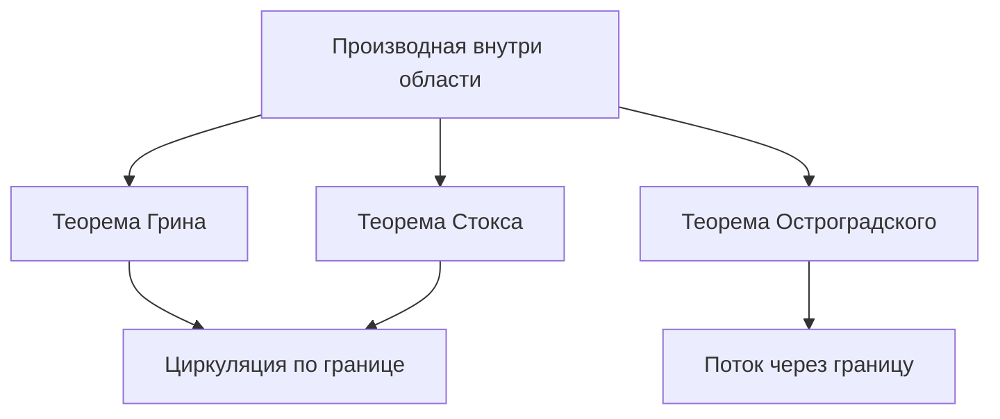

# 18. Векторный анализ и интегральные теоремы

[← 17. Кратные интегралы и замена переменных](17-multiple-integrals.md) · [Оглавление](index.md) · [Термины и теоремы](term-index.md) · [19. Теория меры и измеримые функции →](19-measure-theory.md)

> **Цель.** Интегрировать по кривым и поверхностям и связывать граничные интегралы с производными внутри области.

<a id="sec-18-1"></a>
## 18.1 Криволинейные интегралы

Для гладкой кривой $`\gamma:[a,b]\to\mathbb R^n`$ интеграл первого рода:

```math
\int_\gamma f\,ds
=\int_a^b f(\gamma(t))\,\|\gamma'(t)\|\,dt.
```

Он не зависит от ориентации. Для векторного поля $`F`$ работа или циркуляция:

```math
\int_\gamma F\cdot dr
=\int_a^b F(\gamma(t))\cdot\gamma'(t)\,dt.
```

При обратной ориентации знак меняется. Перепараметризация с сохранением ориентации не меняет оба интеграла.

Поле **потенциально**, если $`F=\nabla\varphi`$. Тогда

```math
\int_\gamma\nabla\varphi\cdot dr=\varphi(\gamma(b))-\varphi(\gamma(a)),
```

поэтому интеграл зависит только от концов. На односвязной области в $`\mathbb R^3`$ $`C^1`$-поле потенциально тогда и только тогда, когда $`\nabla\times F=0`$; на общих областях возможны топологические препятствия.

<a id="sec-18-2"></a>
## 18.2 Поверхностные интегралы и поток

Для гладкой поверхности $`r(u,v)`$ элемент площади:

```math
dS=\|r_u\times r_v\|\,du\,dv.
```

Поэтому $`\iint_\Sigma f\,dS=\iint f(r(u,v))\|r_u\times r_v\|\,du\,dv`$. Ориентация задаётся единичной нормалью $`n`$. Поток:

```math
\iint_\Sigma F\cdot n\,dS
=\iint F(r(u,v))\cdot(r_u\times r_v)\,du\,dv,
```

если параметризация согласована с нужной нормалью. Смена ориентации меняет знак потока, но не скалярной площади.

<a id="sec-18-3"></a>
## 18.3 Градиент, дивергенция и ротор

В декартовых координатах

```math
\nabla f=(f_x,f_y,f_z),
```
```math
\nabla\cdot F=P_x+Q_y+R_z,
```
```math
\nabla\times F=
\begin{vmatrix}
\mathbf i&\mathbf j&\mathbf k\\
\partial_x&\partial_y&\partial_z\\
P&Q&R
\end{vmatrix},
\qquad F=(P,Q,R).
```

Дивергенция измеряет плотность локального истечения, ротор — локальное вращение. При $`C^2`$-гладкости верны $`\nabla\times(\nabla f)=0`$ и $`\nabla\cdot(\nabla\times F)=0`$.

<a id="sec-18-4"></a>
## 18.4 Теоремы Грина, Стокса и Гаусса

> <a id="green-theorem"></a>**Теорема Грина.** Для положительно ориентированной кусочно гладкой границы плоской области $`D`$
> ```math
> \oint_{\partial D}P\,dx+Q\,dy
> =\iint_D(Q_x-P_y)\,dA.
> ```

Положительная ориентация — против часовой стрелки для внешней границы и по часовой для отверстий. В частности,

```math
\operatorname{area}(D)=\frac12\oint_{\partial D}(x\,dy-y\,dx).
```

> <a id="stokes-theorem"></a>**Теорема Стокса.** Для ориентированной поверхности $`\Sigma`$ с согласованно ориентированной границей
> ```math
> \oint_{\partial\Sigma}F\cdot dr
> =\iint_\Sigma(\nabla\times F)\cdot n\,dS.
> ```

[Теорема Грина](#green-theorem) — плоский частный случай. Ориентация границы определяется правилом правой руки относительно $`n`$.

> <a id="divergence-theorem"></a>**Теорема о дивергенции (Гаусса–Остроградского).** Для тела $`\Omega`$ с кусочно гладкой границей и внешней нормалью
> ```math
> \iint_{\partial\Omega}F\cdot n\,dS
> =\iiint_\Omega\nabla\cdot F\,dV.
> ```

Все результаты требуют подходящей гладкости и учитывают каждую компоненту границы с правильной ориентацией.



## Разобранный пример

Пусть $`F(x,y,z)=(x,y,z)`$ в шаре радиуса $`R`$. Так как $`\nabla\cdot F=3`$, по [теореме о дивергенции](#divergence-theorem) внешний [поток](#sec-18-2) равен

```math
\iiint_{B_R}3\,dV=3\cdot\frac{4\pi R^3}{3}=4\pi R^3.
```

Непосредственно: на сфере $`n=(x,y,z)/R`$, поэтому $`F\cdot n=R`$ и поток равен $`R\cdot4\pi R^2=4\pi R^3`$.

## Типичные ошибки

1. Скалярные интегралы неориентированы; работа и поток ориентированы.
2. Нулевой [ротор](#sec-18-3) даёт потенциал только при подходящей топологии области.
3. Ориентация границы — существенная часть теоремы.

## Упражнения

1. Вычислите $`\int_\gamma(x\,dx+y\,dy)`$ по любому [гладкому пути](09-improper-integrals-applications.md#sec-9-3) из $`(0,0)`$ в $`(1,1)`$.
2. По теореме Грина вычислите $`\oint(x^2+y^2)\,dy`$ по единичной окружности против часовой стрелки.
3. Найдите поток $`F=(x,y,z)`$ через границу куба $`[0,1]^3`$.

<details>
<summary>Краткие ответы</summary>

1. Потенциал равен $`(x^2+y^2)/2`$, поэтому интеграл равен $`1`$.
2. $`P=0`$, $`Q=x^2+y^2`$; интеграл равен $`\iint_D2x\,dA=0`$ по симметрии.
3. Дивергенция равна $`3`$, объём куба $`1`$, внешний поток равен $`3`$.
</details>

---

[← 17. Кратные интегралы и замена переменных](17-multiple-integrals.md) · [Оглавление](index.md) · [Термины и теоремы](term-index.md) · [19. Теория меры и измеримые функции →](19-measure-theory.md)
