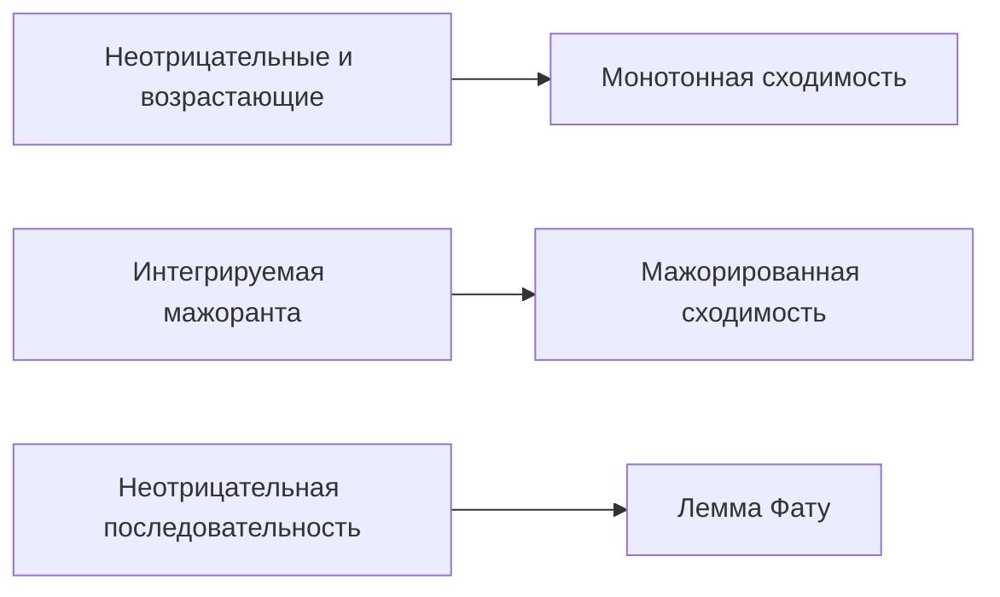

# 20. Интеграл Лебега и предельные теоремы

[Назад](19-measure-theory.md) · [Оглавление](index.md) · [Далее](21-lp-spaces.md)

> **Цель.** Определить интеграл Лебега и применять предельные теоремы, делающие его более гибким, чем интеграл Римана.

## 20.1 Построение интеграла

Для неотрицательной простой функции $\varphi=\sum_{k=1}^{m}a_k1_{A_k}$ полагают

$$
\int_X\varphi\,d\mu=\sum_{k=1}^{m}a_k\mu(A_k),
$$

с соглашением $0\cdot\infty=0$. Для общей измеримой $f\ge0$

$$
\int_X f\,d\mu
=\sup\left\{\int_X\varphi\,d\mu:
0\le\varphi\le f,\ \varphi\text{ простая}\right\}.
$$

Значение может быть $+\infty$. Пусть $f^+=\max(f,0)$ и $f^-=\max(-f,0)$, тогда $f=f^+-f^-$ и $|f|=f^++f^-$. Измеримая $f$ **интегрируема**, $f\in L^1(\mu)$, если

$$
\int_X|f|\,d\mu<\infty,
$$

и тогда $\int f\,d\mu=\int f^+\,d\mu-\int f^-\,d\mu$.

Интеграл линеен и монотонен. Изменение функции на нулевом множестве не меняет интеграл. Интегрируемая функция конечна почти всюду, и

$$
\left|\int_Xf\,d\mu\right|\le\int_X|f|\,d\mu.
$$

## 20.2 Три основные предельные теоремы

> **Теорема Леви о монотонной сходимости.** Если $0\le f_n\uparrow f$ почти всюду, то
> $$\int_Xf_n\,d\mu\uparrow\int_Xf\,d\mu,$$
> включая возможность бесконечного предела.

> **Лемма Фату.** Для измеримых $f_n\ge0$
> $$\int_X\liminf_{n\to\infty}f_n\,d\mu
> \le\liminf_{n\to\infty}\int_Xf_n\,d\mu.$$

> **Теорема Лебега о мажорированной сходимости.** Если измеримые $f_n\to f$ п.в. и $|f_n|\le g$ для интегрируемой $g$, то
> $$\lim_{n\to\infty}\int_X|f_n-f|\,d\mu=0,
> \qquad
> \lim_{n\to\infty}\int_Xf_n\,d\mu=\int_Xf\,d\mu.$$

Мажоранта существенна. Функции $n1_{(0,1/n)}$ поточечно стремятся к нулю на $(0,1)$, но все имеют интеграл $1$. Их нельзя ограничить одной интегрируемой функцией, не зависящей от $n$.

## 20.3 Связь с интегралом Римана

Ограниченная интегрируемая по Риману функция на $[a,b]$ интегрируема по Лебегу, и интегралы совпадают. Лебегов подход работает и для очень разрывных функций: $\int_{[0,1]}1_{\mathbb Q}\,d\lambda=0$.

Абсолютно сходящийся несобственный интеграл Римана даёт интеграл Лебега с тем же значением. Условно сходящийся интеграл, например $\int_1^\infty\sin x/x\,dx$, **не** задаёт конечный интеграл Лебега по всему промежутку, поскольку $\int|\sin x|/x=\infty$.

## 20.4 Произведение мер и Фубини–Тонелли

Для $\sigma$-конечных пространств строится мера-произведение $\mu\times\nu$ с $(\mu\times\nu)(A\times B)=\mu(A)\nu(B)$.

- **Тонелли:** для измеримой $f\ge0$ интеграл по произведению и оба повторных интеграла равны, возможно бесконечны.
- **Фубини:** если $\int|f|\,d(\mu\times\nu)<\infty$, оба повторных интеграла существуют и равны интегралу по произведению.

Без неотрицательности или абсолютной интегрируемости повторные интегралы могут различаться или не существовать. $\sigma$-конечность покрывает $\mathbb R^n$ с мерой Лебега и большинство стандартных приложений.

## Разобранный пример

Вычислим $\int_0^1x^{-1/2}\,dx$. Положим

$$
f_n(x)=x^{-1/2}1_{(1/n,1)}(x).
$$

Эти функции возрастают к $x^{-1/2}$ при $0<x<1$. По монотонной сходимости

$$
\int_0^1x^{-1/2}\,dx
=\lim_{n\to\infty}\int_{1/n}^{1}x^{-1/2}\,dx
=\lim_{n\to\infty}2(1-n^{-1/2})=2.
$$

## Типичные ошибки

1. Сходимость почти всюду сама по себе не влечёт сходимость интегралов.
2. Условная несобственная сходимость не является абсолютной интегрируемостью по Лебегу.
3. Фубини требует абсолютной интегрируемости, Тонелли — неотрицательности.

## Упражнения

1. Вычислите $\int_{[0,1]}1_{\mathbb Q}\,d\lambda$.
2. Примените мажорированную сходимость к $\lim_n\int_0^1\frac{1+nx}{n(1+x^2)}\,dx$.
3. Приведите пример строгого неравенства в лемме Фату.

Краткие ответы

1. Ноль, поскольку $\mathbb Q\cap[0,1]$ имеет меру ноль.
2. Подынтегральные функции ограничены числом $2$ при $n\ge1$ и стремятся к $x/(1+x^2)$; предел равен $\frac12\log2$. Константа $2$ интегрируема на конечном промежутке.
3. Для $f_n=n1_{(0,1/n)}$ поточечный предел п.в. равен нулю, левая часть $0$, а правая $1$.

---

[Назад](19-measure-theory.md) · [Оглавление](index.md) · [Далее](21-lp-spaces.md)
