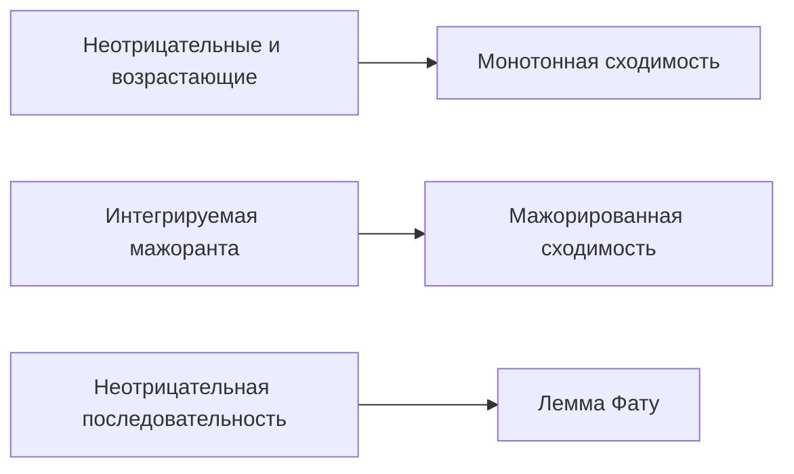

# 20. Интеграл Лебега и предельные теоремы

[← 19. Теория меры и измеримые функции](19-measure-theory.md) · [Оглавление](index.md) · [Термины и теоремы](term-index.md) · [21. Пространства Lp и виды сходимости →](21-lp-spaces.md)

> **Цель.** Определить [интеграл Лебега](#sec-20-1) и применять предельные теоремы, делающие его более гибким, чем [интеграл Римана](08-riemann-integration.md#sec-8-2).

<a id="sec-20-1"></a>
## 20.1 Построение интеграла

Для неотрицательной [простой функции](19-measure-theory.md#sec-19-4) $`\varphi=\sum_{k=1}^{m}a_k1_{A_k}`$ полагают

```math
\int_X\varphi\,d\mu=\sum_{k=1}^{m}a_k\mu(A_k),
```

с соглашением $`0\cdot\infty=0`$. Для общей измеримой $`f\ge0`$

```math
\int_X f\,d\mu
=\sup\left\{\int_X\varphi\,d\mu:
0\le\varphi\le f,\ \varphi\text{ простая}\right\}.
```

Значение может быть $`+\infty`$. Пусть $`f^+=\max(f,0)`$ и $`f^-=\max(-f,0)`$, тогда $`f=f^+-f^-`$ и $`|f|=f^++f^-`$. Измеримая $`f`$ **интегрируема**, $`f\in L^1(\mu)`$, если

```math
\int_X|f|\,d\mu<\infty,
```

и тогда $`\int f\,d\mu=\int f^+\,d\mu-\int f^-\,d\mu`$.

Интеграл линеен и монотонен. Изменение функции на нулевом множестве не меняет интеграл. Интегрируемая функция конечна почти всюду, и

```math
\left|\int_Xf\,d\mu\right|\le\int_X|f|\,d\mu.
```

<a id="sec-20-2"></a>
## 20.2 Три основные предельные теоремы

> <a id="lebesgue-monotone-convergence-theorem"></a>**Теорема Леви о монотонной сходимости.** Если $`0\le f_n\uparrow f`$ почти всюду, то
> ```math
> \int_Xf_n\,d\mu\uparrow\int_Xf\,d\mu,
> ```
> включая возможность бесконечного предела.

> <a id="fatou-lemma"></a>**Лемма Фату.** Для измеримых $`f_n\ge0`$
> ```math
> \int_X\liminf_{n\to\infty}f_n\,d\mu
> \le\liminf_{n\to\infty}\int_Xf_n\,d\mu.
> ```

> <a id="dominated-convergence-theorem"></a>**Теорема Лебега о мажорированной сходимости.** Если измеримые $`f_n\to f`$ п.в. и $`|f_n|\le g`$ для интегрируемой $`g`$, то
> ```math
> \lim_{n\to\infty}\int_X|f_n-f|\,d\mu=0,
> \qquad
> \lim_{n\to\infty}\int_Xf_n\,d\mu=\int_Xf\,d\mu.
> ```

Мажоранта существенна. Функции $`n1_{(0,1/n)}`$ поточечно стремятся к нулю на $`(0,1)`$, но все имеют интеграл $`1`$. Их нельзя ограничить одной интегрируемой функцией, не зависящей от $`n`$.



<a id="sec-20-3"></a>
## 20.3 Связь с интегралом Римана

Ограниченная интегрируемая по Риману функция на $`[a,b]`$ интегрируема по Лебегу, и интегралы совпадают. Лебегов подход работает и для очень разрывных функций: $`\int_{[0,1]}1_{\mathbb Q}\,d\lambda=0`$.

Абсолютно сходящийся [несобственный интеграл](09-improper-integrals-applications.md#sec-9-1) Римана даёт интеграл Лебега с тем же значением. [Условно сходящийся](04-numeric-series.md#sec-4-3) интеграл, например $`\int_1^\infty\sin x/x\,dx`$, **не** задаёт конечный интеграл Лебега по всему промежутку, поскольку $`\int|\sin x|/x=\infty`$.

<a id="sec-20-4"></a>
## 20.4 Произведение мер и Фубини–Тонелли

Для $`\sigma`$-конечных пространств строится мера-произведение $`\mu\times\nu`$ с $`(\mu\times\nu)(A\times B)=\mu(A)\nu(B)`$.

- **Тонелли:** для измеримой $`f\ge0`$ интеграл по произведению и оба [повторных интеграла](17-multiple-integrals.md#sec-17-1) равны, возможно бесконечны.
- **Фубини:** если $`\int|f|\,d(\mu\times\nu)<\infty`$, оба повторных интеграла существуют и равны интегралу по произведению.

Без неотрицательности или абсолютной интегрируемости повторные интегралы могут различаться или не существовать. $`\sigma`$-конечность покрывает $`\mathbb R^n`$ с [мерой Лебега](19-measure-theory.md#sec-19-3) и большинство стандартных приложений.

## Разобранный пример

Вычислим $`\int_0^1x^{-1/2}\,dx`$. Положим

```math
f_n(x)=x^{-1/2}1_{(1/n,1)}(x).
```

Эти функции возрастают к $`x^{-1/2}`$ при $`0<x<1`$. По монотонной сходимости

```math
\int_0^1x^{-1/2}\,dx
=\lim_{n\to\infty}\int_{1/n}^{1}x^{-1/2}\,dx
=\lim_{n\to\infty}2(1-n^{-1/2})=2.
```

## Типичные ошибки

1. Сходимость почти всюду сама по себе не влечёт сходимость интегралов.
2. Условная несобственная сходимость не является абсолютной интегрируемостью по Лебегу.
3. Фубини требует абсолютной интегрируемости, Тонелли — неотрицательности.

## Упражнения

1. Вычислите $`\int_{[0,1]}1_{\mathbb Q}\,d\lambda`$.
2. Примените [мажорированную сходимость](#dominated-convergence-theorem) к $`\lim_n\int_0^1\frac{1+nx}{n(1+x^2)}\,dx`$.
3. Приведите пример строгого неравенства в [лемме Фату](#fatou-lemma).

<details>
<summary>Краткие ответы</summary>

1. Ноль, поскольку $`\mathbb Q\cap[0,1]`$ имеет меру ноль.
2. Подынтегральные функции ограничены числом $`2`$ при $`n\ge1`$ и стремятся к $`x/(1+x^2)`$; предел равен $`\frac12\log2`$. Константа $`2`$ интегрируема на конечном промежутке.
3. Для $`f_n=n1_{(0,1/n)}`$ поточечный предел п.в. равен нулю, левая часть $`0`$, а правая $`1`$.
</details>

---

[← 19. Теория меры и измеримые функции](19-measure-theory.md) · [Оглавление](index.md) · [Термины и теоремы](term-index.md) · [21. Пространства Lp и виды сходимости →](21-lp-spaces.md)
