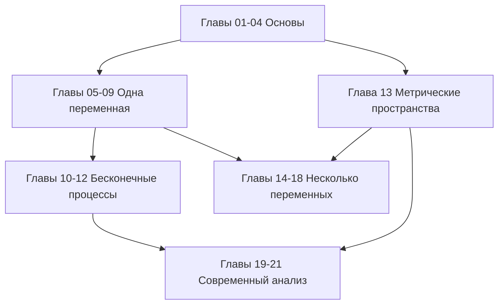

# Математический анализ

[English](../en/index.md) · **Русский** · [Español](../es/index.md)

Строгий курс от основ до современной теории интегрирования. Все 21 глава используют стандартный Markdown, MathJax и простые Mermaid-диаграммы для Obsidian и GitHub.

## Справочные материалы

- [Работа с хранилищем и обозначения](00-notation.md)
- [Формульная шпаргалка](formula-sheet.md)
- [Трёхъязычный глоссарий](glossary.md)
- [Рекомендуемые книги и задачники](../../REFERENCES.md)

## Карта курса

## Часть I — Основы

1. [Логика, множества и функции](01-logic-sets-functions.md) — кванторы, доказательства, мощность.
2. [Действительные числа и полнота](02-real-numbers.md) — супремум, архимедовость, плотность.
3. [Последовательности и пределы](03-sequences.md) — монотонный и кошиевский критерии, подпоследовательности.
4. [Числовые ряды](04-numeric-series.md) — признаки, абсолютная и условная сходимость.

## Часть II — Анализ функций одной переменной

5. [Предел и непрерывность](05-limits-continuity.md) — пределы функций, промежуточные значения, равномерная непрерывность.
6. [Дифференцирование](06-derivatives.md) — линейное приближение, правило цепочки, обратные функции.
7. [Теоремы о среднем, формула Тейлора и выпуклость](07-taylor-convexity.md).
8. [Интеграл Римана](08-riemann-integration.md) — суммы Дарбу, основная теорема, методы вычисления.
9. [Несобственные интегралы и приложения](09-improper-integrals-applications.md) — сходимость, площадь, длина, объём, работа.

## Часть III — Бесконечные процессы

10. [Последовательности и ряды функций](10-function-sequences-series.md) — равномерная сходимость и предельные переходы.
11. [Степенные ряды и аналитические функции](11-power-series.md) — радиус, почленные операции, ряды Тейлора.
12. [Ряды Фурье](12-fourier-series.md) — ортогональность, поточечная и среднеквадратичная сходимость.

## Часть IV — Несколько переменных и топология

13. [Метрические пространства, компактность и полнота](13-metric-spaces.md).
14. [Функции нескольких переменных](14-several-variables.md) — совместные пределы, непрерывность, компактные области.
15. [Многомерное дифференцирование](15-multivariable-differentiation.md) — матрица Якоби, градиент, гессиан.
16. [Обратные и неявные функции; экстремумы](16-implicit-functions-extrema.md) — локальные теоремы и множители Лагранжа.

## Часть V — Интегрирование в нескольких переменных

17. [Кратные интегралы и замена переменных](17-multiple-integrals.md) — Фубини, полярные и сферические координаты.
18. [Векторный анализ и интегральные теоремы](18-vector-calculus.md) — криволинейные и поверхностные интегралы, Грин, Стокс, Гаусс.

## Часть VI — Современный анализ

19. [Теория меры и измеримые функции](19-measure-theory.md).
20. [Интеграл Лебега и предельные теоремы](20-lebesgue-integration.md).
21. [Пространства $L^p$ и виды сходимости](21-lp-spaces.md) — Гёльдер, полнота, геометрия гильбертова пространства.

## Рекомендуемый порядок работы

1. Прочитайте цели и воспроизведите каждое определение без подсказки.
2. Разберите примеры и отметьте, где именно используется каждое условие теоремы.
3. Решайте упражнения до открытия кратких ответов.
4. Ведите журнал ошибок и связывайте его с соответствующими главами.
5. Повторяйте по формульной шпаргалке только после понимания выводов; она не заменяет теорию.

Для первого курса изучайте главы 1–12 и 14–18, обращаясь к главе 13 по необходимости. Для второго курса повторите краткие выводы и сосредоточьтесь на главах 13 и 19–21. Исходный архив лекций описан отдельно в [примечании к источникам](../../source/README.md).
