# Математический анализ, лекции 2025/26

**Русский** · [English](../../en/lectures-2025-26/index.md) · [Español](../../es/lectures-2025-26/index.md)

Конспекты переписаны из PDF-файлов лекций Д. Е. Апушкинской (РУДН). Печатные слайды извлечены из текстового слоя, рукописные страницы переписаны по изображению, рисунки вставлены как иллюстрации. Формулы — в LaTeX (MathJax), схемы — в Mermaid; оба формата поддерживаются в Obsidian и на GitHub.

| Лекция | Дата | Содержание | Файл | Исходный PDF |
|---|---|---|---|---|
| 0 | 01.09.2025 | Множества, включение, логическая символика, операции, законы де Моргана | [lecture-00.md](lecture-00.md) | `МА2526_лекция_0.pdf` |
| 1–2 | 04.09.2025 | Отображения, инъекция, сюръекция, биекция, мощность, счётные множества | [lecture-01-02.md](lecture-01-02.md) | `ma25_26-lectures_1-2_notes.pdf` |
| 3 | 11.09.2025 | Не более чем счётные множества, несчётность, континуум | [lecture-03.md](lecture-03.md) | `ма25_26_лекция_3_notes.pdf` |
| 4 | 11.09.2025 | Аксиомы поля и порядка вещественных чисел | [lecture-04.md](lecture-04.md) | `ма25_26_лекция_4_notes.pdf` |
| 5–6 | — | Промежутки, несобственные элементы, аксиомы Архимеда и Кантора, индукция, бином Ньютона, sup/inf | [lecture-05-06.md](lecture-05-06.md) | `ma25_26-lectures_5-6_notes.pdf` |
| 7 | — | Максимум и минимум конечного множества, целая часть, плотность ℚ в ℝ | [lecture-07.md](lecture-07.md) | `ma25_26_лекция_7_notes.pdf` |
| 8 | — | Предел последовательности: определение, единственность, ограниченность, предельный переход, полицейские | [lecture-08.md](lecture-08.md) | `ма25_26_лекция_8_notes.pdf` |
| 9–10 | 02.10.2025 | Бесконечно малые и бесконечно большие, арифметика пределов, неопределённости | [lecture-09-10.md](lecture-09-10.md) | `ma25_26-lectures_9-10_notes.pdf` |
| 11–12 | 09.10.2025 | Точные грани, монотонные последовательности, число e, подпоследовательности, теорема Больцано–Вейерштрасса | [lecture-11-12.md](lecture-11-12.md) | `ma25_26-lectures_11-12_notes.pdf` |
| 13 | 16.10.2025 | Верхний и нижний пределы, фундаментальные последовательности, критерий Больцано–Коши | [lecture-13.md](lecture-13.md) | `ma25_26_лекция_13_notes.pdf` |
| 14 | 16.10.2025 | Предельные и изолированные точки, предел функции по Коши и по Гейне, единственность, локальная ограниченность | [lecture-14.md](lecture-14.md) | `ма25_26_лекция_14_notes.pdf` |
| 15 | 23.10.2025 | Стабилизация знака, арифметика пределов функций, композиция, односторонние пределы, монотонные функции, критерий Коши для функций | [lecture-15.md](lecture-15.md) | `ма25_26_лекция_15_notes_pdf.pdf` |

Иллюстрации, извлечённые из рукописных страниц, лежат в общей папке [`../../assets/lectures-2025-26/`](../../assets/lectures-2025-26/).

## Соглашения

- Номера определений, теорем и следствий сохранены как в исходных слайдах. В лекциях 5–6 номер «Определение 1.3.5» повторён трижды; см. примечание в файле.
- Рукописные страницы отмечены заголовком «Рукописная страница N (PDF-стр. N)».
- Примечания редактора оформлены цитатой и начинаются со слова «Примечание» или «Замечание».

```mermaid
flowchart LR
    A["Лекция 0: множества"] --> B["Лекции 1–2: отображения и счётность"]
    B --> C["Лекция 3: не более чем счётные множества и континуум"]
    C --> D["Лекция 4: аксиомы вещественных чисел"]
    D --> E["Лекции 5–6: аксиомы полноты, индукция, бином"]
    E --> F["Лекция 7: максимум, минимум, плотность ℚ"]
    F --> G["Лекция 8: предел последовательности"]
    G --> H["Лекции 9–10: бесконечно малые и большие"]
    H --> I["Лекции 11–12: точные грани, монотонные последовательности"]
    I --> J["Лекция 13: верхний и нижний пределы, критерий Коши"]
    J --> K["Лекция 14: предел функции по Коши и Гейне"]
    K --> L["Лекция 15: односторонние пределы, монотонные функции"]
```

