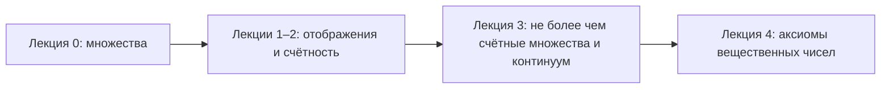

# Математический анализ, лекции 2025/26

**Русский** · [English](../../en/lectures-2025-26/index.md) · [Español](../../es/lectures-2025-26/index.md)

Конспекты переписаны из PDF-файлов лекций Д. Е. Апушкинской (РУДН). Печатные слайды извлечены из текстового слоя, рукописные страницы переписаны по изображению, рисунки вставлены как иллюстрации. Формулы — в LaTeX (MathJax), схемы — в Mermaid; оба формата поддерживаются в Obsidian и на GitHub.

| Лекция | Дата | Содержание | Файл | Исходный PDF |
|---|---|---|---|---|
| 0 | 01.09.2025 | Множества, включение, логическая символика, операции, законы де Моргана | [lecture-00.md](lecture-00.md) | `МА2526_лекция_0.pdf` |
| 1–2 | 04.09.2025 | Отображения, инъекция, сюръекция, биекция, мощность, счётные множества | [lecture-01-02.md](lecture-01-02.md) | `ma25_26-lectures_1-2_notes.pdf` |
| 3 | 11.09.2025 | Не более чем счётные множества, несчётность, континуум | [lecture-03.md](lecture-03.md) | `ма25_26_лекция_3_notes.pdf` |
| 4 | 11.09.2025 | Аксиомы поля и порядка вещественных чисел | [lecture-04.md](lecture-04.md) | `ма25_26_лекция_4_notes.pdf` |

Иллюстрации, извлечённые из рукописных страниц, лежат в общей папке [`../../assets/lectures-2025-26/`](../../assets/lectures-2025-26/).

## Соглашения

- Номера определений, теорем и следствий сохранены как в исходных слайдах.
- Рукописные страницы отмечены заголовком «Рукописная страница N (PDF-стр. N)».
- Примечания редактора оформлены цитатой и начинаются со слова «Примечание» или «Замечание».

