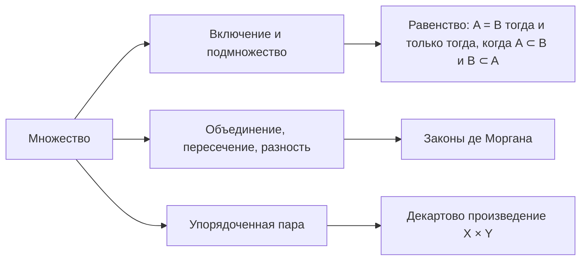

# Лекция 0 — Множества и логическая символика

[Указатель лекций](index.md) · [Лекции 1–2 →](lecture-01-02.md) · [Термины и теоремы](../term-index.md) · [English](../../en/lectures-2025-26/lecture-00.md) · [Español](../../es/lectures-2025-26/lecture-00.md)

> **Источник:** `МА2526_лекция_0.pdf` — 17 слайдов (Beamer), Д. Е. Апушкинская, РУДН, 01 сентября 2025. Текст извлечён из текстового слоя PDF и сверен с изображениями слайдов; формулы переписаны в LaTeX. В этом файле иллюстраций нет: слайды содержат только текст и формулы.

## Слайд 1. Титул

Математический анализ · лекция 0 · 01 сентября 2025.

## Слайд 2. Цель лекции

- Познакомимся с основными определениями теории множеств.
- Обсудим логическую символику и операции над множествами.
- Сформулируем законы де Моргана.
- Обсудим упорядоченные пары и декартово произведение.

## Слайд 3. Глава 1, §0. Множества

<a id="def-1-0-1"></a>**Определение 1.0.1.** Множество — это набор, совокупность, собрание объектов, которые называются элементами множества. Множества бывают конечными и бесконечными. Обычно множества обозначаются заглавными латинскими буквами.

Вообще говоря, [определение 1.0.1](#def-1-0-1) формально не является определением. Множество — это неопределяемое понятие. Не определяя строго понятие множества, мы, тем не менее, обсудим его свойства и правила обращения с ним.

В курсе математического анализа нам будет удобнее оставаться в рамках «наивной» теории множеств.

## Слайд 4. Способы задания множеств

Способы задания множеств:

1. Перечисление.
2. Выделение элементов множества с помощью некоторого свойства.

Описание множества путём указания свойства может иногда приводить к противоречию (парадокс Рассела).

**Обозначение.** Элемент $`a`$ принадлежит множеству $`A`$: $`a \in A`$. Элемент $`a`$ не принадлежит множеству $`A`$: $`a \notin A`$.

## Слайд 5. Включение (подмножество)

<a id="def-1-0-2"></a>**Определение 1.0.2.** Если каждый элемент множества $`X`$ принадлежит множеству $`Y`$, то говорят, что $`X`$ содержится в $`Y`$ (а также — что $`X`$ подмножество $`Y`$, $`X`$ — часть $`Y`$, $`Y`$ содержит $`X`$) и пишут

```math
X \subset Y \quad\text{или}\quad Y \supset X .
```

Принадлежность — элемент сам принадлежит этому множеству: $`\{1, 2\} \in \{3, 4, \{1, 2\}\}`$.

Включение — все элементы одного из множеств являются элементами второго: $`\{1, 2\} \subset \{3, 4, 1, 2\}`$.

## Слайд 6. Пустое множество

Удобно ввести в рассмотрение пустое множество — множество, в котором нет ни одного элемента. Пустое множество обозначается $`\varnothing`$.

$`\varnothing \subset X`$ для всякого $`X`$, т.е. пустое множество является подмножеством любого другого множества.

## Слайд 7. Свойства включения; равенство множеств

Свойства включения:

- $`A \subset A`$, т.е. множество является подмножеством самого себя;
- $`A \subset B`$ и $`B \subset C \Rightarrow A \subset C`$.

<a id="def-1-0-3"></a>**Определение 1.0.3.** Если множества $`A`$ и $`B`$ состоят из одних и тех же элементов, то их называют равными и пишут $`A = B`$.

Другими словами, $`A = B`$ тогда и только тогда, когда $`A \subset B`$ и $`B \subset A`$.

## Слайд 8. Числовые множества

Несколько числовых множеств имеют общепринятые обозначения:

- $`\mathbb{N}`$ — множество натуральных чисел;
- $`\mathbb{Z}_+`$ — множество неотрицательных целых чисел;
- $`\mathbb{Z}`$ — множество целых чисел;
- $`\mathbb{Q}`$ — множество рациональных чисел, т.е. дробей вида $`\dfrac{p}{q}`$, где $`p \in \mathbb{Z}`$, $`q \in \mathbb{N}`$;
- $`\mathbb{R}`$ — множество вещественных (действительных) чисел;
- $`\mathbb{C}`$ — множество комплексных чисел.

## Слайд 9. Математический язык: импликация, эквивалентность, отрицание

Если $`P`$ и $`Q`$ — два утверждения, то запись

```math
P \Rightarrow Q
```

называется импликацией и означает, что если верно $`P`$, то верно и $`Q`$. Запись $`Q \Leftarrow P`$ означает то же самое.

Также говорят: из $`P`$ следует $`Q`$; $`P`$ влечёт $`Q`$; $`P`$ достаточно для $`Q`$; $`Q`$ необходимо для $`P`$.

Если $`P \Rightarrow Q`$ и $`Q \Rightarrow P`$, то говорят, что утверждения $`P`$ и $`Q`$ равносильны (или эквивалентны), или что $`P`$ необходимо и достаточно для $`Q`$, и пишут $`P \Leftrightarrow Q`$.

Через $`\neg P`$ обозначается отрицание утверждения $`P`$.

## Слайд 10. Математический язык: кванторы

Для сокращения записи бывает удобно использовать два специальных значка, называемых [кванторами](../01-logic-sets-functions.md#sec-1-1):

- $`\forall`$ — квантор общности (всеобщности); заменяет слова «любой», «всякий», «каждый» или «для любого», «для всякого», «для каждого»;
- $`\exists`$ — квантор существования; заменяет слова «существует», «найдется», «можно подобрать».

Двоеточие в формулах с кванторами заменяет слова «такой, что», но будет ставиться не всегда.

## Слайд 11. Семейство множеств

Множество определяется своими элементами, поэтому бессмысленно говорить, что какой-то элемент принадлежит множеству в нескольких экземплярах или что множество содержит несколько одинаковых элементов. Чтобы рассматривать несколько экземпляров одного и того же элемента, используют понятие семейства.

<a id="def-1-0-4"></a>**Определение 1.0.4.** Пусть $`X`$ и $`A`$ — множества, и некоторые элементы множества $`X`$ снабжены (занумерованы) элементами множества $`A`$ (индексами). При этом каждый индекс использован ровно один раз, но элементы $`X`$ могут быть снабжены более чем одним индексом. Последнее и означает, что элементы $`X`$ могут присутствовать в семействе во многих экземплярах. Для семейства используются обозначения $`\{x_\alpha\}_{\alpha \in A}`$ или $`(x_\alpha)_{\alpha \in A}`$.

## Слайд 12. Операции над множествами: объединение

<a id="def-1-0-5"></a>**Определение 1.0.5.** Пусть $`\{X_\alpha\}_{\alpha \in A}`$ — семейство множеств. Объединением семейства $`\{X_\alpha\}_{\alpha \in A}`$ называется множество всех элементов, которые принадлежат хотя бы одному из множеств $`X_\alpha`$:

```math
\bigcup_{\alpha \in A} X_\alpha = \{\, x : \exists\, \alpha \in A,\ x \in X_\alpha \,\}.
```

Если семейство состоит из двух множеств $`X`$ и $`Y`$, пишут $`X \cup Y`$ (неважно, как нумеровать множества).

Ясно, что

```math
(X \cup Y) \cup Z = X \cup (Y \cup Z), \qquad X \cup Y = Y \cup X, \qquad X \cup X = X \cup \varnothing = X .
```

## Слайд 13. Операции над множествами: пересечение

<a id="def-1-0-6"></a>**Определение 1.0.6.** Пусть $`\{X_\alpha\}_{\alpha \in A}`$ — семейство множеств. Пересечением семейства называется множество всех элементов, которые принадлежат каждому из множеств $`X_\alpha`$:

```math
\bigcap_{\alpha \in A} X_\alpha = \{\, x : \forall\, \alpha \in A,\ x \in X_\alpha \,\}.
```

Если семейство состоит из двух множеств $`X`$ и $`Y`$, пишут $`X \cap Y`$ (неважно, как нумеровать множества).

Ясно, что

```math
(X \cap Y) \cap Z = X \cap (Y \cap Z), \qquad X \cap Y = Y \cap X, \qquad X \cap X = X, \qquad X \cap \varnothing = \varnothing .
```

## Слайд 14. Операции над множествами: разность и дополнение

<a id="def-1-0-7"></a>**Определение 1.0.7.** Разностью множеств $`X`$ и $`Y`$ называется множество всех элементов, которые принадлежат $`X`$, но не принадлежат $`Y`$:

```math
X \setminus Y = \{\, x : x \in X,\ x \notin Y \,\}.
```

В [определении 1.0.7](#def-1-0-7) не предполагается, что $`Y \subset X`$. Если $`Y \subset X`$, то разность $`X \setminus Y`$ называется ещё дополнением множества $`Y`$ до множества $`X`$. Дополнение $`X`$ до основного множества $`U`$ называется дополнением $`X`$ и обозначается $`X^c`$.

Ясно, что

```math
(X^c)^c = X, \qquad X \cup X^c = U, \qquad X \cap X^c = \varnothing .
```

## Слайд 15. Законы де Моргана

<a id="thm-1-0-1"></a>**Теорема 1.0.1.** Пусть $`\{X_\alpha\}_{\alpha \in A}`$ — семейство множеств, $`Y`$ — множество. Тогда

```math
Y \setminus \bigcup_{\alpha \in A} X_\alpha = \bigcap_{\alpha \in A} \left(Y \setminus X_\alpha\right),
```

```math
Y \setminus \bigcap_{\alpha \in A} X_\alpha = \bigcup_{\alpha \in A} \left(Y \setminus X_\alpha\right),
```

```math
Y \cap \bigcup_{\alpha \in A} X_\alpha = \bigcup_{\alpha \in A} \left(Y \cap X_\alpha\right),
```

```math
Y \cup \bigcap_{\alpha \in A} X_\alpha = \bigcap_{\alpha \in A} \left(Y \cup X_\alpha\right).
```

## Слайд 16. Упорядоченная пара

<a id="def-1-0-8"></a>**Определение 1.0.8.** Упорядоченная пара — это двухэлементное семейство, где множеством индексов является $`\{1, 2\}`$.

В обозначении упорядоченной пары $`(a, b)`$ считается, что на первом месте написан элемент, занумерованный индексом $`1`$, а на втором — индексом $`2`$. Равенство пар $`(a, b)`$ и $`(c, d)`$ означает, что $`a = c`$ и $`b = d`$.

Аналогично определяется упорядоченный набор из $`m`$ элементов $`(x_1, x_2, \dots, x_m)`$. Элементы упорядоченного набора называются его координатами или компонентами.

## Слайд 17. Декартово (прямое) произведение

<a id="def-1-0-9"></a>**Определение 1.0.9.** Декартовым (или прямым) произведением множеств $`X`$ и $`Y`$ называется множество всех упорядоченных пар таких, что первый элемент пары принадлежит $`X`$, а второй — $`Y`$:

```math
X \times Y = \{\, (x, y) : x \in X,\ y \in Y \,\}.
```

Это определение обобщается на несколько сомножителей:

```math
X_1 \times \cdots \times X_m = \{\, (x_1, \dots, x_m) : x_i \in X_i \ \ \forall\, i = 1, \dots, m \,\}.
```

**Порядок сомножителей существенен!**

## Схема лекции


