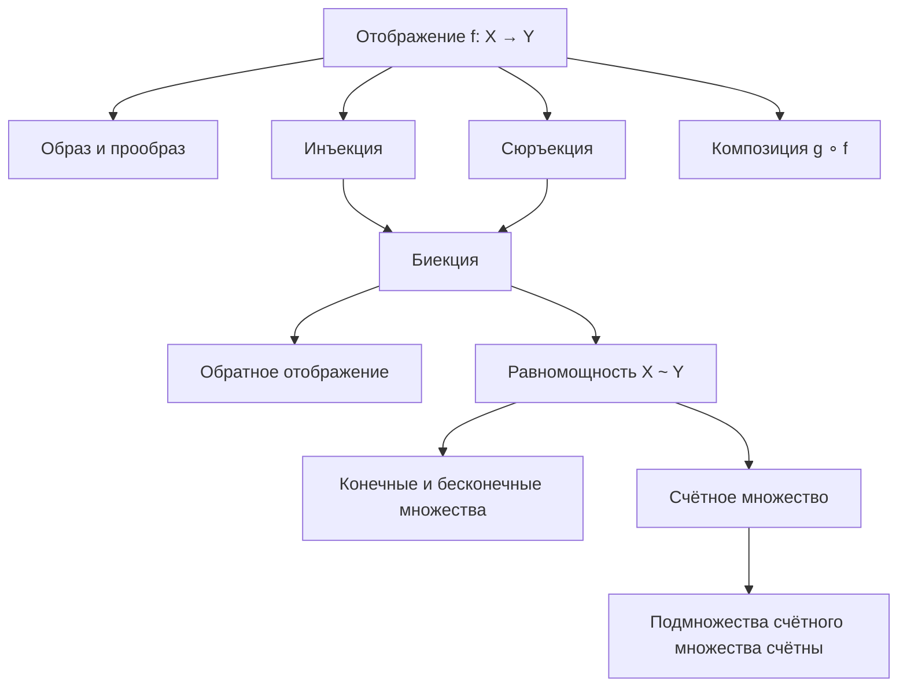

# Лекции 1–2 — Отображения и счётные множества

[← Лекция 0](lecture-00.md) · [Указатель лекций](index.md) · [Лекция 3 →](lecture-03.md) · [Термины и теоремы](../term-index.md) · [English](../../en/lectures-2025-26/lecture-01-02.md) · [Español](../../es/lectures-2025-26/lecture-01-02.md)

> **Источник:** `ma25_26-lectures_1-2_notes.pdf` — 23 страницы: 15 печатных слайдов с текстовым слоем и 8 страниц рукописных заметок (без текстового слоя). Печатные слайды извлечены из текстового слоя и сверены с изображениями; рукописные страницы переписаны по изображению. Рисунки с рукописных страниц 13, 14 и 15 вставлены как иллюстрации. Номера PDF-страниц указаны в заголовках.

## Слайд 2. Цитата дня

> «Первая лекция всегда начинается с сеанса ритуального запугивания. Здрассте, я Баба-Яга из сказки профессор А., буду читать вам лекции по этому предмету. Трепещите, ибо час расплаты близок.
>
> Если вы пропустите K лекций, будете считаться злостным прогульщиком. Если прогуляете M лекций — ваш портрет появится на двери деканата с надписью „Wanted“, а если N, то вы никогда не существовали. Ну и так далее.
>
> Эту часть лекции всегда слушают внимательно: предмет студентов может и вовсе не интересовать, но дожить до следующего семестра хочется всем…»
>
> — tchainka, LiveJournal

## Слайд 3. Цель лекции

- Поговорим об отображениях и понятиях, связанных с ними.
- Введём понятие эквивалентности.
- Обсудим [счётность](#def-1-2-5) и [несчётность](lecture-03.md#thm-1-2-5) множеств.

## §1. Отображения

<a id="def-1-1-1"></a>
### Слайд 4. Определение 1.1.1

Рассмотрим два произвольных множества $`X`$ и $`Y`$. Если каждому элементу $`x`$ множества $`X`$ сопоставлен по определённому правилу $`f`$ один элемент $`y`$ множества $`Y`$, то говорят, что задано отображение множества $`X`$ в множество $`Y`$, и пишут

```math
f : X \to Y \qquad\text{или}\qquad X \xrightarrow{\ f\ } Y .
```

Это описание нельзя считать строгим определением понятия «отображение», т.к. оно содержит не получившие до сих пор определения понятия «правило» и «сопоставлен». Нам будет удобнее считать понятие отображения неопределяемым.

### Слайд 5. Отображения

Отображение — это тройка объектов $`(X, Y, f)`$. Если из контекста ясно, о каких множествах $`X`$ и $`Y`$ идёт речь, то указывают только правило $`f`$ и говорят «отображение $`f`$».

Множество $`X`$ называют областью определения или областью задания, а множество $`Y`$ — областью значений или областью изменения отображения.

Элемент $`y \in Y`$, который сопоставляется элементу $`x \in X`$ по правилу $`f`$, обозначается через $`f(x)`$ и называется значением отображения $`f`$ на элементе $`x`$ или образом элемента $`x`$. При этом $`x`$ называется аргументом отображения или независимой переменной, а $`y`$ — значением отображения или зависимой переменной.

Если $`X`$ и $`Y`$ — числовые множества, то отображение называется функцией.

### Слайд 6. Образ и прообраз

<a id="def-1-1-2"></a>**Определение 1.1.2.** Пусть $`f : X \to Y`$, $`A`$ — множество. Множество

```math
f(A) = \{\, y \in Y : \exists\, x \in A,\ f(x) = y \,\}
```

называется образом множества $`A`$ при отображении $`f`$. Множеством значений отображения $`f`$ называется множество $`f(X)`$, то есть образ множества $`X`$.

<a id="def-1-1-3"></a>**Определение 1.1.3.** Пусть $`f : X \to Y`$, $`B`$ — множество. Множество

```math
f^{-1}(B) = \{\, x \in X : f(x) \in B \,\}
```

называется прообразом множества $`B`$ при отображении $`f`$.

### Слайд 7. Инъекция, сюръекция, биекция

<a id="def-1-1-4"></a>**Определение 1.1.4.** Отображение $`f : X \to Y`$ называется инъективным (инъекцией), если

```math
\forall\, x_1, x_2 \in X:\quad x_1 \neq x_2 \ \Rightarrow\ f(x_1) \neq f(x_2).
```

<a id="def-1-1-5"></a>**Определение 1.1.5.** Отображение $`f : X \to Y`$ называется сюръективным (сюръекцией), если

```math
\forall\, y \in Y\ \ \exists\, x \in X:\quad f(x) = y .
```

<a id="def-1-1-6"></a>**Определение 1.1.6.** Отображение $`f : X \to Y`$ называется биективным (биекцией), если оно инъективно и сюръективно.

### Рукописная страница 8 (PDF-стр. 8). Примеры

Отображение $`f : X \to Y`$, $`f(x) = x^2`$.

1. Если $`X = Y = \mathbb{R}`$, то $`f`$ не [сюръекция](#def-1-1-5) (т.к. $`f`$ не принимает отрицательных значений); $`f`$ не [инъекция](#def-1-1-4), т.к. $`f(-1) = f(1) = 1`$.
2. Если $`X = \mathbb{R}`$, $`Y = \mathbb{R}_+`$, то $`f`$ сюръекция, но не инъекция.
3. Если $`X = \mathbb{R}_+`$, $`Y = \mathbb{R}`$, то $`f`$ инъекция, но не сюръекция.
4. Если $`X = Y = \mathbb{R}_+`$, то $`f`$ сюръекция и инъекция, т.е. [биекция](#def-1-1-6).

### Слайд 9. График отображения и обратное отображение

<a id="def-1-1-7"></a>**Определение 1.1.7.** Пусть $`f : X \to Y`$. Графиком отображения называется множество

```math
\Gamma_f = \{\, (x, y) : x \in X,\ y = f(x) \,\}.
```

<a id="def-1-1-8"></a>**Определение 1.1.8.** Пусть $`f : X \to Y`$ инъективно. Отображение, которое каждому $`y \in f(X)`$ сопоставляет то (единственное) значение $`x \in X`$, для которого $`f(x) = y`$, называется обратным к $`f`$ и обозначается $`f^{-1}`$.

### Слайд 10. Композиция

<a id="def-1-1-9"></a>**Определение 1.1.9.** Пусть $`f : X \to Y`$, $`g : Y_0 \to Z`$, $`f(X) \subset Y_0 \subset Y`$. Отображение $`h : X \to Z`$, действующее по правилу

```math
h(x) = g(f(x)), \qquad x \in X,
```

называется композицией или суперпозицией отображений $`f`$ и $`g`$ и обозначается $`g \circ f`$. При этом $`g`$ называется внешним, а $`f`$ — внутренним отображением.

Вообще говоря, $`g \circ f \neq f \circ g`$, даже если обе композиции определены.

### Слайд 11. Тождественное отображение. Сужение и продолжение

<a id="def-1-1-10"></a>**Определение 1.1.10.** Отображение $`\mathrm{id}_X : X \to X`$, которое $`\forall x \in X`$ сопоставляет сам этот элемент, называется тождественным отображением в множестве $`X`$.

<a id="def-1-1-11"></a>**Определение 1.1.11.** Пусть $`f : X \to Y`$, $`X_0 \subset X`$. Отображение, которое $`\forall x \in X_0`$ сопоставляет значение $`f(x)`$, называется сужением отображения $`f`$ на множество $`X_0`$ и обозначается $`f|_{X_0}`$. Если отображение $`g`$ есть сужение отображения $`f`$, то $`f`$ называется продолжением $`g`$.

## §2. Мощность. Счётные и несчётные множества

<a id="def-1-2-1"></a>
### Слайд 12. Определение 1.2.1 (равномощность)

**Определение 1.2.1.** Множества $`X`$ и $`Y`$ называют эквивалентными или равномощными и пишут $`X \sim Y`$, если существует биекция $`\varphi : X \to Y`$. Другими словами, два множества называются эквивалентными, если между ними можно установить взаимно однозначное соответствие.

### Рукописные страницы 13, 14, 15 (PDF-стр. 13–15). Примеры равномощных множеств

**Стр. 13.** Примеры [равномощных](#def-1-2-1) множеств:

1. Противоположные стороны прямоугольника равномощны: друг другу сопоставляются противоположные точки.
2. Гипотенуза и катет прямоугольного треугольника также равномощны, хотя и имеют разные длины: взаимно однозначным соответствием будет проекция гипотенузы на катет.


**Стр. 14.**

3. Любые два невырожденных отрезка $`[a,b]`$ и $`[c,d]`$ равномощны: одна из биекций задаётся формулой

```math
 y = \frac{x-a}{b-a}\, d + \frac{b-x}{b-a}\, c .
```

4. Концентрические окружности равномощны: друг другу сопоставляются точки, лежащие на одном луче, выходящем из центра.
5. Интервал $`(-1, 1)`$ равномощен $`\mathbb{R}`$: одна из биекций задаётся формулой $`y = \operatorname{tg}\!\left(\dfrac{\pi x}{2}\right)`$.


**Стр. 15.**

6. Окружность без точки и прямая равномощны. Взаимно однозначное соответствие, изображённое на рисунке, называется **стереографической проекцией**.


### Слайд 16. Конечные и бесконечные множества

<a id="def-1-2-2"></a>**Определение 1.2.2.** Множество $`X`$ называется конечным, если оно эквивалентно некоторому отрезку в $`\mathbb{N}`$ (отрезок в $`\mathbb{N}`$ состоит из $`n`$ последовательно идущих натуральных чисел).

<a id="def-1-2-3"></a>**Определение 1.2.3.** Множество $`X`$ называется бесконечным, если оно не является конечным или если оно эквивалентно своей собственной части.

### Слайд 17. Отношение эквивалентности

<a id="def-1-2-4"></a>**Определение 1.2.4.** Отношение $`\sim`$ между элементами некоторого множества называется отношением эквивалентности, если оно обладает следующими тремя свойствами:

1. Рефлексивность: $`A \sim A`$.
2. Симметричность: если $`A \sim B`$, то $`B \sim A`$.
3. Транзитивность: если $`A \sim B`$ и $`B \sim C`$, то $`A \sim C`$.

<a id="prop-1-2-1"></a>**Утверждение 1.2.1.** Равномощность множеств является отношением эквивалентности.

### Рукописная страница 18 (PDF-стр. 18). Доказательство утверждения 1.2.1

Так как $`\mathrm{id}_A`$ — биекция множества $`A`$ на себя, то $`A \sim A`$.

Если $`\varphi : A \to B`$ — биекция, то $`\varphi^{-1} : B \to A`$ тоже биекция, поэтому из того, что $`A \sim B`$, следует, что $`B \sim A`$.

Если $`\varphi : A \to B`$ и $`\psi : B \to C`$ — биекции, то $`\psi \circ \varphi : A \to C`$ тоже биекция.

Поэтому из того, что $`A \sim B`$ и $`B \sim C`$, следует, что $`A \sim C`$.

### Слайд 19. Счётное множество

<a id="def-1-2-5"></a>**Определение 1.2.5.** Множество называется счётным, если оно эквивалентно множеству натуральных чисел.

Таким образом, множество счётно, если его элементы можно расположить в виде последовательности $`A = \{a_1, a_2, a_3, \dots\}`$, то есть занумеровать натуральными числами так, что каждый элемент будет занумерован ровно один раз и при этом будет израсходован весь натуральный ряд.

### Рукописная страница 20 (PDF-стр. 20). Примеры счётных множеств

1. Множество $`A = \{2, 4, 6, 8, 10, \dots\}`$ всех чётных натуральных чисел счётно. Биекция: $`a_n = 2n`$.
2. Множество $`A = \{1, 4, 9, 16, 25, \dots\}`$ всех квадратов натуральных чисел счётно. Биекция: $`a_n = n^2`$.
3. Множество $`\mathbb{Z} = \{0, \pm 1, \pm 2, \dots\}`$ счётно. Биекция:

```math
 a_{2n-1} = 1 - n, \qquad a_{2n} = n .
```

При $`n=1`$: $`a_1 = 0`$, $`a_2 = 1`$; при $`n=2`$: $`a_3 = -1`$, $`a_4 = 2`$; при $`n=3`$: $`a_5 = -2`$, $`a_6 = 3`$, …

### Слайд 21. Подмножества счётного множества

<a id="thm-1-2-1"></a>**Теорема 1.2.1.** Всякое бесконечное множество содержит счётное подмножество.

<a id="thm-1-2-2"></a>**Теорема 1.2.2.** Всякое бесконечное подмножество счётного множества счётно: если $`A`$ счётно, $`B \subset A`$ и $`B`$ бесконечно, то $`B`$ счётно.

### Рукописная страница 22 (PDF-стр. 22). Доказательство теоремы 1.2.1

Пусть множество $`A`$ бесконечно. Тогда в нём есть элемент $`a_1`$.

Множество $`A \setminus \{a_1\}`$ бесконечно, поэтому $`\exists\, a_2 \in A \setminus \{a_1\}`$.

Множество $`A \setminus \{a_1, a_2\}`$ также бесконечно, поэтому $`\exists\, a_3 \in A \setminus \{a_1, a_2\}`$.

Так как $`A`$ бесконечно, этот процесс не обрывается ни на каком шаге. Продолжая его далее, получим множество $`B = \{a_1, a_2, a_3, \dots\}`$, которое по построению будет счётным подмножеством $`A`$.

### Рукописная страница 23 (PDF-стр. 23). Доказательство теоремы 1.2.2

Расположим элементы $`A`$ в виде последовательности $`A = \{a_1, a_2, a_3, a_4, \dots\}`$.

Будем нумеровать элементы $`B`$ в порядке их появления в этой последовательности. Тогда каждый элемент $`B`$ будет занумерован ровно один раз.

Так как $`B`$ бесконечно, для нумерации будет использовано всё $`\mathbb{N}`$.

## Схема лекции


