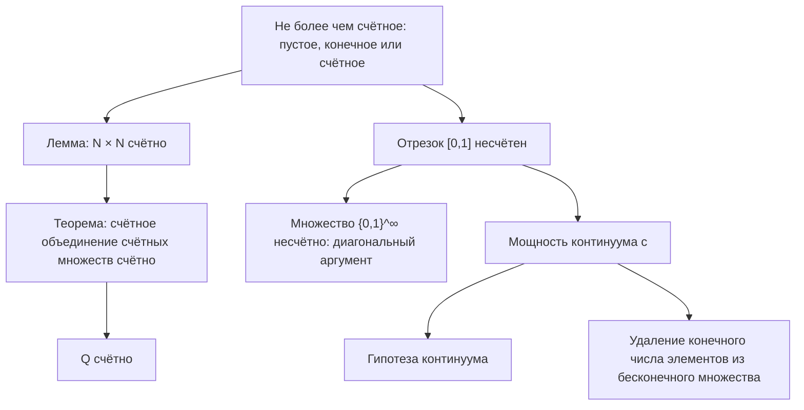

# Лекция 3 — Не более чем счётные множества и континуум

[Указатель лекций](index.md) · [English](../../en/lectures-2025-26/lecture-03.md) · [Español](../../es/lectures-2025-26/lecture-03.md)

> **Источник:** `ма25_26_лекция_3_notes.pdf` — 17 страниц: 9 печатных слайдов с текстовым слоем и 8 рукописных страниц. Рисунки с рукописных страниц 5, 12 и 17 вставлены как иллюстрации. Номера PDF-страниц указаны в заголовках.

## Слайд 2. Цитата дня

> «Делай, что должно, и будь, что будет.»
>
> — Марк Аврелий

## Слайд 3. Цель лекции

- Обсудим не более чем счётные множества.
- Приведём примеры счётных и несчётных множеств.
- Поговорим о гипотезе континуума и мощности множеств. ряд аксиом поля вещественных чисел (аксиомы поля, порядка и полноты).

> **Примечание редактора.** Последняя строка слайда 3 содержит фрагмент «ряд аксиом поля вещественных чисел (аксиомы поля, порядка и полноты).» — он виден на изображении слайда, вероятно, это остаток текста из цели лекции 4. Фрагмент сохранён без изменений; к теме лекции 3 он не относится.

## §2. Мощность. Счётные и несчётные множества

### Слайд 4. Не более чем счётные множества

**Определение 1.2.6.** Пустое, конечное или счётное множество называется не более чем счётным.

**Теорема 1.2.3.** Не более чем счётное объединение не более чем счётных множеств не более чем счётно.

**Лемма 1.2.1.** Множество $\mathbb{N} \times \mathbb{N}$ счётно.

### Рукописная страница 5 (PDF-стр. 5). Доказательство леммы 1.2.1

Запишем множество $\mathbb{N} \times \mathbb{N}$ в виде бесконечной в обоих направлениях таблицы (матрицы):

$$
\begin{array}{ccccccc}
11 & 12 & 13 & 14 & 15 & 16 & \dots \\
21 & 22 & 23 & 24 & 25 & 26 & \dots \\
31 & 32 & 33 & 34 & 35 & 36 & \dots \\
\vdots & \vdots & \vdots & \vdots & \vdots & \vdots &
\end{array}
$$

Элементы $\mathbb{N} \times \mathbb{N}$ можно занумеровать «по диагонали»:

$$
\{\,11,\ 12,\ 21,\ 31,\ 22,\ 13,\ 14,\ 23,\ 32,\ \dots\,\},
$$

или «по квадратам»:

$$
\{\,11,\ 12,\ 22,\ 21,\ 31,\ 32,\ 33,\ 23,\ 13,\ 14,\ 24,\ \dots\,\}.
$$

### Рукописная страница 6 (PDF-стр. 6). Продолжение леммы и доказательство теоремы 1.2.3

Другими словами, задана биекция множеств $\mathbb{N} \times \mathbb{N}$ и $\mathbb{N}$. Тем самым доказана счётность множества $\mathbb{N} \times \mathbb{N}$.

**Доказательство (теорема 1.2.3).** Пусть $B = \bigcup_{k=1}^{n} A_k$ или $B = \bigcup_{k=1}^{\infty} A_k$, где множества $A_k$ не более чем счётны. Запишем элементы $A_1$ в первую строку матрицы, элементы $A_2 \setminus A_1$ — во вторую строку и так далее, т.е. если задано множество $A_k$, то элементы

$$
A_k \setminus \bigcup_{j=1}^{k-1} A_j
$$

запишем в $k$-ю строку матрицы.

Таким образом, все элементы множества $B$ окажутся записанными в клетки матрицы (но при этом некоторые клетки могут остаться пустыми).

### Рукописная страница 7 (PDF-стр. 7). Окончание доказательства теоремы 1.2.3

Значит, $B$ равномощно некоторому подмножеству счётного (по лемме 1.2.1) множества $\mathbb{N} \times \mathbb{N}$. По теореме 1.2.2 множество $B$ не более чем счётно.

### Слайд 8. Примеры счётных множеств

**Теорема 1.2.4.** Множество $\mathbb{Q}$ счётно.

**Следствие 1.2.1.** Если $a, b \in \mathbb{R}$, $a < b$, то $\mathbb{Q} \cap (a, b)$ счётно.

### Рукописная страница 9 (PDF-стр. 9). Доказательство теоремы 1.2.4

Введём обозначения:

$$
\mathbb{Q}_+ = \{\, x \in \mathbb{Q} : x > 0 \,\}, \qquad \mathbb{Q}_- = \{\, x \in \mathbb{Q} : x < 0 \,\}, \qquad \mathbb{Q} = \mathbb{Q}_+ \cup \mathbb{Q}_- \cup \{0\}.
$$

$$
\forall\, q \in \mathbb{N} \ \mapsto\ \mathbb{Q}_q = \left\{ \frac{1}{q}, \frac{2}{q}, \frac{3}{q}, \frac{4}{q}, \dots \right\} \quad \text{— счётное множество.}
$$

$$
\mathbb{Q}_+ = \bigcup_{q=1}^{\infty} \mathbb{Q}_q \quad \text{— счётное множество (по теореме 1.2.3).}
$$

$\mathbb{Q}_-$ — аналогично, счётное множество. Тогда $\mathbb{Q} = \mathbb{Q}_+ \cup \mathbb{Q}_- \cup \{0\}$ — тоже счётное множество (по теореме 1.2.3).

### Слайд 10. Примеры несчётных множеств

До сих пор мы не привели ни одного примера бесконечного множества, про которое было бы доказано, что оно не является счётным (такие множества называют несчётными).

**Теорема 1.2.5.** Отрезок $[0, 1]$ несчётен.

**Следствие 1.2.2.** Множества $\mathbb{R}$ и $\mathbb{R} \setminus \mathbb{Q}$ несчётны.

### Рукописные страницы 11–13 (PDF-стр. 11–13). Пример Кантора (о несчётном множестве)

**Пример Кантора.** Рассмотрим множество всех бесконечных последовательностей из $0$ и $1$:

$$
\{0, 1\}^{\infty}.
$$

**Утверждение.** Множество $\{0,1\}^{\infty}$ не является счётным.

**Доказательство (от противного).** Делаем некое предположение $\Rightarrow$ логические умозаключения $\Rightarrow$ бред (противоречие) $\Rightarrow$ это показывает, что наше начальное предположение неверно.

Предположим, что множество $\{0,1\}^{\infty}$ счётно. Тогда мы можем занумеровать эти последовательности натуральными числами:

1. $\to\ 0\ 1\ 1\ 0\ \dots$
2. $\to\ 1\ 1\ 1\ 1\ \dots$
3. $\to\ 0\ 1\ 0\ 1\ \dots$
4. $\vdots$

Рассмотрим теперь последовательность, состоящую из диагональных элементов: $0\ 1\ 0\ \dots$. На $n$-м месте стоит $n$-й элемент из $n$-й последовательности.

Построим «зелёную» последовательность (на рисунке она записана под таблицей диагональных элементов): на каждом месте $n$ стоит элемент, отличный от $n$-го элемента $n$-й последовательности.

> **Пояснение редактора:** «отличный» здесь означает противоположный значению $0$ или $1$; на рисунке зелёная последовательность — $1\ 0\ 1\ \dots$.

На первом месте у этой последовательности стоит не то, что у 1-й последовательности; на втором месте — не то, что у 2-й последовательности; …; на $n$-м месте — не то, что у $n$-й последовательности; …

Может ли «зелёная последовательность» быть какой-то $k$-й последовательностью из перенумерованного списка? Нет, т.к. на $k$-м месте у «зелёной последовательности» стоит не то, что у $k$-й последовательности.

Т.е. мы не посчитали «зелёную последовательность» $\Rightarrow$ противоречие!

$\Rightarrow$ Наше предположение неверно $\Rightarrow$ множество $\{0,1\}^{\infty}$ несчётно.

### Слайд 14. Мощность континуума

**Определение 1.2.7.** Если множество эквивалентно отрезку $[0, 1]$, то говорят, что оно имеет мощность континуума.

Отметим без доказательства ещё несколько фактов о мощности множеств:

1. Любой невырожденный отрезок и, в частности, вся прямая $\mathbb{R}$ имеет мощность континуума. Более того, при любом $m \in \mathbb{N}$ множество $\mathbb{R}^m$ имеет мощность континуума.
2. Множество всех функций $f : [0,1] \to \mathbb{R}$ «богаче» элементами, чем отрезок $[0,1]$, т.е. оно не равномощно отрезку, но имеет часть, равномощную отрезку.

### Слайд 15. Гипотеза континуума

**Гипотеза континуума.** Всякое бесконечное подмножество $\mathbb{R}$ равномощно $\mathbb{N}$ или $\mathbb{R}$.

1. Гипотеза была сформулирована Г. Кантором.
2. В 1934 году К. Гёдель доказал, что гипотеза континуума не противоречит остальным аксиомам теории множеств.
3. В 1964 году П. Коэн доказал, что её отрицание также не противоречит остальным аксиомам теории множеств.

### Слайд 16. Мощность множества

Мы определили равномощность множеств, нигде не определяя, что такое мощность множества, и не пользуясь этим понятием.

Чтобы определить понятие мощности множества, можно поступить так. Разобьём все множества на классы эквивалентности: два множества попадают в один класс, если они эквивалентны. После этого каждый класс назовём мощностью.

Обычно мощность $n$-элементного множества (класс $n$-элементных множеств) так и обозначают числом $n$, а мощность континуума — буквой $\mathfrak{c}$.

### Рукописная страница 17 (PDF-стр. 17). Замечание

Если из бесконечного множества удалить конечное число элементов, то получится множество, равномощное исходному.

**Конечные множества таким свойством не обладают!**

## Схема лекции

