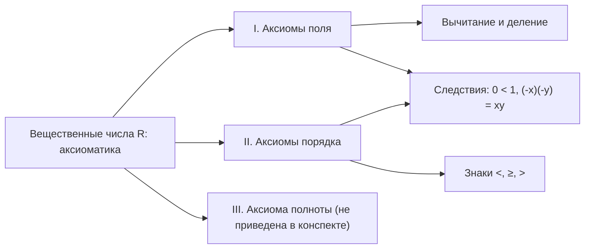

# Лекция 4 — Аксиомы вещественных чисел

[← Лекция 3](lecture-03.md) · [Указатель лекций](index.md) · [Лекции 5–6 →](lecture-05-06.md) · [Термины и теоремы](../term-index.md) · [English](../../en/lectures-2025-26/lecture-04.md) · [Español](../../es/lectures-2025-26/lecture-04.md)

> **Источник:** `ма25_26_лекция_4_notes.pdf` — 10 страниц: 9 печатных слайдов с текстовым слоем и 1 рукописная страница (стр. 9). На рукописной странице иллюстраций нет.
>
> **Замечание о полноте.** В файле изложены аксиомы поля (I) и порядка (II). [Аксиомы полноты](../02-real-numbers.md#completeness-axiom) в конспекте не приведены, поэтому их нет и в этой записи.

## Слайд 2. Цитата дня

> «Делай, что должно, и будь, что будет.»
>
> — Марк Аврелий

## Слайд 3. Цель лекции

- Опишем ряд аксиом поля вещественных чисел (аксиомы поля, порядка и полноты).

## §3. Вещественные числа

### Слайд 4. Вводная часть

Чёткое определение вещественного числа, скорее всего, неизвестно. В этом параграфе мы определим множество вещественных чисел аксиоматически: множество $`\mathbb{R}`$ называется множеством вещественных чисел, если выполнен некоторый набор условий (аксиом).

Для удобства разобьём аксиомы, которых всего шестнадцать, на группы.

### Слайд 5. I. Аксиомы поля (I.1–I.4)

В множестве $`\mathbb{R}`$ определены две операции, называемые сложением и умножением, действующие из $`\mathbb{R} \times \mathbb{R}`$ в $`\mathbb{R}`$ и удовлетворяющие следующим свойствам.

- **I.1** Ассоциативность сложения: $`(x + y) + z = x + (y + z)`$.
- **I.2** Коммутативность сложения: $`x + y = y + x`$.
- **I.3** Существует нейтральный элемент по сложению $`0`$, такой что $`\forall x \in \mathbb{R}:\ x + 0 = x`$.
- **I.4** $`\forall x \in \mathbb{R}\ \exists`$ обратный элемент $`\tilde{x} \in \mathbb{R}`$, такой что $`x + \tilde{x} = 0`$. Такой элемент обозначается $`-x`$.

### Слайд 6. I. Аксиомы поля (I.5–I.9)

- **I.5** Ассоциативность умножения: $`(xy)z = x(yz)`$.
- **I.6** Коммутативность умножения: $`xy = yx`$.
- **I.7** Существует нейтральный элемент по умножению $`1`$, такой что $`\forall x \in \mathbb{R}:\ x \cdot 1 = x`$.
- **I.8** $`\forall x \in \mathbb{R} \setminus \{0\}\ \exists`$ обратный элемент $`x^{-1} \in \mathbb{R}`$, такой что $`x \cdot x^{-1} = 1`$. Такой элемент обозначается также $`\dfrac{1}{x}`$.
- **I.9** Дистрибутивность: $`x(y + z) = xy + xz`$.

### Слайд 7. Поле; вычитание и деление

Множество, в котором определены две операции, удовлетворяющие свойствам I.1–I.9, называется **полем**, а сами свойства I.1–I.9 — аксиомами поля.

Аксиома I.4 позволяет определить вычитание:

```math
x - y = x + (-y),
```

а аксиома I.8 — деление на любое число, отличное от нуля:

```math
\frac{x}{y} = x \cdot \frac{1}{y}.
```

### Слайд 8. II. Аксиомы порядка

Между элементами $`\mathbb{R}`$ определено отношение $`\leq`$ со следующими свойствами.

- **II.1** $`\forall x, y \in \mathbb{R}`$ верно $`x \leq y`$ или $`y \leq x`$.
- **II.2** Транзитивность: если $`x \leq y`$ и $`y \leq z`$, то $`x \leq z`$.
- **II.3** Если $`x \leq y`$ и $`y \leq x`$, то $`x = y`$.
- **II.4** Если $`x \leq y`$, то $`x + z \leq y + z`$ $`\forall z \in \mathbb{R}`$.
- **II.5** Если $`0 \leq x`$ и $`0 \leq y`$, то $`0 \leq xy`$.

Поле, в котором введено отношение порядка, удовлетворяющее свойствам II.1–II.5, называется **упорядоченным**.

### Рукописная страница 9 (PDF-стр. 9). Другие знаки неравенств

Другие знаки неравенств определяются так:

- $`a < b`$ означает, что $`a \leq b`$ и $`a \neq b`$;
- $`a \geq b`$ означает, что $`b \leq a`$;
- $`a > b`$ означает, что $`b \leq a`$ и $`a \neq b`$.

### Слайд 10. Замечание об аксиомах поля и порядка

Аксиомы поля и порядка — это привычные свойства арифметических действий и неравенств с вещественными числами. Другие знакомые свойства (например, $`0 < 1`$ или $`(-x)(-y) = xy`$) при аксиоматическом определении вещественных чисел с помощью этой системы аксиом являются теоремами и могут быть выведены из аксиом.

## Схема лекции


