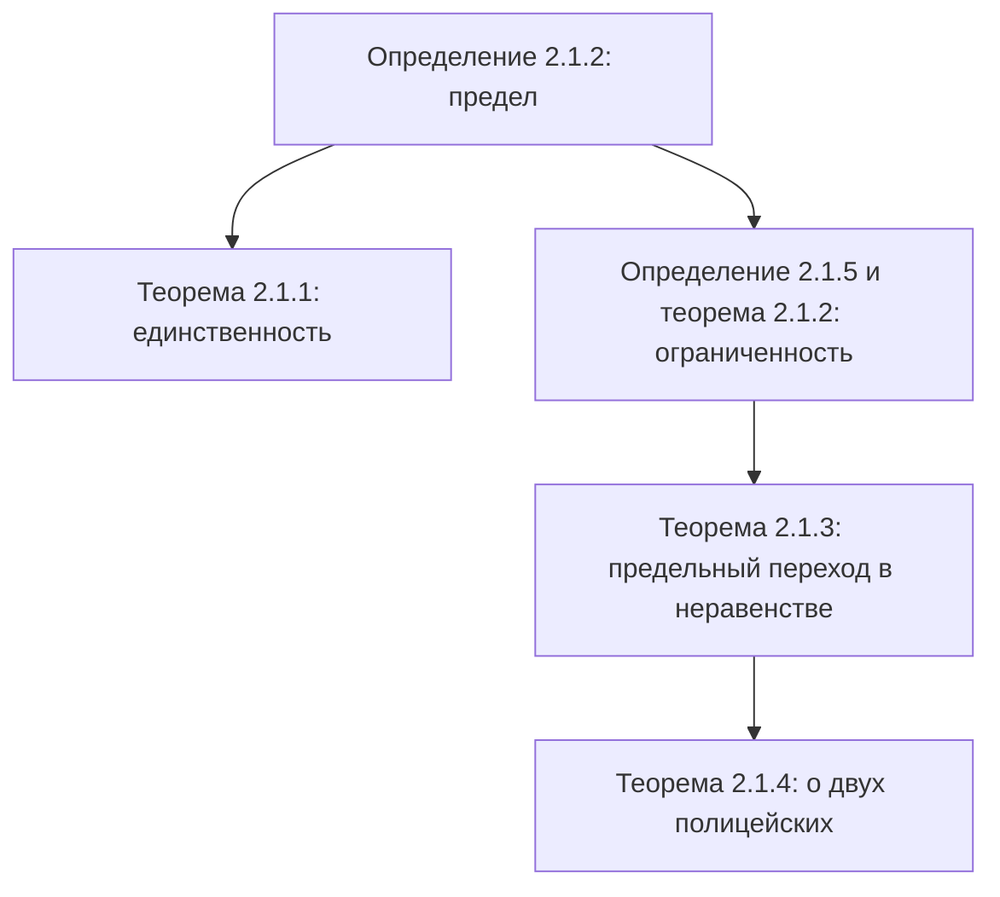

# Лекция 8 — Предел последовательности

[← Лекция 7](lecture-07.md) · [Указатель лекций](index.md) · [Лекции 9–10 →](lecture-09-10.md) · [Термины и теоремы](../term-index.md) · [English](../../en/lectures-2025-26/lecture-08.md) · [Español](../../es/lectures-2025-26/lecture-08.md)

> **Источник:** `ма25_26_лекция_8_notes.pdf` — 25 страниц: печатные слайды с текстовым слоем и рукописные страницы (стр. 6–9, 13, 14, 17, 19, 21, 24, 25). Рукописные страницы переписаны по изображению. Номера PDF-страниц указаны в заголовках. Рисунков в лекции нет.

## Слайд 2. Цитата дня

> Всё, что ни делается, всё к лучшему. Просто не всегда к вашему.

## Слайд 3. Цель лекции

- Дать определение [предела последовательности](#def-2-1-2).
- Доказать ряд утверждений о пределе последовательности: единственность предела, ограниченность [сходящейся последовательности](#def-2-1-3), предельный переход в неравенстве, [теорема о двух полицейских](#thm-2-1-4).

## §1. Предел последовательности

### Слайд 4. Определения

<a id="def-2-1-1"></a>**Определение 2.1.1.** Числовая последовательность — это отображение из множества натуральных чисел $`\mathbb{N}`$ в множество вещественных чисел $`\mathbb{R}`$.

<a id="def-2-1-2"></a>**Определение 2.1.2.** Пусть $`\{x_n\}_{n=1}^{\infty}`$ — последовательность вещественных чисел. Число $`a \in \mathbb{R}`$ называют **пределом** последовательности $`\{x_n\}`$ и пишут

```math
\lim_{n \to \infty} x_n = a \qquad\text{или}\qquad x_n \xrightarrow[n\to\infty]{} a,
```

если для любого положительного числа $`\varepsilon`$ существует такой номер $`N`$, что для всех номеров $`n`$, больших $`N`$, выполняется неравенство $`|x_n - a| < \varepsilon`$:

```math
\forall \varepsilon > 0\ \ \exists N \in \mathbb{N}:\ \forall n \in \mathbb{N},\ n > N \ \Rightarrow\ |x_n - a| < \varepsilon.
```

### Слайд 5. Сходимость

<a id="def-2-1-3"></a>**Определение 2.1.3.** Последовательность, имеющая некоторое число своим пределом, называется **сходящейся**; в противном случае (то есть если никакое число не является пределом этой последовательности) — **расходящейся**.

Говорят также «$`x_n`$ сходится к $`a`$» или «$`x_n`$ стремится к $`a`$».

### Рукописная страница 6 (PDF-стр. 6). Пример ①: $`\frac1n \to 0`$ по определению

**Пример ①.** Докажем по определению, что число $`a = 0`$ является пределом $`x_n = \dfrac1n`$.

Возьмём некоторое (произвольное, любое) $`\varepsilon > 0`$. Постараемся подобрать такое $`N \in \mathbb{N}`$, что $`\forall n > N`$ верно $`\left|\dfrac1n - 0\right| < \varepsilon`$.

```math
\left|\frac1n - 0\right| = \frac1n < \varepsilon \ \Rightarrow\ n > \frac1\varepsilon \ \Rightarrow\ N := \left[\frac1\varepsilon\right] + 1.
```

- При $`\varepsilon = 1`$: $`N = \left[\tfrac11\right] + 1 = 2`$; $`\forall n > 2`$: $`x_n = \dfrac1n < \dfrac12 < 1 = \varepsilon`$.
- При $`\varepsilon = \tfrac13`$: $`N = \left[\tfrac{1}{1/3}\right] + 1 = 4`$; $`\forall n > 4`$: $`x_n = \dfrac1n < \dfrac14 < \dfrac13`$.

### Рукописная страница 7 (PDF-стр. 7). Пример ②: постоянная последовательность

**Пример ②.** Пусть $`x_n = a`$ для всех $`n`$. Докажем, что $`\lim_{n\to\infty} x_n = a`$.

Такая последовательность называется **постоянной** или **стационарной**.

Возьмём $`\varepsilon > 0`$: $`|x_n - a| = |a - a| = 0 < \varepsilon`$ — выполняется при всех $`\varepsilon > 0`$ и всех $`n \in \mathbb{N}`$. Поэтому в определении подходит любой номер $`N`$, например $`N = 1`$.

### Рукописная страница 8 (PDF-стр. 8). Отрицание определения предела

Число $`a`$ является пределом $`\{x_n\}`$: $`\forall \varepsilon > 0\ \exists N \in \mathbb{N}:\ \forall n > N\ |x_n - a| < \varepsilon`$.

Число $`a`$ **не** является пределом $`\{x_n\}`$. На основе правил отрицания утверждений с [кванторами](../01-logic-sets-functions.md#sec-1-1) имеем:

```math
\exists \varepsilon^* > 0\ \ \forall N \in \mathbb{N}\ \ \exists n > N:\ \ |x_n - a| \ge \varepsilon^*.
```

**Пример.** Докажем, что $`x_n = (-1)^n`$ не имеет предела, то есть никакое число $`a`$ не является его пределом.

### Рукописная страница 9 (PDF-стр. 9). Продолжение: $`(-1)^n`$ не сходится

Пусть $`a \in \mathbb{R}`$. Положим $`\varepsilon^* = 1`$ и возьмём $`N \in \mathbb{N}`$.

- Если $`a < 0`$, положим $`n = 2N`$; если $`a \ge 0`$, положим $`n = 2N+1`$.

Тогда $`n > N`$ и

```math
\bigl|(-1)^n - a\bigr| = \begin{cases} |1 - a| \ge 1, & \text{если } a < 0, \\ |-1 - a| \ge 1, & \text{если } a \ge 0. \end{cases}
```

Следовательно, $`a`$ не является пределом $`\{(-1)^n\}`$.

Последовательность: $`x_1 = -1`$, $`x_2 = 1`$, $`x_3 = -1`$, $`x_4 = 1`$, …

### Слайд 10. Замечание 1

**Замечание 1.** Если для некоторого $`\varepsilon_0 > 0`$ нашёлся номер $`N`$ из определения предела, то тот же номер $`N`$ подходит и для любого числа $`\varepsilon > \varepsilon_0`$.

Действительно, если $`|x_n - a| < \varepsilon_0`$, а $`\varepsilon > \varepsilon_0`$, то тем более $`|x_n - a| < \varepsilon`$. Поэтому достаточно проверять справедливость определения (существование номера $`N`$) лишь для достаточно малых $`\varepsilon`$, то есть для $`\varepsilon`$ меньших некоторого положительного числа.

### Слайд 11. Замечание 2

**Замечание 2.** Если для некоторого $`\varepsilon_0 > 0`$ нашёлся номер $`N`$ из определения предела, то для того же $`\varepsilon_0`$ подходит и любой номер $`N_1 > N`$.

Действительно, если неравенство $`|x_n - a| < \varepsilon`$ выполняется для всех $`n > N`$, а $`N_1 > N`$, то оно тем более выполняется для всех $`n > N_1`$. По той же причине в определении предела не обязательно требовать, чтобы $`N`$ было натуральным числом.

### Слайд 12. Ещё замечания

**Замечание 3.** Определение предела останется равносильным исходному, если вместо $`n > N`$ писать $`n \ge N`$ и (или) вместо $`|x_n - a| < \varepsilon`$ писать $`|x_n - a| \le \varepsilon`$.

**Замечание 4.** Пусть последовательности $`\{x_n\}`$ и $`\{y_n\}`$ таковы, что, начиная с некоторого номера $`n_0`$, их значения совпадают: $`x_n = y_n`$ при всех $`n > n_0`$. Тогда их пределы одновременно существуют или нет и, если существуют, то равны.

**Замечание 5.**

```math
|x_n - a| < \varepsilon \iff a - \varepsilon < x_n < a + \varepsilon.
```

### Рукописная страница 13 (PDF-стр. 13). Пояснения к замечаниям 3 и 4

**Пояснение к замечанию 3.** Из $`|x_n - a| < \varepsilon`$ следует $`|x_n - a| \le \varepsilon`$. С другой стороны, пусть $`|x_n - a| \le \varepsilon`$. Возьмём $`\varepsilon > 0`$ и подберём $`N`$ такое, что $`\forall n > N`$: $`|x_n - a| \le \varepsilon/2 \Rightarrow |x_n - a| < \varepsilon`$. В силу произвольности $`\varepsilon`$ число $`a`$ удовлетворяет определению со знаком «$`<`$».

**Пояснение к замечанию 4.** Если $`a = \lim x_n`$ и номер $`N`$ подходит для $`\varepsilon`$ из определения предела для $`\{x_n\}`$, то $`N_1 = \max\{N, n_0 - 1\}`$ подходит для того же $`\varepsilon`$ из определения предела для $`\{y_n\}`$.

### Рукописная страница 14 (PDF-стр. 14). Дополнительный вывод

**Доп. вывод.** Если у $`\{x_n\}`$ изменить конечное число элементов, то её предел не изменится. Поэтому можно говорить о $`\lim_{n\to\infty}\{x_n\}_{n=n_0}^{\infty}`$.

### Слайд 15. $`\varepsilon`$-окрестность

<a id="def-2-1-4"></a>**Определение 2.1.4.** Интервал $`(a - \varepsilon, a + \varepsilon)`$ называется **$`\varepsilon`$-окрестностью** точки $`a`$ и обозначается $`V_\varepsilon(a)`$.

Определение предела последовательности можно переформулировать с использованием окрестностей: число $`a`$ называется пределом последовательности $`\{x_n\}`$, если для любой окрестности точки $`a`$ все члены последовательности, начиная с некоторого номера, принадлежат этой окрестности.

Отметим ещё, что пересечение двух окрестностей точки $`a`$ есть её окрестность:

```math
V_{\varepsilon_1}(a) \cap V_{\varepsilon_2}(a) = V_{\min\{\varepsilon_1, \varepsilon_2\}}(a).
```

### Слайд 16. Единственность предела

<a id="thm-2-1-1"></a>**Теорема 2.1.1.** Последовательность не может иметь более одного предела: если $`a, b \in \mathbb{R}`$, $`x_n \to a`$, $`x_n \to b`$, то $`a = b`$.

### Рукописная страница 17 (PDF-стр. 17). Доказательство теоремы 2.1.1

**Доказательство ([теорема 2.1.1](#thm-2-1-1)).** Предположим противное: пусть $`a \ne b`$ ⇒ $`|a - b| > 0`$.

Возьмём $`\varepsilon = \dfrac{|a - b|}{2}`$.

- $`x_n \to a`$ ⇔ $`\exists N_1`$: $`\forall n > N_1`$ $`|x_n - a| < \varepsilon`$;
- $`x_n \to b`$ ⇔ $`\exists N_2`$: $`\forall n > N_2`$ $`|x_n - b| < \varepsilon`$.

Рассмотрим $`n > \max\{N_1, N_2\}`$:

```math
|a - b| = |a - x_n + x_n - b| \le |a - x_n| + |x_n - b| < 2\varepsilon = |a - b|,
```

(использовано неравенство треугольника $`|x + y| \le |x| + |y|`$). Итак, $`|a-b| < |a-b|`$ — противоречие. Следовательно, $`a = b`$. ∎

> **Примечание редактора.** На полях рукописи стоит ремарка лектора «Ура! Бред!» — перенесена как есть.

### Слайд 18. Ограниченные последовательности

<a id="def-2-1-5"></a>**Определение 2.1.5.** Последовательность $`\{x_n\}`$ называется **ограниченной**, если множество её значений ограничено:

```math
\exists R > 0:\ \forall n \in \mathbb{N}\ \ |x_n| \le R.
```

<a id="thm-2-1-2"></a>**Теорема 2.1.2.** Сходящаяся последовательность ограничена.

### Рукописная страница 19 (PDF-стр. 19). Доказательство теоремы 2.1.2

**Доказательство ([теорема 2.1.2](#thm-2-1-2)).** Пусть $`\{x_n\}`$ — сходящаяся последовательность, $`x_n \to a`$. Возьмём $`\varepsilon = 1`$. Существует $`N`$: $`\forall n > N`$ $`|x_n - a| < 1`$.

Тогда для всех $`n > [N] + 1`$:

```math
|x_n| = |x_n - a + a| \le |x_n - a| + |a| < 1 + |a|.
```

Положим $`R = \max\{ |x_1|, |x_2|, \dots, |x_{[N]+1}|,\ 1 + |a| \}`$. Тогда $`|x_n| \le R`$ для всех $`n \in \mathbb{N}`$.

**Пометка на полях:** $`x_1, x_2, \dots, x_{[N]+1}`$ — конечный набор элементов, поэтому можно найти наибольший по модулю; $`x_{[N]+2}, \dots < 1 + |a|`$ по определению предела. ∎

### Слайд 20. Предельный переход в неравенстве

<a id="thm-2-1-3"></a>**Теорема 2.1.3.** Пусть $`\{x_n\}`$, $`\{y_n\}`$ — вещественные последовательности, $`x_n \le y_n`$ при всех $`n \in \mathbb{N}`$, $`a, b \in \mathbb{R}`$, $`x_n \to a`$, $`y_n \to b`$. Тогда $`a \le b`$.

Иначе: если $`x_n \le y_n`$ при всех $`n`$ и существуют пределы $`\{x_n\}`$ и $`\{y_n\}`$, то $`\lim x_n \le \lim y_n`$.

**Следствие.**

1. Если $`x_n \le b`$ при всех $`n`$ и существует $`\lim x_n`$, то $`\lim x_n \le b`$.
2. Если $`x_n \ge a`$ при всех $`n`$ и существует $`\lim x_n`$, то $`\lim x_n \ge a`$.
3. Если $`x_n \in [a, b]`$ при всех $`n`$ и существует $`\lim x_n`$, то $`\lim x_n \in [a, b]`$.

### Рукописная страница 21 (PDF-стр. 21). Доказательство теоремы 2.1.3

**Доказательство ([теорема 2.1.3](#thm-2-1-3)).** Предположим противное: пусть $`a > b`$ ⇒ $`\varepsilon = \dfrac{a - b}{2} > 0`$.

- $`\exists N_1`$: $`\forall n > N_1`$ $`|x_n - a| < \varepsilon`$ ⇒ $`a - \varepsilon < x_n`$.
- $`\exists N_2`$: $`\forall n > N_2`$ $`|y_n - b| < \varepsilon`$ ⇒ $`y_n < b + \varepsilon`$.

[Ликбез: $`|x_n - a| < \varepsilon \iff a - \varepsilon < x_n < a + \varepsilon`$; $`|y_n - b| < \varepsilon \iff b - \varepsilon < y_n < b + \varepsilon`$.]

Рассмотрим $`n > \max\{N_1, N_2\}`$. Тогда

```math
y_n < b + \varepsilon = b + \frac{a - b}{2} = \frac{a + b}{2} = a - \varepsilon < x_n,
```

что противоречит условию $`x_n \le y_n`$ для всех $`n \in \mathbb{N}`$. ∎

### Слайд 22. Замечание 6: строгое неравенство

**Замечание 6.** При предельном переходе строгое неравенство может превратиться в нестрогое: из того, что $`x_n < y_n`$ при всех $`n`$, не следует, что $`\lim x_n < \lim y_n`$.

### Слайд 23. Сжатая последовательность (теорема о двух полицейских)

<a id="thm-2-1-4"></a>**Теорема 2.1.4.** Пусть $`\{x_n\}`$, $`\{y_n\}`$, $`\{z_n\}`$ — вещественные последовательности, $`x_n \le y_n \le z_n`$ при всех $`n`$, $`a \in \mathbb{R}`$, $`\lim x_n = \lim z_n = a`$. Тогда предел $`\{y_n\}`$ существует и равен $`a`$.

### Рукописная страница 24 (PDF-стр. 24). Доказательство теоремы 2.1.4

**Доказательство ([теорема 2.1.4](#thm-2-1-4)).** Возьмём $`\varepsilon > 0`$.

- $`x_n \to a`$ ⇔ $`\exists N_1`$: $`\forall n > N_1`$ $`|x_n - a| < \varepsilon`$ ⇔ $`a - \varepsilon < x_n < a + \varepsilon`$.
- $`z_n \to a`$ ⇔ $`\exists N_2`$: $`\forall n > N_2`$ $`|z_n - a| < \varepsilon`$ ⇔ $`a - \varepsilon < z_n < a + \varepsilon`$.

Положим $`N = \max\{N_1, N_2\}`$. Тогда $`\forall n > N`$ верно

```math
a - \varepsilon < x_n \le y_n \le z_n < a + \varepsilon \ \Rightarrow\ |y_n - a| < \varepsilon.
```

Значит, $`y_n \to a`$. ∎

### Рукописная страница 25 (PDF-стр. 25). Замечания к теоремам 2.1.3 и 2.1.4

**Замечание 1 (частный случай теоремы 2.1.4).** Если $`|y_n| \le z_n`$ для всех $`n \in \mathbb{N}`$ и $`z_n \to 0`$, то $`y_n \to 0`$. Действительно, $`|y_n| \le z_n \iff -z_n \le y_n \le z_n`$, и $`-z_n \to 0`$, $`z_n \to 0`$.

**Замечание 2.** В [теоремах 2.1.3](#thm-2-1-3) и [2.1.4](#thm-2-1-4) достаточно выполнения неравенств $`\forall n \ge n_0`$, где $`n_0 \in \mathbb{N}`$.

## Структура лекции



## Служебные страницы

- Страница 1 — титульная; страница 2 — цитата дня (переведена выше).
- Страница 3 — цель лекции (переведена выше).
