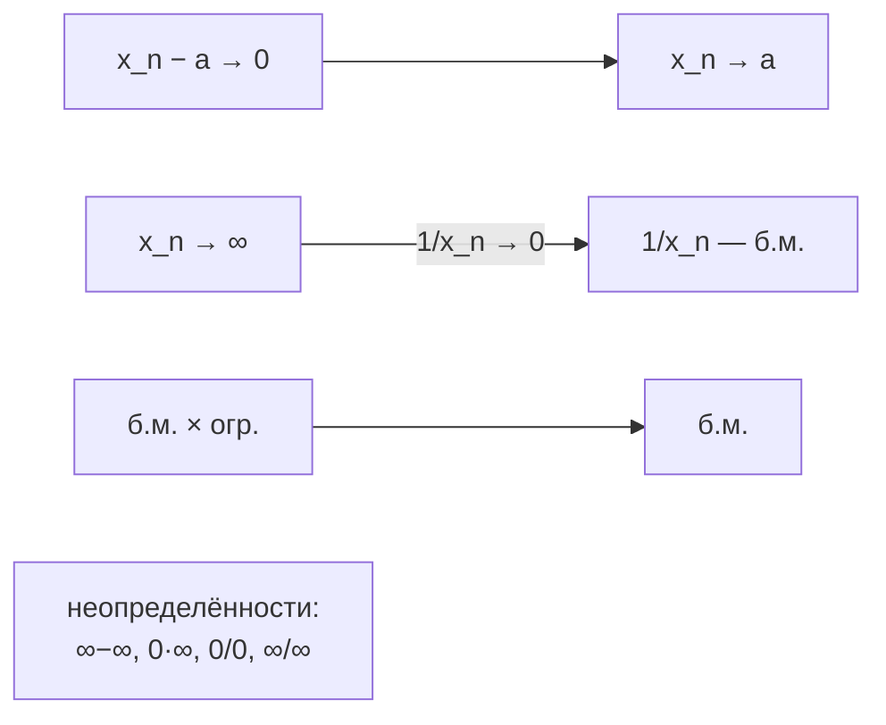

# Лекции 9–10 — Бесконечно малые и бесконечно большие, арифметика пределов

[Указатель лекций](index.md) · [English](../../en/lectures-2025-26/lecture-09-10.md) · [Español](../../es/lectures-2025-26/lecture-09-10.md)

> **Источник:** `ma25_26-lectures_9-10_notes.pdf` — 28 страниц: печатные слайды с текстовым слоем, слайды с рукописными пометками (стр. 4, 5) и рукописные страницы без текстового слоя (стр. 6, 8–11, 14, 16, 19, 21, 24–28). Рукописные страницы переписаны по изображению. Номера PDF-страниц указаны в заголовках. Рисунков в лекции нет.
>
> **Примечание редактора.** Номера ③ и ④ в замечании на стр. 26 и 28 расходятся (на стр. 26 — ③: $\infty,\infty$, ④: $0,0$; на стр. 28 — ③: $0,0$, ④: $\infty,\infty$). Оба варианта сохранены как в рукописи соответствующей страницы.

## Слайд 2. Цитата дня

> Объяснить можно всё, но не всем.

## Слайд 3. Цель лекции

- Определить бесконечно малые и бесконечно большие последовательности и обсудить их свойства.

## §2. Бесконечно малые и бесконечно большие

### Слайд 4. Бесконечно малая последовательность

**Определение 2.2.1.** Числовая последовательность называется **бесконечно малой**, если она стремится к нулю.

Таким образом, стремление последовательности $\{x_n\}$ к $a$ равносильно тому, что $\{x_n - a\}$ бесконечно мала.

**Рукописная пометка** (поля слайда 4):

$$
x_n \to a \iff x_n - a \to 0 \iff \{x_n - a\}\ \text{б.м.}
$$

$$
\{x_n\} \text{ сходится к } a \iff \{x_n - a\} \text{ бесконечно малая последовательность.}
$$

### Слайд 5. Лемма 2.2.1

**Лемма 2.2.1.** Произведение бесконечно малой последовательности на ограниченную есть бесконечно малая: если $\{x_n\}$, $\{y_n\}$ — вещественные последовательности, $\{x_n\}$ — бесконечно малая, $\{y_n\}$ — ограничена, то $\{x_n y_n\}$ — бесконечно малая.

**Рукописная пометка:** $\{x_n\}$ б.м. ⇔ $x_n \to 0$; $\{y_n\}$ ограничена ⇔ $\exists M \in \mathbb{R}: |y_n| \le M\ \forall n$; ⇒ $\{x_n y_n\}$ б.м. ⇔ $x_n y_n \to 0$ при $n \to \infty$.

### Рукописная страница 6 (PDF-стр. 6). Доказательство леммы 2.2.1

**Доказательство (лемма 2.2.1).** $\{y_n\}$ ограничена ⇔ $\exists M > 0$: $|y_n| \le M\ \forall n$. «Не ущемляя общности», будем считать, что $M \ge 1$.

Возьмём $\varepsilon > 0$. $x_n \to 0$ ⇔ $\exists N$: $\forall n > N$ $|x_n| < \dfrac{\varepsilon}{M}$.

Тогда $\forall n > N$:

$$
|x_n y_n - 0| = |x_n y_n| = |x_n| \cdot |y_n| < \frac{\varepsilon}{M} \cdot M = \varepsilon.
$$

(Использовано свойство модуля $|AB| = |A|\cdot|B|$ и $|y_n| \le M$.) ∎

### Слайд 7. Арифметические действия над сходящимися последовательностями

**Теорема 2.2.1.** Пусть $\{x_n\}$, $\{y_n\}$ — вещественные последовательности, $x_0, y_0 \in \mathbb{R}$, $x_n \to x_0$, $y_n \to y_0$. Тогда

1. $x_n + y_n \to x_0 + y_0$;
2. $x_n y_n \to x_0 y_0$;
3. $x_n - y_n \to x_0 - y_0$;
4. $|x_n| \to |x_0|$;
5. если, кроме того, $y_n \ne 0$ при всех $n$ и $y_0 \ne 0$, то $\dfrac{x_n}{y_n} \to \dfrac{x_0}{y_0}$.

### Рукописная страница 8 (PDF-стр. 8). Доказательство теоремы 2.2.1, пункт ①

**Доказательство (теорема 2.2.1).**

**①** Пусть $x_n \to x_0$, $y_n \to y_0$. Покажем, что $x_n + y_n \to x_0 + y_0$.

Возьмём $\varepsilon > 0$. $x_n \to x_0$ ⇔ $\exists N_1$: $\forall n > N_1$ $|x_n - x_0| < \dfrac{\varepsilon}{2}$; $\ y_n \to y_0$ ⇔ $\exists N_2$: $\forall n > N_2$ $|y_n - y_0| < \dfrac{\varepsilon}{2}$.

Положим $N = \max\{N_1, N_2\}$. $\forall n > N$:

$$
|(x_n + y_n) - (x_0 + y_0)| = |(x_n - x_0) + (y_n - y_0)| \le |x_n - x_0| + |y_n - y_0| < \frac{\varepsilon}{2} + \frac{\varepsilon}{2} = \varepsilon.
$$

### Рукописная страница 9 (PDF-стр. 9). Пункты ② и ③

**②** Оценим $|x_n y_n - x_0 y_0|$:

$$
|x_n y_n - x_0 y_0| = |x_n y_n - x_0 y_n + x_0 y_n - x_0 y_0| = \bigl|(x_n - x_0) y_n + x_0 (y_n - y_0)\bigr|
$$
$$
\le |x_n - x_0|\cdot |y_n| + |x_0|\cdot |y_n - y_0|.
$$

Пометки на полях:

- $|x_n - x_0|$ — **бесконечно малая**, т.к. $x_n \to x_0$;
- $|y_n|$ — **ограничена**, т.к. $\{y_n\}$ сходящаяся, а всякая сходящаяся последовательность ограничена;
- $|x_0|$ — **ограничена**, т.к. $x_0 \in \mathbb{R}$ конечно;
- $|y_n - y_0|$ — **бесконечно малая**, т.к. $y_n \to y_0$.

Итак, (б.м.)·(огр.) + (огр.)·(б.м.) = б.м. по пункту ①.

**③** Следует из ① и ②: $x_n - y_n = x_n + (-1) y_n \to x_0 + (-1) y_0 = x_0 - y_0$.

### Рукописная страница 10 (PDF-стр. 10). Пункты ④ и ⑤

**④** Воспользуемся свойством модуля: $\bigl| |x_n| - |x_0| \bigr| \le |x_n - x_0|$.

**⑤** Достаточно показать, что $\dfrac{1}{y_n} \to \dfrac{1}{y_0}$, так как по пункту ② имеем

$$
\frac{x_n}{y_n} = x_n\cdot\frac{1}{y_n} \to x_0 \cdot \frac{1}{y_0} = \frac{x_0}{y_0}.
$$

Оценим разность:

$$
\left|\frac{1}{y_n} - \frac{1}{y_0}\right| = \left|\frac{y_0 - y_n}{y_0 y_n}\right| = |y_n - y_0| \cdot \frac{1}{|y_n|} \cdot \frac{1}{|y_0|}.
$$

Здесь $|y_n - y_0|$ — б.м., а $\dfrac{1}{|y_0|}$ — константа. Остаётся показать, что $\dfrac{1}{y_n}$ ограничена.

Возьмём $\varepsilon = \dfrac{|y_0|}{2} > 0$, т.к. по условию $y_0 \ne 0$. $y_n \to y_0$ ⇔ $\exists N$: $\forall n > N$ $|y_n - y_0| < \varepsilon = \dfrac{|y_0|}{2}$.

### Рукописная страница 11 (PDF-стр. 11). Завершение пункта ⑤

Тогда $\forall n > N$ имеем

$$
|y_n| = |y_0 + y_n - y_0| \ge |y_0| - |y_n - y_0| > |y_0| - \varepsilon = \frac{|y_0|}{2}
$$

(свойство модуля).

Обозначим $k := \min\left\{ |y_1|, |y_2|, \dots, |y_N|,\ \dfrac{|y_0|}{2} \right\}$. Тогда $\dfrac{1}{|y_n|} \le \dfrac{1}{k}$ для всех $n$, то есть $\left\{\dfrac{1}{y_n}\right\}$ — ограничена.

Значит,

$$
\left|\frac{1}{y_n} - \frac{1}{y_0}\right| = |y_n - y_0|\cdot\frac{1}{|y_n|}\cdot\frac{1}{|y_0|} = \text{б.м.} \cdot \text{огр.} \cdot \text{огр.} = \text{б.м.}
$$

> **Примечание редактора.** На рукописи не оговорено, что $y_n \ne 0$ при всех $n$ (это нужно для определения $1/y_n$). Для $n \le N$ подразумевается $y_n \ne 0$; в минимуме $k$ при этом $k > 0$. Отмечено как предположение курса.

**Замечание.** $z_n \to a$ ⇔ $z_n - a \to 0$ ⇔ $\{z_n - a\}$ — б.м.

### Слайд 12. Бесконечно большие: $\pm\infty$

**Определение 2.2.2.** Говорят, что вещественная последовательность $\{x_n\}$ стремится к:

1. **плюс бесконечности**, и пишут $\lim_{n\to\infty} x_n = +\infty$ или $x_n \xrightarrow[n\to\infty]{} +\infty$, если

$$
\forall E > 0\ \ \exists N \in \mathbb{N}:\ \forall n > N\ \ x_n > E;
$$

2. **минус бесконечности**, и пишут $\lim_{n\to\infty} x_n = -\infty$ или $x_n \xrightarrow[n\to\infty]{} -\infty$, если

$$
\forall E > 0\ \ \exists N \in \mathbb{N}:\ \forall n > N\ \ x_n < -E.
$$

**Рукописная пометка:** $x_n > E$ ⇔ $\{x_n\} \to +\infty$; $x_n < -E$ ⇔ $\{x_n\} \to -\infty$ ⇔ $\{-x_n\} \to +\infty$.

### Слайд 13. Бесконечности неопределённого знака

**Определение 2.2.3.** Говорят, что вещественная последовательность $\{x_n\}$ стремится к **бесконечности** (бесконечности неопределённого знака), и пишут $\lim_{n\to\infty} x_n = \infty$ или $x_n \xrightarrow[n\to\infty]{} \infty$, если

$$
\forall E > 0\ \ \exists N \in \mathbb{N}:\ \forall n > N\ \ |x_n| > E.
$$

**Замечание 1.** Из определений следует, что если $x_n \to \pm\infty$, то $x_n \to \infty$. **Обратное неверно!**

### Рукописная страница 14 (PDF-стр. 14). Пример

**Пример.** $x_n = (-1)^n \cdot n$ ⇒ $|x_n| = n \to \infty$.

Значения: $-1, 2, -3, 4, -5, \dots$. Последовательность **не стремится ни к $+\infty$, ни к $-\infty$**, но стремится к бесконечности неопределённого знака.

### Слайд 15. Бесконечно большая последовательность

**Определение 2.2.4.** Последовательность, стремящаяся к бесконечности, называется **бесконечно большой**.

**Замечание 2.** Из определений следует, что если $x_n \to \infty$, то $\{x_n\}$ не ограничена. **Обратное неверно!**

**Замечание 3.** Имеет место единственность предела в $\mathbb{R}$: если $a, b \in \mathbb{R}$, $x_n \to a$, $x_n \to b$, то $a = b$.

### Рукописная страница 16 (PDF-стр. 16). Пример к замечанию 2

**Пример (к замечанию 2).** Если $\{x_n\}$ не ограничена, то $x_n \to \infty$ не следует (стрелка «⇒» на рукописи перечёркнута). Контрпример:

$$
x_n = \bigl(1 + (-1)^n\bigr) \cdot n: \quad 0,\ 4,\ 0,\ 8,\ 0,\ 10,\ \dots
$$

Последовательность не ограничена, но не стремится к $\infty$ (члены с нечётными номерами равны $0$).

### Слайд 17. Замечания о бесконечно больших

**Замечание 4.** Определение достаточно проверять лишь для достаточно больших чисел $E$; можно также опустить в определении требование $E > 0$.

**Замечание 5.** Определение сходящейся последовательности не меняется: последовательность называется сходящейся, если она имеет конечный предел. Бесконечно большие последовательности являются расходящимися.

### Слайд 18. Окрестности бесконечно удалённых точек

**Определение 2.2.5.**

$$
V(+\infty) = (E, +\infty], \qquad V(-\infty) = (-\infty, -E), \qquad V(\infty) = \{ x \in \mathbb{R} : |x| > E \}.
$$

Если же нужно определить именно $\varepsilon$-окрестности, то полагают $V_\varepsilon(+\infty) = \left(\dfrac{1}{\varepsilon}, +\infty\right]$ и т.п. Тогда $\varepsilon$-окрестности сужаются с уменьшением $\varepsilon > 0$.

**Замечание 6.**

1. Если $x_n > y_n$ при всех $n$ и $y_n \to +\infty$, то $x_n \to +\infty$.
2. Если $x_n \le y_n$ при всех $n$ и $y_n \to -\infty$, то $x_n \to -\infty$.

### Рукописная страница 19 (PDF-стр. 19). Пояснение к замечанию 6

$y_n \to +\infty$ ⇔ $\forall E > 0\ \exists N_0 \in \mathbb{N}:\ \forall n > N_0\ \ y_n > E$.

$\forall n$: $y_n \le x_n$ ⇒ $\forall n > N_0$: $x_n > E$ ⇒ $x_n \to +\infty$.

**Замечание 6** дополняет теорему о сжатой последовательности (о двух полицейских).

### Слайд 20. Связь между бесконечно большими и бесконечно малыми

**Лемма 2.2.2.** Пусть $\{x_n\}$ — вещественная последовательность, $x_n \ne 0$ ни при каком $n$. Тогда последовательность $\{x_n\}$ бесконечно большая в том и только в том случае, когда $\left\{\dfrac{1}{x_n}\right\}$ — бесконечно малая.

### Рукописная страница 21 (PDF-стр. 21). Доказательство леммы 2.2.2

**Доказательство (лемма 2.2.2).**

**①** (⇒): $\{x_n\}$ — б.б. ⇔ $x_n \to \infty$. Покажем, что $\dfrac{1}{x_n} \to 0$.

Возьмём $\varepsilon > 0$. Положим $E = \dfrac{1}{\varepsilon}$. Для $E = \dfrac{1}{\varepsilon} > 0$ существует $N$: $\forall n > N$ $|x_n| > E$ ⇔ $\varepsilon > \dfrac{1}{|x_n|} = \left|\dfrac{1}{x_n}\right|$ ⇒ $\left\{\dfrac{1}{x_n}\right\}$ — б.м.

**②** (⇐): доказательство аналогично (доделать дома).

### Слайд 22. Арифметические действия над бесконечно большими

**Теорема 2.2.2.** Пусть $\{x_n\}$, $\{y_n\}$ — вещественные последовательности, $a, b \in \mathbb{R} \cup \{\infty\}$.

1. Если $x_n \to +\infty$, $\{y_n\}$ ограничена снизу, то $x_n + y_n \to +\infty$.
2. Если $x_n \to -\infty$, $\{y_n\}$ ограничена сверху, то $x_n + y_n \to -\infty$.
3. Если $x_n \to \infty$, $\{y_n\}$ ограничена, то $x_n + y_n \to \infty$.
4. Если $x_n \to \pm\infty$, $y_n \ge b > 0$ для всех $n$ (или $y_n \to b > 0$), то $x_n y_n \to \pm\infty$.
5. Если $x_n \to \pm\infty$, $y_n \le b < 0$ для всех $n$ (или $y_n \to b < 0$), то $x_n y_n \to \mp\infty$.
6. Если $x_n \to \infty$, $|y_n| \ge b > 0$ для всех $n$ (или $y_n \to b \ne 0$), то $x_n y_n \to \infty$.
7. Если $x_n \to a \ne 0$, $y_n \to 0$, $y_n \ne 0$ при всех $n$, то $\dfrac{x_n}{y_n} \to \infty$.

### Слайд 23. Теорема 2.2.2 (продолжение)

8. Если $x_n \to a \in \mathbb{R}$, $y_n \to \infty$, то $\dfrac{x_n}{y_n} \to 0$.
9. Если $x_n \to \infty$, $y_n \to b \in \mathbb{R}$, $y_n \ne 0$ при всех $n$, то $\dfrac{x_n}{y_n} \to \infty$.

### Рукописная страница 24 (PDF-стр. 24). Доказательство теоремы 2.2.2, пункт ①

**Доказательство (теорема 2.2.2).** Мы ограничимся доказательством утверждений 1, 6, 8.

**①** $\{y_n\}$ ограничена снизу ⇔ $\exists m \in \mathbb{R}$: $\forall n \in \mathbb{N}$ $y_n \ge m$.

Возьмём $E > 0$. $x_n \to +\infty$ ⇒ распишем определение для $E - m$: $\exists N$: $\forall n > N$ $x_n > E - m$ ⇒

$$
x_n + y_n > E - m + m = E.
$$

В силу произвольности $E$ это означает, что $x_n + y_n \to +\infty$.

> **Примечание редактора.** На рукописи в последнем неравенстве написано $y_m$; по смыслу — $y_n$.

### Рукописная страница 25 (PDF-стр. 25). Пункт ⑥

**⑥** Пусть $|y_n| \ge b > 0$ для всех $n \in \mathbb{N}$.

Возьмём $E > 0$. $x_n \to +\infty$ ⇒ распишем определение предела для $\dfrac{E}{b}$: $\exists N$: $\forall n > N$ $|x_n| > \dfrac{E}{b}$.

Тогда $\forall n > N$: $|x_n y_n| = |x_n|\cdot|y_n| > \dfrac{E}{b}\cdot b = E$.

**Пометка:** $y_n \to b \ne 0$. Положим $b_1 = \dfrac{|b|}{2}$, если $b$ — число; $b_1 = 1$, если $b = \infty$. Тогда, начиная с некоторого номера, $|y_n| \ge b_1$, и применяем доказанное утверждение из начала пункта ⑥.

### Рукописная страница 26 (PDF-стр. 26). Пункт ⑧ и замечание о неопределённостях

**⑧** $\dfrac{x_n}{y_n} = x_n \cdot \dfrac{1}{y_n} \to a \cdot 0 = 0$: здесь $y_n \to \infty$ ⇒ $\dfrac{1}{y_n}$ — б.м. (по лемме 2.2.2); применяем теорему о пределе произведения и лемму 2.2.2.

Для остальных утверждений — упражнение.

**Замечание.** Мы не можем ничего сказать о значении предела в следующих ситуациях:

- **①** $x_n \to +\infty$, $y_n \to -\infty$: $x_n + y_n = ?$
- **②** $x_n \to 0$, $y_n \to \infty$: $x_n \cdot y_n = ?$
- **③** $x_n \to \infty$, $y_n \to \infty$: $\dfrac{x_n}{y_n} = ?$
- **④** $x_n \to 0$, $y_n \to 0$: $\dfrac{x_n}{y_n} = ?$

### Рукописная страница 27 (PDF-стр. 27). Примеры

**Примеры.**

- **1a)** $x_n = a + n$, $a \in \mathbb{R}$; $y_n = -n$ ⇒ $x_n + y_n = a \to a$.
- **1b)** $x_n = n^2 + n$; $y_n = -n$ ⇒ $x_n + y_n = n^2 \to +\infty$.
- **1c)** $x_n = n^2$; $y_n = -n^2 - n$ ⇒ $x_n + y_n = -n \to -\infty$.
- **1d)** $x_n = n + (-1)^n$; $y_n = -n$ ⇒ $x_n + y_n = (-1)^n$ — **не имеет предела**.

### Рукописная страница 28 (PDF-стр. 28). Замечание: неопределённости

**Замечание.** В ситуациях:

1. $x_n \to +\infty$, $y_n \to -\infty$ (сумма);
2. $x_n \to 0$, $y_n \to \infty$ (произведение);
3. $x_n \to 0$, $y_n \to 0$ (частное $x_n / y_n$);
4. $x_n \to \infty$, $y_n \to \infty$ (частное $x_n / y_n$)

говорят, что имеет место **неопределённость** вида $\infty - \infty$, $0 \cdot \infty$, $\dfrac{0}{0}$, $\dfrac{\infty}{\infty}$ соответственно.

В этом случае нахождение предела называют **раскрытием неопределённости**.

## Служебные страницы

- Страница 1 — титульная; страница 2 — цитата дня (переведена выше).
- Страницы 4, 5, 12, 13, 15, 17, 18, 20, 22, 23 — печатные слайды; рукописные пометки на слайдах 4 и 5 учтены выше.
