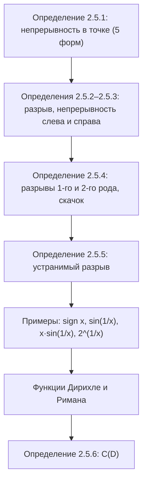

# Лекция 16 — Непрерывные функции: определения и точки разрыва

[← Лекция 15](lecture-15.md) · [Указатель лекций](index.md) · [Лекции 17–18 →](lecture-17-18.md) · [Термины и теоремы](../term-index.md) · [English](../../en/lectures-2025-26/lecture-16.md) · [Español](../../es/lectures-2025-26/lecture-16.md)

> **Источник:** `ма25_26_лекция_16_notes.pdf` — 16 страниц: печатные слайды с текстовым слоем (страницы 1–4, 7–10, 12, 16; на страницах 10 и 12 — цветные рукописные пометки поверх печатных рисунков), рукописные страницы без текстового слоя (5, 6, 11, 13–15). Рукописные страницы переписаны по изображению. Номера страниц PDF указаны в заголовках; печатные слайды пронумерованы в PDF как «1/10»–«10/10».
>
> **Примечание редактора.** Дата лекции взята из нижнего колонтитула слайдов («23 октября 2025»). «Цитата дня» на странице 2 та же, что в лекции 15, и ниже не повторяется.

## Печатные слайды 1–3. Вступление

**Цель лекции.** Дадим ряд определений о непрерывных функциях.

## Глава 2. Теория пределов. §5. Непрерывные функции

### Печатный слайд 4 (PDF-стр. 4). Определение непрерывности в точке

<a id="def-2-5-1"></a>**Определение 2.5.1.** Пусть $`f : D \subset \mathbb{R} \to \mathbb{R}`$, $`x_0 \in D`$. Функция $`f`$ называется **непрерывной в точке $`x_0`$**, если выполняется одно из следующих утверждений.

1. [Предел функции](lecture-14.md#def-2-4-4) $`f`$ в точке $`x_0`$ существует и равен $`f(x_0)`$. Это определение применимо, если $`x_0`$ — [предельная точка](lecture-14.md#def-2-4-1) $`D`$.
2. $`\forall \varepsilon > 0\ \exists \delta > 0\ \forall x \in D : |x - x_0| < \delta \Rightarrow |f(x) - f(x_0)| < \varepsilon`$.
3. $`\forall V(f(x_0))\ \exists V(x_0))\ f(V(x_0) \cap D) \subset V(f(x_0))`$.
4. $`\forall \{x_n\} : x_n \in D,\ x_n \to x_0 \Rightarrow f(x_n) \to f(x_0)`$.
5. $`\Delta y \xrightarrow[\Delta x \to 0]{} 0`$. Здесь $`\Delta x = x - x_0`$ — приращение аргумента, а $`\Delta y = f(x) - f(x_0)`$ — приращение функции. Это определение применимо, если $`x_0`$ — предельная точка $`D`$.

### Рукописная страница 5 (PDF-стр. 5). Замечания к определению 2.5.1

(Зелёным, с рисунком графика, уходящего в $`+\infty`$ с обеих сторон от вертикальной пунктирной прямой $`x = x_0`$:) $`x_0`$ — предельная точка $`D`$, $`x_0 \notin D`$, т.е. $`f(x_0)`$ не определена $`\Rightarrow`$ $`f`$ не является [непрерывной в точке](#def-2-5-1) $`x_0`$ (в смысле определения ①).


**Замечание (рукопись).** ②, ③, ④ означают, что число $`A = f(x_0)`$ является пределом $`f`$ в точке $`x_0`$.

В ② опущено условие $`x \ne x_0`$, но в этом месте это не страшно, т.к. неравенство $`|f(x) - f(x_0)| < \varepsilon`$ верно при $`x = x_0`$.

Аналогично, в ③ опущено условие $`\dot V(x_0)`$, в ④ опущено условие $`x_n \ne x_0`$.

### Рукописная страница 6 (PDF-стр. 6). Изолированная точка

**Замечание (рукопись).** Пусть $`x_0`$ — изолированная точка $`D`$ $`\Rightarrow`$ $`\exists \delta > 0 : V_\delta(x_0) \cap D = \{x_0\}`$,

```math
f(V_\delta(x_0) \cap D) = \{f(x_0)\} \subset V(f(x_0)) \qquad \forall f \text{ и } \forall V(f(x_0)).
```

Обведено жёлтым: **всякая функция непрерывна в изолированной точке своей области определения.**

### Печатный слайд 7 (PDF-стр. 7). Разрывные функции и непрерывность слева и справа

<a id="def-2-5-2"></a>**Определение 2.5.2.** Пусть $`f : D \subset \mathbb{R} \to \mathbb{R}`$, $`x_0 \in \mathbb{R}`$. Если функция $`f`$ не является непрерывной в точке $`x_0`$, то говорят, что $`f`$ **разрывна** (терпит разрыв, испытывает разрыв) в точке $`x_0`$, а точку $`x_0`$ называют **точкой разрыва** функции $`f`$.

<a id="def-2-5-3"></a>**Определение 2.5.3.** Пусть $`f : D \subset \mathbb{R} \to \mathbb{R}`$, $`x_0 \in \mathbb{R}`$. Если сужение функции $`f`$ на множество $`E_1 = D \cap (-\infty, x_0]`$ ($`E_2 = D \cap [x_0, +\infty)`$) непрерывно в точке $`x_0`$, то говорят, что функция $`f`$ **непрерывна слева (справа)** в точке $`x_0`$.

> **Примечание редактора.** В [определениях 2.5.2](#def-2-5-2) и [2.5.3](#def-2-5-3) на слайде написано $`x_0 \in \mathbb{R}`$ (а не $`x_0 \in D`$): о разрыве говорят и в точке, где функция не определена, что согласуется с [определением 2.5.5](#def-2-5-5) ниже.

### Печатный слайд 8 (PDF-стр. 8). Точки разрыва первого и второго рода

<a id="def-2-5-4"></a>**Определение 2.5.4.** Если существуют конечные пределы $`f(x_0^-)`$ и $`f(x_0^+)`$, но не все три числа $`f(x_0^-)`$, $`f(x_0^+)`$, $`f(x_0)`$ равны между собой, то точку $`x_0`$ называют **точкой разрыва первого рода** функции $`f`$.

[Разрыв первого рода](#def-2-5-4) ещё называют **скачком**. Скачком также называют разность $`f(x_0^+) - f(x_0^-)`$, а разности $`f(x_0) - f(x_0^-)`$ и $`f(x_0^+) - f(x_0)`$ называют скачками функции $`f`$ слева и справа в точке $`x_0`$.

В противном случае, т.е. если хотя бы один из [односторонних пределов](lecture-15.md#def-2-4-5) в точке разрыва $`x_0`$ бесконечен или вовсе не существует, точку $`x_0`$ называют **точкой разрыва второго рода** функции $`f`$.

### Печатный слайд 9 (PDF-стр. 9). Точки устранимого разрыва

<a id="def-2-5-5"></a>**Определение 2.5.5.** Пусть $`f(x_0^-) = f(x_0^+) = A \in \mathbb{R}`$, но $`f(x_0) \ne A`$ или $`f`$ не определена в точке $`x_0`$. Тогда точку $`x_0`$ называют **точкой устранимого разрыва** функции $`f`$.

### Печатный слайд 10 с рукописными пометками (PDF-стр. 10). Примеры

$`f(x) = \operatorname{sign} x = \begin{cases} 1, & x > 0, \\ 0, & x = 0, \\ -1, & x < 0. \end{cases}`$

Рукописно: $`\lim\limits_{x \to 0^+} f = 1 = f(0^+)`$; $`\lim\limits_{x \to 0^-} f = -1 = f(0^-)`$. Скачок $`f(0^+) - f(0^-) = 2`$; $`f(0) - f(0^-) = f(0^+) - f(0) = 1`$; оба односторонних скачка (справа и слева) $`= 1`$. Красная стрелка от точки $`(0, 0)`$: «разрыв 1 рода».


$`f(x) = \sin \dfrac{1}{x}`$ (печатный график с отметками $`-\dfrac{2}{\pi}`$, $`-\dfrac{1}{\pi}`$, $`\dfrac{1}{\pi}`$, $`\dfrac{2}{\pi}`$ и пунктирными прямыми $`y = \pm 1`$).


### Рукописная страница 11 (PDF-стр. 11). Разрыв второго рода для $`\sin \frac1x`$

Докажем, что $`0`$ — точка разрыва 2-го рода (для $`f(x) = \sin \dfrac1x`$).

$`x_n = \dfrac{1}{2\pi n}`$, $`x_n > 0`$, $`f(x_n) = \sin\left(\dfrac{1}{1/(2\pi n)}\right) = \sin(2\pi n) = 0 \xrightarrow[n\to\infty]{} 0`$.

$`\widetilde x_n = \dfrac{1}{2\pi n + \pi/2}`$, $`\widetilde x_n > 0`$, $`f(\widetilde x_n) = \sin\left(2\pi n + \dfrac{\pi}{2}\right) = 1 \xrightarrow[n\to\infty]{} 1`$.

Красным: $`\Rightarrow`$ не существует $`\lim\limits_{x \to 0^+} \sin \dfrac1x`$! $`\Rightarrow`$ $`0`$ — точка разрыва 2-го рода!

### Печатный слайд 12 с рукописными пометками (PDF-стр. 12). Примеры-2

$`f(x) = x \sin\left(\dfrac1x\right)`$: рукописно $`\lim\limits_{x \to 0} \left(x \sin \dfrac1x\right) = 0`$ $`\Rightarrow`$ $`0`$ — точка устранимого разрыва.


$`f(x) = 2^{1/x}`$: рукописно $`\lim\limits_{x \to 0^+} 2^{1/x} = +\infty`$; $`\lim\limits_{x \to 0^-} 2^{1/x} = 0`$; «0 — точка разрыва 2-го рода».


### Рукописная страница 13 (PDF-стр. 13). Пример ⟨1⟩: функция Дирихле

**Примеры. ⟨1⟩ Функция Дирихле**

```math
\chi(x) = \begin{cases} 1, & x \in \mathbb{Q}, \\ 0, & x \notin \mathbb{Q} \end{cases}
```

разрывна в каждой точке, причём все разрывы 2 рода. Действительно, для любого $`x_0 \in \mathbb{R}`$ можно подобрать 2 последовательности: рациональных чисел $`\{x_n\}`$ и иррациональных чисел $`\{y_n\}`$ такие, что $`x_n, y_n > 0`$ (так на рукописи; по смыслу — $`x_n, y_n`$ справа от $`x_0`$); $`x_n, y_n \to x_0`$.

Например, можно взять $`x_n = \dfrac{[n x_0] + 1}{n}`$, $`y_n = x_n + \dfrac{\sqrt2}{n}`$. Тогда $`\chi(x_n) = 1 \to 1`$, $`\chi(y_n) = 0 \to 0`$.

Поэтому предела $`\chi`$ справа в точке $`x_0`$ не существует. Аналогично доказывается не-существование левостороннего предела.

### Рукописные страницы 14–15 (PDF-стр. 14–15). Пример ⟨2⟩: функция Римана

**⟨2⟩ Функция Римана**

```math
\psi(x) = \begin{cases} \dfrac1q, & x = \dfrac pq \in \mathbb{Q},\ \text{дробь несократима}, \\ 0, & x \notin \mathbb{Q} \end{cases}
```

непрерывна во всех иррациональных точках и имеет разрывы 1 рода во всех рациональных точках. Достаточно показать, что $`\lim \psi`$ в любой точке $`x_0`$ равен $`0`$. Возьмём $`\varepsilon > 0`$ и подберём $`N`$ так, чтобы $`\dfrac1N < \varepsilon`$.

Количество рациональных чисел со знаменателями, меньшими $`N`$, в проколотой $`2`$-окрестности точки $`x_0`$ конечно.


(Зелёным:) Обозначим через $`r`$ расстояние от точки $`x_0`$ до ближайшего из них. Тогда в проколотой $`r`$-окрестности точки $`x_0`$ нет рациональных чисел со знаменателями $`< N`$, т.е. все значения функции $`\psi`$ в этой [проколотой окрестности](lecture-14.md#def-2-4-2) $`< \varepsilon`$.

Изобразить графики функций Дирихле и Римана не удаётся из-за хаотического поведения этих функций.

> **Примечание редактора.** На рукописи для рациональной точки $`x_0 = p/q`$ предел $`\psi`$ равен $`0 \ne \psi(x_0) = 1/q`$, поэтому разрыв в ней устранимый; на странице 14 он назван разрывом 1 рода (устранимый разрыв — частный случай в смысле [определения 2.5.5](#def-2-5-5), когда $`f(x_0^-) = f(x_0^+)`$).

### Печатный слайд 16 (PDF-стр. 16). Функции, непрерывные на множестве

<a id="def-2-5-6"></a>**Определение 2.5.6.** Функция называется **непрерывной на множестве $`D`$**, если она непрерывна в каждой точке множества $`D`$.

Множество функций, заданных и непрерывных на множестве $`D`$, обозначается $`C(D)`$. Если $`D = \langle a, b\rangle`$ — промежуток, то скобки обычно опускают и пишут $`C\langle a, b\rangle`$.

## Структура лекции



## Служебные страницы

- Страница 1 — титульная; страница 2 — «цитата дня» (та же, что в лекции 15); страница 3 — цель лекции.
- Печатные рисунки на страницах 10 и 12 вставлены выше как иллюстрации; цветные рукописные подписи к ним переписаны в текст.
