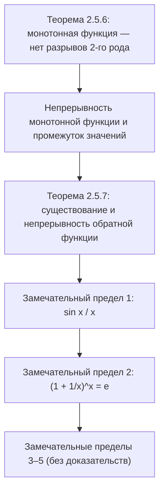

# Лекции 19–20 — Монотонные функции, обратная функция, замечательные пределы

[Указатель лекций](index.md) · [English](../../en/lectures-2025-26/lecture-19-20.md) · [Español](../../es/lectures-2025-26/lecture-19-20.md)

> **Источник:** `ma25_26-lectures_19-20_notes.pdf` — 20 страниц: печатные слайды с текстовым слоем (страницы 1–4, 8, 11, 12, 16, 20), рукописные страницы без текстового слоя (5–7, 9, 10, 13–15, 17–19). Рукописные страницы переписаны по изображению. Номера страниц PDF указаны в заголовках; печатные слайды пронумерованы в PDF как «1/9»–«9/9».
>
> **Примечание редактора.** Дата лекции взята из нижнего колонтитула слайдов («06 ноября 2025»). Доказательства приведены на рукописных страницах только для замечательных пределов 1 и 2; пределы 3–5 даны на слайдах без доказательств. Обозначение $\langle a, b\rangle$ — промежуток любого типа (см. лекции 5–6).

## Печатные слайды 1–3. Вступление

**Цитата дня (слайд 2).** «ТИПИЧНЫЕ МЕТОДЫ ДОКАЗАТЕЛЬСТВА — 2»:

- *Доказательство ссылкой на литературу:* «Непосредственно вытекает из результата, приведённого в [1]. [1] К. А. Който (ред.) Югославское математическое общество. Заседание II. 1925. Сборник рукописей внесекционных докладов. Стр. 17.»
- *Доказательство ссылкой на страницу:* «Обоснование имеется на стр. 478 в [2]. [2] Аут Оф Пейпер. Теория нумераций. М.: Каунтер, 1990. 396 с.»
- *Доказательство ссылкой на:* «Заинтересованный читатель может найти доказательство этого результата на домашней странице Л. Узера: Eror 404 Page not found» (орфография слайда сохранена).

**Цель лекции.** Поговорим о свойствах монотонных функций (разрывы и непрерывность монотонных функций, существование и непрерывность обратной функции). Докажем утверждения о замечательных пределах.

## §5. Непрерывные функции (продолжение): монотонные функции

### Печатный слайд 4 (PDF-стр. 4). О разрывах и непрерывности монотонной функции

**Теорема 2.5.6.** Пусть $f : \langle a, b\rangle \to \mathbb{R}$, $f$ монотонна. Тогда справедливы следующие утверждения:

1. $f$ не может иметь разрывов второго рода.
2. Непрерывность $f$ равносильна тому, что её множество значений — промежуток.

### Рукописные страницы 5–7 (PDF-стр. 5–7). Доказательство теоремы 2.5.6

**Доказательство (теорема 2.5.6).** Пусть (для определённости) $f$ возрастает.

① Пусть $x_0 \in (a, b\rangle$, $x_1 \in (a, x_0)$ (на рукописи — рисунок числовой прямой с точками $a$, $x_1$ (зелёная), $x_0$ (красная), $b$). Тогда $f(x_1) \le f(x) \le f(x_0)$ $\forall x \in (x_1, x_0)$, т.е. $f$ возрастает и ограничена сверху на $\langle a, x_0)$. По теореме о пределе монотонной функции (теорема 2.4.9 из лекции 15) существует конечный предел $f(x_0^-)$, и по теореме о предельном переходе в неравенстве $f(x_1) \le f(x_0^-) \le f(x_0)$.

Аналогично доказывается, что $\forall x_0 \in \langle a, b)$ существует конечный предел $f(x_0^+)$, причём $f(x_0) \le f(x_0^+) \le f(x_2)$ $\forall x_2 \in (x_0, b\rangle$.

② Пусть $f(\langle a, b\rangle)$ — промежуток. Докажем, что $f$ непрерывна слева в любой $x_0 \in (a, b\rangle$ (от противного).

Пусть $f(x_0^-) < f(x_0)$ — существование конечного предела слева уже доказано в ①.

Возьмём $y \in (f(x_0^-), f(x_0))$ $\Rightarrow$ если $a < x_1 < x_0$, то $y \in [f(x_1), f(x_0)]$ $\Rightarrow$ $y \in f(\langle a, b\rangle)$ (подчёркнуто).

С другой стороны, $\begin{cases} \forall x \in \langle a, x_0) : f(x) \le f(x_0^-) < y \\ \forall x \in [x_0, b\rangle : f(x) \ge f(x_0) > y \end{cases} \Rightarrow$ $y$ не значение $f$, т.е. $y \notin f(\langle a, b\rangle)$ (подчёркнуто) — противоречие.

$\Rightarrow$ $f(x_0^-) = f(x_0)$. Аналогично покажем, что $f$ непрерывна справа в точке $x_0$. Итак, мы показали, что $f(\langle a, b\rangle)$ — промежуток $\Rightarrow$ $f$ непрерывна.

Докажем теперь, что $f$ непрерывна $\Rightarrow$ $f(\langle a, b\rangle)$ — промежуток.

Итак, $f \in C\langle a, b\rangle$, $m = \inf\limits_{x \in \langle a,b\rangle} f(x)$, $M = \sup\limits_{x \in \langle a,b\rangle} f(x)$ ($m, M \in \overline{\mathbb{R}}$) $\Rightarrow$ по теореме Больцано–Коши $E := f(\langle a, b\rangle)$ выпукло.

(Зелёным:) **Определение.** Множество $E$ называется **выпуклым**, если вместе с любыми своими двумя точками оно содержит отрезок, их соединяющий. (Рисунки: выпуклая «капля» с отрезком внутри и невыпуклое «сердце», где отрезок между двумя красными точками выходит наружу.)

$\Rightarrow$ $f(\langle a, b\rangle) = \langle m, M\rangle$. $\blacksquare$

### Печатный слайд 8 (PDF-стр. 8). О существовании и непрерывности обратной функции

**Теорема 2.5.7.** Пусть $f \in C\langle a, b\rangle$, $f$ строго монотонна, $m = \inf\limits_{x \in \langle a,b\rangle} f(x)$, $M = \sup\limits_{x \in \langle a,b\rangle} f(x)$. Тогда справедливы следующие утверждения:

1. $f$ обратима, $f^{-1} : \langle m, M\rangle \to \langle a, b\rangle$ — биекция.
2. $f^{-1}$ строго монотонна одновременно с $f$.
3. $f^{-1}$ непрерывна на $\langle m, M\rangle$.

### Рукописные страницы 9–10 (PDF-стр. 9–10). Доказательство теоремы 2.5.7

**Доказательство (теорема 2.5.7).** Пусть (для определённости) $f$ строго возрастает.

① Если $\begin{cases} x_1, x_2 \in \langle a, b\rangle \\ x_1 < x_2 \end{cases} \Rightarrow f(x_1) < f(x_2)$ $\Rightarrow$ существует $f^{-1}$.

По теореме 2.5.6, пункт 2 $\Rightarrow$ $f(\langle a, b\rangle) = \langle m, M\rangle$, и по общим свойствам обратного отображения $\Rightarrow$ $f^{-1}$ — биекция, $f^{-1} : \langle m, M\rangle \to \langle a, b\rangle$.

② Покажем, что $f^{-1}$ строго возрастает.

Если $\begin{cases} y_1, y_2 \in \langle m, M\rangle \\ y_1 < y_2 \end{cases} \Rightarrow \begin{cases} y_1 = f(x_1), & x_1 = f^{-1}(y_1) \\ y_2 = f(x_2), & x_2 = f^{-1}(y_2) \end{cases}$, $x_1, x_2 \in \langle a, b\rangle$ $\Rightarrow$ $f(x_1) < f(x_2)$.

При этом $x_1 < x_2$, т.к. возможность $x_1 \ge x_2$ исключена в силу **строгого** возрастания $f$.

③ $\begin{cases} f^{-1} \text{ возрастает на } \langle m, M\rangle \\ f^{-1}(\langle m, M\rangle) = \langle a, b\rangle \end{cases} \Rightarrow$ по теореме 2.5.6, пункт 2 $\Rightarrow$ $f^{-1}$ непрерывна. $\blacksquare$

### Печатный слайд 11 (PDF-стр. 11). Свойства монотонных функций

1. Множество точек разрыва монотонной функции не более чем счётно.
2. Если функция задана на промежутке, непрерывна и обратима, то она строго монотонна и, следовательно, обратная функция непрерывна.
3. Существует обратимая функция $f : \mathbb{R} \to \mathbb{R}$, непрерывная в точке $0$, но такая, что $f^{-1}$ разрывна в точке $f(0)$.

(На рукописных страницах доказательства этих утверждений не приведены.)

## §6. Замечательные пределы и сравнение функций

### Печатный слайд 12 (PDF-стр. 12). Первый замечательный предел

Замечательными пределами называют пять равенств, часто использующихся при раскрытии неопределённостей.

1. $\lim\limits_{x \to 0} \dfrac{\sin x}{x} = 1$.

**Следствие.** $\lim\limits_{x \to 0} \dfrac{1 - \cos x}{x^2} = \dfrac12$, $\lim\limits_{x \to 0} \dfrac{\operatorname{tg} x}{x} = 1$, $\lim\limits_{x \to 0} \dfrac{\arcsin x}{x} = 1$, $\lim\limits_{x \to 0} \dfrac{\operatorname{arctg} x}{x} = 1$.

### Рукописные страницы 13–15 (PDF-стр. 13–15). Доказательство первого замечательного предела

**Доказательство.** Покажем, что если $0 < x < \dfrac\pi2$, то $\sin x < x < \operatorname{tg} x$.

На рисунке: точка $O$, луч под углом $x$ к отрезку $OA$, $|OA| = 1$, точка $B$ на луче с перпендикуляром $BC$ на $OA$ ($C$ — основание) и точка $D$ — пересечение луча с вертикалью через $A$; красной линией выделен отрезок $BA$, дугой — граница сектора.

$\triangle OAB \subset$ сектор $OAB$ $\subset \triangle OAD$,

$$
\underbrace{S_{\triangle OAB}}_{=\,\frac12 |OA|\cdot|BC|} < \underbrace{S_{\text{сектор } OAB}}_{=\,\frac12 |OA|^2 x} < \underbrace{S_{\triangle OAD}}_{=\,\frac12 |OA|\cdot|AD|}.
$$

$|OA| = 1$, $|BC| = \sin x$, $\dfrac{|AD|}{|OA|} = \operatorname{tg} x$ $\Rightarrow$ $\dfrac12 \sin x < \dfrac12 x < \dfrac12 \operatorname{tg} x$. ✓

Т.к. $0 < x < \dfrac\pi2$, из $0 < \sin x < x < \operatorname{tg} x$ получаем $1 < \dfrac{x}{\sin x} < \dfrac{1}{\cos x}$, т.е. $1 > \dfrac{\sin x}{x} > \cos x$.

Проверим, что $\cos x \xrightarrow[x \to 0]{} 1$: $0 < 1 - \cos x = 2 \sin^2 \dfrac x2 < 2\left(\dfrac x2\right)^2 = \dfrac{x^2}{2} \xrightarrow[x \to 0]{} 0$ $\Rightarrow$ по теореме о двух полицейских $1 - \cos x \xrightarrow[x \to 0]{} 0$.

Тогда из $1 > \dfrac{\sin x}{x} > \cos x$, где обе крайние части стремятся к $1$ при $x \to 0$, по теореме о двух полицейских $\dfrac{\sin x}{x} \xrightarrow[x \to 0]{} 1$. Т.е. мы доказали, что $\lim\limits_{x \to 0^+} \dfrac{\sin x}{x} = 1$.

$x < 0$ $\Rightarrow$ $\dfrac{\sin x}{x} = \dfrac{-\sin x}{-x} = \dfrac{\sin(-x)}{-x} = \dfrac{\sin y}{y} \xrightarrow[y \to 0^+]{} 1$, $y > 0$ (т.е. $y = -x$). $\blacksquare$

### Печатный слайд 16 (PDF-стр. 16). Замечательные пределы-2

2. $\lim\limits_{x \to \infty} \left(1 + \dfrac1x\right)^x = e$.

**Замечание.** Заменяя $x$ на $\dfrac1x$, второй замечательный предел можно записать и так: $\lim\limits_{x \to 0} (1 + x)^{1/x} = e$.

3. $\lim\limits_{x \to 0} \dfrac{\log_a(1 + x)}{x} = \dfrac{1}{\ln a}$, $a > 0$, $a \ne 1$. В частности, $\lim\limits_{x \to 0} \dfrac{\ln(1 + x)}{x} = 1$.

### Рукописные страницы 17–19 (PDF-стр. 17–19). Доказательство второго замечательного предела

**Доказательство: 2.** (В рамке из лекций 11–12:) $e = \lim\limits_{n \to \infty} \left(1 + \dfrac1n\right)^n$.

$f(x) = \left(1 + \dfrac1x\right)^x$, $f : \mathbb{R} \setminus [-1, 0] \to \mathbb{R}$. Возьмём $\{x_n\}$, $x_n \xrightarrow[n \to \infty]{} \infty$, и покажем, что $f(x_n) \xrightarrow[n \to \infty]{} e$.

① Пусть сначала $x_n \in \mathbb{N}$ $\forall n$. $\forall \varepsilon > 0$ $\Rightarrow$ по определению числа $e$ существует $K \in \mathbb{N}$: $\forall k \in \mathbb{N}$, $k > K$ $\Rightarrow$ $|f(k) - e| < \varepsilon$. Но у нас $x_n \xrightarrow[n \to \infty]{} \infty$ (по нашему выбору $\{x_n\}$), а тогда начиная с некоторого номера $x_n > K$ $\Rightarrow$ $|f(x_n) - e| < \varepsilon$.

② $x_n \to +\infty$ $\Rightarrow$ начиная с некоторого номера $x_n \ge 1$ $\Rightarrow$ не умаляя общности, можно считать, что $x_n \ge 1$ $\forall n$. (Далее на рукописи сразу записано неравенство $(\ast)$, получаемое из $[x_n] \le x_n < [x_n] + 1$ монотонностью основания и показателя:)

$$
\left(1 + \frac{1}{[x_n] + 1}\right)^{[x_n]} \le \left(1 + \frac{1}{x_n}\right)^{x_n} \le \left(1 + \frac{1}{[x_n]}\right)^{[x_n] + 1} \tag{$\ast$}
$$

Перепишем $(\ast)$ в виде:

$$
\frac{f([x_n] + 1)}{1 + \dfrac{1}{1 + [x_n]}} \le f(x_n) \le \left(1 + \frac{1}{[x_n]}\right) \underbrace{f([x_n])}_{=\, \left(1 + \frac{1}{[x_n]}\right)^{[x_n]}} \tag{$\ast\ast$}
$$

(зелёным: $f([x_n] + 1) = \left(1 + \dfrac{1}{[x_n] + 1}\right)^{[x_n] + 1}$).

$\{[x_n]\}$, $\{[x_n] + 1\}$ — последовательности натуральных чисел, стремящиеся к $+\infty$ $\Rightarrow$ по ① $f([x_n]) \to e$, $f([x_n] + 1) \to e$.

В $(\ast\ast)$: числитель левой части $\to e$, её знаменатель $1 + \dfrac{1}{1 + [x_n]} \to 1$ (красная стрелка), множитель $\left(1 + \dfrac{1}{[x_n]}\right) \to 1$ (красная стрелка), а $f([x_n]) \xrightarrow[n \to \infty]{} e$ $\Rightarrow$ по теореме о двух полицейских $f(x_n) \to e$ (подчёркнуто бирюзовым).

③ Пусть $x_n \xrightarrow[n \to \infty]{} -\infty$. Тогда $y_n := -x_n$, $y_n \xrightarrow[n \to \infty]{} +\infty$, $y_n - 1 \xrightarrow[n \to \infty]{} +\infty$,

$$
f(x_n) = \left(1 + \frac{1}{-y_n}\right)^{-y_n} = \left(\frac{1 - y_n}{-y_n}\right)^{-y_n} = \left(\frac{y_n - 1}{y_n}\right)^{-y_n} = \left(\frac{y_n}{y_n - 1}\right)^{y_n} = \left(1 + \frac{1}{y_n - 1}\right)^{y_n} = f(y_n - 1)\left(1 + \frac{1}{y_n - 1}\right) \longrightarrow e,
$$

где $f(y_n - 1) \xrightarrow[n \to \infty]{} e$ (зелёная стрелка), а множитель $\left(1 + \dfrac{1}{y_n - 1}\right) \to 1$ (красная стрелка). $\blacksquare$

> **Примечание редактора.** В цепочке для ③ на рукописи промежуточная дробь записана как $\left(\dfrac{1 - y_n}{-y_n}\right)^{-y_n}$; это то же самое, что $\left(\dfrac{y_n - 1}{y_n}\right)^{-y_n}$, поскольку $1 - \dfrac{1}{y_n} = \dfrac{y_n - 1}{y_n}$.

### Печатный слайд 20 (PDF-стр. 20). Замечательные пределы-3

4. $\lim\limits_{x \to 0} \dfrac{(1 + x)^\alpha - 1}{x} = \alpha$, $\alpha \in \mathbb{R}$.

5. $\lim\limits_{x \to 0} \dfrac{a^x - 1}{x} = \ln a$, $a > 0$. В частности, $\lim\limits_{x \to 0} \dfrac{e^x - 1}{x} = 1$.

## Структура лекции

## Служебные страницы

- Страница 1 — титульная; страница 2 — «цитата дня»; страница 3 — цель лекции.
- Доказательство теоремы 2.5.6 занимает PDF-стр. 5 (пункт 1), 6 (пункт 2, «промежуток ⇒ непрерывность») и 7 («непрерывность ⇒ промежуток» и определение выпуклости).
