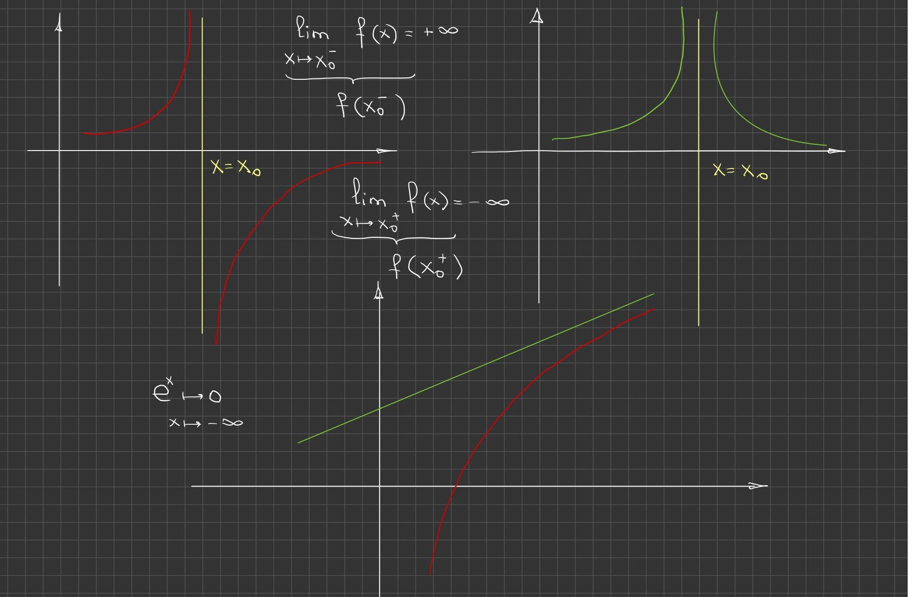
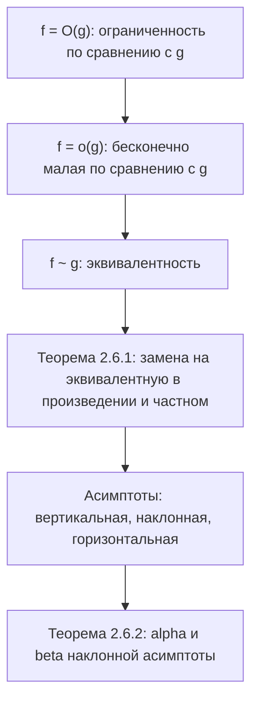

# Лекция 21 — Сравнение функций и асимптоты

[← Лекции 19–20](lecture-19-20.md) · [Указатель лекций](index.md) · [Лекции 22–23 →](lecture-22-23.md) · [Термины и теоремы](../term-index.md) · [English](../../en/lectures-2025-26/lecture-21.md) · [Español](../../es/lectures-2025-26/lecture-21.md)

> **Источник:** `ma25_26_lecture_21_notes.pdf` — 17 страниц: печатные слайды с текстовым слоем (страницы 1–4, 7, 8, 10, 12, 13, 15), рукописные страницы без текстового слоя (5, 6, 9, 11, 14, 16, 17). Рукописные страницы переписаны по изображению. Номера страниц PDF указаны в заголовках; печатные слайды пронумерованы в PDF как «1/10»–«10/10».
>
> **Примечание редактора.** Дата лекции взята из нижнего колонтитула слайдов («13 ноября 2025»). «Цитата дня» на странице 2 та же, что в лекциях 22–23 («Типичные методы доказательства — 3»), и полностью приведена в файле лекций 22–23; здесь она не повторяется.

## Печатные слайды 1–3. Вступление

**Цель лекции.** Обсудим [бесконечно малые](lecture-09-10.md#def-2-2-1) функции и утверждения, с ними связанные. Поговорим об [асимптотах](#thm-2-6-2).

## Глава 2. Теория пределов. §6. Замечательные пределы и сравнение функций (продолжение)

### Печатный слайд 4 (PDF-стр. 4). Бесконечно малые и прочие функции

Пусть $`f, g : D \subset \mathbb{R} \to \mathbb{R}`$, $`x_0`$ — [предельная точка](lecture-14.md#def-2-4-1) $`D`$, и существуют функция $`\varphi : D \to \mathbb{R}`$ и окрестность $`V(x_0)`$ точки $`x_0`$, такие что $`f(x) = \varphi(x) g(x)`$ $`\forall x \in \dot V(x_0) \cap D`$.

1. Если $`\varphi`$ ограничена на $`\dot V(x_0) \cap D`$, то говорят, что функция $`f`$ **ограничена по сравнению с $`g`$** при $`x \to x_0`$, и пишут $`f(x) = O(g(x))`$, $`x \to x_0`$.
2. Если $`\varphi(x) \xrightarrow[x \to x_0]{} 0`$, то говорят, что функция $`f`$ — **бесконечно малая по сравнению с $`g`$** при $`x \to x_0`$, и пишут $`f(x) = o(g(x))`$, $`x \to x_0`$.

### Рукописная страница 5 (PDF-стр. 5). Замечание к 1 и пример

**Замечание к 1 (рукопись).** $`f(x) = O(g(x))`$ при $`x \to x_0`$, если $`\begin{cases} \exists V(x_0) \cap D \\ \exists M \in \mathbb{R} \end{cases}`$ (на рукописи $`M`$ обозначено буквой $`\mu`$): $`\left|\dfrac{f(x)}{g(x)}\right| \le M`$ $`\forall x \in \dot V(x_0) \cap D`$.

**Пример.** $`x^3 - 7x^5 + 100x^{2025} = O(x^3)`$ при $`x \to 0`$:

```math
\frac{f(x)}{g(x)} = \frac{x^3 - 7x^5 + 100x^{2025}}{x^3} = 1 - 7x^2 + 100x^{2022} \xrightarrow[x \to 0]{} 1.
```

Но тогда существует $`V(0)`$: $`\left|\dfrac{f(x)}{g(x)}\right| \le 10`$ $`\forall x \in \dot V(0)`$.

(Зелёным:) $`x^3 - 7x^5 + 100x^{2025} = O(x^{2025})`$ при $`x \to +\infty`$:

```math
\frac{f(x)}{g(x)} = \frac{x^3 - 7x^5 + 100x^{2025}}{x^{2025}} = 100 + \frac{1}{x^{2022}} - \frac{7}{x^{2020}} \xrightarrow[x \to +\infty]{} 100.
```

> **Примечание редактора.** В последнем равенстве на рукописи в знаменателе последнего слагаемого написано $`x^{2025}`$; правильно $`x^{2020}`$ (так как $`2025 - 5 = 2020`$), что и исправлено выше.

### Рукописная страница 6 (PDF-стр. 6). Замечание к 2 и пример

**Замечание к 2 (рукопись).** $`f(x) = o(g(x))`$ при $`x \to x_0`$, если $`\lim\limits_{x \to x_0} \dfrac{f(x)}{g(x)} = 0`$.

**Пример.** $`1 - \cos x = o(x)`$ при $`x \to 0`$:

```math
\lim_{x \to x_0} \frac{f(x)}{g(x)} = \lim_{x \to 0} \frac{1 - \cos x}{x} = \lim_{x \to 0} \frac{2\sin^2\frac x2}{x} = \lim_{x \to 0} \left(\frac{\sin\frac x2}{\frac x2}\right)^2 \cdot \frac x2 = 1 \cdot \lim_{x \to 0} \frac x2 = 0,
```

где использовано $`\cos 2\alpha = 1 - 2\sin^2\alpha`$, т.е. $`2\sin^2\dfrac x2 = 1 - \cos x`$, а множитель $`\left(\dfrac{\sin\frac x2}{\frac x2}\right)^2 \to 1`$ при $`x \to 0`$ (первый замечательный предел; зелёная скобка на рукописи).

### Печатный слайд 7 (PDF-стр. 7). Бесконечно малые и прочие функции-2

3. Если $`\varphi(x) \xrightarrow[x \to x_0]{} 1`$, то говорят, что функции $`f`$ и $`g`$ **эквивалентны** или **асимптотически равны** при $`x \to x_0`$, и пишут $`f(x) \sim g(x)`$, $`x \to x_0`$.

### Печатный слайд 8 (PDF-стр. 8). Замена на эквивалентную при вычислении пределов

<a id="thm-2-6-1"></a>**Теорема 2.6.1.** Пусть $`f, \widetilde f, g, \widetilde g : D \subset \mathbb{R} \to \mathbb{R}`$, $`x_0`$ — предельная точка $`D`$, $`f(x) \sim \widetilde f(x)`$, $`g(x) \sim \widetilde g(x)`$, $`x \to x_0`$. Тогда справедливы следующие утверждения:

1. $`\lim\limits_{x \to x_0} f(x) g(x) = \lim\limits_{x \to x_0} \widetilde f(x) \widetilde g(x)`$.
2. Если $`x_0`$ — предельная точка области определения $`\dfrac{f}{g}`$, то $`\lim\limits_{x \to x_0} \dfrac{f(x)}{g(x)} = \lim\limits_{x \to x_0} \dfrac{\widetilde f(x)}{\widetilde g(x)}`$.

(В обоих утверждениях пределы одновременно существуют или нет и, если существуют, то равны.)

### Рукописная страница 9 (PDF-стр. 9). Доказательство теоремы 2.6.1

**Доказательство ([теорема 2.6.1](#thm-2-6-1)).** Пусть $`\lim\limits_{x \to x_0} \dfrac{f(x)}{g(x)} = A`$. Проверим, что существует $`\lim\limits_{x \to x_0} \dfrac{\widetilde f(x)}{\widetilde g(x)}`$:

```math
\lim_{x \to x_0} \frac{\widetilde f(x)}{\widetilde g(x)} = \lim_{x \to x_0} \frac{\widetilde f(x)}{f(x)} \cdot \frac{f(x)}{g(x)} \cdot \frac{g(x)}{\widetilde g(x)} = \underbrace{\lim_{x \to x_0} \frac{\widetilde f(x)}{f(x)}}_{=\,1,\ \text{т.к. } f \sim \widetilde f} \cdot \lim_{x \to x_0} \frac{f(x)}{g(x)} \cdot \underbrace{\lim_{x \to x_0} \frac{g(x)}{\widetilde g(x)}}_{=\,1,\ \text{т.к. } g \sim \widetilde g} = \lim_{x \to x_0} \frac{f(x)}{g(x)} = A. \quad \blacksquare
```

(На рукописи доказательство проведено для частного; для произведения — аналогично.)

### Печатный слайд 10 (PDF-стр. 10). Замечания

Если $`g(x) \ne 0`$ в $`\dot V(x_0) \cap D`$, то и $`\widetilde g(x) \ne 0`$ в $`\dot{\widetilde V}(x_0) \cap D`$, и обратно. Поэтому точка $`x_0`$ одновременно является или не является предельной для областей определения $`\dfrac{f}{g}`$ и $`\dfrac{\widetilde f}{\widetilde g}`$.

Из условий [теоремы 2.6.1](#thm-2-6-1) **не** следует, что $`\lim\limits_{x \to x_0} (f(x) \pm g(x)) = \lim\limits_{x \to x_0} \left(\widetilde f(x) \pm \widetilde g(x)\right)`$. Другими словами, при отыскании предела множители в произведении и частном заменять на эквивалентные можно, а слагаемые в сумме и разности, вообще говоря, нельзя.

### Рукописная страница 11 (PDF-стр. 11). Пример к замечанию

**Пример (к замечанию).** $`f(x) = x + 1`$, $`\widetilde f(x) = g(x) = \widetilde g(x) = x`$, $`x_0 = +\infty`$:

$`\lim\limits_{x \to x_0} (f(x) - g(x)) = \lim\limits_{x \to +\infty} (x + 1 - x) = 1`$;

$`\lim\limits_{x \to x_0} (\widetilde f(x) - \widetilde g(x)) = \lim\limits_{x \to +\infty} (x - x) = 0`$.

Красным обведено: $`1 \ne 0`$!!!

### Печатный слайд 12 (PDF-стр. 12). Замечания о пределах вида $`f^g`$

Для нахождения [пределов функций](lecture-14.md#def-2-4-4) вида $`f^g`$ ($`f > 0`$) бывает удобным преобразование $`(f(x))^{g(x)} = e^{g(x) \ln f(x)}`$.

### Печатный слайд 13 (PDF-стр. 13). Асимптоты

1. Пусть $`x_0 \in \mathbb{R}`$, функция $`f`$ задана по крайней мере на $`\langle a, x_0)`$ или $`(x_0, b\rangle`$ и действует в $`\mathbb{R}`$. Прямая $`x = x_0`$ называется **вертикальной асимптотой** функции $`f`$, если $`f(x_0^+)`$ или $`f(x_0^-)`$ равны $`-\infty`$ или $`+\infty`$ (в текстовом слое слайда символ $`\infty`$ записан как «1»).
2. Пусть $`\langle a, +\infty) \subset D \subset \mathbb{R}`$, $`f : D \to \mathbb{R}`$, $`\alpha, \beta \in \mathbb{R}`$. Прямая $`y = \alpha x + \beta`$ называется **наклонной асимптотой** функции $`f`$ при $`x \to +\infty`$, если $`f(x) = \alpha x + \beta + o(1)`$, $`x \to +\infty`$. Аналогично определяется наклонная асимптота при $`x \to -\infty`$ функции, заданной по крайней мере на $`(-\infty, b\rangle`$.
3. **Горизонтальная асимптота** — частный случай наклонной при $`\alpha = 0`$. Прямая $`y = \beta`$ — горизонтальная асимптота функции $`f`$ при $`x \to \pm\infty`$ тогда и только тогда, когда $`f(x) \xrightarrow[x \to \pm\infty]{} \beta`$.

### Рукописная страница 14 (PDF-стр. 14). Рисунки асимптот

Три рисунка без подписей осей: слева (красным) — вертикальная асимптота $`x = x_0`$ (жёлтая прямая) с подписями $`\lim\limits_{x \to x_0^-} f(x) = f(x_0^-) = +\infty`$ и $`\lim\limits_{x \to x_0^+} f(x) = f(x_0^+) = -\infty`$; справа вверху (зелёным) — вертикальная асимптота $`x = x_0`$, к которой график уходит в $`+\infty`$ с обеих сторон; внизу — красная кривая, приближающаяся к зелёной наклонной прямой. Слева внизу отдельно записано: $`e^x \xrightarrow[x \to -\infty]{} 0`$ (пример горизонтальной асимптоты $`y = 0`$).



### Печатный слайд 15 (PDF-стр. 15). Уравнение наклонной асимптоты

<a id="thm-2-6-2"></a>**Теорема 2.6.2.** Пусть $`\langle a, +\infty) \subset D \subset \mathbb{R}`$, $`f : D \to \mathbb{R}`$, $`\alpha, \beta \in \mathbb{R}`$. Прямая $`y = \alpha x + \beta`$ — асимптота $`f`$ при $`x \to +\infty`$ тогда и только тогда, когда

```math
\alpha = \lim_{x \to +\infty} \frac{f(x)}{x}, \qquad \beta = \lim_{x \to +\infty} (f(x) - \alpha x).
```

### Рукописная страница 16 (PDF-стр. 16). Доказательство теоремы 2.6.2

**Доказательство ([теорема 2.6.2](#thm-2-6-2)).**

($`\Rightarrow`$) Прямая $`y = \alpha x + \beta`$ — асимптота $`f`$ при $`x \to +\infty`$ $`\Rightarrow`$ (по определению наклонной асимптоты) $`f(x) = \alpha x + \beta + \varphi(x)`$, $`\varphi(x) \xrightarrow[x \to +\infty]{} 0`$.

Поэтому $`\dfrac{f(x)}{x} - \alpha = \dfrac{\beta + \varphi(x)}{x} \xrightarrow[x \to +\infty]{} 0`$, т.е. $`\dfrac{f(x)}{x} \xrightarrow[x \to +\infty]{} \alpha`$; и $`f(x) - \alpha x = \beta + \varphi(x) \xrightarrow[x \to +\infty]{} \beta`$.

($`\Leftarrow`$) $`\begin{cases} \lim\limits_{x \to +\infty} \dfrac{f(x)}{x} = \alpha \\ \lim\limits_{x \to +\infty} (f(x) - \alpha x) = \beta \end{cases} \Rightarrow`$ положим $`\varphi(x) := f(x) - \alpha x - \beta`$ $`\Rightarrow`$ $`\varphi(x) \xrightarrow[x \to +\infty]{} 0`$ $`\Rightarrow`$ $`f(x) = \alpha x + \beta + \varphi(x)`$, где $`\varphi(x) \xrightarrow[x \to +\infty]{} 0`$ $`\Rightarrow`$ по определению $`y = \alpha x + \beta`$ — асимптота $`f`$. $`\blacksquare`$

(На рукописи коэффициенты асимптоты записаны латиницей как $`a`$, $`b`$ вместо $`\alpha`$, $`\beta`$ печатного слайда; здесь сохранены обозначения слайда.)

### Рукописная страница 17 (PDF-стр. 17). Замечание об асимптотических разложениях

**Замечание (рукопись).** Частный случай асимптотических разложений: $`f(x) = f(x_0) + A(x - x_0) + o(x - x_0)`$, $`x \to x_0`$. Изучением таких асимптотических разложений занимается [дифференциальное](lecture-24-25-26.md#def-3-3-1) исчисление (см. лекции 22–23).

## Структура лекции



## Служебные страницы

- Страница 1 — титульная; страница 2 — «цитата дня» (та же, что в лекциях 22–23); страница 3 — цель лекции.
