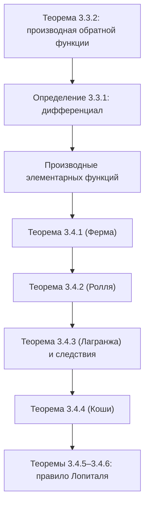

# Лекции 24–26 — Дифференцирование обратной функции, дифференциал, теоремы о среднем и правило Лопиталя

[← Лекции 22–23](lecture-22-23.md) · [Указатель лекций](index.md) · [Лекции 27–28 →](lecture-27-28.md) · [Термины и теоремы](../term-index.md) · [English](../../en/lectures-2025-26/lecture-24-25-26.md) · [Español](../../es/lectures-2025-26/lecture-24-25-26.md)

> **Источник:** `ma25_26-lectures_24-25-26_notes.pdf` — 42 страницы: печатные слайды с текстовым слоем (стр. 1–5, 8, 13–15, 18, 19, 22, 24, 25, 27, 29, 31, 32, 34, 38) и рукописные страницы без текстового слоя (6, 7, 9–12, 16, 17, 20, 21, 23, 26, 28, 30, 33, 35–37, 39–42). Рукописные страницы расшифрованы по изображению. В заголовках указаны номера страниц PDF; печатные слайды пронумерованы в PDF как «1/20»–«20/20».
>
> **Примечание редактора.** Дата лекции взята из подвала слайдов («20 ноября 2025»). Обозначение $`\langle A, B\rangle`$ — промежуток произвольного вида.

## Печатные слайды 1–3. Введение

**Цитата дня (слайд 2).** «Принцип Арнольда: Если какое-то понятие имеет персональное имя, то это — не имя первооткрывателя». (В. И. Арнольд)

**Цель лекции.** Обсудим правило дифференцирования [обратной функции](lecture-01-02.md#def-1-1-8). Введем понятие [дифференциала](#def-3-3-1). Докажем теоремы, связывающие значения функций на концах промежутка со значениями их [производных](lecture-22-23.md#def-3-1-1) в некоторых «средних» точках, лежащих внутри промежутка. Выведем ряд следствий из теорем о среднем. В частности, [правило Лопиталя](#thm-3-4-5), полезное при вычислении пределов.

## Глава 3, §3. Правила дифференцирования (продолжение)

### Печатный слайд 4 (стр. PDF 4). Дифференцирование обратной функции

<a id="thm-3-3-2"></a>**Теорема 3.3.2.** Пусть $`f`$ — строго монотонная непрерывная функция на $`\langle A, B\rangle`$, $`a \in \langle A, B\rangle`$, $`f`$ дифференцируема в точке $`a`$, $`f'(a) \ne 0`$. Тогда обратная к $`f`$ функция $`f^{-1}`$ дифференцируема в точке $`f(a)`$ и

```math
\left(f^{-1}\right)'(f(a)) = \frac{1}{f'(a)}.
```

### Печатный слайд 5 (стр. PDF 5). Геометрический смысл теоремы 3.3.2

Так как график $`f^{-1}`$ получается из графика $`f`$ симметрией относительно прямой $`y = x`$, то

```math
\left(f^{-1}\right)'(f(a)) = \operatorname{tg} \beta = \operatorname{ctg} \alpha = \frac{1}{f'(a)}.
```

На левом рисунке: графики $`y = f(x)`$ и $`y = f^{-1}(x)`$, симметричные относительно пунктирной прямой $`y = x`$, касательные в точках $`a`$ и $`f(a)`$ и углы $`\alpha`$, $`\beta`$. На правом рисунке — случай $`f'(a) = 0`$ (подпись сделана от руки поверх слайда): касательная к графику $`f`$ в точке $`a`$ горизонтальна, а к графику $`f^{-1}`$ в точке $`f(a)`$ — вертикальна.


### Рукописные страницы 6–7 (стр. PDF 6–7). Доказательство теоремы 3.3.2

**Доказательство ([теорема 3.3.2](#thm-3-3-2)).** Пусть $`y = f(x)`$, $`x = f^{-1}(y)`$.

$`y_0 = f(a)`$ $`\Rightarrow`$ $`a = f^{-1}(y_0)`$ (жёлтым). Положим $`f(a + h) =: \widetilde y_0`$.

Если $`h \ne 0`$ $`\Rightarrow`$ $`\widetilde y_0 \ne y_0`$ (приписка: т.к. $`f`$ строго монотонна и $`\exists f^{-1}(y)`$) $`\Rightarrow`$ $`\widetilde y_0 = y_0 + k`$, $`k \ne 0`$.

```math
\frac{f^{-1}(y_0 + k) - f^{-1}(y_0)}{k} = \frac{a + h - a}{\widetilde y_0 - y_0} = \frac{h}{f(a + h) - f(a)}.
```

Если $`k \ne 0`$ $`\Rightarrow`$ $`h \ne 0`$ $`\to`$ можно «перевернуть дробь» (жёлтым):

```math
= \frac{1}{\dfrac{f(a + h) - f(a)}{h}}.
```

«Теперь будем переходить к пределу при $`k \mapsto 0`$» (в рукописи здесь написано $`k \mapsto \infty`$; опечатка). Тогда

```math
\lim_{k \mapsto 0} \frac{f^{-1}(y_0 + k) - f^{-1}(y_0)}{k} = \left(f^{-1}\right)'(y_0) = \left(f^{-1}\right)'(f(a)).
```

С др. стороны,

```math
\lim_{k \mapsto 0} \frac{1}{\dfrac{f(a + h) - f(a)}{h}} = \lim_{h \mapsto 0} \frac{1}{\dfrac{f(a + h) - f(a)}{h}} = \frac{1}{f'(a)}.
```

Приписка со стрелкой к переходу $`k \mapsto 0 \to h \mapsto 0`$: если $`k \mapsto 0`$, то $`h \mapsto 0`$; это следует из непрерывности $`f^{-1}`$, а $`f^{-1}`$ непрерывна, если $`f`$ непрерывна и монотонна. $`\blacksquare`$

### Печатный слайд 6 (стр. PDF 8). Дифференциал

<a id="def-3-3-1"></a>**Определение 3.3.1.** Дифференциалом функции $`f`$ в точке $`x_0`$ называется функция

```math
df(x_0, h) = df(x_0) = f'(x_0) h.
```

### Рукописные страницы 9–12 (стр. PDF 9–12). Производные элементарных функций

**Производные элементарных функций** (заголовок на стр. 9).

① $`f(x) = \sin x`$, $`a \in \mathbb{R}`$:

```math
f'(a) = \lim_{x \mapsto a} \frac{f(x) - f(a)}{x - a} = \lim_{x \mapsto a} \frac{\sin x - \sin a}{x - a} = \lim_{x \mapsto a} \frac{2 \sin\dfrac{x - a}{2} \cos\dfrac{x + a}{2}}{x - a} = \lim_{x \mapsto a} \frac{2 \cdot \dfrac{x - a}{2} \cos\dfrac{x + a}{2}}{x - a},
```

где (жёлтым) a) $`\dfrac{x - a}{2} \xrightarrow[x \mapsto a]{} 0`$ $`\Rightarrow`$ $`\sin\dfrac{x - a}{2} \sim_a \dfrac{x - a}{2}`$; b) $`\lim\limits_{x \mapsto a} \dfrac{2\sin\dfrac{x - a}{2}}{x - a} = \lim\limits_{x \mapsto a} \dfrac{\sin\dfrac{x - a}{2}}{\dfrac{x - a}{2}} = 1`$ (первый замечательный предел). Итого $`= \lim\limits_{x \mapsto a} \cos\dfrac{x + a}{2} = \cos a`$ ✓.

② $`f(x) \equiv 1`$, $`a \in \mathbb{R}`$:

$`f'(a) = \lim\limits_{x \mapsto a} \dfrac{f(x) - f(a)}{x - a} = \lim\limits_{x \mapsto a} \dfrac{1 - 1}{x - a} = \left[\dfrac00\right]`$.

$`f(x) - f(a) = F(x)(x - a)`$ $`\forall x \in \mathbb{R}`$, $`F(a) = f'(a)`$ (третье утверждение критерия [дифференцируемости](lecture-22-23.md#def-3-2-1), [теорема 3.2.1](lecture-22-23.md#thm-3-2-1)).

$`f(x) - f(a) = 1 - 1 = 0`$ $`\Rightarrow`$ $`0 = F(x) \cdot (x - a)`$ $`\forall x \in \mathbb{R}`$ $`\Rightarrow`$ $`F(x) \equiv 0`$ $`\Rightarrow`$ $`f'(a) = 0`$.

③ $`f(x) = b^x`$ ($`b > 0`$), $`a \in \mathbb{R}`$:

```math
f'(a) = \lim_{x \mapsto a} \frac{b^x - b^a}{x - a} = \lim_{x \mapsto a} \frac{b^a (b^{x - a} - 1)}{x - a} = b^a \lim_{x \mapsto a} \frac{b^{x - a} - 1}{x - a} = b^a \ln b,
```

где под последним пределом подписано $`\ln b`$; сбоку жёлтым: $`\lim\limits_{y \to 0} \dfrac{b^y - 1}{y} = \ln b`$ (пятый замечательный предел).

④ $`f(x) = x^{\alpha}`$, $`\alpha \ne 0`$:

a) $`\alpha \in \mathbb{N}`$ $`\Rightarrow`$ $`f'(x)`$ определена на $`\mathbb{R}`$. В случае $`\alpha = 1`$ мы считаем $`x^{\alpha - 1} = 1`$ даже при $`x = 0`$, т.е. $`x' \equiv 1`$.

b) $`\alpha \in \mathbb{Z} \setminus \mathbb{N}`$. Тогда $`f'`$ определена на $`\mathbb{R} \setminus \{0\}`$.

c) $`\alpha = \dfrac{m}{2n + 1}`$, $`m \in \mathbb{Z}`$, $`n \in \mathbb{N}`$ $`\Rightarrow`$ если $`\alpha > 1`$, $`f'`$ определена на $`\mathbb{R}`$; если $`\alpha < 1`$, то $`f'`$ определена на $`\mathbb{R} \setminus \{0\}`$.

d) $`\alpha \in \mathbb{R} \setminus \mathbb{Q}`$ или $`\alpha = \dfrac{2m + 1}{2n}`$, $`m \in \mathbb{Z}`$, $`n \in \mathbb{N}`$ $`\Rightarrow`$ при $`\alpha > 1`$ $`f'`$ определена на $`[0; +\infty)`$; при $`\alpha < 1`$ — на $`(0; +\infty)`$.

```math
f'(a) = \lim_{x \mapsto a} \frac{x^{\alpha} - a^{\alpha}}{x - a} = a^{\alpha} \lim_{x \mapsto a} \frac{\left(\dfrac xa\right)^{\alpha} - 1}{x - a} = a^{\alpha} \lim_{x \mapsto a} \frac{\alpha\left(\dfrac xa - 1\right)}{x - a} = \alpha a^{\alpha - 1},
```

если $`\alpha \in \mathbb{R} \setminus \{0\}`$ в случаях a)–c), при $`a > 0`$ в случае d) (здесь использовано, что $`(1 + t)^{\alpha} - 1 \sim \alpha t`$ при $`t \to 0`$ — четвёртый замечательный предел).

Если $`a = 0`$: при $`\alpha < 0`$ не определено $`f(0)`$ $`\Rightarrow`$ не определено $`f'(0)`$;

```math
\alpha > 0 \Rightarrow f'(0) = \lim_{x \mapsto 0} \frac{f(x) - f(0)}{x} = \lim_{x \mapsto 0} \frac{x^{\alpha}}{x} = \lim_{x \mapsto 0} x^{\alpha - 1} = \begin{cases} 0, & \alpha > 1, \\ 1, & \alpha = 1, \\ \infty, & \alpha \in (0, 1). \end{cases}
```

## Глава 3, §4. Теоремы о среднем и их приложения

### Печатный слайд 7 (стр. PDF 13). Введение в §4

Докажем вначале необходимое условие того, что в заданной [внутренней точке](lecture-57-58.md#def-5-3-3) промежутка функция достигает своего наибольшего или наименьшего значения. Этот факт будет использоваться в дальнейшем как при доказательстве теорем о среднем, так и при изучении [локальных экстремумов](lecture-29-30.md#def-3-7-1).

### Печатный слайд 8 (стр. PDF 14). Теорема П. Ферма

<a id="thm-3-4-1"></a>**Теорема 3.4.1.** Пусть $`a \in (A, B)`$, $`f : \langle A, B\rangle \to \mathbb{R}`$ — дифференцируемая в точке $`a`$ функция. Если $`f(a) = \max\limits_{\langle A, B\rangle} f`$ или $`f(a) = \min\limits_{\langle A, B\rangle} f`$, то $`f'(a) = 0`$.

### Печатный слайд 9 (стр. PDF 15). Геометрический смысл теоремы Ферма

(Рукописная приписка вверху слайда:) Например, $`f(x) = x`$ на $`[0, 1]`$, то утв. [теоремы 3.4.1](#thm-3-4-1) неверно, т.к. $`\max\limits_{x \in [0,1]} f(x) = f(1) = 1`$, но $`f'(1) = 1 \ne 0`$.

- В условиях [теоремы 3.4.1](#thm-3-4-1) существенно, что точка $`a`$ лежит **внутри** промежутка.
- Геометрический смысл [теоремы Ферма](#thm-3-4-1) состоит в том, что в точке $`a`$ касательная к графику функции горизонтальна (на рисунках: максимум и минимум во внутренней точке $`a`$ с горизонтальными касательными).


### Рукописная страница 16 (стр. PDF 16). Доказательство теоремы Ферма

**Доказательство ([теорема 3.4.1](#thm-3-4-1)).** Пусть для определенности $`f(a) = \max\limits_{x \in \langle A, B\rangle} f`$ $`\Rightarrow`$ $`f(x) - f(a) \le 0`$ $`\forall x \in \langle A, B\rangle`$.

Если $`x > a`$, то $`\dfrac{f(x) - f(a)}{x - a} \le 0`$ $`\Rightarrow`$ $`f'_+(a) = \lim\limits_{x \mapsto a^+} \dfrac{f(x) - f(a)}{x - a} \le 0`$.

Если $`x < a`$, то $`\dfrac{f(x) - f(a)}{x - a} \ge 0`$ $`\Rightarrow`$ $`f'_-(a) = \lim\limits_{x \mapsto a^-} \dfrac{f(x) - f(a)}{x - a} \ge 0`$.

(Жёлтым:) Но! По условию теоремы $`f`$ дифференцируема в т. $`a`$ $`\Rightarrow`$ $`f'(a) = f'_+(a) = f'_-(a)`$ $`\Rightarrow`$ $`f'(a) = f'_+(a) \ge 0`$ и $`f'(a) = f'_-(a) \le 0`$ $`\Rightarrow`$ $`f'(a) = 0`$. $`\blacksquare`$

> **Примечание редактора.** В последней строке рукописи знаки при [односторонних производных](../06-derivatives.md#sec-6-1) переставлены относительно строк выше (правильно: $`f'_+(a) \le 0`$ и $`f'_-(a) \ge 0`$); вывод $`f'(a) = 0`$ от этого не меняется.

### Рукописная страница 17 (стр. PDF 17). Замечание: теорема Ферма не достаточна

**Замечание (рукописное).** Теорема Ферма не явл. достаточным (подчёркнуто зелёным) условием экстремума.

**Пример.** $`f(x) = x^3`$, $`f'(x) = 3x^2`$, $`f : \mathbb{R} \mapsto \mathbb{R}`$, $`f'(0) = 0`$. (Красным:) Но $`x = 0`$ — внутренняя точка, не является точкой экстремума (рядом красный график $`x^3`$ с отмеченной точкой $`0`$).


(Зелёным:) $`f'(a) = 0`$ $`\Rightarrow`$ точка $`a`$ м/б (может быть) как точкой экстремума, так и нет.

### Печатный слайд 10 (стр. PDF 18). Теорема М. Ролля

<a id="def-3-4-1"></a>**Определение 3.4.1.** Функция $`f : \langle A, B\rangle \to \mathbb{R}`$ называется дифференцируемой на $`\langle A, B\rangle`$, если она дифференцируема в любой точке промежутка $`\langle A, B\rangle`$.

<a id="thm-3-4-2"></a>**Теорема 3.4.2.** Пусть функция $`f`$ непрерывна на $`[A, B]`$ и дифференцируема на $`(A, B)`$. Если $`f(A) = f(B)`$, то существует точка $`c \in (A, B)`$, для которой $`f'(c) = 0`$.

### Печатный слайд 11 (стр. PDF 19). Замечания к теореме Ролля

- Геометрический смысл [теоремы 3.4.2](#thm-3-4-2) также заключается в том, что касательная к графику $`f`$ в точке $`c`$ горизонтальна.
- Утверждение [теоремы 3.4.2](#thm-3-4-2) может быть неверным, если $`f`$ не дифференцируема в некоторой точке $`(A, B)`$ или разрывна на одном из концов $`[A, B]`$ (на рисунках: «домик» с изломом в вершине и наклонный отрезок с разрывом в точке $`B`$).


### Рукописные страницы 20–21 (стр. PDF 20–21). Доказательство теоремы Ролля и замечание

**Доказательство ([теорема 3.4.2](#thm-3-4-2)).** По условию теоремы $`f`$ — непрерывна на $`[A, B]`$ $`\Rightarrow`$ по теореме Вейерштрасса $`\exists a, b \in [A, B]`$: $`f(a) = \min\limits_{[A, B]} f`$, $`f(b) = \max\limits_{[A, B]} f`$.

① Пусть $`a`$ и $`b`$ — это концевые точки $`[A, B]`$. $`f(A) = f(B)`$ — по условию $`\Rightarrow`$ $`f`$ — постоянна на $`[A, B]`$ $`\Rightarrow`$ $`f'(c) = 0`$ $`\forall c \in (A, B)`$.

② Пусть теперь $`a`$ или $`b`$ лежит в $`(A, B)`$ $`\Rightarrow`$ по теореме Ферма $`\Rightarrow`$ либо $`f'(a) = 0`$, либо $`f'(b) = 0`$. $`\blacksquare`$

**Замечание (рукописное, стр. 20–21).** $`f'(a) = \lim\limits_{x \mapsto a} \dfrac{f(x) - f(a)}{x - a}`$ — это означает, что $`\dfrac{f(x) - f(a)}{x - a} \approx f'(a)`$ при $`x`$ близких к $`a`$. У этого соотношения есть глобальный аналог: даже при **фиксированном** (подчёркнуто зелёным) $`x`$ разностное отношение $`\dfrac{f(x) - f(a)}{x - a}`$ есть производная $`f`$, но не в точке $`a`$, а в некоторой «средней» точке, лежащей между $`a`$ и $`x`$.

### Печатный слайд 12 (стр. PDF 22). Теорема Ж.-Л. Лагранжа

<a id="thm-3-4-3"></a>**Теорема 3.4.3.** Пусть функция $`f`$ непрерывна на $`[A, B]`$ и дифференцируема на $`(A, B)`$. Тогда существует точка $`c \in (A, B)`$, для которой

```math
\frac{f(B) - f(A)}{B - A} = f'(c).
```

### Рукописная страница 23 (стр. PDF 23). Доказательство теоремы Лагранжа

**Доказательство ([теорема 3.4.3](#thm-3-4-3)).** Рассмотрим функцию $`g(x) = f(x) - \dfrac{f(B) - f(A)}{B - A}(x - A)`$.

$`g(A) = f(A) - \dfrac{f(B) - f(A)}{B - A} \cdot (A - A) = f(A)`$;

$`g(B) = f(B) - \dfrac{f(B) - f(A)}{B - A} \cdot (B - A) = f(A)`$.

Итак, $`\begin{cases} g \text{ — непрерывна на } [A, B] \\ g \text{ — дифференцируема на } (A, B) \\ g(A) = g(B) \end{cases} \Rightarrow`$ по [теореме Ролля](#thm-3-4-2) $`\exists c \in (A, B)`$: $`g'(c) = 0`$.

$`g'(c) = f'(c) - \dfrac{f(B) - f(A)}{B - A} = 0`$. $`\blacksquare`$

### Печатный слайд 13 (стр. PDF 24). Геометрический смысл теоремы Лагранжа

Геометрический смысл [теоремы Лагранжа](#thm-3-4-3) таков: в некоторой точке $`c \in (A, B)`$ касательная к графику $`f`$ параллельна хорде, соединяющей концы графика $`f`$ (на рисунке отмечены равные углы наклона хорды и касательной).


### Печатный слайд 14 (стр. PDF 25). Замечания к теореме Лагранжа

1. Точка $`c`$, вообще говоря, не единственна.
2. Теорема Ролля является частным случаем теоремы Лагранжа.
3. Утверждение теоремы Лагранжа можно записать в виде $`f(B) - f(A) = f'(c)(B - A)`$. Это равенство называют **формулой конечных приращений**, поскольку оно выражает приращение функции $`f`$ на отрезке $`[A, B]`$ через приращение ее аргумента.
4. Теорему Лагранжа часто используют в следующей симметричной форме: существует такое $`\theta \in (0, 1)`$, что $`\dfrac{f(B) - f(A)}{B - A} = f'(A + \theta(B - A))`$.

### Рукописная страница 26 (стр. PDF 26). К замечанию 4

Для док-ва 4 (в рамке) достаточно положить $`\theta = \dfrac{c - A}{B - A}`$, где $`c`$ — точка из утверждения теоремы Лагранжа: $`A + \dfrac{c - A}{B - A} \cdot (B - A) = c`$.

Преимущество записи из 4 состоит в том, что она справедлива и для функций, заданных на $`[B, A]`$ при $`B < A`$. Действительно, точка $`A + \theta(B - A)`$ лежит между $`A`$ и $`B`$ при **любых** (подчёркнуто) $`A`$ и $`B`$ ($`A \ne B`$), а $`\dfrac{f(B) - f(A)}{B - A}`$ не меняется при перестановке $`A`$ и $`B`$.

### Печатный слайд 15 (стр. PDF 27). Оценка конечных приращений

<a id="cor-3-4-1"></a>**Следствие 3.4.1.** Пусть функция $`f`$ непрерывна на $`[A, B]`$ и дифференцируема на $`(A, B)`$. Если существуют $`m, M \in \mathbb{R}`$: $`m \le f'(x) \le M`$ $`\forall x \in (A, B)`$, то

```math
m(B - A) \le f(B) - f(A) \le M(B - A).
```

В частности, если $`|f'(x)| \le M`$ при всех $`x \in (A, B)`$, то $`|f(B) - f(A)| \le M(B - A)`$.

### Рукописная страница 28 (стр. PDF 28). Доказательство следствия 3.4.1

**Доказательство ([следствие 3.4.1](#cor-3-4-1)).** По формуле конечных приращений $`f(B) - f(A) = f'(c)(B - A)`$, где

```math
\left. \begin{aligned} m &\le f'(x) \le M \quad \forall x \in (A, B) \\ c &\in (A, B) \end{aligned} \right\} \Rightarrow m \le f'(c) \le M. \qquad \blacksquare
```

### Печатный слайд 16 (стр. PDF 29). О равномерной непрерывности

<a id="cor-3-4-2"></a>**Следствие 3.4.2.** Пусть $`f`$ дифференцируема на $`\langle A, B\rangle`$ и существует такое $`M > 0`$, что $`|f'(x)| \le M`$ $`\forall x \in \langle A, B\rangle`$. Тогда $`f`$ равномерно непрерывна на $`\langle A, B\rangle`$.

### Рукописная страница 30 (стр. PDF 30). Доказательство следствия 3.4.2

**Доказательство ([следствие 3.4.2](#cor-3-4-2)).** $`\forall \varepsilon > 0`$ (подчёркнуто зелёным) положим $`\delta = \dfrac{\varepsilon}{M}`$ (подчёркнуто зелёным).

Если $`x, y \in \langle A, B\rangle`$ и $`|x - y| < \delta`$ (подчёркнуто зелёным) $`\Rightarrow`$ в силу [следствия 3.4.1](#cor-3-4-1) $`\Rightarrow`$ $`|f(x) - f(y)| \le M |x - y| < M \cdot \delta = \varepsilon`$ (части подчёркнуты зелёным). $`\blacksquare`$

### Печатный слайд 17 (стр. PDF 31). Теорема О. Коши

<a id="thm-3-4-4"></a>**Теорема 3.4.4.** Пусть функции $`f`$ и $`g`$ непрерывны на $`[A, B]`$ и дифференцируемы на $`(A, B)`$. Предположим, что $`g'(x) \ne 0`$ $`\forall x \in (A, B)`$. Тогда существует точка $`c \in (A, B)`$, для которой

```math
\frac{f(B) - f(A)}{g(B) - g(A)} = \frac{f'(c)}{g'(c)}.
```

### Печатный слайд 18 (стр. PDF 32). Замечания к теореме Коши

1. Теорема Лагранжа получается из теоремы Коши, если взять $`g(x) = x`$.
2. В условиях [теоремы 3.4.4](#thm-3-4-4) значения функции $`g`$ в точках $`A`$ и $`B`$ различны, иначе по теореме Ролля нашлась бы точка $`a \in (A, B)`$, в которой $`g'(a) = 0`$.
3. Утверждение теоремы Коши можно записать в симметричной форме: существует такое $`\theta \in (0, 1)`$, что

```math
\frac{f(B) - f(A)}{g(B) - g(A)} = \frac{f'(A + \theta(B - A))}{g'(A + \theta(B - A))}.
```

### Рукописная страница 33 (стр. PDF 33). Доказательство теоремы Коши

**Доказательство ([теорема 3.4.4](#thm-3-4-4)).** Положим $`h(x) = f(x) - \dfrac{f(B) - f(A)}{g(B) - g(A)} (g(x) - g(A))`$.

$`h(A) = h(B) = f(A)`$ $`\Rightarrow`$ по теореме Ролля $`\exists c \in (A, B)`$: $`h'(c) = 0`$.

$`h'(c) = f'(c) - \dfrac{f(B) - f(A)}{g(B) - g(A)} \cdot g'(c) = 0`$ $`\Rightarrow`$ $`f'(c) = \dfrac{f(B) - f(A)}{g(B) - g(A)} \cdot g'(c)`$. $`\blacksquare`$

### Печатный слайд 19 (стр. PDF 34). Правило Лопиталя для б.м. функций $`\left[\frac00\right]`$

<a id="thm-3-4-5"></a>**Теорема 3.4.5.** Пусть $`-\infty \le a < b \le +\infty`$, пусть функции $`f`$ и $`g`$ дифференцируемы на $`(a, b)`$, $`g'(x) \ne 0`$ $`\forall x \in (a, b)`$. Предположим, что

1. $`f(x) \xrightarrow[x \to a]{} 0`$ и $`g(x) \xrightarrow[x \to a]{} 0`$;
2. Предел $`\lim\limits_{x \to a} \dfrac{f'(x)}{g'(x)}`$ существует и равен $`L \in \overline{\mathbb{R}}`$.

Тогда $`\lim\limits_{x \to a} \dfrac{f(x)}{g(x)}`$ также существует и равен $`L`$.

**Замечание.** В данной формулировке правило Лопиталя служит для нахождения правостороннего предела.

### Рукописные страницы 35–37 (стр. PDF 35–37). Доказательство теоремы 3.4.5

**Доказательство ([теорема 3.4.5](#thm-3-4-5)).** Рассмотрим 2 случая: $`a \in \mathbb{R}`$ и $`a = -\infty`$.

① $`a \in \mathbb{R}`$. Доопределим $`f`$ и $`g`$ нулём в точке $`a`$ $`\Rightarrow`$ $`f`$ и $`g`$ станут непрерывными функциями на $`[a, b)`$.

Пусть $`x \in (a, b)`$ (зелёной стрелкой указан заштрихованный отрезок $`[a, x]`$ на числовой прямой с точками $`a`$, $`x`$, $`b`$). Тогда $`\exists c(x) \in (a, x) \subset (a, b)`$ такое, что (по теореме Коши на $`[a, x]`$, зелёным; причём $`g(x) \ne 0`$)

```math
\frac{f(x)}{g(x)} = \frac{f(x) - f(a)}{g(x) - g(a)} = \frac{f'(c(x))}{g'(c(x))}.
```

Так как $`a < c(x) < x`$ и при $`x \mapsto a`$ оба конца стремятся к $`a`$ (стрелки вниз), то $`\lim\limits_{x \mapsto a} c(x) = a`$ и $`c(x) \ne a`$ при $`x \ne a`$.

По теореме о пределе композиции

```math
\lim_{x \mapsto a} \frac{f(x)}{g(x)} = \lim_{x \mapsto a} \frac{f'(c(x))}{g'(c(x))} = \lim_{x \mapsto a} \left(\frac{f'}{g'} \circ c\right)(x) = L,
```

где (зелёным) $`\dfrac{f'}{g'}(c(x)) = \dfrac{f'}{g'} \circ c`$.

② $`a = -\infty`$. В силу локальности можно считать, что $`b \in \mathbb{R}`$. Функции $`\varphi(t) = f(\ln t)`$, $`\psi(t) = g(\ln t)`$ определены и дифференцируемы на $`(0, e^b)`$ (жёлтым: $`t \in (0, e^b)`$ $`\Rightarrow`$ $`\ln t \in (-\infty, b) = (a, b)`$, где $`-\infty`$ подписано как $`a`$).

Причём, $`\varphi'(t) = f'(\ln t) \cdot \dfrac1t`$, $`\psi'(t) = g'(\ln t) \cdot \dfrac1t`$. Отсюда $`\psi'(t) \ne 0`$ $`\forall t \in (0, e^b)`$.

По теореме о пределе композиции $`\dfrac{\varphi'(t)}{\psi'(t)} = \left(\dfrac{f'}{g'}\right)(\ln t) \mapsto L`$ при $`t \mapsto 0^+`$.

Так как $`\varphi(t) \mapsto 0`$, $`\psi(t) \mapsto 0`$ при $`t \mapsto 0^+`$, то функции $`\varphi`$ и $`\psi`$ удовлетворяют условию [теоремы 3.4.5](#thm-3-4-5), которая для промежутка $`\langle 0, e^b\rangle`$ уже доказана. Применяя ее, получим (жёлтой стрелкой замкнуто на $`L`$ выше)

```math
\lim_{x \mapsto -\infty} \frac{f(x)}{g(x)} = \lim_{t \mapsto 0^+} \frac{\varphi(t)}{\psi(t)} = \lim_{t \mapsto 0^+} \frac{\varphi'(t)}{\psi'(t)} = L.
```

(Жёлтым:) Заметим также, что $`g(\ln t) = \psi(t) \ne 0`$ $`\forall t \in (0, e^b)`$ $`\Rightarrow`$ $`g(x) \ne 0`$ $`\forall x \in (a, b)`$. $`\blacksquare`$

### Печатный слайд 20 (стр. PDF 38). Правило Лопиталя для б.б. функций $`\left[\frac\infty\infty\right]`$

<a id="thm-3-4-6"></a>**Теорема 3.4.6.** Пусть $`-\infty \le a < b \le +\infty`$, пусть функции $`f`$ и $`g`$ дифференцируемы на $`(a, b)`$, $`g'(x) \ne 0`$ $`\forall x \in (a, b)`$. Предположим, что

1. $`\lim\limits_{x \to a} g(x) = \infty`$;
2. Предел $`\lim\limits_{x \to a} \dfrac{f'(x)}{g'(x)}`$ существует и равен $`L \in \overline{\mathbb{R}}`$.

Тогда $`\lim\limits_{x \to a} \dfrac{f(x)}{g(x)}`$ также существует и равен $`L`$.

### Рукописные страницы 39–42 (стр. PDF 39–42). Доказательство теоремы 3.4.6, замечание и пример

**Доказательство ([теорема 3.4.6](#thm-3-4-6)).** Мы рассмотрим только случай $`L \in \mathbb{R}`$. Случаи $`L = \pm\infty`$ — упр.!

① Пусть сначала $`L = 0`$. Возьмем $`\varepsilon > 0`$ (подчёркнуто бирюзовым; рядом схема числовой прямой: $`(a`$, красным отрезок $`[x]`$ с крестиком $`x`$, жёлтая точка $`y`$, $`\sigma`$, $`b`$).

Т.к. $`\lim\limits_{x \mapsto a} \dfrac{f'(x)}{g'(x)} = L = 0`$, то $`\exists \sigma \in (a, b)`$ (подчёркнуто бирюзовым) такое, что $`\left|\dfrac{f'(t)}{g'(t)}\right| < \dfrac{\varepsilon}{2}`$ $`\forall t \in (a, \sigma)`$.

(Зелёным:) Фиксируем $`y \in (a, \sigma)`$ (подчёркнуто бирюзовым) и пусть $`x \in (a, y)`$. По теореме Коши $`\exists t^* \in (x, y)`$ такое, что

```math
\frac{f(x) - f(y)}{g(x) - g(y)} = \frac{f'(t^*)}{g'(t^*)} \Rightarrow \left|\frac{f(x) - f(y)}{g(x) - g(y)}\right| < \frac{\varepsilon}{2} \quad \text{(подчёркнуто жёлтым).}
```

Заметим, что $`\lim\limits_{x \mapsto a} \dfrac{g(x) - g(y)}{g(x)} = 1`$ и $`\lim\limits_{x \mapsto a} \dfrac{f(y)}{g(x)} = 0`$, поскольку $`\lim\limits_{x \mapsto a} g(x) = \infty`$, а точка $`y`$ — фиксирована (в рукописи на стр. 39 во втором пределе в числителе стоит $`f(x)`$; по смыслу и по стр. 40 должно быть $`f(y)`$).

Поэтому (стр. 40) $`\exists \delta \in (a, y)`$ (подчёркнуто бирюзовым), что

```math
0 < \frac{g(x) - g(y)}{g(x)} < \frac32 \ \text{(подчёркнуто красным)} \quad \text{и} \quad \left|\frac{f(y)}{g(x)}\right| < \frac{\varepsilon}{4} \ \text{(подчёркнуто зелёным)} \qquad \forall x \in (a, b)
```

(в рукописи область на стр. 40 записана как $`(a, b)`$; далее берётся $`x \in (a, \delta)`$).

Тогда $`\forall x \in (a, \delta)`$ (подчёркнуто бирюзовым)

```math
\left|\frac{f(x)}{g(x)}\right| = \left|\frac{f(x) - f(y)}{g(x) - g(y)} \cdot \frac{g(x) - g(y)}{g(x)} + \frac{f(y)}{g(x)}\right| \le \left|\frac{f(x) - f(y)}{g(x) - g(y)}\right| \cdot \left|\frac{g(x) - g(y)}{g(x)}\right| + \left|\frac{f(y)}{g(x)}\right| < \frac{\varepsilon}{2} \cdot \frac32 + \frac{\varepsilon}{4} = \varepsilon,
```

где под скобками подписано: $`< \dfrac{\varepsilon}{2}`$ (жёлтая скобка), $`< \dfrac32`$ (красная скобка), $`< \dfrac{\varepsilon}{4}`$ (зелёная скобка).

А это и означает, что $`\lim\limits_{x \mapsto a} \dfrac{f(x)}{g(x)} = 0 = L`$.

② (стр. 41) Пусть теперь $`L`$ — произвольное вещественное число $`\ne 0`$. Положим $`h(x) = f(x) - Lg(x)`$. Тогда $`\lim\limits_{x \mapsto a} \dfrac{h'(x)}{g'(x)} = \lim\limits_{x \mapsto a} \left(\dfrac{f'(x)}{g'(x)} - L\right) = 0`$, и уже по доказанному пункту ① имеем

```math
\lim_{x \mapsto a} \left(\frac{f(x)}{g(x)} - L\right) = \lim_{x \mapsto a} \left(\frac{f(x) - Lg(x)}{g(x)}\right) = \lim_{x \mapsto a} \frac{h(x)}{g(x)} = 0. \qquad \blacksquare
```

**Замечание (рукописное, жёлтым).** Обратить утверждения [теорем 3.4.5](#thm-3-4-5) и [3.4.6](#thm-3-4-6) нельзя!

**Пример (стр. 42).** $`f(t) = t + \sin t`$, $`g(t) = t`$. Тогда $`\lim\limits_{t \mapsto +\infty} \dfrac{f(t)}{g(t)} = \lim\limits_{t \mapsto +\infty} \left(1 + \dfrac{\sin t}{t}\right) = 1`$. Но! $`\dfrac{f'(t)}{g'(t)} = \dfrac{1 + \cos t}{1} = 1 + \cos t`$ не имеет предела при $`t \mapsto +\infty`$.

Под примером — рисунок: катящееся вправо колесо («$`\to`$ с $`v = 1`$»), на ободе красным отмечена точка $`f(t)`$, точка касания с землёй подписана $`g(t)`$ (физическая интерпретация: точка на ободе колеса).


## Структура лекции



## Служебные страницы

- Стр. 1 — титульная; стр. 2 — цитата дня; стр. 3 — цель лекции.
- Производные элементарных функций: стр. 9 (① sin), стр. 10 (② константа, ③ показательная), стр. 11–12 (④ степенная).
