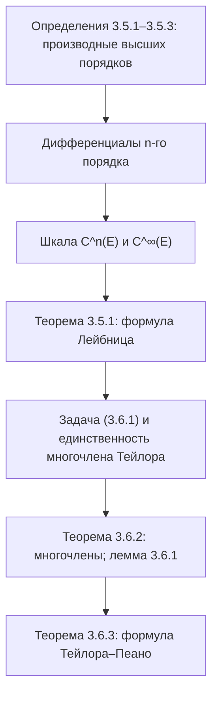

# Лекции 27–28 — Производные высших порядков и формула Тейлора

[← Лекции 24–26](lecture-24-25-26.md) · [Указатель лекций](index.md) · [Лекции 29–30 →](lecture-29-30.md) · [Термины и теоремы](../term-index.md) · [English](../../en/lectures-2025-26/lecture-27-28.md) · [Español](../../es/lectures-2025-26/lecture-27-28.md)

> **Источник:** `ma25_26-lectures_27-28_notes.pdf` — 31 страница: печатные слайды с текстовым слоем (стр. 1–12, 14, 16–18, 21–23, 26, 29, 31) и рукописные страницы без текстового слоя (13, 15, 19, 20, 24, 25, 27, 28, 30). Рукописные страницы расшифрованы по изображению. В заголовках указаны номера страниц PDF; печатные слайды пронумерованы в PDF как «1/22»–«22/22».
>
> **Примечание редактора.** Дата лекции взята из подвала слайдов («04 декабря 2025»).

## Печатные слайды 1–3. Введение

**Цитата дня (слайд 2).** «— Как мне понять, что он [~~научный руководитель~~ дракон] выбрал меня? — Он попытается тебя убить». (Аватар). Слово «научный руководитель» на слайде зачёркнуто; под цитатой — фото дракона в очках за ноутбуком и кадр с икраном из «Аватара».


**Цель лекции.** Введем понятие [производной](lecture-22-23.md#def-3-1-1) произвольного порядка. Обсудим [формулу Тейлора](#thm-3-6-3).

## Глава 3, §5. Производные высших порядков

### Печатный слайд 4 (стр. PDF 4). Множество дифференцируемости

До сих пор мы говорили про первую производную функции. Введем теперь понятие производной произвольного порядка.

Пусть $`E \subset \mathbb{R}`$, $`f : E \to \mathbb{R}`$, $`a \in \mathbb{R}`$ и выполнено условие

```math
\exists \delta > 0 : (a - \delta, a + \delta) \cap E \text{ — невырожденный промежуток} \tag{5.1}
```

<a id="def-3-5-1"></a>**Определение 3.5.1.** Определим $`E_1`$ как множество точек $`E`$, удовлетворяющих условию (5.1), в которых функция $`f`$ дифференцируема. Мы будем называть $`E_1`$ множеством дифференцируемости $`f`$, а функцию $`x \mapsto f'(x)`$, определенную на $`E_1`$, производной $`f`$.

### Печатный слайд 5 (стр. PDF 5). Вторая производная $`f`$

Обозначим через $`E_2`$ множество всех точек $`a \in E_1`$ таких, что

1. $`\exists \delta > 0 : E_1 \cap (a - \delta, a + \delta) = E \cap (a - \delta, a + \delta)`$;
2. Функция $`f'`$ [дифференцируема](lecture-22-23.md#def-3-2-1) в точке $`a`$.

<a id="def-3-5-2"></a>**Определение 3.5.2.** Пусть $`a \in E_2`$. Число $`(f')'(a)`$ называется второй производной $`f`$ в точке $`a`$ и обозначается $`f''(a)`$, а функция $`f`$ называется дважды дифференцируемой в точке $`a`$. Функция $`f''`$, определенная на $`E_2`$ соотношением $`x \mapsto f''(x)`$, называется второй производной $`f`$.

Другие обозначения на слайде: $`f^{(2)}(a)`$, $`\dfrac{d^2 f}{dx^2}(a)`$, $`D^2 f(a)`$.

### Печатный слайд 6 (стр. PDF 6). $`n`$-ая производная $`f`$

Предположим, что мы уже определили функции $`f^{(2)}, \ldots, f^{(n-1)}`$, заданные соответственно на $`E_2, \ldots, E_{n-1}`$. Обозначим через $`E_n`$ множество всех точек $`a \in E_{n-1}`$ таких, что

1. $`\exists \delta > 0 : E_{n-1} \cap (a - \delta, a + \delta) = E \cap (a - \delta, a + \delta)`$;
2. Функция $`f^{(n-1)}`$ дифференцируема в точке $`a`$.

<a id="def-3-5-3"></a>**Определение 3.5.3.** Пусть $`a \in E_n`$. Число $`(f^{(n-1)})'(a)`$ называется $`n`$-ой производной $`f`$ в точке $`a`$ и обозначается $`f^{(n)}(a)`$, а функция $`f`$ называется $`n`$ раз дифференцируемой в точке $`a`$. Функция $`f^{(n)}`$, определенная на $`E_n`$ соотношением $`x \mapsto f^{(n)}(x)`$, называется $`n`$-ой производной $`f`$.

Соглашения: $`f^{(0)} = f`$, $`E_0 = E`$.

### Печатный слайд 7 (стр. PDF 7). Односторонние производные высших порядков

Положим для $`a \in E`$ и $`n \in \mathbb{N}`$ и определим [односторонние производные](../06-derivatives.md#sec-6-1) порядка $`n`$ как

```math
f^{(n)}_+(a) = \left(f\big|_{[a, +\infty) \cap E}\right)^{(n)}(a), \qquad f^{(n)}_-(a) = \left(f\big|_{(-\infty, a] \cap E}\right)^{(n)}(a).
```

Заметим, что при $`n = 1`$ мы получим определение односторонних производных, введенное ранее.

### Печатный слайд 8 (стр. PDF 8). Дифференциалы $`n`$-го порядка функции $`f`$

Пусть $`h \in \mathbb{R}`$. Обозначим $`g_1(x) = d_x f(h) = f'(x) dh`$, $`x \in E_1`$ (обозначение $`dh`$ на слайдах используется для приращения $`h`$).

<a id="def-3-5-4"></a>**Определение 3.5.4.** Для $`a \in E_2`$ положим

```math
d^2_a f(h) = d_a g_1(g) = g_1'(a) dh = \big(f'(a) dh\big)' dh = f''(a)(dh)^2.
```

> **Примечание редактора.** В записи $`d_a g_1(g)`$ на слайде, по-видимому, опечатка: аргументом должно быть приращение $`h`$ (ср. [определение 3.5.5](#def-3-5-5) ниже, где стоит $`d_a g_{n-1}(h)`$).

Тогда $`d^2_a f(h)`$ называется **вторым дифференциалом $`f`$ в точке $`a`$ на приращении $`h`$**.

Пусть $`d^2_a f, \ldots, d^{(n-1)}_a f`$ уже определены. Положим $`g_{n-1}(x) = d^{n-1}_x f(h)`$, $`x \in E_{n-1}`$.

<a id="def-3-5-5"></a>**Определение 3.5.5.** Для $`a \in E_n`$ число $`d_a g_{n-1}(h)`$ называется **$`n`$-ым дифференциалом $`f`$ в точке $`a`$ на приращении $`h`$** и обозначается $`d^n_a f(h)`$.

### Печатный слайд 9 (стр. PDF 9). Дифференциалы $`n`$-го порядка — итог

По [индукции](../01-logic-sets-functions.md#example-induction) мы определили [дифференциал](lecture-24-25-26.md#def-3-3-1) функции $`f`$ произвольного порядка $`n`$. Для $`n = 1`$ мы будем писать вместо $`d^1_a f`$ просто $`d_a f`$. Заметим, что

```math
d^n_a f(h) = f^{(n)}(a) h^n \qquad \forall n \in \mathbb{N} \text{ и } a \in E_n.
```

### Печатный слайд 10 (стр. PDF 10). $`n`$-кратная дифференцируемость функции на множестве

<a id="def-3-5-6"></a>**Определение 3.5.6.** Пусть $`F \subset E`$. Назовем функцию $`f`$ $`n`$ раз дифференцируемой на $`F`$, если она $`n`$ раз дифференцируема в любой точке $`F`$ (то есть $`F \subset E_n`$). Если при этом $`f^{(n)}`$ непрерывна на $`F`$, то $`f`$ называется $`n`$ раз непрерывно дифференцируемой на $`F`$.

### Печатный слайд 11 (стр. PDF 11). Шкала непрерывно дифференцируемых функций $`C^k`$

<a id="def-3-5-7"></a>**Определение 3.5.7.** Пусть $`n \in \mathbb{N} \cup \{0\} =: \mathbb{N}_0`$, пусть $`E \subset \mathbb{R}`$. Обозначим через $`C^n(E)`$ множество функций, определенных и $`n`$ раз непрерывно дифференцируемых на $`E`$.

Для $`n = 0`$ класс $`C^n(E)`$ есть множество непрерывных на $`E`$ функций. В этом случае вместо $`C^0(E)`$ мы будем писать просто $`C(E)`$. Кроме того, положим

```math
C^{\infty}(E) = \bigcap_{n=0}^{\infty} C^n(E).
```

Этот класс состоит из функций, имеющих на $`E`$ производные любого порядка.

### Печатный слайд 12 (стр. PDF 12). Шкала $`C^k`$ — замечания

Классы $`C^n`$ уменьшаются с ростом $`n`$, то есть

```math
C(E) \supset C^1(E) \supset \cdots \supset C^n(E) \supset C^{n+1}(E) \supset \cdots \supset C^{\infty}(E).
```

**Замечания.**

1. Все включения строгие.
2. Класс дифференцируемых на $`E`$ функций строго шире класса [непрерывно дифференцируемых](lecture-63-64.md#thm-6-3-1) на $`E`$ функций.

### Рукописная страница 13 (стр. PDF 13). Примеры к замечаниям

**Пример (рукописный).**

1 (в рамке) $`f_n(x) = x^{n + 1/3}`$:

$`f_n'(x) = \left(n + \tfrac13\right) x^{n + 1/3 - 1} = \left(n + \tfrac13\right) x^{n - 2/3}`$;

$`f_n''(x) = \left(n + \tfrac13\right)\left(n - \tfrac23\right) x^{n - 2/3 - 1} = \left(n + \tfrac13\right)\left(n - \tfrac23\right) x^{n - 5/3}`$; …

$`f_n^{(n)}(x) = \left(n + \tfrac13\right)\left(n - \tfrac23\right) \cdots \dfrac43 \sqrt[3]{x}`$ — определена и непрерывна на $`\mathbb{R}`$, но не дифференцируема в $`0`$.

$`\Rightarrow`$ $`f_n \in C^n(\mathbb{R})`$, но $`f_n \notin C^{n+1}(\mathbb{R})`$ и тем более $`f \notin C^{\infty}(\mathbb{R})`$ (так в рукописи; имеется в виду $`f_n`$).

2 (в рамке) $`f(x) = \begin{cases} x^2 \sin\dfrac1x, & x \ne 0, \\ 0, & x = 0, \end{cases}`$ $`f`$ — дифференцируема на $`\mathbb{R}`$,

$`f'(x) = \begin{cases} 2x \sin\dfrac1x - \cos\dfrac1x, & x \ne 0, \\ 0, & x = 0, \end{cases}`$ $`f'(x)`$ разрывна в т. $`0`$, т.к. не имеет там предела!

### Печатный слайд 13 (стр. PDF 14). Связь производных старших порядков с арифметическими операциями

<a id="thm-3-5-1"></a>**Теорема 3.5.1.** Пусть $`E \subset \mathbb{R}`$, $`a \in E`$, $`n \in \mathbb{N}`$. Если $`f`$ и $`g`$ $`n`$ раз дифференцируемы в точке $`a`$, то справедливы утверждения:

1. Для любых $`\alpha, \beta \in \mathbb{R}`$ функция $`\alpha f + \beta g`$ $`n`$ раз дифференцируема в точке $`a`$ и $`(\alpha f + \beta g)^{(n)}(a) = \alpha f^{(n)}(a) + \beta g^{(n)}(a)`$.
2. Функция $`fg`$ $`n`$ раз дифференцируема в точке $`a`$ и

```math
(fg)^{(n)}(a) = \sum_{k=0}^{n} C^k_n f^{(k)}(a) g^{(n-k)}(a)
```

(формула Лейбница).

### Рукописная страница 15 (стр. PDF 15). Замечание: формула Лейбница при $`n = 1`$

**Замечание (рукописное).** ($`n = 1`$ в кружке)

```math
(f \cdot g)^{(1)}(a) = \sum_{k=0}^{1} C^k_1 f^{(k)}(a) g^{(1-k)}(a),
```

где левая часть подписана как $`(f \cdot g)'(a)`$ (подчёркнуто бирюзовым):

```math
= C^0_1 f^{(0)}(a) g^{(1)}(a) + C^1_1 f^{(1)}(a) g^{(0)}(a) = \frac{1!}{0! \, 1!} f(a) g'(a) + \frac{1!}{1! \, 0!} f'(a) g(a) = f(a) g'(a) + f'(a) g(a)
```

(подчёркнуто бирюзовым) — обычное правило дифференцирования произведения.

## Глава 3, §6. Формула Тейлора

### Печатный слайд 14 (стр. PDF 16). Мотивация

В определенных ситуациях исследование поведения функции можно свести к изучению многочлена, который «хорошо приближает» эту функцию. Отметим преимущества такого подхода.

1. Нахождение значений многочленов требует лишь операций сложения и умножения. Поэтому, аппроксимируя функцию многочленами, мы получаем удобный (на слайде: «удобныый») способ приближенного вычисления ее значений.
2. Проанализировать поведение многочленов первой или второй степени не составляет труда, поскольку их графики легко строятся. Если такие многочлены достаточно хорошо приближают функцию в окрестности какой-либо точки, то мы сможем получить информацию о некоторых локальных свойствах этой функции.

### Печатный слайд 15 (стр. PDF 17). Формализация задачи

Пусть $`E \subset \mathbb{R}`$, $`a \in E`$ — [предельная точка](lecture-14.md#def-2-4-1) множества $`E`$, $`f : E \to \mathbb{R}`$, $`n \in \mathbb{Z}_+`$. Необходимо построить многочлен

```math
p(x) = \sum_{k=0}^{n} c_k (x - a)^k
```

степени не выше $`n`$, для которого

```math
p(a) = f(a) \quad \text{и} \quad f(x) = p(x) + o\big((x - a)^n\big) \quad (x \mapsto a). \tag{3.6.1}
```

### Печатный слайд 16 (стр. PDF 18). Единственность многочлена $`p`$

<a id="thm-3-6-1"></a>**Теорема 3.6.1.** Если многочлен $`p`$, удовлетворяющий условию (3.6.1), существует, то он единственный.

### Рукописные страницы 19–20 (стр. PDF 19–20). Доказательство теоремы 3.6.1

**Доказательство ([теорема 3.6.1](#thm-3-6-1)).** Пусть $`p(x) = \sum\limits_{k=0}^{n} c_k (x - a)^k`$, $`p(a) = f(a)`$, $`f(x) = p(x) + o\big((x - a)^n\big)`$. Пусть $`\exists q(x) = \sum\limits_{k=0}^{n} b_k (x - a)^k`$, $`q(a) = f(a)`$, $`f(x) = q(x) + o\big((x - a)^n\big)`$.

Тогда $`r(x) := p(x) - q(x) = \sum\limits_{k=0}^{n} r_k (x - a)^k`$, где $`r_k := c_k - b_k`$, и $`r(x) = o\big((x - a)^n\big)`$ при $`x \mapsto a`$.

Допустим, что $`r(x) \not\equiv 0`$, т.е. не все $`r_k = 0`$ $`\Rightarrow`$ (стр. 20) $`r(x) = r_m (x - a)^m + \ldots + r_n (x - a)^n`$, где $`m \in \mathbb{Z}_+`$ и $`r_m \ne 0`$ (первый ненулевой коэффициент). Тогда

```math
\sum_{k=m}^{n} r_k (x - a)^{k - m} = \frac{r(x)}{(x - a)^m} = \frac{o\big((x - a)^n\big)}{(x - a)^m} = o\big((x - a)^{n - m}\big) \quad \text{при } x \mapsto a
```

(последнее равенство на стр. 19 записано зелёным). Но левая часть при $`x \mapsto a`$ стремится к $`r_m \ne 0`$, а правая — к $`0`$: противоречие (молния). Внизу стр. 20 — вспомогательная выкладка: $`\dfrac{\sum\limits_{k=0}^{n} r_k (x - a)^k}{(x - a)^m} = \dfrac{\sum\limits_{k=m}^{n} r_k (x - a)^k}{(x - a)^m} = \sum\limits_{k=m}^{n} r_k (x - a)^{k - m}`$. $`\blacksquare`$

### Печатный слайд 17 (стр. PDF 21). Многочлен Тейлора

<a id="def-3-6-1"></a>**Определение 3.6.1.** Многочлен $`p`$ степени не выше $`n`$, удовлетворяющий условию (3.6.1), называется многочленом Тейлора функции $`f`$ порядка $`n`$ в точке $`a`$ и обозначается $`T_{a,n} f`$.

### Печатный слайд 18 (стр. PDF 22). Формула Тейлора для многочленов

Пусть $`a \in \mathbb{R}`$, $`n \in \mathbb{N}`$. Рассмотрим сначала случай, когда функция есть многочлен степени не выше $`n`$. Обозначим его через $`p`$ и запишем в виде $`p(x) = \sum\limits_{k=0}^{n} c_k (x - a)^k`$, где $`c_0, \ldots, c_n \in \mathbb{R}`$. Ясно, что $`c_0 = p(a)`$. Как выразить остальные коэффициенты $`c_k`$ в терминах $`p`$?

### Печатный слайд 19 (стр. PDF 23). Формула Тейлора для многочленов-2

<a id="thm-3-6-2"></a>**Теорема 3.6.2.** Пусть $`n \in \mathbb{Z}_+`$, $`p`$ — многочлен степени не выше $`n`$. Тогда при любых $`a, x \in \mathbb{R}`$

```math
p(x) = \sum_{k=0}^{n} \frac{p^{(k)}(a)}{k!} (x - a)^k.
```

### Рукописные страницы 24–25 (стр. PDF 24–25). Доказательство теоремы 3.6.2

**Доказательство ([теорема 3.6.2](#thm-3-6-2)).** Покажем вначале, что

```math
\left. \big((x - a)^k\big)^{(m)} \right|_{x = a} = \begin{cases} 0, & \text{если } m \ne k, \\ m!, & \text{если } m = k. \end{cases}
```

(Жёлтым:) **Напоминание:** $`\big[(x - a)^3\big]' = 3(x - a)^2`$, $`\big[(x - a)^3\big]'' = \big[3(x - a)^2\big]' = 3 \cdot 2 \cdot (x - a)`$, $`\big[(x - a)^3\big]''' = 3 \cdot 2 \cdot 1`$.

① $`m \le k`$: $`\left. \big((x - a)^k\big)^{(m)} \right|_{x = a} = \left. k \cdot (k - 1) \cdot \ldots \cdot (k - m + 1) (x - a)^{k - m} \right|_{x = a} = \begin{cases} 0, & m < k, \\ k! = m!, & \text{при } m = k. \end{cases}`$

② $`m > k`$ $`\Rightarrow`$ $`\big((x - a)^k\big)^{(m)} = 0`$ $`\forall x \in \mathbb{R}`$, поскольку $`\big((x - a)^k\big)^{(k)} = \mathrm{const}`$.

$`p(x) = \sum\limits_{k=0}^{n} c_k (x - a)^k`$ $`\Rightarrow`$ $`p^{(m)}(a) = \sum\limits_{k=0}^{n} c_k \left. \big((x - a)^k\big)^{(m)} \right|_{x = a} = c_m \cdot m!`$ $`\forall m = 1, 2, \ldots, n`$ ($`p^{(m)}(a)`$ и $`c_m \cdot m!`$ подчёркнуты бирюзовым).

**Иллюстрация (стр. 25).** $`n > 4`$: 

$`p^{(4)}(x) = c_0^{(4)} + c_1 \left. \big[(x - a)\big]^{(4)} \right|_{x = a} + c_2 \left. \big[(x - a)^2\big]^{(4)} \right|_{x = a} + c_3 \left. \big[(x - a)^3\big]^{(4)} \right|_{x = a} + c_4 \left. \big[(x - a)^4\big]^{(4)} \right|_{x = a} + c_5 \ldots`$,

где розовым выделены скобки, равные $`0`$ («$`= 0`$»), а под четвёртым слагаемым подписано $`4 \cdot 3 \cdot 2 \cdot 1`$.

$`\Rightarrow`$ $`p^{(m)}(a) = c_m \cdot m!`$ $`\Rightarrow`$ $`c_m = \dfrac{p^{(m)}(a)}{m!}`$.

(Зелёным:) Итак, $`T_{a,n} p(x) = p(x) = \sum\limits_{k=0}^{n} \dfrac{p^{(k)}(a)}{k!} (x - a)^k`$. $`\blacksquare`$

### Печатный слайд 20 (стр. PDF 26). Свойство $`n`$ раз дифференцируемой функции

<a id="lem-3-6-1"></a>**Лемма 3.6.1.** Пусть $`E \subset \mathbb{R}`$, $`a \in E`$, $`g : E \to \mathbb{R}`$, $`n \in \mathbb{N}`$. Предположим, что функция $`g`$ $`n`$ раз дифференцируема в точке $`a`$ и

```math
g(a) = g'(a) = \cdots = g^{(n)}(a) = 0.
```

Тогда $`g(x) = o\big((x - a)^n\big)`$ при $`x \mapsto a`$.

### Рукописные страницы 27–28 (стр. PDF 27–28). Доказательство леммы 3.6.1

**Доказательство ([лемма 3.6.1](#lem-3-6-1)):** индукция по $`n`$.

**База:** $`n = 1`$ (в рамке) $`\Rightarrow`$ $`g`$ — дифференцируема в точке $`a`$ $`\Rightarrow`$ по опр. дифференцируемости $`\Rightarrow`$ $`g(x) = g(a) + g'(a)(x - a) + o(x - a)`$ при $`x \mapsto a`$, где $`g(a) = 0`$ и $`g'(a) = 0`$ по условию леммы (жёлтые скобки) $`\Rightarrow`$ $`g(x) = o(x - a)`$ при $`x \mapsto a`$ ✓.

**Инд. предположение:** $`g(x) = o\big((x - a)^n\big)`$.

**Инд. переход:** $`n \mapsto n + 1`$ $`\Rightarrow`$ т.е. мы предполагаем, что $`g(x)`$ $`(n + 1)`$ раз дифференцируема в точке $`a`$ и $`g(a) = g'(a) = \ldots = g^{(n)}(a) = g^{(n+1)}(a) = 0`$ $`\Rightarrow`$ (жёлтым) применяем инд. предположение к функции $`g'`$, где $`g'(a) = \ldots = (g')^{(n)}(a) = 0`$ $`\Rightarrow`$ (стр. 28) $`g'(x) = o\big((x - a)^n\big)`$ при $`x \mapsto a`$ (подчёркнуто бирюзовым).

(Жёлтым:) $`\exists \sigma > 0`$ такое, что $`E \cap (a - \sigma, a + \sigma)`$ явл. промежутком и функция $`g'`$ — $`n`$-раз дифференцируема на нем. По определению «$`o`$» $`\Rightarrow`$ $`\exists \delta \in (0, \sigma)`$ такое, что $`|g'(x)| \le \varepsilon |x - a|^n`$ при $`x \in E`$, $`|x - a| < \delta`$.

Пусть $`x \in E`$, $`|x - a| < \delta`$ $`\Rightarrow`$ $`\exists \theta \in (0, 1)`$ такое, что $`g(x) = g(x) - g(a) = g'(a + \theta(x - a))(x - a)`$ ([формула конечных приращений](lecture-24-25-26.md#thm-3-4-3)).

(Красным:) Заметим, что $`|a + \theta(x - a) - a| = \theta |x - a| < \theta \delta < \delta`$ $`\Rightarrow`$ $`|g'(a + \theta(x - a))| \le \varepsilon \big(\theta |x - a|\big)^n \le \varepsilon |x - a|^n`$.

Тогда

```math
|g(x)| = |g(x) - g(a)| = |g'(a + \theta(x - a))| \cdot |x - a| \le \varepsilon |x - a|^n \cdot |x - a| = \varepsilon |x - a|^{n + 1} \Rightarrow g(x) = o\big((x - a)^{n + 1}\big) \quad \text{при } x \mapsto a. \qquad \blacksquare
```

> **Примечание редактора.** В последней цепочке рукописи написано $`|g(x) - g(0)|`$ вместо $`|g(x) - g(a)|`$; выше исправлено. Величина $`\varepsilon > 0`$ в определении «$`o`$» произвольна; в рукописи [квантор](../01-logic-sets-functions.md#sec-1-1) $`\forall \varepsilon > 0`$ отдельно не выписан.

### Печатный слайд 21 (стр. PDF 29). Формула Тейлора–Пеано

<a id="thm-3-6-3"></a>**Теорема 3.6.3.** Пусть $`E \subset \mathbb{R}`$, $`a \in E`$, $`f : E \to \mathbb{R}`$, $`n \in \mathbb{N}`$. Предположим, что $`f`$ $`n`$ раз дифференцируема в точке $`a`$. Тогда

```math
f(x) = \sum_{k=0}^{n} \frac{f^{(k)}(a)}{k!} (x - a)^k + o\big((x - a)^n\big), \qquad (x \mapsto a). \tag{3.6.2}
```

### Рукописная страница 30 (стр. PDF 30). Доказательство теоремы 3.6.3

**Доказательство ([теорема 3.6.3](#thm-3-6-3)).** Положим $`p(x) = \sum\limits_{k=0}^{n} \dfrac{f^{(k)}(a)}{k!} (x - a)^k`$ (подчёркнуто бирюзовым).

По [теореме 3.6.2](#thm-3-6-2) $`p(x)`$ также равно $`\sum\limits_{k=0}^{n} \dfrac{p^{(k)}(a)}{k!} (x - a)^k`$ (подчёркнуто бирюзовым).

Приравнивая коэффициенты этих многочленов при $`(x - a)^k`$: $`k = 0`$: $`p^{(0)}(a) = f^{(0)}(a)`$; $`k = 1`$: $`p'(a) = f'(a)`$; … $`\Rightarrow`$ $`p^{(k)}(a) = f^{(k)}(a)`$ $`\forall k = 0, 1, \ldots, n`$.

Положим $`g(x) = f(x) - p(x)`$ $`\Rightarrow`$ $`g(a) = g'(a) = \ldots = g^{(n)}(a) = 0`$ $`\Rightarrow`$ по [лемме 3.6.1](#lem-3-6-1) $`g(x) = o\big((x - a)^n\big)`$ при $`x \mapsto a`$, т.е.

```math
f(x) = p(x) + o\big((x - a)^n\big) = \sum_{k=0}^{n} \frac{f^{(k)}(a)}{k!} (x - a)^k + o\big((x - a)^n\big) \quad \text{при } x \mapsto a. \qquad \blacksquare
```

### Печатный слайд 22 (стр. PDF 31). Замечания

1. Если $`a = 0`$, то полученное равенство (3.6.2) называют еще [формулой Маклорена](../07-taylor-convexity.md#sec-7-3).
2. Формула Тейлора–Пеано не дает оценки погрешности (остатка в формуле Тейлора)

```math
R_{a,n} f(x) = f(x) - \sum_{k=0}^{n} \frac{f^{(k)}(a)}{k!} (x - a)^k
```

такой аппроксимации при конкретном $`x`$, что делает ее непригодной для приближенных вычислений.

## Структура лекции



## Служебные страницы

- Стр. 1 — титульная; стр. 2 — цитата дня (фото вставлены выше); стр. 3 — цель лекции.
- Доказательство [теоремы 3.6.2](#thm-3-6-2): стр. 24 (основная часть) и стр. 25 (иллюстрация при $`n > 4`$).
