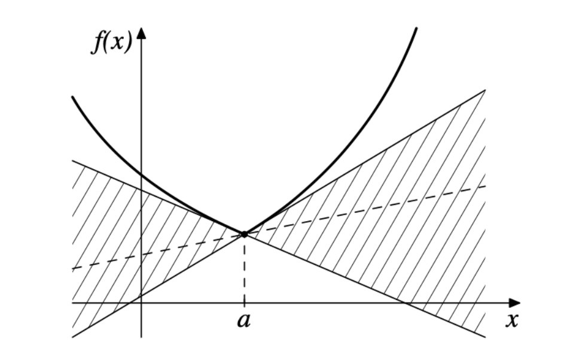
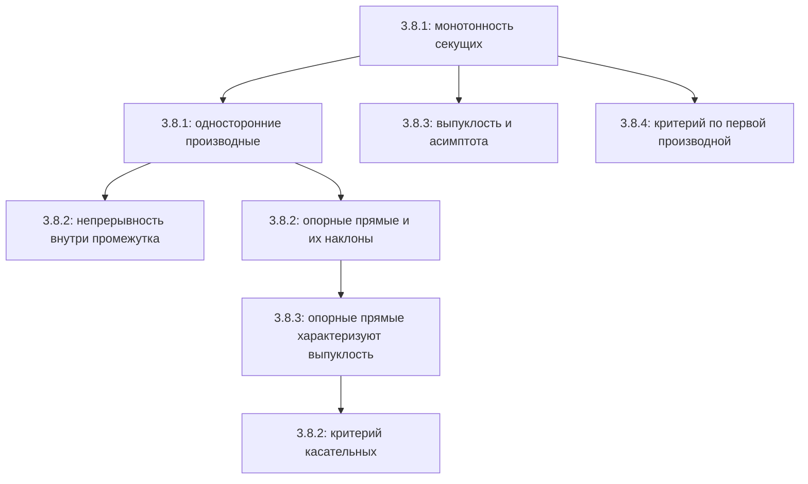

# Лекции 33–34 — Выпуклость, опорные прямые и критерии выпуклости

[Индекс лекций](index.md) · [English](../../en/lectures-2025-26/lecture-33-34.md) · [Español](../../es/lectures-2025-26/lecture-33-34.md)

> **Источник:** `ma25_26-lectures_33-34_notes.pdf` — 28 страниц, 16 печатных слайдов. Рукописные страницы: 6–7, 9–10, 12, 17–18, 22, 24–25, 27–28. У части рукописных страниц есть бессмысленный текстовый слой: они расшифрованы по изображениям, а не по этому слою. Дата слайдов: 12 февраля 2026.
>
> **Семестр 2, лекции 33–64.** Семестр 1 закончился лекцией 32. **Начиная с лекции 33 материал уже дублируется** в другой папке: [лекционный регистр `ru/lectures/`](../lectures/index.md), [§3.8 «Выпуклость»](../lectures/01-convexity-3-8.md). Сохранён и [архивный конспект «Лекция 33-34»](../../../source/MathInMind/МАТАН_Л/Лекция%2033-34.md). Этот файл — самостоятельная полная иллюстрированная расшифровка нового PDF, а не замена ссылкой на старый материал.
>
> **Обозначения.** $I=\langle A,B\rangle$; $f'_-(a)$ и $f'_+(a)$ — левая и правая производные. «Возрастает» без слова «строго» означает «не убывает». В отличие от печатных слайдов, случайные знаки строгого неравенства в рукописном доказательстве для обычной выпуклости ниже заменены нестрогими с пояснением.

## Печатные слайды 1–3 (стр. PDF 1–3). Введение

**Цитата дня:** «Абсолютная истина состоит в том, что большинство людей ничего не умеет делать хорошо». Г. Г. Харди, «Апология математика» — атрибуция на слайде.

**Цель:** продолжить обсуждение выпуклых функций, связи выпуклости с монотонностью и различных критериев выпуклости.

## Глава 3, §8. Выпуклые функции — продолжение

### Печатный слайд 4 (стр. PDF 4). Повторение определения

**Определение 3.8.1** повторено из [лекций 31–32](lecture-31-32.md). Для $f:I\to\mathbb R$:

$$
f(\lambda a+(1-\lambda)b)\le\lambda f(a)+(1-\lambda)f(b)
\qquad(a,b\in I,\ 0<\lambda<1)
$$

означает выпуклость; строгое неравенство при $a\ne b$ означает строгую выпуклость. Рукописная пометка: «Напоминаем определение выпуклости».

### Печатный слайд 5 (стр. PDF 5). Выпуклость и монотонность секущих

**Следствие 3.8.1.** Пусть $f:I\to\mathbb R$, $a\in I$ и

$$
F(x)=\frac{f(x)-f(a)}{x-a},\qquad x\in I\setminus\{a\}.
$$

1. Если $f$ выпукла на $I$, то $F$ не убывает на $I\setminus\{a\}$.
2. Если $f$ строго выпукла, то $F$ строго возрастает на этом множестве.

### Рукописная страница (стр. PDF 6). Доказательство следствия 3.8.1

Доказывается пункт 2. Для $x<y$, $x,y\ne a$, по лемме о трёх хордах получаем соответственно

$$
\begin{array}{ll}
\dfrac{f(x)-f(a)}{x-a}<\dfrac{f(y)-f(a)}{y-a},&a<x<y,\\[6pt]
\dfrac{f(a)-f(x)}{a-x}<\dfrac{f(a)-f(y)}{a-y},&x<y<a,\\[6pt]
\dfrac{f(a)-f(x)}{a-x}<\dfrac{f(y)-f(a)}{y-a},&x<a<y.
\end{array}
$$

В каждом случае это $F(x)<F(y)$. Для пункта 1 используются нестрогие неравенства. $\blacksquare$

### Рукописная страница (стр. PDF 7). Пример строгой выпуклости

Функция $f(x)=x^2$ строго выпукла на $\mathbb R$. Действительно, при $a<c<b$

$$
\frac{f(c)-f(a)}{c-a}-\frac{f(b)-f(c)}{b-c}
=\frac{c^2-a^2}{c-a}-\frac{b^2-c^2}{b-c}
=c+a-(b+c)=a-b<0.
$$

Применяем лемму 3.8.1.

### Печатный слайд 6 (стр. PDF 8). Односторонние производные

До сих пор не предполагались ни непрерывность, ни дифференцируемость. Выпуклость сама обеспечивает некоторую регулярность.

**Теорема 3.8.1.** Пусть $f$ выпукла на $I$, $a\in I$.

1. Если $a<B$, существует $f'_+(a)\in[-\infty,+\infty)$; если $a>A$, существует $f'_-(a)\in(-\infty,+\infty]$.
2. Если $a\in(A,B)$, обе производные конечны и

$$
f'_-(a)\le f'_+(a).
$$

### Рукописные страницы (стр. PDF 9–10). Доказательство теоремы 3.8.1

Снова рассматриваем $F(x)=(f(x)-f(a))/(x-a)$. По следствию 3.8.1 она не убывает. При $a<B$ по теореме о пределе монотонной функции

$$
f'_+(a)=\lim_{x\to a+}F(x)=\inf_{x>a}F(x)\in[-\infty,+\infty).
$$

Аналогично

$$
f'_-(a)=\lim_{x\to a-}F(x)=\sup_{x<a}F(x)\in(-\infty,+\infty].
$$

Для внутренней точки из $F(x)\le F(y)$ при $x<a<y$, переходя к односторонним пределам, получаем $f'_-(a)\le f'_+(a)$. Зафиксировав $u<a<v$ в $I$, видим также

$$
F(u)\le f'_-(a)\le f'_+(a)\le F(v).
$$

Крайние значения конечны, значит, конечны и обе производные. $\blacksquare$

> **Примечание редактора.** На рукописных стр. 9–10 встречаются «строго возрастает» и строгие неравенства, хотя теорема предполагает лишь выпуклость. Для её доказательства нужны и верны нестрогие неравенства. Предельное неравенство тоже нестрогое даже в строго выпуклом случае: у $x^2$ односторонние производные совпадают.

### Печатный слайд 7 (стр. PDF 11). Непрерывность внутри промежутка

**Следствие 3.8.2.** Выпуклая на $I$ функция непрерывна на $(A,B)$.

**Рукописное доказательство на слайде.** В каждой внутренней точке существуют конечные левая и правая производные. Из этого следует непрерывность слева и справа, а значит, непрерывность в точке. $\blacksquare$

### Рукописная страница (стр. PDF 12). На концах поведение хуже

Пример:

$$
f(x)=-\sqrt{1-x^2}\quad(-1<x\le1),\qquad f(-1)=1.
$$

Функция выпукла на $[-1,1]$: на $(-1,1]$ её график — нижняя полуокружность; поднятие значения в левом конце не нарушает неравенство выпуклости. При этом

$$
f'_+(-1)=-\infty,\qquad f'_-(1)=+\infty,
$$

и в точке $-1$ функция разрывна. Выпуклая функция может быть менее регулярной на концах, чем внутри промежутка.

### Печатный слайд 8 (стр. PDF 13). Опорная прямая

**Определение 3.8.2.** Пусть $f:I\to\mathbb R$, $a\in I$, $k\in\mathbb R$ и $g(x)=f(a)+k(x-a)$.

1. Прямая $y=g(x)$ называется **опорной** для $f$ в $a$, если $f(x)\ge g(x)$ для всех $x\in I$.
2. Она называется **строго опорной**, если $f(x)>g(x)$ для всех $x\in I\setminus\{a\}$.

Опорная прямая проходит через $(a,f(a))$ и лежит не выше графика; строго опорная пересекает график только в этой точке.

### Печатные слайды 9–10 (стр. PDF 14–15). Все опорные прямые

**Лемма 3.8.2.** Пусть $f:I\to\mathbb R$, $a\in(A,B)$, $k\in\mathbb R$, $\ell:\ y=f(a)+k(x-a)$.

1. Если $f$ выпукла на $I$, то $\ell$ опорная в $a$ тогда и только тогда, когда

$$
k\in[f'_-(a),f'_+(a)].
$$

2. Если $f$ строго выпукла, то $\ell$ строго опорная тогда и только тогда, когда выполняется то же условие на $k$.

### Печатный слайд 11 (стр. PDF 16). Существование и единственность

1. По теореме 3.8.1 отрезок $[f'_-(a),f'_+(a)]$ непуст и конечен во внутренней точке. Поэтому у выпуклой функции есть опорная прямая в каждой внутренней точке, а у строго выпуклой — строго опорная. Для концевой точки достаточно потребовать конечную одностороннюю производную.
2. Если $f$ дифференцируема в $a\in(A,B)$, опорная прямая единственна и совпадает с касательной.

Рукописная пометка:

$$
f'_-(a)=f'_+(a)=f'(a)\quad\Longrightarrow\quad k=f'(a).
$$

### Рукописные страницы (стр. PDF 17–18). Доказательство леммы 3.8.2

На странице ограничиваются строго выпуклым случаем, пунктом 2.

**Необходимость.** Если $\ell$ строго опорная, то при $x\to a+$

$$
0<f(x)-f(a)-k(x-a)
=(x-a)\bigl(f'_+(a)-k+o(1)\bigr).
$$

Деля на $x-a>0$ и переходя к пределу, получаем $k\le f'_+(a)$. Аналогично слева, где $x-a<0$, получаем $f'_-(a)\le k$.

**Достаточность.** Пусть $f'_-(a)\le k\le f'_+(a)$. При $x>a$ строгая монотонность секущих даёт

$$
F(x)>\inf_{t>a}F(t)=f'_+(a)\ge k.
$$

Значит, $f(x)-f(a)>k(x-a)$. При $x<a$ имеем $F(x)<\sup_{t<a}F(t)=f'_-(a)\le k$; умножение на отрицательное $x-a$ снова даёт то же строгое опорное неравенство. Следовательно, график вне $a$ лежит выше $\ell$. Для обычной выпуклости все нужные знаки нестрогие. $\blacksquare$

### Печатный слайд 12 (стр. PDF 19). Опорные прямые характеризуют выпуклость

**Лемма 3.8.3.** Пусть $f:I\to\mathbb R$.

1. Если в каждой точке $a\in I$ есть опорная прямая, то $f$ выпукла на $I$.
2. Если в каждой точке есть строго опорная прямая, то $f$ строго выпукла.

> **Пояснение редактора.** Отдельного доказательства этой леммы в PDF нет. Для $c=\lambda a+(1-\lambda)b$ берут опорную прямую в $c$, умножают неравенства $f(a)\ge f(c)+k(a-c)$ и $f(b)\ge f(c)+k(b-c)$ на $\lambda$ и $1-\lambda$ и складывают. Члены с $k$ сокращаются; при строгой опорности и $a\ne b$ неравенство строгое.

### Печатные слайды 13–14 (стр. PDF 20–21). Критерий касательных

Положим $T_{a,1}f(x)=f(a)+f'(a)(x-a)$.

**Теорема 3.8.2.** Пусть $f:I\to\mathbb R$ дифференцируема на $I$.

1. $f$ выпукла на $I$ тогда и только тогда, когда для любых $a,x\in I$

$$
f(x)\ge T_{a,1}f(x).
$$

2. $f$ строго выпукла на $I$ тогда и только тогда, когда для любых различных $a,x\in(A,B)$

$$
f(x)>T_{a,1}f(x).
$$

График выпуклой функции — верхняя огибающая семейства её касательных. При строгой выпуклости каждая касательная имеет с графиком только одну общую точку.

### Рукописная страница (стр. PDF 22). Доказательство теоремы 3.8.2

Доказывается строгий случай. При дифференцируемости опорная прямая совпадает с касательной, а для опорных прямых нужное утверждение уже доказано. Обратно, если $f(x)>T_{a,1}f(x)$ при $x\ne a$, касательная строго опорная; по лемме 3.8.3 функция строго выпукла. $\blacksquare$

> **Примечание редактора.** В строгом пункте слайд формулирует условие для внутренних $a,x$. Оно даёт строгую выпуклость внутри; непрерывность на включённых концах, следующая из принятой в теореме дифференцируемости, распространяет её на весь $I$.

### Печатный слайд 15 (стр. PDF 23). Выпуклость и асимптота

**Теорема 3.8.3.** Пусть $f:(A,+\infty)\to\mathbb R$ имеет при $x\to+\infty$ асимптоту $y=kx+b$.

1. Если $f$ выпукла, то $f(x)\ge kx+b$ при всех $x>A$.
2. Если $f$ строго выпукла, то $f(x)>kx+b$ при всех $x>A$.

Утверждения верны и для асимптот при $x\to-\infty$. Асимптоту можно понимать как «опорную прямую в бесконечности».

> **Исправление редактора.** В замечании на слайде 15 напечатано $f(x)=kx-b\to0$. Условие асимптоты — $f(x)-kx-b\to0$. На рисунке каждая ветвь рассматривается на своём промежутке; функция через вертикальную асимптоту не объявляется выпуклой на всей прямой.

### Рукописные страницы (стр. PDF 24–25). Доказательство теоремы 3.8.3

Доказывается строгий пункт. Положим $g(x)=f(x)-kx$. По определению асимптоты $g(x)\to b$. Покажем, что $g$ строго убывает.

Для $A<x<y$ рассмотрим

$$
F(t)=\frac{f(t)-f(x)}{t-x},\qquad t>x.
$$

Из строгой выпуклости $F$ строго возрастает. При этом

$$
\lim_{t\to+\infty}F(t)
=\lim_{t\to+\infty}\frac{kt+b+o(1)-f(x)}{t-x}=k.
$$

Поэтому $F(y)<k$, то есть

$$
f(y)-f(x)<k(y-x)
\quad\Longleftrightarrow\quad
g(y)<g(x).
$$

Строго убывающая функция с пределом $b$ удовлетворяет $g(x)>b$. Следовательно, $f(x)>kx+b$. В нестрогом случае получаются $g(y)\le g(x)$ и $g(x)\ge b$. $\blacksquare$

> **Примечание редактора.** Вычисление предела записано через определение асимптоты. На рукописной стр. 24 для $k\ne0$ указан только предел $f(t)\to+\infty$; при $k<0$ он равен $-\infty$, но приведённая выше выкладка работает при любом $k$.

### Печатный слайд 16 (стр. PDF 26). Критерий по первой производной

**Теорема 3.8.4.** Пусть $f:I\to\mathbb R$ непрерывна на $I$ и дифференцируема на $(A,B)$.

1. $f$ выпукла на $I$ тогда и только тогда, когда $f'$ не убывает на $(A,B)$.
2. $f$ строго выпукла на $I$ тогда и только тогда, когда $f'$ строго возрастает на $(A,B)$.

### Рукописные страницы (стр. PDF 27–28). Доказательство теоремы 3.8.4

Доказывается пункт 2.

**Необходимость.** Для $x<y$ из $(A,B)$ покажем

$$
f'(x)<\frac{f(y)-f(x)}{y-x}<f'(y).
$$

Функция $F(t)=(f(t)-f(x))/(t-x)$ строго возрастает на $(x,y]$. Поэтому

$$
f'(x)=\lim_{t\to x+}F(t)=\inf_{t\in(x,y]}F(t)<F(y).
$$

Правое неравенство доказывается аналогично, с секущими из $y$. В частности, $f'(x)<f'(y)$.

**Достаточность.** Пусть $a<c<b$ из $I$. По теореме Лагранжа найдутся $\alpha\in(a,c)$ и $\beta\in(c,b)$ такие, что

$$
\frac{f(c)-f(a)}{c-a}=f'(\alpha)
<f'(\beta)=\frac{f(b)-f(c)}{b-c},
$$

так как $\alpha<\beta$ и $f'$ строго возрастает. Лемма о трёх хордах даёт строгую выпуклость. Нестрогий случай доказывается заменой соответствующих знаков. $\blacksquare$

## Структура лекции

---

Предыдущие: [лекции 31–32 — конец семестра 1](lecture-31-32.md) · Следующая: [лекция 35](lecture-35.md) · Дублирующий раздел: [§3.8 в `ru/lectures/`](../lectures/01-convexity-3-8.md).
