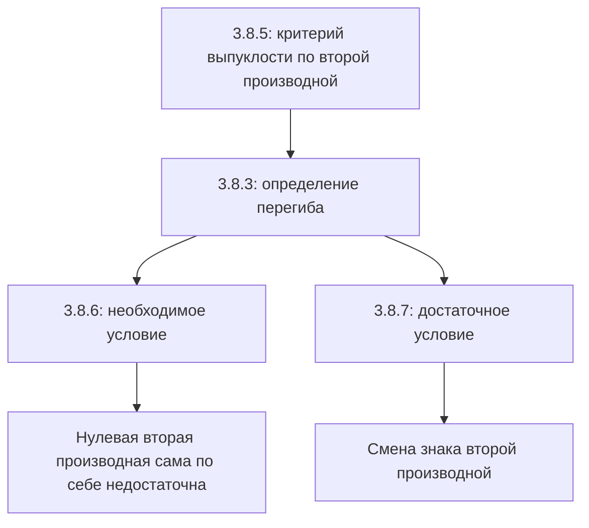

# Лекция 35 — Вторая производная, выпуклость и точки перегиба

[Индекс лекций](index.md) · [English](../../en/lectures-2025-26/lecture-35.md) · [Español](../../es/lectures-2025-26/lecture-35.md)

> **Источник:** `ma25_26_lecture_35_notes.pdf` — 8 страниц, 7 печатных слайдов и одна рукописная страница (стр. PDF 5). Расшифрованы также пометки на слайдах 5–6. Дата: 19 февраля 2026.
>
> **Семестр 2: лекции 33–64; семестр 1 закончился лекцией 32. Дублирование начинается с лекции 33.** Этот материал уже есть в [папке `ru/lectures/`](../lectures/index.md), в [§3.8 «Выпуклость»](../lectures/01-convexity-3-8.md), и в [архивной «Лекции 35»](../../../source/MathInMind/МАТАН_Л/Лекция%2035.md). Здесь сохранена самостоятельная полная иллюстрированная версия по новому PDF.
>
> **Обозначения.** $I=\langle A,B\rangle$, $\overline{\mathbb R}=\mathbb R\cup\{-\infty,+\infty\}$. Черта над $\mathbb R$ в определении перегиба и теореме 3.8.7 сверена с изображением: допускается бесконечная производная, хотя текстовый слой теряет черту.

## Печатные слайды 1–3 (стр. PDF 1–3). Введение

**Цитата дня:** «Завтра сегодня станет вчера!»

**Цель:** «Домучаем выпуклые функции» — критерии выпуклости и точки перегиба.

## Глава 3, §8. Выпуклые функции — окончание

### Печатный слайд 4 (стр. PDF 4). Критерий по второй производной

**Теорема 3.8.5.** Пусть $f:I\to\mathbb R$ непрерывна на $I$ и дважды дифференцируема на $(A,B)$.

1. Функция $f$ выпукла на $I$ тогда и только тогда, когда

$$
f''(x)\ge0\qquad\text{для всех }x\in(A,B).
$$

2. Если $f''(x)>0$ для всех $x\in(A,B)$, то $f$ строго выпукла на $I$.

> **Примечание редактора.** В пункте 1 именно $\ge0$, а в пункте 2 — $>0$. Извлечённый текст PDF не различает эти знаки надёжно. Обратное к пункту 2 неверно: строго выпуклая функция может иметь нулевую вторую производную в отдельных точках.

### Рукописная страница (стр. PDF 5). Доказательство теоремы 3.8.5

По теореме 3.8.4 и критерию монотонности

$$
f\text{ выпукла на }I
\quad\Longleftrightarrow\quad
f'\text{ не убывает на }(A,B)
\quad\Longleftrightarrow\quad
f''(x)\ge0\quad(x\in(A,B)).
$$

Если же $f''(x)>0$ всюду на $(A,B)$, то $f'$ строго возрастает по критерию монотонности. Теорема 3.8.4 даёт строгую выпуклость $f$. $\blacksquare$

### Печатный слайд 5 (стр. PDF 6). Точка перегиба

**Определение 3.8.3.** Пусть $f:I\to\mathbb R$, $a\in(A,B)$, и выполнены условия:

1. Найдётся $\delta>0$ такое, что $(a-\delta,a+\delta)\subset(A,B)$, а $f$ имеет разный характер выпуклости на $(a-\delta,a]$ и $[a,a+\delta)$: на одном промежутке выпукла, на другом вогнута.
2. Функция $f$ непрерывна в $a$.
3. Существует $f'(a)\in\overline{\mathbb R}$.

Тогда $a$ называется **точкой перегиба** $f$.

> **Пояснение редактора.** «Разный характер» означает действительную смену выпуклости; нельзя объявить линейную функцию имеющей перегиб в каждой точке только потому, что она одновременно выпукла и вогнута. Эскиз показывает, зачем допускается бесконечная производная. Например, $f(x)=-\sqrt[3]{x-a}$ непрерывна и меняет характер выпуклости в $a$, где производная равна $-\infty$; эта формула — редакторский пример, на рисунке формула не указана.

### Печатный слайд 6 (стр. PDF 7). Необходимое условие перегиба

**Теорема 3.8.6.** Пусть $f:I\to\mathbb R$, $a\in(A,B)$, $f$ дважды дифференцируема в $a$. Если $a$ — точка перегиба, то

$$
f''(a)=0.
$$

Это **не достаточное** условие!

**Рукописный контрпример на слайде:** $f(x)=x^4$ строго выпукла на $\mathbb R$, $f''(x)=12x^2$, $f''(0)=0$, но ноль не является точкой перегиба. Этот же пример показывает, почему из строгой выпуклости не следует $f''>0$ всюду.

### Печатный слайд 7 (стр. PDF 8). Достаточное условие перегиба

**Теорема 3.8.7.** Пусть $f:I\to\mathbb R$, $a\in(A,B)$, $f$ непрерывна в $a$ и имеет там производную из $\overline{\mathbb R}$. Пусть существует $\delta>0$, для которого $f$ дважды дифференцируема на $(a-\delta,a)\cup(a,a+\delta)\subset I$, и выполнено одно из условий:

1. $f''>0$ на $(a-\delta,a)$ и $f''<0$ на $(a,a+\delta)$;
2. $f''<0$ на $(a-\delta,a)$ и $f''>0$ на $(a,a+\delta)$.

Тогда $a$ — точка перегиба $f$.

### Дополнение редактора. Связь двух условий

Доказательства теорем 3.8.6–3.8.7 в этом PDF отдельно не записаны; следующие пояснения — редакторские, а не дополнительные рукописные страницы.

- Для теоремы 3.8.6 смена выпуклости означает смену направления монотонности $f'$. При существующей конечной $f''(a)$ функция $f'$ имеет в $a$ локальный экстремум; по теореме Ферма $(f')'(a)=f''(a)=0$.
- Для теоремы 3.8.7 знаки $f''$ дают разные характеры выпуклости по теореме 3.8.5. Непрерывность позволяет присоединить $a$ к обоим односторонним промежуткам. Вместе с существованием производной это даёт определение 3.8.3.
- Например, $f(x)=x^3$ имеет $f''(x)=6x$: знак меняется в нуле, поэтому ноль — перегиб. У $x^4$ знак не меняется, поэтому перегиба нет.

## Структура лекции

---

Предыдущие: [лекции 33–34](lecture-33-34.md) · Следующая: [лекция 36 — первообразная](lecture-36.md) · Дублирующий раздел: [§3.8 в `ru/lectures/`](../lectures/01-convexity-3-8.md).
