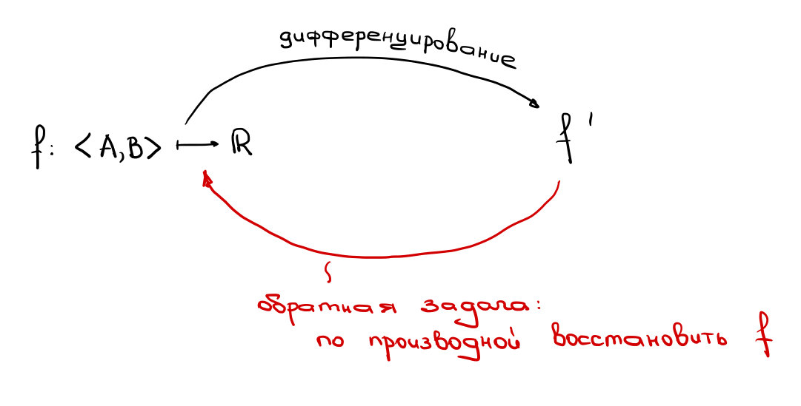
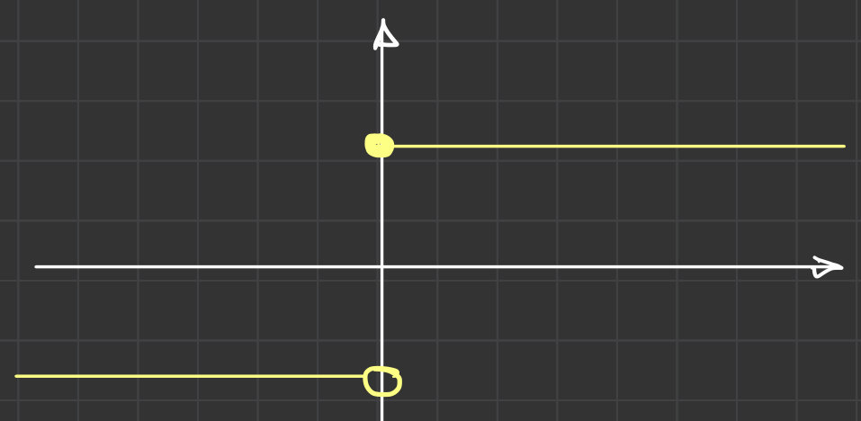
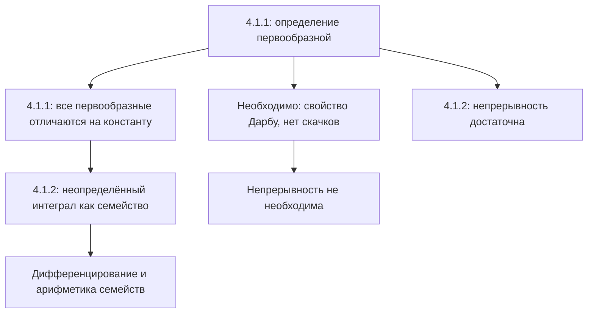

# Лекция 36 — Первообразная и неопределённый интеграл

[← Лекция 35](lecture-35.md) · [Указатель лекций](index.md) · [Лекции 37–38 →](lecture-37-38.md) · [Термины и теоремы](../term-index.md) · [English](../../en/lectures-2025-26/lecture-36.md) · [Español](../../es/lectures-2025-26/lecture-36.md)

> **Источник:** `ma25_26_lecture_36_notes.pdf` — 20 страниц, 14 печатных слайдов. Рукописные страницы: 8, 10–12, 18–19; также расшифрована схема на печатной стр. PDF 4. Дата: 19 февраля 2026.
>
> **Семестр 2: лекции 33–64; семестр 1 заканчивается лекцией 32. Начиная с лекции 33 есть дублирующий материал** в [папке `ru/lectures/`](../lectures/index.md). Для этой лекции см. [§4.1 «Первообразная и неопределённый интеграл»](../lectures/02-antiderivatives-4-1.md) и [архивную «Лекцию 36»](../../../source/MathInMind/МАТАН_Л/Лекция%2036.md). Здесь дан полный иллюстрированный конспект нового PDF, а не сокращённая ссылка на старые заметки.
>
> **Обозначения.** $`I=\langle A,B\rangle`$ — промежуток, $`\mathcal P_f(I)`$ — множество всех [первообразных](#def-4-1-1) $`f`$ на нём. В включённых концах [производная](lecture-22-23.md#def-3-1-1) понимается односторонне, как в предыдущих лекциях.

## Печатные слайды 1–3 (стр. PDF 1–3). Введение

**Цитата дня:** «Завтра сегодня станет вчера!»

**Цели:**

- После изучения дифференцирования рассмотреть обратную задачу: известна производная, требуется найти функцию.
- Определить первообразную и описать все первообразные на промежутке.
- Обсудить операции с неопределёнными интегралами.
- Сформулировать необходимые и достаточные условия существования первообразных.

## Глава 4. Интегральное исчисление функций одной вещественной переменной

### Печатный слайд 4 (стр. PDF 4). Обратная задача

Рукописная схема: дифференцирование переводит $`f`$ в $`f'`$, а обратная задача состоит в восстановлении $`f`$ по производной.



## §1. Первообразная функция и неопределённый интеграл

### Печатный слайд 5 (стр. PDF 5). Первообразная на промежутке

<a id="def-4-1-1"></a>**Определение 4.1.1.** Пусть $`f:I\to\mathbb R`$. Функция $`F:I\to\mathbb R`$ называется **первообразной** $`f`$ на $`I`$, если

1. $`F`$ [дифференцируема](lecture-22-23.md#def-3-2-1) на $`I`$;
2. $`F'(x)=f(x)`$ для всех $`x\in I`$.

Обозначение:

```math
\mathcal P_f(I)=\{F:I\to\mathbb R:\ F\text{ дифференцируема на }I,\ F'=f\}.
```

### Печатный слайд 6 (стр. PDF 6). Три вопроса

1. Для каких $`f`$ множество $`\mathcal P_f(I)`$ непусто?
2. Как описать $`\mathcal P_f(I)`$, если оно непусто?
3. Как вычислять первообразные, если они существуют?

Начинаем со второго: на промежутке первообразная единственна с точностью до постоянного слагаемого.

### Печатный слайд 7 (стр. PDF 7). Описание всех первообразных

<a id="thm-4-1-1"></a>**Теорема 4.1.1.** Пусть $`f,F,G`$ заданы на $`I`$, причём $`F\in\mathcal P_f(I)`$. Равносильны утверждения:

1. $`G\in\mathcal P_f(I)`$.
2. Существует $`c\in\mathbb R`$ такое, что $`G(x)=F(x)+c`$ для всех $`x\in I`$.

Иными словами,

```math
\mathcal P_f(I)=\{F+c:\ c\in\mathbb R\}.
```

Поэтому достаточно найти одну первообразную.

### Рукописная страница (стр. PDF 8). Доказательство теоремы 4.1.1

**$`1\Rightarrow2`$.** Пусть $`H(x)=G(x)-F(x)`$. Тогда

```math
H'(x)=G'(x)-F'(x)=f(x)-f(x)=0\qquad(x\in I).
```

По критерию постоянства функции $`H`$ постоянна на промежутке $`I`$, то есть $`G=F+c`$.

**$`2\Rightarrow1`$.** Если $`G=F+c`$, обе функции в правой части дифференцируемы, поэтому $`G`$ тоже дифференцируема и

```math
G'(x)=F'(x)+0=f(x)\qquad(x\in I).
```

Следовательно, $`G\in\mathcal P_f(I)`$. $`\blacksquare`$

### Печатный слайд 8 (стр. PDF 9). Неопределённый интеграл

<a id="def-4-1-2"></a>**Определение 4.1.2.** Пусть $`f:I\to\mathbb R`$, $`F\in\mathcal P_f(I)`$. Множество функций

```math
\{F(x)+c:\ c\in\mathbb R\}
```

называется **неопределённым интегралом** $`f`$ на $`I`$ и обозначается

```math
\int f(x)\,dx.
```

Фактически это $`\mathcal P_f(I)`$, записанное через одну выбранную первообразную.

> **Исправление редактора.** В предпосылке определения на слайде после $`f:I\to\mathbb R`$ пропущено $`F\in`$ перед $`\mathcal P_f(I)`$. Выбор первообразной $`F`$ восстановлен, поскольку она используется в следующей строке.

### Рукописные страницы (стр. PDF 10–12). Смысл обозначений

Для краткости пишут

```math
\int f(x)\,dx=F(x)+c,
```

опуская фигурные скобки и понимая под $`c`$ произвольное вещественное число. Это **семейство функций**, а не одна функция с заранее выбранной константой.

Обозначение дано по аналогии с [определённым интегралом](lecture-39-40.md#def-4-2-6). На стр. 10 приведена неформальная картина:

```math
\text{определённый интеграл}\ \sim\
\lim_{\Delta x_k\to0}\sum_k f(x_k)\Delta x_k.
```

На стр. 11: $`f(x)\,dx`$ сопоставляется с $`f(x_k)\Delta x_k`$, а знак $`\int`$ — с вытянутой буквой $`S`$ (суммированием).

> **Примечание редактора.** Это мотивационная схема «на пальцах», а не определение предела [интегральных сумм](lecture-37-38.md#def-4-2-4): [разбиения](lecture-37-38.md#def-4-2-2), оснащения и ранг вводятся в [лекциях 37–38](lecture-37-38.md).

Вообще можно было бы обозначать неопределённый интеграл просто $`\int f`$, но запись с $`dx`$ полезна:

1. Она указывает переменную интегрирования. В примере на стр. 11:

```math
\int x^y\,dx:\quad x\mapsto x^y,\quad y\text{ — параметр};
```

```math
\int x^y\,dy:\quad y\mapsto x^y,\quad x\text{ — параметр}.
```

2. Трактуя $`dx`$ как [дифференциал](lecture-24-25-26.md#def-3-3-1), можно удобно формулировать правила вычисления интегралов (стр. 12).

### Печатные слайды 9–10 (стр. PDF 13–14). Дифференцирование интеграла

Неопределённый интеграл — **множество функций**, но некоторые операции над функциями переносятся на такие множества.

Пусть у $`f`$ есть первообразная на $`I`$. Все представители семейства имеют одну и ту же производную, поэтому условимся писать

```math
\left(\int f(x)\,dx\right)'=f(x),\qquad x\in I.
```

### Печатный слайд 11 (стр. PDF 15). Арифметика множеств функций

Пусть $`D,E`$ — множества функций на $`I`$, $`h:I\to\mathbb R`$, $`\lambda\in\mathbb R`$ фиксировано. Определим

```math
D+E=\{f+g:\ f\in D,\ g\in E\},
```

```math
E+h=\{g+h:\ g\in E\},\qquad
\lambda E=\{\lambda g:\ g\in E\}.
```

> **Примечание редактора.** В последней формуле слайда $`\lambda\in\mathbb R`$ напечатано внутри множества. При умножении на **фиксированное** число $`\lambda`$ перебираются только $`g\in E`$, а не все возможные множители $`\lambda`$.

### Печатный слайд 12 (стр. PDF 16). Операции с неопределёнными интегралами

Пусть $`F,G`$ — первообразные $`f,g`$ на $`I`$, а $`H:I\to\mathbb R`$. Тогда

```math
\int f(x)\,dx+\int g(x)\,dx
=\{F(x)+G(x)+c:\ c\in\mathbb R\},
```

```math
\int f(x)\,dx+H(x)
=\{F(x)+H(x)+c:\ c\in\mathbb R\},
```

```math
\lambda\int f(x)\,dx
=\{\lambda F(x)+c:\ c\in\mathbb R\},\qquad\lambda\ne0.
```

> **Пояснение редактора.** Ограничение $`\lambda\ne0`$ существенно для равенства **множеств**: $`0\cdot\mathcal P_f(I)=\{0\}`$, тогда как первообразные нулевой функции — все постоянные функции. Во второй формуле $`H`$ произвольна: утверждается равенство множеств сумм, а не дифференцируемость $`H`$.

### Печатный слайд 13 (стр. PDF 17). Необходимые условия существования

Полное описание функций, имеющих первообразную, сложно; рассматриваем отдельно необходимые и достаточные условия. **Непрерывность не является необходимым условием.**

### Рукописная страница (стр. PDF 18). Следствие теоремы Дарбу

Если у $`f`$ есть первообразная $`F`$, то $`f=F'`$. Поэтому $`f`$ обладает [свойством Дарбу](lecture-31-32.md#thm-3-7-6): образ каждого промежутка в области определения — промежуток. В частности, у неё не может быть скачков; [разрывы второго рода](lecture-16.md#def-2-5-4) могут встречаться.

> **Пояснение редактора.** Нельзя заменять свойство Дарбу только отсутствием скачков: отсутствие скачка само по себе ещё не гарантирует существование первообразной. Рассуждение о производных дано в [лекциях 31–32](lecture-31-32.md).

### Рукописная страница (стр. PDF 19). Пример функции без первообразной

```math
f(x)=
\begin{cases}
1,&x\ge0,\\
-1,&x<0.
\end{cases}
```

В нуле у $`f`$ скачок — разрыв первого рода. Следовательно, у неё **нет первообразной на промежутке, содержащем ноль как внутреннюю точку**.



Разрывы второго рода у производной допустимы, так что непрерывность не необходима.

> **Редакторский пример к последней фразе.** В лекциях 31–32 построена дифференцируемая функция $`u(x)=x^2(2+\sin(1/x))`$ при $`x\ne0`$, $`u(0)=0`$. Её производная разрывна в нуле, но имеет первообразную $`u`$. Это пример допустимого осциллирующего разрыва, а не утверждение, что любая функция с разрывом второго рода имеет первообразную.

### Печатный слайд 14 (стр. PDF 20). Достаточное условие существования

<a id="thm-4-1-2"></a>**Теорема 4.1.2.** Если $`f`$ непрерывна на $`I`$, то у неё есть первообразная на $`I`$.

В этом PDF теорема сформулирована без доказательства. Её связь с [интегралом с переменным верхним пределом](lecture-43-44.md#thm-4-3-2) рассматривается при изучении определённого интеграла; см. также [общую главу об интеграле Римана](../08-riemann-integration.md).

## Структура лекции



---

Предыдущая: [лекция 35](lecture-35.md) · Следующие: [лекции 37–38](lecture-37-38.md) · Дублирующий раздел: [§4.1 в `ru/lectures/`](../lectures/02-antiderivatives-4-1.md).
