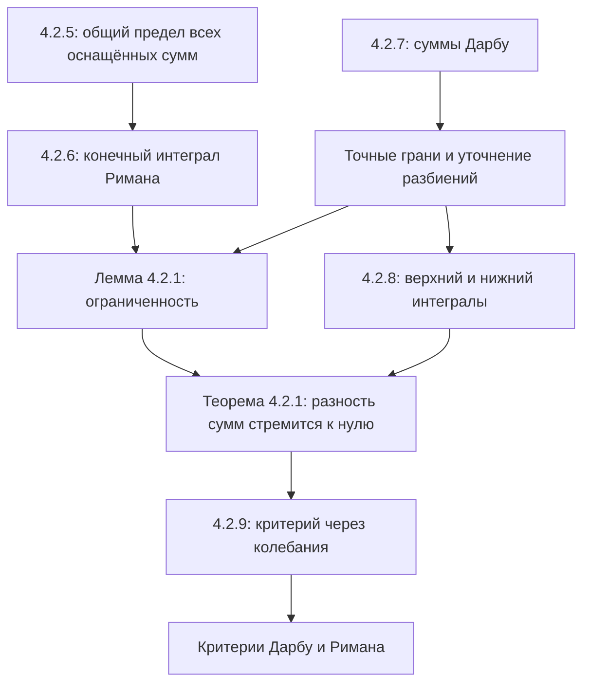

# Лекции 39–40 — Интеграл Римана и суммы Дарбу

[← Лекции 37–38](lecture-37-38.md) · [Указатель лекций](index.md) · [Лекции 41–42 →](lecture-41-42.md) · [Термины и теоремы](../term-index.md) · [English](../../en/lectures-2025-26/lecture-39-40.md) · [Español](../../es/lectures-2025-26/lecture-39-40.md)

> **Источник:** `ma25_26-lectures_39-40_notes.pdf` — 31 страница, 13 печатных слайдов. Рукописные страницы: 5, 7, 10–11, 13–21, 25–27, 29, 31. Включены пометки на печатных слайдах. Дата: 5 марта 2026. Иллюстрации — проверенные фрагменты самого PDF, не перерисовки.
>
> **Семестр 2: лекции 33–64; семестр 1 завершился лекцией 32. Дублирующий материал существует начиная с лекции 33** в [папке `ru/lectures/`](../lectures/index.md). Эта лекция пересекается с [§4.2 «Интеграл Римана»](../lectures/03-riemann-integral-4-2.md); сохранён [архивный конспект «Лекция 39-40 1»](../../../source/MathInMind/МАТАН_Л/Лекция%2039-40%201.md). Ниже — полная самостоятельная иллюстрированная расшифровка нового источника, а не ссылка вместо конспекта.
>
> **Соглашения.** $`a<b`$, $`\tau=\{x_k\}_{k=0}^{n}`$, $`a=x_0<\cdots<x_n=b`$, $`\Delta x_k=x_{k+1}-x_k>0`$, $`\lambda_\tau=\max_k\Delta x_k`$, $`\xi_k\in[x_k,x_{k+1}]`$. Определения [разбиения](lecture-37-38.md#def-4-2-2) и [оснащения](lecture-37-38.md#def-4-2-4) даны в [лекциях 37–38](lecture-37-38.md). Вначале ограниченность функции не предполагается: верхние суммы могут равняться $`+\infty`$, нижние — $`-\infty`$. [Интеграл Римана](#def-4-2-6) в этой лекции всегда **конечное вещественное число**.

## Печатные слайды 1–3 (стр. PDF 1–3). Введение

**«Цитата дня»** — изображение «ёлки Римана» и «ёлки Лебега»: вертикальные и горизонтальные полоски. Это шутливая иллюстрация, не определение [интеграла Лебега](../20-lebesgue-integration.md#sec-20-1).


**Цели:** предел интегральных сумм; интеграл Римана; [суммы Дарбу](#def-4-2-8) и их свойства; ограниченность интегрируемой функции; верхний и нижний интегралы Дарбу; [колебания](#def-4-2-9); [критерии интегрируемости](#thm-4-2-1). В списке целей упомянута также интегрируемость непрерывных и монотонных функций; соответствующие теоремы и доказательства находятся в [следующем PDF, лекциях 41–42](lecture-41-42.md).

## Глава 4, §2. Интеграл Римана

### Печатный слайд 4 (стр. PDF 4). Предел интегральных сумм

<a id="def-4-2-5"></a>**Определение 4.2.5.** Пусть $`f:[a,b]\to\mathbb R`$. Число $`I\in\mathbb R`$ называется пределом интегральных сумм при ранге разбиения, стремящемся к нулю, если

```math
\forall\varepsilon>0\ \exists\delta>0\ \forall\tau:
\lambda_\tau<\delta\ \forall\xi\qquad
|\sigma_\tau(f,\xi)-I|<\varepsilon.
```

Обозначения:

```math
I=\lim_{\lambda_\tau\to0}\sigma_\tau(f,\xi)
=\lim_{\lambda\to0}\sigma.
```

Одно и то же число должно приближать суммы для **всех** достаточно мелких разбиений и **всех** их оснащений.

### Рукописная страница (стр. PDF 5). Последовательная формулировка

1. Можно сформулировать определение на [языке последовательностей](lecture-14.md#thm-2-4-1): для **любой** последовательности оснащённых разбиений $`\{(\tau^j,\xi^j)\}`$

```math
\lambda_{\tau^j}\xrightarrow[j\to\infty]{}0
\quad\Longrightarrow\quad
\sigma_{\tau^j}(f,\xi^j)\xrightarrow[j\to\infty]{}I.
```

2. Это не обычный [предел функции](lecture-14.md#def-2-4-4) одной переменной «ранг»: интегральная сумма зависит от всего оснащённого разбиения, а не только от его ранга. Разные разбиения и оснащения с одинаковым рангом могут давать разные суммы.

### Печатный слайд 5 и рукописная страница (стр. PDF 6–7). Интеграл Римана

<a id="def-4-2-6"></a>**Определение 4.2.6.** Если предел интегральных сумм существует и равен $`I\in\mathbb R`$, то $`f`$ называется **интегрируемой по Риману** на $`[a,b]`$, а число $`I`$ — её **интегралом Римана**, или **определённым интегралом**:

```math
I=\int_a^b f
=\int_a^b f(x)\,dx
=\int_a^b f(r)\,dr.
```

Рукописное дополнение на стр. 6 напоминает:

```math
\sigma_\tau(f,\xi)=\sum_{k=0}^{n-1}f(\xi_k)\Delta x_k,
\qquad I=\lim_{\lambda_\tau\to0}\sigma_\tau(f,\xi).
```

Обозначение $`\mathcal R[a,b]`$ — множество интегрируемых по Риману функций. Числа $`a,b`$ — пределы интегрирования; $`f`$ — подынтегральная функция. Буква переменной интегрирования не влияет на значение числа.

### Печатный слайд 6 (стр. PDF 8). Три вопроса

Итак, интеграл — предел интегральных сумм. Возникают вопросы:

1. Какие функции интегрируемы?
2. Какими свойствами обладает интеграл?
3. Как найти интеграл?

Далее рассматривается первый вопрос.

### Печатный слайд 7 и рукописные страницы (стр. PDF 9–11). Суммы Дарбу

<a id="def-4-2-7"></a>**Определение 4.2.7.** Для $`f:[a,b]\to\mathbb R`$ и разбиения $`\tau`$ положим

```math
M_k=\sup_{x\in[x_k,x_{k+1}]}f(x),\qquad
m_k=\inf_{x\in[x_k,x_{k+1}]}f(x),\qquad k=0,\ldots,n-1.
```

**Верхняя** и **нижняя суммы Дарбу**:

```math
S_\tau(f)=\sum_{k=0}^{n-1}M_k\Delta x_k,\qquad
s_\tau(f)=\sum_{k=0}^{n-1}m_k\Delta x_k.
```


> **Пояснение редактора к рисунку.** Подписи высот на эскизе начинаются с 1, а в определении подотрезки индексируются с 0. В формулах используется индексация определения.

Если $`f`$ непрерывна на $`[a,b]`$, по теореме Вейерштрасса на каждом подотрезке существуют точки $`\widetilde\xi_k,\widehat\xi_k`$ такие, что

```math
M_k=\max_{[x_k,x_{k+1}]}f=f(\widetilde\xi_k),\qquad
m_k=\min_{[x_k,x_{k+1}]}f=f(\widehat\xi_k).
```

**Рукописное замечание:** в общем случае точные грани не обязаны быть значениями функции. Поэтому суммы Дарбу могут **не быть суммами Римана** ни для какого оснащения. Они устроены проще: от оснащения вообще не зависят.

### Печатный слайд 8 (стр. PDF 12). Четыре свойства сумм Дарбу

1. Для любого разбиения:

```math
f\text{ ограничена сверху}\ \Longleftrightarrow\ S_\tau(f)<+\infty,
\qquad
f\text{ ограничена снизу}\ \Longleftrightarrow\ s_\tau(f)>-\infty.
```

2. При фиксированном разбиении точные грани по всем оснащениям равны:

```math
S_\tau(f)=\sup_\xi\sigma_\tau(f,\xi),\qquad
s_\tau(f)=\inf_\xi\sigma_\tau(f,\xi).
```

3. Добавление точек разбиения не увеличивает верхнюю и не уменьшает нижнюю сумму. Если $`T\supset\tau`$, то

```math
s_\tau(f)\le s_T(f)\le S_T(f)\le S_\tau(f).
```

4. Любая нижняя сумма не превосходит **любой** верхней, даже для разных разбиений:

```math
s_{\tau_1}(f)\le S_{\tau_2}(f).
```

### Рукописные страницы (стр. PDF 13–14). Доказательство свойства 1

Пусть $`f(x)\le M`$ на $`[a,b]`$. Тогда $`M_k\le M`$, поэтому

```math
S_\tau(f)\le\sum_{k=0}^{n-1}M\Delta x_k=M(b-a)<+\infty.
```

Обратно, если $`f`$ не [ограничена сверху](lecture-05-06.md#def-1-3-7), то хотя бы на одном из конечного числа подотрезков она не ограничена сверху. Для этого индекса $`\nu`$ имеем $`M_\nu=+\infty`$, а значит $`S_\tau(f)=+\infty`$. Аналогичное рассуждение для нижней грани, либо применение доказанного к $`-f`$, даёт вторую эквивалентность. $`\blacksquare`$

### Рукописные страницы (стр. PDF 15–18). Доказательство свойства 2

Для любого оснащения $`f(\xi_k)\le M_k`$, следовательно,

```math
\sigma_\tau(f,\xi)
=\sum_{k=0}^{n-1}f(\xi_k)\Delta x_k
\le\sum_{k=0}^{n-1}M_k\Delta x_k=S_\tau(f).
```

Покажем, что это **точная** верхняя грань. Если $`f`$ ограничена сверху, по определению [супремума](lecture-11-12.md#def-2-3-1) для каждого $`\varepsilon>0`$ выберем оснащение $`\xi^*`$ так, что

```math
f(\xi_k^*)>M_k-\frac{\varepsilon}{b-a}.
```

Умножая на положительные длины и суммируя, получаем

```math
\begin{aligned}
\sigma_\tau(f,\xi^*)
&>\sum_{k=0}^{n-1}\left(M_k-\frac{\varepsilon}{b-a}\right)\Delta x_k\\
&=S_\tau(f)-\frac{\varepsilon}{b-a}\sum_{k=0}^{n-1}\Delta x_k
=S_\tau(f)-\varepsilon.
\end{aligned}
```

Если $`f`$ не ограничена сверху, выберем подотрезок $`[x_\nu,x_{\nu+1}]`$, на котором она не ограничена, и произвольные точки $`\xi_k^*`$ при $`k\ne\nu`$.


Для любого $`A>0`$ можно выбрать оставшуюся точку так, чтобы

```math
f(\xi_\nu^*)>
\frac{A-\sum_{k\ne\nu}f(\xi_k^*)\Delta x_k}{\Delta x_\nu}.
```

Тогда $`\sigma_\tau(f,\xi^*)>A`$, то есть верхняя грань всех сумм равна $`+\infty=S_\tau(f)`$. Нижняя грань доказывается аналогично с обратными неравенствами. $`\blacksquare`$

### Рукописные страницы (стр. PDF 19–21). Доказательства свойств 3–4

**3. Уточнение разбиения.** Достаточно добавить одну точку $`c\in(x_\nu,x_{\nu+1})`$; добавление конечного числа точек — повторение этого шага.


Обозначим через $`M',M''`$ супремумы на двух новых подотрезках. Тогда $`M',M''\le M_\nu`$. При конечных верхних суммах рукописное вычисление имеет вид

```math
\begin{aligned}
S_\tau-S_T
&=M_\nu(x_{\nu+1}-x_\nu)-M'(c-x_\nu)-M''(x_{\nu+1}-c)\\
&\ge M_\nu\bigl[(x_{\nu+1}-x_\nu)-(c-x_\nu)-(x_{\nu+1}-c)\bigr]=0.
\end{aligned}
```

> **Пояснение редактора.** При неограниченности сверху обе верхние суммы равны бесконечности по свойству 1: их сравнение верно, но разность бесконечностей не берётся. Аналогично для нижних сумм. Это уточняет область применимости вычитания в рукописном доказательстве.

Для нижних сумм новые [инфимумы](lecture-11-12.md#def-2-3-2) не меньше старого, поэтому $`s_T\ge s_\tau`$.

**4. Разные разбиения.** Если разбиения совпадают, утверждение следует из $`m_k\le M_k`$. В общем случае положим $`T=\tau_1\cup\tau_2`$ и применим свойство 3:

```math
s_{\tau_1}\le s_T\le S_T\le S_{\tau_2}.
```


Итак, $`s_{\tau_1}\le S_{\tau_2}`$. $`\blacksquare`$

### Печатный слайд 9 (стр. PDF 22). Ограниченность интегрируемой функции

<a id="lem-4-2-1"></a>**Лемма 4.2.1.** Интегрируемая на отрезке функция ограничена на нём.

**Рукописное доказательство.** Предположим противное, например, неограниченность сверху. Для любого разбиения по свойствам 1–2

```math
\sup_\xi\sigma_\tau(f,\xi)=S_\tau(f)=+\infty.
```

Поэтому для любого предполагаемого предела $`I\in\mathbb R`$ и сколь угодно мелкого разбиения можно найти оснащение с $`\sigma_\tau(f,\xi)>I+1`$. Определение предела не выполнено. Случай неограниченности снизу аналогичен. $`\blacksquare`$

### Печатный слайд 10 (стр. PDF 23). Интегралы Дарбу

<a id="def-4-2-8"></a>**Определение 4.2.8.** Величины

```math
I^*=\inf_\tau S_\tau(f),\qquad
I_*=\sup_\tau s_\tau(f)
```

называются **верхним** и **нижним интегралами Дарбу**.

Рукописные замечания:

1. Из свойства 4 следует $`I_*\le I^*`$.
2. Как и для сумм Дарбу, ограниченность функции сверху или снизу связана с соответствующими бесконечностями:

```math
f\text{ не ограничена сверху}\ \Longleftrightarrow\ I^*=+\infty,
\qquad
f\text{ не ограничена снизу}\ \Longleftrightarrow\ I_*=-\infty.
```

Если $`f`$ ограничена, обе величины конечны.

### Печатный слайд 11 (стр. PDF 24). Критерий интегрируемости

<a id="thm-4-2-1"></a>**Теорема 4.2.1.** Для $`f:[a,b]\to\mathbb R`$

```math
f\in\mathcal R[a,b]
\quad\Longleftrightarrow\quad
\lim_{\lambda_\tau\to0}\bigl(S_\tau(f)-s_\tau(f)\bigr)=0.
```

То есть

```math
\forall\varepsilon>0\ \exists\delta>0\ \forall\tau:
\lambda_\tau<\delta\quad\Longrightarrow\quad
S_\tau(f)-s_\tau(f)<\varepsilon.
```

**Следствие (без номера).** Для интегрируемой функции

```math
\lim_{\lambda_\tau\to0}S_\tau(f)
=\lim_{\lambda_\tau\to0}s_\tau(f)
=\int_a^b f.
```

### Рукописные страницы (стр. PDF 25–27). Доказательство теоремы 4.2.1

**Необходимость.** Пусть $`I=\int_a^b f`$. Для заданного $`\varepsilon>0`$ по определению предела выберем $`\delta>0`$ так, что при $`\lambda_\tau<\delta`$ для всех оснащений

```math
I-\frac{\varepsilon}{3}<\sigma_\tau(f,\xi)<I+\frac{\varepsilon}{3}.
```

Переходя к инфимуму и супремуму по оснащениям, получаем

```math
I-\frac{\varepsilon}{3}\le s_\tau\le S_\tau\le I+\frac{\varepsilon}{3},
\qquad
0\le S_\tau-s_\tau\le\frac{2\varepsilon}{3}<\varepsilon.
```

**Достаточность.** Пусть разность сумм стремится к нулю. Тогда она конечна хотя бы для одного достаточно мелкого разбиения. Следовательно, обе суммы для этого разбиения конечны; свойство 1 даёт ограниченность $`f`$, а затем конечность всех сумм и обоих интегралов Дарбу.

> **Пояснение редактора.** Это развёрнутый первый переход рукописи «все суммы конечны». Под стрелкой на стр. 26 ошибочно написано стремление ранга к бесконечности; здесь и во всём критерии требуется $`\lambda_\tau\to0`$.

Для любого разбиения

```math
s_\tau\le I_*\le I^*\le S_\tau,
\qquad
0\le I^*-I_*\le S_\tau-s_\tau.
```

Правая часть стремится к нулю, поэтому $`I^*=I_*=:I`$. Вместе с $`s_\tau\le\sigma_\tau(f,\xi)\le S_\tau`$ это даёт

```math
|\sigma_\tau(f,\xi)-I|\le S_\tau-s_\tau.
```

По заданному $`\varepsilon>0`$ выбираем $`\delta>0`$ из условия критерия. Оценка выполняется для всех разбиений с $`\lambda_\tau<\delta`$ и всех оснащений: предел сумм равен $`I`$. $`\blacksquare`$

**Вывод, выделенный в рукописи:** для любой интегрируемой функции и любого разбиения

```math
s_\tau(f)\le\int_a^b f\le S_\tau(f).
```

### Печатный слайд 12 и рукописная страница (стр. PDF 28–29). Колебание и следствие

<a id="def-4-2-9"></a>**Определение 4.2.9.** Для непустого множества $`D\subset\mathbb R`$ колебанием функции $`f:D\to\mathbb R`$ называется

```math
\omega(f)_D=\sup_{x,y\in D}\bigl(f(x)-f(y)\bigr)
=\sup_{x\in D}f(x)-\inf_{y\in D}f(y).
```

На слайде сделана пометка: «колебание = осцилляция».

```math
\omega_k(f)=\omega(f)_{[x_k,x_{k+1}]}=M_k-m_k,
\qquad
S_\tau(f)-s_\tau(f)=\sum_{k=0}^{n-1}\omega_k(f)\Delta x_k.
```

Поэтому [теорему 4.2.1](#thm-4-2-1) можно записать так:

```math
f\in\mathcal R[a,b]
\quad\Longleftrightarrow\quad
\lim_{\lambda_\tau\to0}\sum_{k=0}^{n-1}\omega_k(f)\Delta x_k=0.
```

**Рукописное доказательство следствия со слайда 11.** Для $`I=\int_a^b f`$ уже доказано $`s_\tau\le I\le S_\tau`$. Поэтому

```math
0\le S_\tau-I\le S_\tau-s_\tau,
\qquad
0\le I-s_\tau\le S_\tau-s_\tau.
```

Обе правые части стремятся к нулю, что и доказывает сходимость обеих сумм к интегралу. $`\blacksquare`$

### Печатный слайд 13 и рукописная страница (стр. PDF 30–31). Ещё две формы критерия

**Замечание 1.** Верхний и нижний интегралы Дарбу являются пределами соответствующих сумм:

```math
\lim_{\lambda_\tau\to0}S_\tau(f)=I^*,\qquad
\lim_{\lambda_\tau\to0}s_\tau(f)=I_*.
```

Для произвольной функции эти пределы могут быть расширенными вещественными величинами.

**Критерий Дарбу.** Функция $`f`$ интегрируема по Риману тогда и только тогда, когда она **ограничена** на $`[a,b]`$ и

```math
I^*=I_*.
```

**Критерий Римана.** Функция $`f`$ интегрируема по Риману тогда и только тогда, когда

```math
\forall\varepsilon>0\ \exists\tau\qquad
S_\tau(f)-s_\tau(f)<\varepsilon.
```

**Рукописное пояснение на стр. 31:** в направлении достаточности последний критерий удобнее [теоремы 4.2.1](#thm-4-2-1): для каждого допуска достаточно найти **одно** подходящее разбиение. Не требуется непосредственно проверять неравенство на всех достаточно мелких разбиениях. Названия двух критериев сохранены как в источнике; их отдельные доказательства здесь не приведены.

> **Примечание редактора.** Ограниченность в критерии Дарбу нельзя заменять одним равенством расширенных интегралов: равенство бесконечных величин ещё не даёт конечного интеграла Римана. В критерии Римана конечность хотя бы одной разности сумм уже обеспечивает ограниченность по свойству 1.

## Структура лекции



---

Предыдущие: [лекции 37–38](lecture-37-38.md) · Следующие: [лекции 41–42](lecture-41-42.md) · [Происхождение иллюстраций](../../assets/lectures-2025-26/provenance-39-44.md).
