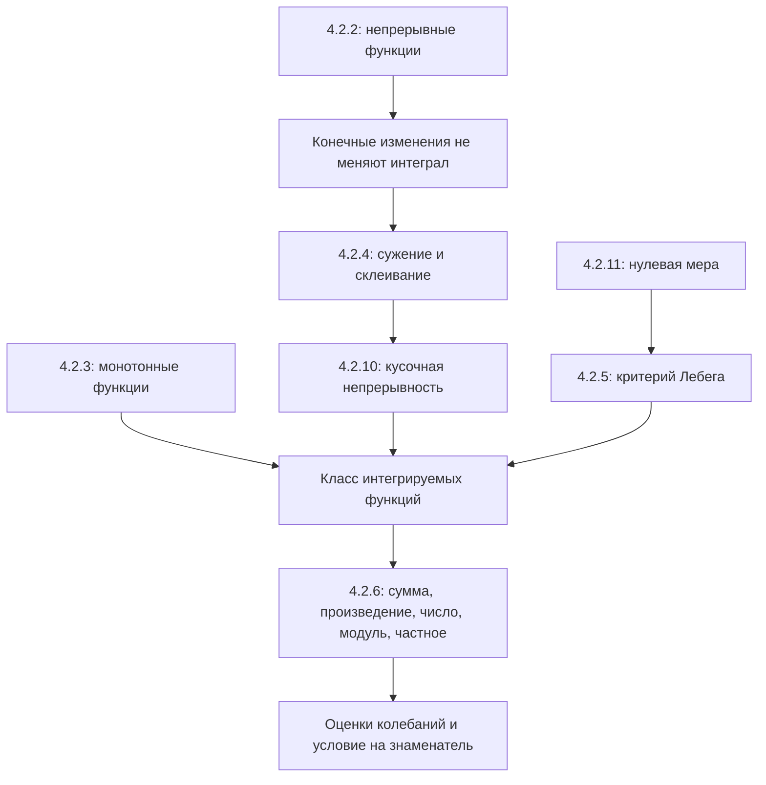

# Лекции 41–42 — Классы интегрируемых функций

[Индекс лекций](index.md) · [English](../../en/lectures-2025-26/lecture-41-42.md) · [Español](../../es/lectures-2025-26/lecture-41-42.md)

> **Источник:** `ma25_26-lectures_41-42_notes.pdf` — 25 страниц, 11 печатных слайдов. Рукописные страницы: 5–6, 8–9, 11, 13–15, 17–18, 22–25. Учтены рисунки и пометки на слайдах. Дата: 12 марта 2026. Все семь иллюстраций извлечены из PDF и проверены отдельно.
>
> **Семестр 2: лекции 33–64; семестр 1 завершился лекцией 32. Дублирующий материал существует начиная с лекции 33** в [папке `ru/lectures/`](../lectures/index.md). Эта лекция пересекается с [§4.2 «Интеграл Римана»](../lectures/03-riemann-integral-4-2.md); сохранён [архивный конспект «Лекция 41-42»](../../../source/MathInMind/МАТАН_Л/Лекция%2041-42.md). Здесь дана полная самостоятельная иллюстрированная расшифровка нового PDF, включая рукописные доказательства.
>
> **Обозначения.** $a<b$; $\mathcal R[a,b]$ — интегрируемые по Риману функции; $C[a,b]$ — непрерывные функции; $\lambda_\tau$ — ранг разбиения; $\omega_k(f)$ — колебание на его подотрезке. Критерий через сумму колебаний и определения см. в [лекциях 39–40](lecture-39-40.md).

## Печатные слайды 1–3 (стр. PDF 1–3). Введение

**Цитата дня:**

> — Возьмите вот этот интеграл.
>
> — Нет, спасибо, не осилю…
>
> — Возьмите в долг, в рассрочку, в ипотеку в конце концов — ведь он хороший.

**Цели:** продолжить критерии интегрируемости; изучить сужения и кусочно-непрерывные функции; определить множество нулевой меры и сформулировать критерий Лебега; рассмотреть арифметические действия над интегрируемыми функциями.

## Глава 4, §2. Интеграл Римана — продолжение

### Печатный слайд 4 (стр. PDF 4). Непрерывные функции

**Теорема 4.2.2.** Непрерывная на отрезке функция интегрируема на нём:

$$
C[a,b]\subset\mathcal R[a,b].
$$

### Рукописные страницы (стр. PDF 5–6). Доказательство теоремы 4.2.2

По теореме Кантора $f$ равномерно непрерывна на $[a,b]$. Для каждого $\varepsilon>0$ найдётся $\delta>0$ такое, что

$$
x,y\in[a,b],\quad |x-y|<\delta
\quad\Longrightarrow\quad
|f(x)-f(y)|<\frac{\varepsilon}{b-a}.
$$

На любом подотрезке длины меньше $\delta$ колебание меньше $\varepsilon/(b-a)$: максимум и минимум на нём достигаются. Для любого разбиения с $\lambda_\tau<\delta$ имеем

$$
\sum_{k=0}^{n-1}\omega_k(f)\Delta x_k
<\sum_{k=0}^{n-1}\frac{\varepsilon}{b-a}\Delta x_k
=\frac{\varepsilon}{b-a}(b-a)=\varepsilon.
$$

По теореме 4.2.1 функция интегрируема. $\blacksquare$

### Печатный слайд 5 (стр. PDF 7). Монотонные функции

**Теорема 4.2.3.** Монотонная на отрезке функция интегрируема на нём.

### Рукописные страницы (стр. PDF 8–9). Доказательство теоремы 4.2.3

Для определённости пусть $f$ не убывает. Тогда $f(a)\le f(x)\le f(b)$.

1. Если $f(a)=f(b)$, функция постоянна, следовательно, непрерывна и интегрируема по теореме 4.2.2.
2. Если $f(a)<f(b)$, для заданного $\varepsilon>0$ положим

$$
\delta=\frac{\varepsilon}{f(b)-f(a)}>0.
$$

При любом разбиении с $\lambda_\tau<\delta$ монотонность даёт

$$
\omega_k(f)=f(x_{k+1})-f(x_k).
$$

Поэтому

$$
\begin{aligned}
\sum_{k=0}^{n-1}\omega_k(f)\Delta x_k
&\le\lambda_\tau\sum_{k=0}^{n-1}\bigl(f(x_{k+1})-f(x_k)\bigr)\\
&=\lambda_\tau\bigl(f(b)-f(a)\bigr)
<\delta\bigl(f(b)-f(a)\bigr)=\varepsilon.
\end{aligned}
$$

Сумма разностей телескопическая. Критерий интегрируемости выполнен. Для невозрастающей функции доказательство аналогично, с разностями в обратном порядке. $\blacksquare$

### Печатный слайд 6 (стр. PDF 10). Изменение в конечном числе точек

**Замечание.** Если значения интегрируемой функции изменить в конечном числе точек, интегрируемость не нарушится и интеграл не изменится.

### Рукописная страница (стр. PDF 11). Доказательство замечания

Пусть $f\in\mathcal R[a,b]$, а $\widetilde f:[a,b]\to\mathbb R$ отличается от неё лишь в точках $t_1,\ldots,t_m$. Ограниченность $f$ даёт $|f|\le A$, а затем

$$
|\widetilde f|\le\widetilde A
=\max\{A,|\widetilde f(t_1)|,\ldots,|\widetilde f(t_m)|\}.
$$

Для одного и того же оснащённого разбиения различаться могут не более $2m$ слагаемых: каждая изменённая точка может принадлежать двум соседним подотрезкам. Поэтому

$$
|\sigma_\tau(f,\xi)-\sigma_\tau(\widetilde f,\xi)|
\le2m(A+\widetilde A)\lambda_\tau
\xrightarrow[\lambda_\tau\to0]{}0.
$$

Так как суммы для $f$ стремятся к её интегралу, то и

$$
\lim_{\lambda_\tau\to0}\sigma_\tau(\widetilde f,\xi)
=\int_a^b f,
\qquad
\int_a^b\widetilde f=\int_a^b f.
$$

Это одновременно доказывает интегрируемость изменённой функции и равенство интегралов. $\blacksquare$

> **Исправление рукописи.** В последней строке стр. 11 под стрелкой ошибочно указан ранг, стремящийся к бесконечности. Нужно стремление к нулю. Строгий вывод — разность сумм стремится к нулю и обе имеют один фиксированный предел; меняющаяся сумма для исходной функции сама не является числом-пределом.

### Печатный слайд 7 (стр. PDF 12). Сужение и склеивание

**Теорема 4.2.4.**

1. Если $f\in\mathcal R[a,b]$ и $[\alpha,\beta]\subset[a,b]$, то $f\in\mathcal R[\alpha,\beta]$.
2. Если $a<c<b$, функция $f:[a,b]\to\mathbb R$ интегрируема на $[a,c]$ и на $[c,b]$, то $f\in\mathcal R[a,b]$.

> **Граница утверждения.** Здесь речь об **интегрируемости**, а не о формуле аддитивности интеграла. Равенство интеграла сумме интегралов по частям появится в [лекциях 43–44](lecture-43-44.md).

### Рукописная страница (стр. PDF 13). Доказательство части 1

Пусть $\alpha<\beta$. Для $\varepsilon>0$ выберем $\delta>0$ по критерию интегрируемости $f$ на $[a,b]$. Возьмём **любое** разбиение $\tau_0$ подотрезка $[\alpha,\beta]$ ранга меньше $\delta$. Дополним его точками на внешних частях до разбиения $\tau$ всего отрезка так, чтобы $\lambda_\tau<\delta$.

Все слагаемые суммы колебаний неотрицательны. Слагаемые на подотрезке входят в сумму по всему разбиению, поэтому

$$
\sum_{[x_k,x_{k+1}]\subset[\alpha,\beta]}\omega_k(f)\Delta x_k
\le\sum_{k=0}^{n-1}\omega_k(f)\Delta x_k<\varepsilon.
$$

Критерий выполнен для всех достаточно мелких разбиений подотрезка. $\blacksquare$

> **Пояснение редактора.** При совпадении внешних концов пустые внешние части просто пропускаются. Вырожденный подотрезок покрывается соглашением о нулевом интеграле, введённым в лекциях 43–44.

### Рукописные страницы (стр. PDF 14–15). Доказательство части 2

Интегрируемость на обеих частях даёт ограниченность на всём отрезке. Обозначим его полное колебание через $\omega=\omega(f)_{[a,b]}$. Если $\omega=0$, функция постоянна и результат уже доказан. Пусть $\omega>0$.

Для $\varepsilon>0$ выберем $\delta_1,\delta_2>0$ так, чтобы суммы колебаний на соответствующих частях были меньше $\varepsilon/3$, и положим

$$
\delta=\min\left\{\delta_1,\delta_2,\frac{\varepsilon}{3\omega}\right\}.
$$

Рассмотрим любое разбиение $\tau$ с $\lambda_\tau<\delta$. Если $c$ — его узел, сумму можно сразу разделить на две части. Но точка $c$ **не обязана** быть узлом: тогда имеется единственный пересекающий её подотрезок $[x_\nu,x_{\nu+1}]$.

Вклад этого подотрезка не больше $\omega\lambda_\tau$. Остальные вклады оцениваются суммами по разбиениям двух частей, полученным с добавлением точки склеивания:

$$
\sum_{k=0}^{n-1}\omega_k(f)\Delta x_k
<\frac{\varepsilon}{3}+\frac{\varepsilon}{3}
+\omega\lambda_\tau<\varepsilon.
$$

При наличии узла склеивания третье слагаемое не требуется. Снова применяем критерий интегрируемости. $\blacksquare$

### Печатный слайд 8 (стр. PDF 16). Кусочно-непрерывные функции

**Определение 4.2.10.** Функция $f:[a,b]\to\mathbb R$ называется **кусочно-непрерывной**, если множество её точек разрыва пусто или конечно и все имеющиеся разрывы — первого рода.

**Следствие (без номера).** Кусочно-непрерывная на отрезке функция интегрируема на нём.

### Рукописные страницы (стр. PDF 17–18). Доказательство следствия и замечания

Если разрывов нет, применяем теорему 4.2.2. В противном случае выделим конечное число внутренних точек разрыва $a_1<\cdots<a_m$, положим $a_0=a$, $a_{m+1}=b$.

На каждом открытом промежутке функция непрерывна и имеет конечные односторонние пределы на концах. Продолжим её непрерывно на соответствующий замкнутый отрезок:

$$
g_i(x)=
\begin{cases}
f(x),&a_i<x<a_{i+1},\\
f(a_i+0),&x=a_i,\\
f(a_{i+1}-0),&x=a_{i+1},
\end{cases}
\qquad i=0,\ldots,m.
$$

Тогда $g_i\in C[a_i,a_{i+1}]\subset\mathcal R[a_i,a_{i+1}]$. На концах исходная функция может отличаться от продолжения, но это не более двух точек; замечание о конечном изменении значений даёт интегрируемость исходной функции на каждой части. Последовательно применяя часть 2 теоремы 4.2.4, получаем интегрируемость на всём отрезке. $\blacksquare$

Рукописное замечание: интегрируемость **не означает** непрерывность или наличие лишь конечного числа разрывов. Включение классов идёт только в одну сторону.

### Печатный слайд 9 (стр. PDF 19). Множество нулевой меры

**Определение 4.2.11.** Множество $E\subset\mathbb R$ имеет **нулевую меру**, если для каждого $\varepsilon>0$ его можно заключить в не более чем счётное объединение интервалов с суммарной длиной меньше $\varepsilon$:

$$
E\subset\bigcup_j(\alpha_j,\beta_j),\qquad
\sum_j(\beta_j-\alpha_j)<\varepsilon.
$$

Семейство покрывающих интервалов может быть конечным или счётным.

### Печатный слайд 10 (стр. PDF 20). Критерий Лебега

**Теорема 4.2.5.** Функция $f:[a,b]\to\mathbb R$ интегрируема по Риману тогда и только тогда, когда она ограничена на отрезке, а множество её точек разрыва имеет нулевую меру.

В этом PDF критерий сформулирован **без доказательства**. Он не утверждает, что у интегрируемой функции обязательно конечное или счётное множество разрывов: требуется именно нулевая мера.

### Печатный слайд 11 (стр. PDF 21). Арифметические действия

**Теорема 4.2.6.** Пусть $f,g\in\mathcal R[a,b]$. Тогда:

1. $f+g\in\mathcal R[a,b]$;
2. $fg\in\mathcal R[a,b]$;
3. $\alpha f\in\mathcal R[a,b]$ для каждого $\alpha\in\mathbb R$;
4. $|f|\in\mathcal R[a,b]$;
5. если $\inf_{x\in[a,b]}|g(x)|>0$, то $f/g\in\mathcal R[a,b]$.

Здесь установлена замкнутость класса интегрируемых функций; формулы для значений интегралов рассматриваются в следующей лекции.

### Рукописные страницы (стр. PDF 22–23). Доказательство пункта 1: сумма

Для любого непустого множества $E\subset[a,b]$ и $x,y\in E$ из неравенства треугольника получаем

$$
\begin{aligned}
|(f+g)(x)-(f+g)(y)|
&\le |f(x)-f(y)|+|g(x)-g(y)|\\
&\le\omega(f)_E+\omega(g)_E.
\end{aligned}
$$

Переходя к точной верхней грани, имеем

$$
\omega(f+g)_E\le\omega(f)_E+\omega(g)_E,
\qquad
\omega_k(f+g)\le\omega_k(f)+\omega_k(g).
$$

Умножаем на длины подотрезков и суммируем:

$$
0\le\sum_{k=0}^{n-1}\omega_k(f+g)\Delta x_k
\le\sum_{k=0}^{n-1}\omega_k(f)\Delta x_k
+\sum_{k=0}^{n-1}\omega_k(g)\Delta x_k
\xrightarrow[\lambda_\tau\to0]{}0.
$$

Обе суммы справа стремятся к нулю по интегрируемости исходных функций. Критерий даёт интегрируемость суммы. $\blacksquare$

### Рукописная страница (стр. PDF 24). Доказательство пункта 2: произведение

По лемме 4.2.1 существуют конечные константы $K,L\ge0$ такие, что $|f|\le K$, $|g|\le L$. Добавляя и вычитая смешанное произведение, получаем

$$
\begin{aligned}
|f(x)g(x)-f(y)g(y)|
&=|[f(x)-f(y)]g(x)+f(y)[g(x)-g(y)]|\\
&\le L|f(x)-f(y)|+K|g(x)-g(y)|.
\end{aligned}
$$

Отсюда

$$
\omega_k(fg)\le L\omega_k(f)+K\omega_k(g).
$$

После умножения на длины и суммирования правая часть стремится к нулю, как в пункте 1. Значит, произведение интегрируемо. $\blacksquare$

> **Исправление рукописи.** В последней оценке на стр. 24 ошибочно написано $\omega_k(f+g)$ вместо $\omega_k(fg)$. Всё предыдущее вычисление и доказываемый пункт относятся к произведению.

### Рукописная страница (стр. PDF 25). Доказательства пунктов 3–5

**3. Умножение на число.** Это пункт 2 при постоянной функции $g\equiv\alpha$, которая непрерывна и потому интегрируема. Нулевой коэффициент также допускается.

**4. Модуль.** Из обратного неравенства треугольника

$$
\bigl||f(x)|-|f(y)|\bigr|\le|f(x)-f(y)|
\quad\Longrightarrow\quad
\omega_k(|f|)\le\omega_k(f).
$$

Критерий колебаний завершает доказательство.

**5. Частное.** Представим $f/g=f\cdot(1/g)$. Достаточно доказать интегрируемость обратной функции и применить пункт 2. Пусть

$$
m=\inf_{x\in[a,b]}|g(x)|>0.
$$

Тогда обратная функция ограничена, а для любых двух точек

$$
\left|\frac1{g(x)}-\frac1{g(y)}\right|
=\left|\frac{g(y)-g(x)}{g(x)g(y)}\right|
\le\frac{|g(y)-g(x)|}{m^2}.
$$

Следовательно,

$$
\omega_k\!\left(\frac1g\right)\le\frac{\omega_k(g)}{m^2}.
$$

Сумма колебаний обратной функции стремится к нулю; она интегрируема, а значит интегрируемо и частное. $\blacksquare$

> **Пояснение редактора.** Для произвольной интегрируемой функции одного отсутствия нулей недостаточно: требуется указанная в теореме **отделённость от нуля**. Если знаменатель непрерывен и нигде не равен нулю на отрезке, нужная положительная нижняя грань следует из теоремы Вейерштрасса.

## Структура лекции

---

Предыдущие: [лекции 39–40](lecture-39-40.md) · Следующие: [лекции 43–44](lecture-43-44.md) · [Происхождение иллюстраций](../../assets/lectures-2025-26/provenance-39-44.md).
