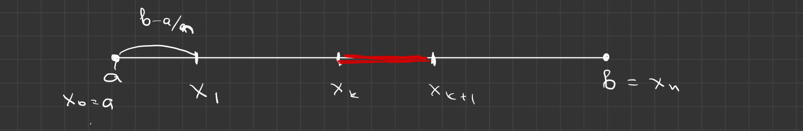
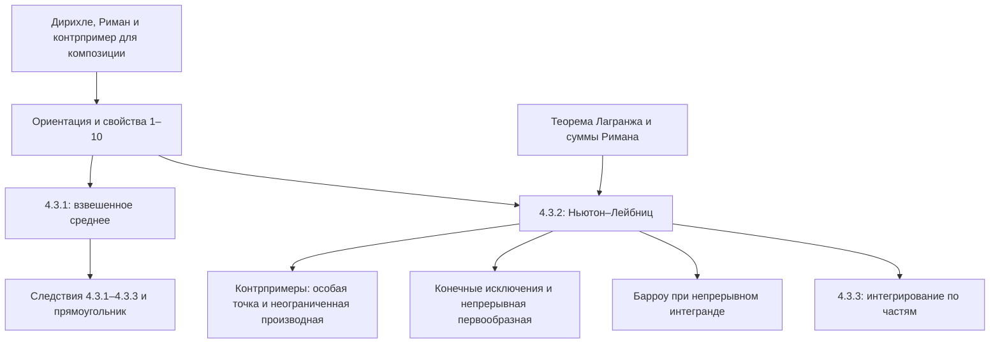

# Лекции 43–44 — Свойства интеграла Римана и формула Ньютона–Лейбница

[Индекс лекций](index.md) · [English](../../en/lectures-2025-26/lecture-43-44.md) · [Español](../../es/lectures-2025-26/lecture-43-44.md)

> **Источник:** `ma25_26-lectures_43-44_notes.pdf` — 38 страниц, 16 печатных слайдов. Рукописные страницы: 4–8, 11–13, 15–16, 18–19, 21, 26–27, 29, 31–32, 34–36, 38. Учтены рукописные добавления на печатных слайдах. Дата: 19 марта 2026. Пять иллюстраций извлечены из соответствующих страниц PDF и проверены по одной.
>
> **Семестр 2: лекции 33–64; семестр 1 завершился лекцией 32. Дублирующий материал существует начиная с лекции 33** в [папке `ru/lectures/`](../lectures/index.md). Начальные примеры пересекаются с [§4.2 «Интеграл Римана»](../lectures/03-riemann-integral-4-2.md), основная часть — с [§4.3 «Свойства интеграла Римана»](../lectures/04-riemann-properties-4-3.md); сохранён [архивный конспект «Лекция 43-44 1»](../../../source/MathInMind/МАТАН_Л/Лекция%2043-44%201.md). Ниже — полная самостоятельная иллюстрированная версия нового источника, а не замена его ссылками.
>
> **Соглашения.** По умолчанию $a<b$; соглашения о вырожденном отрезке и обратном порядке пределов вводятся отдельно. $\mathcal R[a,b]$ и $C[a,b]$ — классы интегрируемых по Риману и непрерывных функций. Определения сумм, колебаний и критерии — в [лекциях 39–40](lecture-39-40.md), классы интегрируемых функций — в [лекциях 41–42](lecture-41-42.md). Все интегралы здесь — собственные интегралы Римана. Условия непрерывности, существенные для пунктов 9–10, указаны явно.

## Печатные слайды 1–3 (стр. PDF 1–3). Введение и границы источника

**Цитата дня:** «Возможно всё! На невозможное просто требуется больше времени!»

**Цели на слайде:** свойства интеграла и теорема Барроу; теоремы о среднем и следствия; формула Ньютона–Лейбница и замечания; интегрирование по частям и замена переменной в определённом интеграле; формула Тейлора с интегральным остатком.

> **Граница PDF.** Данный файл заканчивается доказательством интегрирования по частям, теоремы 4.3.3. Замена переменной и интегральный остаток Тейлора **упомянуты в целях, но здесь не развёрнуты**; их формулы и доказательства не приписываются этому источнику.

## Рукописные примеры перед §3

### Рукописная страница (стр. PDF 4). Функция Дирихле

$$
\chi(x)=
\begin{cases}
1,&x\in\mathbb Q,\\
0,&x\notin\mathbb Q.
\end{cases}
$$

В любом невырожденном подотрезке есть рациональные и иррациональные точки. Поэтому для каждого разбиения

$$
M_k=1,\quad m_k=0,\quad\omega_k(\chi)=1,
\qquad
\sum_{k=0}^{n-1}\omega_k(\chi)\Delta x_k=b-a\ne0.
$$

Критерий интегрируемости не выполнен: $\chi\notin\mathcal R[a,b]$.

### Рукописные страницы (стр. PDF 5–7). Функция Римана (Томаэ)

$$
\psi(x)=
\begin{cases}
1/q,&x=p/q\in\mathbb Q,\ p\in\mathbb Z,\ q\in\mathbb N,\ \gcd(p,q)=1,\\
0,&x\notin\mathbb Q.
\end{cases}
$$

Утверждение: функция интегрируема на любом отрезке, её интеграл равен нулю. В рукописном доказательстве рассматривается $[0,1]$.

**1. Нижние суммы.** На каждом подотрезке есть иррациональные точки, а функция неотрицательна, поэтому $s_\tau(\psi)=0$.

**2. Верхние суммы.** По заданному $\varepsilon>0$ выберем натуральное число

$$
N>\frac2\varepsilon,\qquad\frac1N<\frac\varepsilon2.
$$

Множество рациональных точек с малыми знаменателями

$$
A=\{p/q\in\mathbb Q\cap[0,1]:\ \gcd(p,q)=1,\ q\le N\}
$$

конечно. Пусть $C_N$ — число его элементов. На эскизе дроби группируются по знаменателям; возможные повторы после сокращения не мешают конечности.

Положим $\delta=\varepsilon/(4C_N)$ и рассмотрим любое разбиение с $\lambda_\tau<\delta$. Разделим его подотрезки на две группы:

- «высокие»: $M_k\ge1/N$; каждый содержит точку множества $A$;
- остальные: $M_k<1/N$.

> **Редакторское пояснение оценки супремума.** Если подотрезок не содержит точек $A$, все ненулевые значения $\psi$ на нём не превосходят $1/(N+1)$. Значит, $M_k\le1/(N+1)<1/N$. Это обосновывает наличие точки с малым знаменателем в каждом «высоком» подотрезке; достижение произвольного супремума здесь не предполагается.

Каждая точка множества принадлежит не более чем двум соседним подотрезкам, значит, высоких подотрезков не больше $2C_N$. Так как $0\le\psi\le1$, получаем

$$
S_\tau(\psi)
\le 2C_N\lambda_\tau+\frac1N\sum_{k=0}^{n-1}\Delta x_k
<2C_N\delta+\frac1N
<\frac\varepsilon2+\frac\varepsilon2=\varepsilon.
$$

Таким образом, $S_\tau(\psi)-s_\tau(\psi)\to0$ при $\lambda_\tau\to0$. По критерию и следствию о пределах сумм

$$
\psi\in\mathcal R[0,1],\qquad\int_0^1\psi=0.
$$

$\blacksquare$

> **Редакционное пояснение общего отрезка.** На произвольном отрезке низкая часть оценивается величиной $(b-a)/N$ вместо $1/N$; число рациональных точек с ограниченными знаменателями на нём по-прежнему конечно, и параметры выбираются соответственно. Если таких высоких точек нет, высокая часть оценки просто отсутствует. Это поясняет заявленное в рукописи утверждение для любого отрезка.

### Рукописная страница (стр. PDF 8). Композиция интегрируемых функций

Контрпример начат внизу стр. 7. Пусть внешняя функция на $[0,1]$ равна

$$
f(y)=
\begin{cases}
1,&0<y\le1,\\
0,&y=0.
\end{cases}
$$

Она интегрируема: отличается от постоянной лишь в одной точке. Внутренняя функция Римана также интегрируема, но

$$
f\circ\psi=\chi\notin\mathcal R[a,b].
$$

**Вывод:** композиция двух интегрируемых функций не обязана быть интегрируемой.

**Рукописное уточнение (без доказательства).** Если потребовать непрерывность внешней функции на содержащем значения внутренней функции **замкнутом отрезке**, утверждение верно:

$$
\varphi:[\alpha,\beta]\to[a,b],\qquad
\varphi\in\mathcal R[\alpha,\beta],\qquad f\in C[a,b]
\quad\Longrightarrow\quad
f\circ\varphi\in\mathcal R[\alpha,\beta].
$$

## Глава 4, §3. Свойства интеграла Римана

### Печатный слайд 4 (стр. PDF 9). Ориентация и вырожденный отрезок

Дополняем определение соглашениями. При $b<a$ и $f\in\mathcal R[b,a]$ полагаем

$$
\int_a^b f=-\int_b^a f.
$$

На вырожденном отрезке любую функцию считаем интегрируемой и полагаем

$$
\int_a^a f=0.
$$

> **Исправление слайда.** В условии обратного порядка концов напечатано $\mathcal R[a,b]$; обычный отрезок области интегрируемости здесь $[b,a]$. Исправлен только порядок концов в условии, не знак формулы.

### Печатный слайд 5 (стр. PDF 10). Свойства 1–6

Пусть подынтегральные функции интегрируемы на соответствующих отрезках.

**1. Перестановка пределов:**

$$
\int_b^a f(x)\,dx=-\int_a^b f(x)\,dx.
$$

**2. Аддитивность по отрезку:** при $a<c<b$

$$
\int_a^b f(x)\,dx
=\int_a^c f(x)\,dx+\int_c^b f(x)\,dx.
$$

**3. Вынесение постоянного множителя:** для $\alpha\in\mathbb R$

$$
\int_a^b\alpha f(x)\,dx=\alpha\int_a^b f(x)\,dx.
$$

**4. Сумма и разность:**

$$
\int_a^b(f(x)\pm g(x))\,dx
=\int_a^b f(x)\,dx\pm\int_a^b g(x)\,dx.
$$

**5. Неотрицательность:**

$$
f\ge0\quad\Longrightarrow\quad\int_a^b f(x)\,dx\ge0.
$$

**6. Монотонность:**

$$
f\le g\quad\Longrightarrow\quad
\int_a^b f(x)\,dx\le\int_a^b g(x)\,dx.
$$

В пунктах 5–6 сохраняются **нестрогие** знаки неравенств, как на слайде.

### Рукописные страницы (стр. PDF 11–13). Доказательства свойств 1–6

**1.** Следует из принятого соглашения.

**2.** Интегрируемость на частях следует из теоремы 4.2.4. Разобьём $[a,c]$ и $[c,b]$ каждое на равные части, число которых равно $n$. Выберем оснащения и обозначим соответствующие суммы через $\sigma_n^1,\sigma_n^2$. Их объединение — оснащённое разбиение всего отрезка.

Его ранг стремится к нулю, и для объединённой суммы

$$
\sigma_n=\sigma_n^1+\sigma_n^2,
\qquad
\lambda_{\tau_n}=\max\left\{\frac{c-a}{n},\frac{b-c}{n}\right\}\to0.
$$

Переходя к пределу, получаем аддитивность.

**3–4.** Для одного и того же оснащения справедливы тождества

$$
\sigma_\tau(\alpha f,\xi)=\alpha\sigma_\tau(f,\xi),
\qquad
\sigma_\tau(f\pm g,\xi)=\sigma_\tau(f,\xi)\pm\sigma_\tau(g,\xi).
$$

Арифметические действия над пределами дают нужные равенства; интегрируемость функций уже обеспечена теоремой 4.2.6.

**6.** Из поточечного сравнения при одинаковом оснащении

$$
f\le g\quad\Longrightarrow\quad
\sigma_\tau(f,\xi)\le\sigma_\tau(g,\xi).
$$

Переходим к пределу и сохраняем нестрогое неравенство.

**5.** Применяем пункт 6 к нулевой и неотрицательной функциям. $\blacksquare$

### Печатный слайд 6 (стр. PDF 14). Свойства 7–10

**7. Оценка модуля интеграла:**

$$
\left|\int_a^b f(x)\,dx\right|\le\int_a^b|f(x)|\,dx.
$$

**8. Оценка через длину:** если $|f(x)|\le M$ на отрезке, то

$$
\left|\int_a^b f(x)\,dx\right|\le M(b-a).
$$

**9. Нулевой интеграл неотрицательной непрерывной функции:**

$$
f\in C[a,b],\qquad f\ge0,\qquad \int_a^b f(x)\,dx=0
\quad\Longrightarrow\quad f\equiv0\text{ на }[a,b].
$$

**10. Теорема Барроу.** Для $f\in C[a,b]$ функция

$$
\varphi(x)=\int_a^x f(y)\,dy,\qquad a\le x\le b,
$$

дифференцируема во внутренних точках и

$$
\varphi'(x)=f(x).
$$

В концах понимаются соответствующие односторонние производные. Доказательство отложено в источнике до стр. 36.

> **Существенные условия.** Непрерывность в пункте 9 **дописана от руки** на слайде. Для пункта 10 она здесь явно восстановлена: печатное утверждение без дополнительного условия о функции слишком широко, а доказательство на стр. 36 использует существование первообразной. Из одной интегрируемости нельзя заключать дифференцируемость интеграла во всех точках. Без непрерывности неверен и пункт 9: функция, равная единице в одной точке и нулю в остальных, имеет нулевой интеграл, но не тождественно равна нулю. Последний пример — редакционное пояснение на основе лекций 41–42.

### Рукописные страницы (стр. PDF 15–16). Доказательства свойств 7–9

**7.** Из $-|f|\le f\le|f|$ и монотонности с линейностью следует

$$
-\int_a^b|f|\le\int_a^b f\le\int_a^b|f|.
$$

Это и есть оценка модуля.

**8.** По пункту 7 и сравнению с постоянной

$$
\left|\int_a^b f\right|\le\int_a^b|f|
\le\int_a^b M=M(b-a).
$$

**9.** Если функция не тождественно нулевая, её неотрицательность даёт точку $x_0\in[a,b]$ с $f(x_0)>0$. По непрерывности существует подотрезок $[\alpha,\beta]\subset[a,b]$ положительной длины, на котором $f(x)\ge f(x_0)/2$. Тогда аддитивность и неотрицательность на остальных частях дают

$$
\int_a^b f\ge\int_\alpha^\beta f
\ge\frac{f(x_0)}2(\beta-\alpha)>0,
$$

вопреки условию. $\blacksquare$

> **Уточнение доказательства.** Если положительное значение достигнуто в конце отрезка, берётся **односторонний** подотрезок внутри области определения, а не симметричная окрестность, выходящая за её границу.

### Печатный слайд 7 (стр. PDF 17). Первая теорема о среднем

**Теорема 4.3.1.** Пусть $f,g\in\mathcal R[a,b]$, $g\ge0$ или $g\le0$, а $m,M\in\mathbb R$ таковы, что $m\le f\le M$. Тогда найдётся $\mu\in[m,M]$ такое, что

$$
\int_a^b fg=\mu\int_a^b g.
$$

### Рукописные страницы (стр. PDF 18–19). Доказательство теоремы 4.3.1

Пусть сначала $g\ge0$. Тогда $\int_a^b g\ge0$, а из $m\le f\le M$ следует $mg\le fg\le Mg$. По свойствам интеграла

$$
m\int_a^b g\le\int_a^b fg\le M\int_a^b g.
$$

- Если $\int_a^b g=0$, обе границы равны нулю, значит $\int_a^b fg=0$. Подходит любое $\mu\in[m,M]$; делить на нулевой интеграл нельзя.
- Если $\int_a^b g>0$, делим неравенство и полагаем

$$
\mu=\frac{\int_a^b fg}{\int_a^b g}\in[m,M].
$$

При $g\le0$ применяем доказанное к $-g\ge0$ и меняем знак в полученном равенстве. $\blacksquare$

### Печатный слайд 8 (стр. PDF 20). Непрерывная функция под знаком среднего

**Следствие 4.3.1.** Пусть $f\in C[a,b]$, $g\in\mathcal R[a,b]$, а $g\ge0$ или $g\le0$. Тогда найдётся $c\in[a,b]$ такое, что

$$
\int_a^b fg=f(c)\int_a^b g.
$$

### Рукописная страница (стр. PDF 21). Доказательство следствия 4.3.1

По теореме Вейерштрасса существуют $m=\min_{[a,b]}f$ и $M=\max_{[a,b]}f$. Теорема 4.3.1 даёт $\mu\in[m,M]$. По теореме о промежуточном значении непрерывная функция принимает это значение: $f(c)=\mu$ для некоторого $c\in[a,b]$. Подставляем в равенство теоремы. $\blacksquare$

### Печатный слайд 9 (стр. PDF 22). Среднее значение ограниченной интегрируемой функции

**Следствие 4.3.2.** Пусть $f\in\mathcal R[a,b]$ и $m\le f\le M$, где $m,M\in\mathbb R$. Тогда существует $\mu\in[m,M]$ такое, что

$$
\int_a^b f=\mu(b-a).
$$

**Рукописное доказательство на слайде:** положить $g\equiv1$ в теореме 4.3.1:

$$
\int_a^b f=\int_a^b f\cdot1=\mu\int_a^b1=\mu(b-a).
$$

$\blacksquare$

### Печатный слайд 10 (стр. PDF 23). Среднее значение непрерывной функции

**Следствие 4.3.3.** Для $f\in C[a,b]$ существует $c\in[a,b]$ такое, что

$$
\int_a^b f=f(c)(b-a).
$$

**Рукописное доказательство на слайде:** положить $g\equiv1$ в следствии 4.3.1. $\blacksquare$

### Печатный слайд 11 (стр. PDF 24). Названия и геометрия

1. Обычно следствия 4.3.2 и 4.3.3 называют **первой теоремой о среднем**, а теорему 4.3.1 и следствие 4.3.1 — **усиленной**, или **обобщённой первой теоремой о среднем**.
2. Следствие 4.3.3 говорит, что интеграл непрерывной функции равен некоторой сумме Римана с **одним** слагаемым. Для изображённой неотрицательной функции площадь под графиком равна площади прямоугольника высоты $f(c)$ и ширины $b-a$.

### Печатный слайд 12 (стр. PDF 25). Формула Ньютона–Лейбница

**Теорема 4.3.2.** Пусть $f\in\mathcal R[a,b]$ и $F$ — первообразная $f$ на $[a,b]$. Тогда

$$
\int_a^b f=F(b)-F(a).
$$

### Рукописные страницы (стр. PDF 26–27). Доказательство теоремы 4.3.2

Для каждого натурального $n$ возьмём равномерное разбиение $\tau_n$:

$$
x_k=a+\frac{k(b-a)}n,\qquad k=0,\ldots,n,
\qquad\lambda_{\tau_n}=\frac{b-a}{n}\to0.
$$

На каждом подотрезке теорема Лагранжа даёт точку $\xi_k\in(x_k,x_{k+1})$ такую, что

$$
F(x_{k+1})-F(x_k)=F'(\xi_k)\Delta x_k=f(\xi_k)\Delta x_k.
$$

Телескопически суммируем:

$$
\begin{aligned}
F(b)-F(a)
&=\sum_{k=0}^{n-1}\bigl(F(x_{k+1})-F(x_k)\bigr)\\
&=\sum_{k=0}^{n-1}f(\xi_k)\Delta x_k
=\sigma_{\tau_n}(f,\xi).
\end{aligned}
$$

Левая часть не зависит от числа частей. Правая стремится к интегралу по интегрируемости $f$, поэтому $\int_a^b f=F(b)-F(a)$. $\blacksquare$

### Печатный слайд 13 (стр. PDF 28). Двойная подстановка

**Замечание 1.** Разность значений функции на концах называется **двойной подстановкой**. Обозначения слайда:

$$
\left.F\right|_a^b
=\left.F(x)\right|_a^b
=\left.F(x)\right|_{x=a}^{b}
=\left.[F(x)]\right|_{x=a}^{b}
=F(b)-F(a).
$$

**Замечание 2.** Двойная подстановка не зависит от выбора первообразной. Если $\Phi=F+C$, то

$$
\Phi(b)-\Phi(a)=F(b)+C-(F(a)+C)=F(b)-F(a).
$$

### Рукописная страница (стр. PDF 29). Нельзя применять формулу через особую точку

В источнике показано **неверное** рассуждение:

$$
\int_{-1}^{1}\frac{dx}{x^2}
\overset{\text{неверно}}{=}\left.-\frac1x\right|_{-1}^{1}=-2.
$$

Подынтегральная функция положительна вне нуля, но получился отрицательный ответ. Ошибка не в арифметике: функция не определена в нуле и неограниченна в его окрестности. Даже произвольное доопределение в нуле не сделает её интегрируемой по Риману. Функция $-1/x$ также не является первообразной **на всём отрезке** $[-1,1]$. Гипотезы теоремы 4.3.2 не выполнены; записанный собственный интеграл не существует.

### Печатный слайд 14 (стр. PDF 30). Условия формулы нельзя опускать

**Замечание 3.** Если $F$ дифференцируема на отрезке и $F'\in\mathcal R[a,b]$, то

$$
\int_a^b F'=F(b)-F(a).
$$

**Замечание 4.** Производная может оказаться неинтегрируемой, поэтому условие её интегрируемости необходимо.

**Замечание 5.** Интегрируемость функции и существование у неё первообразной — независимые условия.

> **Исправление слайда.** В печатном условии замечания 3 лишняя буква: $FF'$ вместо $F'$. Нужное условие интегрируемости производной отдельно восстановлено рукописной пометкой к замечанию 4.

### Рукописная страница (стр. PDF 31). Производная, не интегрируемая по Риману

$$
F(x)=
\begin{cases}
x^2\sin(1/x^2),&x\ne0,\\
0,&x=0.
\end{cases}
$$

Дифференцирование вне нуля и определение производной в нуле дают

$$
F'(x)=
\begin{cases}
2x\sin(1/x^2)-\dfrac2x\cos(1/x^2),&x\ne0,\\
0,&x=0.
\end{cases}
$$

Действительно, в нуле вычисляется предел разностного отношения:

$$
F'(0)=\lim_{h\to0}\frac{F(h)-F(0)}h
=\lim_{h\to0}h\sin(1/h^2)=0.
$$

Рукописная проверка неограниченности использует последовательность

$$
F'\!\left(\frac1{\sqrt{2k\pi}}\right)
=-2\sqrt{2k\pi}\xrightarrow[k\to\infty]{}-\infty.
$$

Следовательно, $F'\notin\mathcal R[-1,1]$ по лемме об ограниченности, хотя первообразная у неё есть — сама $F$.

### Рукописная страница (стр. PDF 32). Независимость двух условий

Обратный пример — $\operatorname{sgn}x$ на $[-1,1]$. Эта функция интегрируема, например, как кусочно-непрерывная, но не имеет первообразной на всём отрезке: её скачок в нуле несовместим со свойством промежуточных значений производной. Сравнение с примером предыдущей страницы подтверждает независимость:

- существование первообразной не гарантирует интегрируемость;
- интегрируемость не гарантирует существование первообразной.

### Печатный слайд 15 (стр. PDF 33). Конечное число исключительных точек

**Замечание 6.** Пусть $f\in\mathcal R[a,b]$, $F\in C[a,b]$, а равенство $F'=f$ выполнено на отрезке за исключением конечного числа точек. Тогда по-прежнему

$$
\int_a^b f=F(b)-F(a).
$$

Непрерывность функции $F$ в исключительных точках сохраняется в условии.

### Рукописные страницы (стр. PDF 34–35). Доказательство замечания 6

Перечислим внутренние исключительные точки $\alpha_1<\cdots<\alpha_{m-1}$ и положим $\alpha_0=a$, $\alpha_m=b$.

Для достаточно малого $\varepsilon>0$ на отрезке $[\alpha_k+\varepsilon,\alpha_{k+1}-\varepsilon]$ применима теорема 4.3.2. Поэтому

$$
\begin{aligned}
\int_{\alpha_k}^{\alpha_{k+1}}f
&=\lim_{\varepsilon\to0+}\int_{\alpha_k+\varepsilon}^{\alpha_{k+1}-\varepsilon}f\\
&=\lim_{\varepsilon\to0+}
\bigl(F(\alpha_{k+1}-\varepsilon)-F(\alpha_k+\varepsilon)\bigr)\\
&=F(\alpha_{k+1})-F(\alpha_k).
\end{aligned}
$$

Первый переход использует непрерывность интеграла по переменным пределам; последний — непрерывность $F$.

> **Пояснение первого перехода.** Из ограниченности $|f|\le M$ и свойства 8 следует $|\int_u^v f|\le M|v-u|$. Интегралы по двум отсекаемым частям стремятся к нулю. Здесь не предполагается непрерывность подынтегральной функции.

По аддитивности и телескопическому сокращению

$$
\int_a^b f
=\sum_{k=0}^{m-1}\int_{\alpha_k}^{\alpha_{k+1}}f
=\sum_{k=0}^{m-1}\bigl(F(\alpha_{k+1})-F(\alpha_k)\bigr)
=F(b)-F(a).
$$

$\blacksquare$

### Рукописная страница (стр. PDF 36). Отложенное доказательство теоремы Барроу

Пусть $f\in C[a,b]$. Существование первообразной $F$ обеспечено теоремой 4.1.2 из [лекции 36](lecture-36.md). В рукописи доказательство начинается с выбора такой первообразной. По формуле Ньютона–Лейбница

$$
\varphi(x)=\int_a^x f(y)\,dy=F(x)-F(a).
$$

Дифференцируем:

$$
\varphi'(x)=F'(x)-0=f(x).
$$

$\blacksquare$

Явное условие непрерывности выше обеспечивает существование используемой первообразной; доказательство не выводит её существование из одной лишь интегрируемости.

### Печатный слайд 16 (стр. PDF 37). Интегрирование по частям

**Теорема 4.3.3.** Пусть $f,g$ дифференцируемы на $[a,b]$ и $f',g'\in\mathcal R[a,b]$. Тогда

$$
\int_a^b fg'
=\left.fg\right|_a^b-\int_a^b f'g.
$$

### Рукописная страница (стр. PDF 38). Доказательство теоремы 4.3.3

1. Дифференцируемые функции $f,g$ непрерывны, следовательно, интегрируемы по теореме 4.2.2.
2. По теореме 4.2.6 произведения $fg'$ и $f'g$ интегрируемы. По правилу произведения их сумма — производная произведения:

$$
(fg)'=fg'+f'g\in\mathcal R[a,b].
$$

3. Применяем линейность и формулу Ньютона–Лейбница:

$$
\int_a^b fg'+\int_a^b f'g
=\int_a^b(fg)'
=\left.fg\right|_a^b.
$$

Перенос второго слагаемого даёт формулу интегрирования по частям. $\blacksquare$

На этом заканчивается фактическое содержание PDF; формул замены переменной и интегрального остатка Тейлора после него нет.

## Структура лекции

---

Предыдущие: [лекции 41–42](lecture-41-42.md) · [Индекс лекций](index.md) · [Происхождение иллюстраций](../../assets/lectures-2025-26/provenance-39-44.md).
