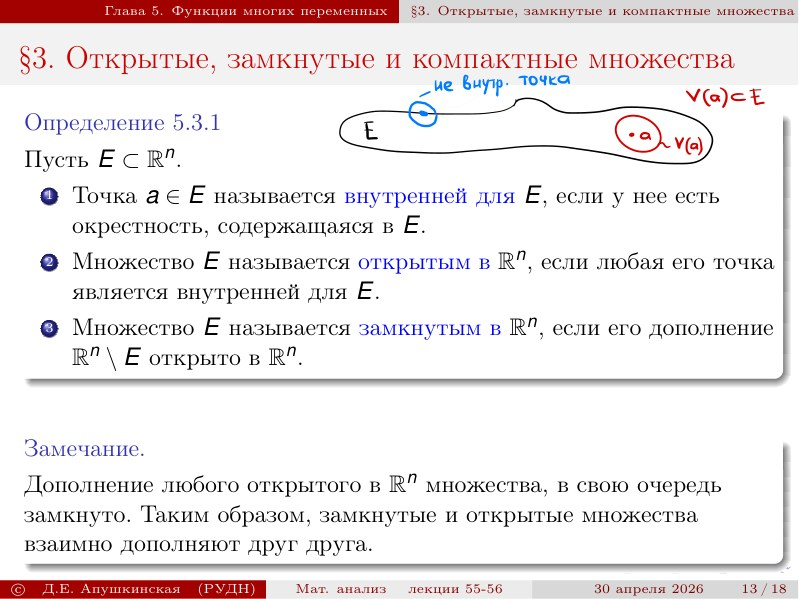
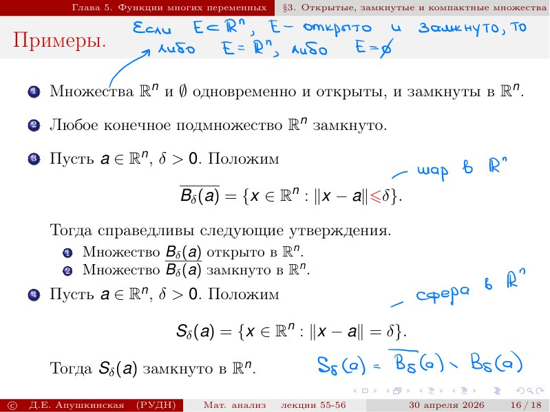
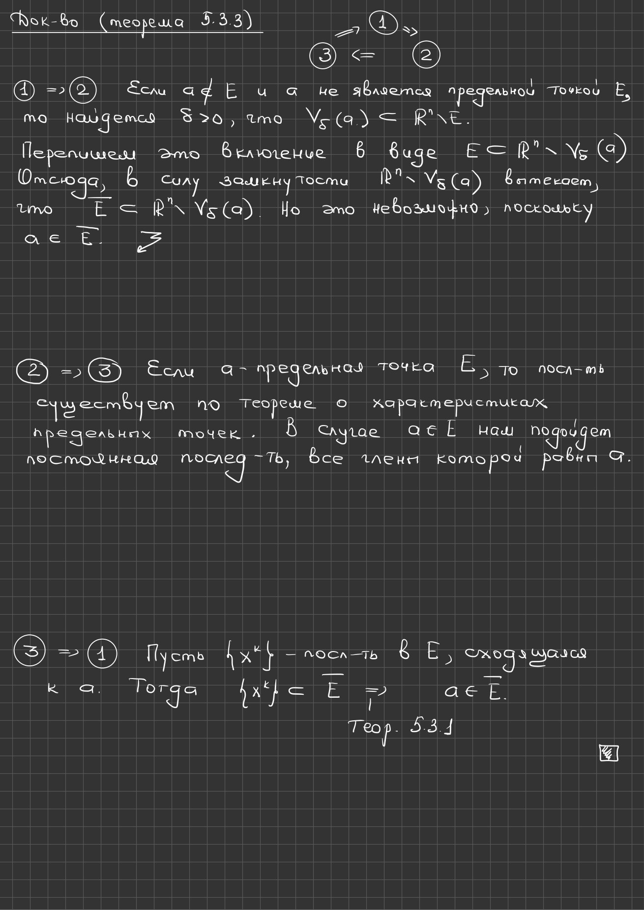

# Лекции 55–56 — предел подпоследовательности, компактность и топология $`\mathbb R^n`$

[← Лекция 54](lecture-54.md) · [Указатель лекций](index.md) · [Лекции 57–58 →](lecture-57-58.md) · [Термины и теоремы](../term-index.md) · [English](../../en/lectures-2025-26/lecture-55-56.md) · [Español](../../es/lectures-2025-26/lecture-55-56.md)


> **Источник и охват.** `MA25-26_ktrwbb_55-56_notes.pdf.txt`: 31 страница PDF, 18 печатных слайдов и 13 рукописных страниц; дата 30 апреля 2026. Печатные слайды 1–9 занимают страницы PDF 1–9; далее слайд 10 — страница 13, слайд 11 — 16, слайд 12 — 17, слайд 13 — 19, слайд 14 — 20, слайд 15 — 22, слайд 16 — 26, слайд 17 — 29 и слайд 18 — 30. Рукописные страницы PDF 10, 11, 12, 14, 15, 18, 21, 23, 24, 25, 27, 28 и 31 включены. Рукописные пометки на печатных слайдах 4, 5, 7, 8, 19 и 26 включены и отнесены к своим слайдам, а не к отдельным страницам PDF. Использован только PDF из чата; исходная папка не просматривалась, поэтому архивные имена и ссылки не указываются.

> **Дублирование семестра 2.** Лекции тематически пересекаются с [§5.2](../../ru/lectures/10-vector-sequences-5-2.md) и [§5.3](../../ru/lectures/11-topology-rn-5-3.md); см. также [регистр](../../ru/lectures/index.md). Семестр 2 охватывает лекции 33–64.

## Печатный слайд 1 (стр. PDF 1) — Титульный слайд

«Математический анализ», лекции 55–56; Д. Е. Апушкинская, РУДН; 30 апреля 2026.

## Печатный слайд 2 (стр. PDF 2) — Цитата дня

«Добро победит зло, если выспится и отдохнет..»

## Печатный слайд 3 (стр. PDF 3) — Цель лекции

Продолжается перенос на многомерный случай утверждений, доказанных ранее для одномерных числовых последовательностей. Требуется найти в $`\mathbb R^n`$ разумные аналоги открытых и замкнутых промежутков и [компактных](lecture-57-58.md#def-5-3-7) множеств.

<a id="thm-5-2-3"></a>
## Печатный слайд 4 (стр. PDF 4) — §2. Предел подпоследовательности — теорема 5.2.3

**Теорема 5.2.3.** Пусть $`\{x^k\}_{k=1}^{\infty}`$ — последовательность в $`\mathbb R^n`$, $`\{x^{k_i}\}_{i=1}^{\infty}`$ — её [подпоследовательность](lecture-11-12.md#def-2-3-7), $`a\in\overline{\mathbb R^n}`$. Если $`\lim_{k\to\infty}x^k=a`$, то $`\lim_{i\to\infty}x^{k_i}`$ также существует и равен $`a`$.

> **Редакторское примечание о текстовом слое.** В печатном слайде точка $`a`$ берётся из пополненного пространства $`\overline{\mathbb R^n}`$; текстовый слой PDF теряет надчёркивание и читается как $`a\in\mathbb R^n`$. Здесь и далее надчёркивания восстановлены по изображению страницы (см. также слайд 16, где потеряны чёрточки над $`B_\delta`$).

**Рукописное доказательство (нижняя часть того же слайда).** Пусть $`a\in\mathbb R^n`$. Тогда

```math
\lim_{i\to\infty}\|x^{k_i}-a\|=\lim_{k\to\infty}\|x^k-a\|=0,
```

откуда

```math
\lim_{i\to\infty}x^{k_i}=a.
```

Случай $`a=\infty`$ разбирается аналогично.


<a id="def-5-2-2"></a>
## Печатный слайд 5 (стр. PDF 5) — Ограниченность в $`\mathbb R^n`$ — определение 5.2.2

**Определение 5.2.2.** 1) Пусть $`E`$ — подмножество $`\mathbb R^n`$. Оно называется ограниченным, если существует такое $`C>0`$, что $`E\subset V_C(0)`$, то есть $`\|x\|<C`$ для любого $`x\in E`$. 2) Пусть $`f:E\subset\mathbb R^n\to\mathbb R^m`$. Отображение $`f`$ называется ограниченным, если множество его значений $`f(E)`$ ограничено в $`\mathbb R^m`$.

```math
E\subset V_C(0)\iff \|x\|<C\ \ \forall x\in E
```

Рукописная пометка под слайдом: «т. е. если $`f(E)`$ ограничено в $`\mathbb R^m`$».

## Печатный слайд 6 (стр. PDF 6) — Ограниченность как конечная точная грань

Ограниченность множества $`E\subset\mathbb R^n`$ эквивалентна условию $`\sup_{x\in E}\|x\|<+\infty`$, а ограниченность отображения $`f:E\subset\mathbb R^n\to\mathbb R^m`$ — условию $`\sup_{x\in E}\|f(x)\|<+\infty`$. В частности, ограниченность в $`\mathbb R^n`$ последовательности $`\{x^k\}_{k=1}^{\infty}`$ означает, что $`\sup_{k\in\mathbb N}\|x^k\|<+\infty`$.

```math
\sup_{x\in E}\|x\|<+\infty,\qquad \sup_{x\in E}\|f(x)\|<+\infty
```

```math
\sup_{k\in\mathbb N}\|x^k\|<+\infty
```

## Печатный слайд 7 (стр. PDF 7) — Ограниченность и проекции

1) Пусть $`E\subset\mathbb R^n`$, $`j\in\{1,\ldots,n\}`$. Проекцией $`E`$ на $`j`$-ю ось называется множество $`E_j=\{x_j:x\in E\}`$. Ограниченность $`E`$ равносильна ограниченности всех её проекций $`E_j`$ при $`j=1,\ldots,n`$; это вытекает непосредственно из оценки ниже. 2) В силу пункта 1 ограниченность отображения $`f:E\subset\mathbb R^n\to\mathbb R^n`$ эквивалентна ограниченности всех его координатных функций. В частности, последовательность $`\{x^k\}`$ в $`\mathbb R^n`$ ограничена тогда и только тогда, когда ограничены все её координатные последовательности.

```math
E_j=\{x_j:\ x\in E\}
```

```math
|x_j|\le\|x\|\le\sqrt{n}\max_{1\le i\le n}|x_i|
```

> **Источник и редакторское уточнение.** В пункте 2 печатного слайда отображение снова записано как $`f:E\subset\mathbb R^n\to\mathbb R^n`$, хотя в [определении 5.2.2](#def-5-2-2) и в остальном изложении образом служит $`\mathbb R^m`$. Расхождение не исправляется молча: ниже используется запись $`f:E\subset\mathbb R^n\to\mathbb R^m`$.

Рукописная пометка: $`x=(x_1,x_2,\ldots,x_n)\in E`$.

<a id="lem-5-2-2"></a>
## Печатный слайд 8 (стр. PDF 8) — Лемма 5.2.2

**Лемма 5.2.2.** Любая сходящаяся в $`\mathbb R^n`$ последовательность $`\{x^k\}`$ ограничена.

**Рукописное доказательство (на том же слайде).** Действительно, по [теореме 5.2.1](lecture-54.md#thm-5-2-1) все координатные последовательности $`\{x_i^k\}`$ сходятся и потому ограничены (согласно одномерной теории). Но тогда по пункту 2 предыдущего слайда ограничена и сама последовательность $`\{x^k\}`$.

## Печатный слайд 9 (стр. PDF 9) — Принцип выбора Больцано–Вейерштрасса

<a id="thm-5-2-4"></a>**Теорема 5.2.4.** Пусть $`\{x^k\}_{k=1}^{\infty}`$ — последовательность в $`\mathbb R^n`$. Тогда: 1) если она ограничена, то из неё можно выбрать сходящуюся подпоследовательность; 2) если она не ограничена, то у неё есть подпоследовательность $`\{x^{k_i}\}`$, стремящаяся к бесконечности.

## Рукописная страница (стр. PDF 10) — Доказательство теоремы 5.2.4, пункт 1

Пусть последовательность $`\{x^k\}`$ ограничена в $`\mathbb R^n`$. Тогда все её координатные последовательности тоже ограничены, и для каждой из них можно воспользоваться одномерным [принципом Больцано–Вейерштрасса](lecture-11-12.md#thm-2-3-4). Выберем из $`\{x_1^k\}`$ сходящуюся подпоследовательность $`\{x_1^{k_i}\}`$; из $`\{x_2^{k_i}\}`$ выберем сходящуюся подпоследовательность $`\{x_2^{s_i}\}`$, заметив, что $`\{x_1^{s_i}\}`$ тоже сходится как подпоследовательность сходящейся $`\{x_1^{k_i}\}`$. Продолжая эти рассуждения для остальных координатных последовательностей, в конце концов получим подпоследовательность $`\{x^{t_i}\}`$, у которой все координатные последовательности сходятся; тогда $`\{x^{t_i}\}`$ сходится в $`\mathbb R^n`$ по [теореме 5.2.1](lecture-54.md#thm-5-2-1).

```math
\{x_1^{k}\}\supset\{x_1^{k_i}\}\supset\{x_1^{s_i}\}\supset\cdots
```


## Рукописная страница (стр. PDF 11) — Схема диагонального выбора

Страница содержит схему выбора, соответствующую предыдущему доказательству. Вектор записывается по координатам; синим обведены члены первой координатной последовательности, из которых выбирается сходящаяся подпоследовательность; зелёным показан возврат к выбранным номерам и прореживание первой координатной последовательности так, чтобы сохранились только номера, задействованные во второй координате. Ниже та же процедура повторяется для третьей координаты; красным отмечен очередной шаг прореживания.

```math
x^k=\left(x_1^k,x_2^k,\ldots,x_n^k\right)
```


## Рукописная страница (стр. PDF 12) — Доказательство теоремы 5.2.4, пункт 2

Так как числовая последовательность $`\{\|x^k\|\}_{k=1}^{\infty}`$ не [ограничена сверху](lecture-05-06.md#def-1-3-7), у неё есть подпоследовательность $`\{\|x^{k_i}\|\}_{i=1}^{\infty}`$, стремящаяся к $`+\infty`$. Тогда

```math
\lim_{i\to\infty}\|x^{k_i}\|=+\infty\ \Longrightarrow\ \lim_{i\to\infty}x^{k_i}=\infty.
```

## Печатный слайд 10 (стр. PDF 13) — Критерий Больцано–Коши

<a id="thm-5-2-5"></a>**Теорема 5.2.5.** Пусть $`\{x^k\}_{k=1}^{\infty}`$ — последовательность в $`\mathbb R^n`$. Тогда равносильны утверждения: 1) последовательность $`\{x^k\}`$ сходится в $`\mathbb R^n`$; 2) для любого $`\varepsilon>0`$ найдётся $`N\in\mathbb N`$ такое, что $`\|x^k-x^m\|<\varepsilon`$ при всех $`k,m>N`$.

**Замечание.** Последовательность в $`\mathbb R^n`$, удовлетворяющую условию 2, называют [сходящейся в себе](lecture-13.md#def-2-3-10) или фундаментальной.

```math
\forall\varepsilon>0\ \ \exists N\in\mathbb N\ \ \forall k,m>N:\ \|x^k-x^m\|<\varepsilon
```

## Рукописная страница (стр. PDF 14) — Доказательство 1) ⇒ 2)

По [теореме 5.2.1](lecture-54.md#thm-5-2-1) все координатные последовательности $`\{x_i^k\}`$ сходятся, и в силу одномерного критерия Больцано–Коши они фундаментальны. Тогда по $`\varepsilon>0`$ можно подобрать такое $`N\in\mathbb N`$, что для любого $`i\in\{1,\ldots,n\}`$

```math
|x_i^k-x_i^m|<\frac{\varepsilon}{\sqrt n}
```

при всех $`k,m\ge N`$. Отсюда в силу неравенства (5.2.1)

```math
|x_i|\le\|x\|\le\sqrt{n}\max_{1\le i\le n}|x_i|,
```

то есть

```math
\|x^k-x^m\|\le\sqrt{n}\max_{1\le i\le n}|x_i^k-x_i^m|<\sqrt n\,\frac{\varepsilon}{\sqrt n}=\varepsilon,
```

получим $`\|x^k-x^m\|<\varepsilon`$, что и даёт утверждение 2.


## Рукописная страница (стр. PDF 15) — Доказательство 2) ⇒ 1)

Условие 2 означает, что $`\forall\varepsilon>0`$ $`\exists N\in\mathbb N`$ $`\forall k,m\in\mathbb N`$ выполнено $`\|x^k-x^m\|<\varepsilon`$. В силу (5.2.1) для любых $`k,m\in\mathbb N`$ и $`i\in\{1,\ldots,n\}`$ справедливо неравенство

```math
|x_i^k-x_i^m|\le\|x^k-x^m\|<\varepsilon.
```

Поэтому условие 2 влечёт сходимость в себе координатных последовательностей $`\{x_i^k\}`$. По одномерному критерию Больцано–Коши все они сходятся в $`\mathbb R`$, а тогда по [теореме 5.2.1](lecture-54.md#thm-5-2-1) последовательность $`\{x^k\}`$ сходится в $`\mathbb R^n`$.

## Печатный слайд 11 (стр. PDF 16) — Предельная и изолированная точки

<a id="def-5-2-3"></a>**Определение 5.2.3.** Пусть $`E\subset\mathbb R^n`$. 1) Точка $`a\in\overline{\mathbb R^n}`$ называется предельной для $`E`$, если для любого $`\varepsilon>0`$ множество $`E\cap\dot V_\varepsilon(a)`$ непусто. 2) Точка $`a\in E`$ называется изолированной для $`E`$, если она не является предельной точкой $`E`$.

```math
E\cap\dot V_\varepsilon(a)\ne\varnothing
```

> **Расхождение текстового слоя.** Здесь и далее текстовый слой теряет точки над символами [проколотых окрестностей](lecture-14.md#def-2-4-2) и надчёркивания: в печатной строке стоит $`\dot V_\varepsilon(a)`$ и $`a\in\overline{\mathbb R^n}`$, тогда как извлечённый текст даёт $`V_\varepsilon(a)`$ и $`a\in\mathbb R^n`$.

## Печатный слайд 12 (стр. PDF 17) — Характеристика предельных точек

<a id="thm-5-2-6"></a>**Теорема 5.2.6.** Пусть $`E\subset\mathbb R^n`$, $`a\in\overline{\mathbb R^n}`$. Тогда равносильны утверждения: 1) точка $`a`$ является предельной для $`E`$; 2) существует последовательность $`\{x^k\}_{k=1}^{\infty}`$ в $`E\setminus\{a\}`$, для которой $`\lim_{k\to\infty}x^k=a`$.

## Рукописная страница (стр. PDF 18) — Доказательство теоремы 5.2.6

Доказательство проводится только для $`a\in\mathbb R^n`$; случай $`a=\infty`$ оставлен в качестве упражнения. 1) ⇒ 2) Пусть $`a`$ — предельная точка $`E`$, то есть $`\forall\varepsilon>0`$ множество $`E\cap\dot V_\varepsilon(a)\ne\varnothing`$. Тогда для любого $`k`$ найдётся точка $`x^k\in E\setminus\{a\}`$, для которой $`\|x^k-a\|<1/k`$. Отсюда $`\lim_{k\to\infty}\|x^k-a\|=0`$, то есть $`\lim_{k\to\infty}x^k=a`$. 2) ⇒ 1) Пусть $`\{x^k\}_{k=1}^{\infty}`$ — последовательность в $`E\setminus\{a\}`$, сходящаяся к $`a`$. Для любого $`\varepsilon>0`$ найдётся такое $`k\in\mathbb N`$, что $`\|x^k-a\|<\varepsilon`$. Поэтому $`x^k\in V_\varepsilon(a)\cap\left(E\setminus\{a\}\right)`$, то есть $`x^k\in\dot V_\varepsilon(a)\cap E`$. Тогда для любого $`\varepsilon>0`$ множество $`E\cap\dot V_\varepsilon(a)\ne\varnothing`$, значит, $`a`$ — предельная точка $`E`$.

```math
\forall\varepsilon>0\ \ E\cap\dot V_\varepsilon(a)\ne\varnothing
```

```math
\|x^k-a\|<\frac1k,\qquad x^k\in E\setminus\{a\}
```

## Печатный слайд 13 (стр. PDF 19) — §3. Открытые, замкнутые и компактные множества

<a id="def-5-3-1"></a>**Определение 5.3.1.** Пусть $`E\subset\mathbb R^n`$. 1) Точка $`a\in E`$ называется внутренней для $`E`$, если у неё есть окрестность, содержащаяся в $`E`$. 2) Множество $`E`$ называется открытым в $`\mathbb R^n`$, если любая его точка является внутренней для $`E`$. 3) Множество $`E`$ называется замкнутым в $`\mathbb R^n`$, если его дополнение $`\mathbb R^n\setminus E`$ открыто в $`\mathbb R^n`$.

**Замечание.** Дополнение любого открытого в $`\mathbb R^n`$ множества, в свою очередь, замкнуто; таким образом, замкнутые и [открытые множества](#def-5-3-1) взаимно дополняют друг друга.

Рукописная схема на слайде: изображено множество $`E`$ с [внутренней точкой](lecture-57-58.md#def-5-3-3) $`a`$ и её окрестностью $`V(a)\subset E`$; отдельно отмечена [граничная точка](lecture-57-58.md#def-5-3-4), не являющаяся внутренней.

```math
V(a)\subset E
```



## Печатный слайд 14 (стр. PDF 20) — Характеристика замкнутых множеств

<a id="thm-5-3-1"></a>**Теорема 5.3.1.** Пусть $`E\subset\mathbb R^n`$. Тогда равносильны утверждения: 1) $`E`$ замкнуто в $`\mathbb R^n`$; 2) $`E`$ содержит все свои предельные точки в $`\mathbb R^n`$; 3) если $`\{x^k\}_{k=1}^{\infty}`$ — сходящаяся последовательность в $`E`$, то $`\lim_{k\to\infty}x^k\in E`$.

## Рукописная страница (стр. PDF 21) — Доказательство теоремы 5.3.1

Доказательство идёт по схеме 1) ⇒ 3) ⇒ 2) ⇒ 1). 1) ⇒ 3): пусть $`\{x^k\}`$ — последовательность в $`E`$, $`a\in\mathbb R^n`$, $`\lim_{k\to\infty}x^k=a`$; покажем, что $`a\in E`$. Если это не так, то есть $`a\notin E`$, то из замкнутости $`E`$ следует существование окрестности $`V(a)\subset\mathbb R^n\setminus E`$. По определению предела при всех достаточно больших $`k\in\mathbb N`$ верно $`x^k\in V(a)\subset\mathbb R^n\setminus E`$; с другой стороны, для всех $`k\in\mathbb N`$ имеем $`x^k\in E`$ — противоречие. 3) ⇒ 2): пусть $`a\in\mathbb R^n`$ — предельная точка $`E`$. По [теореме 5.2.6](#thm-5-2-6) существует последовательность $`\{x^k\}\subset E`$, сходящаяся к $`a`$; тогда в силу 3) получаем $`a\in E`$. 2) ⇒ 1): докажем, что $`\mathbb R^n\setminus E`$ открыто. Пусть $`a\in\mathbb R^n\setminus E`$; проверим, что существует окрестность $`V(a)\subset\mathbb R^n\setminus E`$. Если это не так, то для любого $`\varepsilon>0`$ множество $`\dot V_\varepsilon(a)\cap E\ne\varnothing`$, то есть $`a`$ — предельная точка $`E`$, и по 2) $`a\in E`$ — противоречие.

```math
\mathbb R^n\setminus E
```

<a id="thm-5-3-2"></a>
## Печатный слайд 15 (стр. PDF 22) — Теорема 5.3.2 о семействах множеств

**Теорема 5.3.2.** Пусть $`A`$ — множество индексов, $`\{E_\alpha\}_{\alpha\in A}`$ и $`\{F_\alpha\}_{\alpha\in A}`$ — семейства открытых и замкнутых подмножеств в $`\mathbb R^n`$ соответственно. Тогда: 1) объединение всех $`E_\alpha`$ открыто, а пересечение всех $`F_\alpha`$ замкнуто в $`\mathbb R^n`$; 2) если множество индексов $`A`$ конечно, то пересечение всех $`E_\alpha`$ открыто, а объединение всех $`F_\alpha`$ замкнуто в $`\mathbb R^n`$.

**Следствие.** Пусть $`E`$ открыто, а $`F`$ замкнуто в $`\mathbb R^n`$. Тогда $`E\setminus F`$ открыто, а $`F\setminus E`$ замкнуто в $`\mathbb R^n`$.

```math
\bigcup_{\alpha\in A}E_\alpha,\qquad \bigcap_{\alpha\in A}F_\alpha
```

```math
E\setminus F,\qquad F\setminus E
```

## Рукописная страница (стр. PDF 23) — Доказательство теоремы 5.3.2, пункт 1

Обозначим $`E:=\bigcup_{\alpha\in A}E_\alpha`$ и $`F:=\bigcap_{\alpha\in A}F_\alpha`$. Если $`a\in E`$, то $`a\in E_\alpha`$ для некоторого $`\alpha\in A`$; поскольку $`E_\alpha`$ открыто и $`a\in E_\alpha`$, найдётся окрестность $`V(a)\subset E_\alpha`$, а значит, $`V(a)\subset E`$, то есть $`E`$ открыто. Для доказательства замкнутости $`F`$ заметим, что по правилу де Моргана

```math
\mathbb R^n\setminus F=\mathbb R^n\setminus\bigcap_{\alpha\in A}F_\alpha=\bigcup_{\alpha\in A}\left(\mathbb R^n\setminus F_\alpha\right).
```

Каждое множество $`\mathbb R^n\setminus F_\alpha`$ открыто по пункту 1 как дополнение замкнутого $`F_\alpha`$, поэтому их объединение открыто; следовательно, $`F`$ замкнуто.

## Рукописная страница (стр. PDF 24) — Доказательство теоремы 5.3.2, пункт 2

Пусть множество индексов $`A`$ конечно и $`E:=\bigcap_{\alpha\in A}E_\alpha`$. Если $`a\in E`$, то $`a\in E_\alpha`$ для всех $`\alpha\in A`$; поскольку каждое $`E_\alpha`$ открыто, для каждого $`\alpha\in A`$ найдётся $`\delta_\alpha>0`$ с $`V_{\delta_\alpha}(a)\subset E_\alpha`$. Положим $`\delta:=\min_{\alpha\in A}\delta_\alpha`$; так как $`A`$ конечно, этот минимум существует и положителен. Тогда $`V_\delta(a)\subset E_\alpha`$ при всех $`\alpha\in A`$, то есть $`V_\delta(a)\subset E`$, и $`E`$ открыто. Замкнутость объединения $`\bigcup_{\alpha\in A}F_\alpha`$ выводится из открытости $`E`$ с помощью правила де Моргана аналогично пункту 1.

```math
\delta:=\min_{\alpha\in A}\delta_\alpha>0,\qquad V_\delta(a)\subset E_\alpha\ \ \forall\alpha\in A
```

## Рукописная страница (стр. PDF 25) — Доказательство следствия к теореме 5.3.2

Имеем $`E\setminus F=E\cap\left(\mathbb R^n\setminus F\right)`$. Множество $`\mathbb R^n\setminus F`$ открыто, так как $`F`$ замкнуто, поэтому по [теореме 5.3.2](#thm-5-3-2) пересечение двух открытых множеств открыто и $`E\setminus F`$ открыто. Второе утверждение доказывается аналогично.

```math
E\setminus F=E\cap\left(\mathbb R^n\setminus F\right)
```

## Печатный слайд 16 (стр. PDF 26) — Примеры

1) Множества $`\mathbb R^n`$ и $`\varnothing`$ одновременно и открыты, и замкнуты в $`\mathbb R^n`$. 2) Любое конечное подмножество $`\mathbb R^n`$ замкнуто. 3) Пусть $`a\in\mathbb R^n`$, $`\delta>0`$, и положим $`\overline{B_\delta(a)}=\{x\in\mathbb R^n:\|x-a\|\le\delta\}`$. Тогда множество $`B_\delta(a)`$ открыто в $`\mathbb R^n`$, а множество $`\overline{B_\delta(a)}`$ замкнуто в $`\mathbb R^n`$. 4) Пусть $`a\in\mathbb R^n`$, $`\delta>0`$, и положим $`S_\delta(a)=\{x\in\mathbb R^n:\|x-a\|=\delta\}`$. Тогда $`S_\delta(a)`$ замкнуто в $`\mathbb R^n`$.

>
> **Источник и редакторское уточнение.** В текстовом слое PDF пункты 3.1 и 3.2 напечатаны без чёрточек, то есть как «$`B_\delta(a)`$ открыто» и «$`B_\delta(a)`$ замкнуто», что невозможно одновременно. По изображению страницы первое вхождение — открытый шар $`B_\delta(a)`$, второе — замкнутый шар $`\overline{B_\delta(a)}`$; ниже используется именно это чтение, а расхождение указано здесь явно.

Рукописные пометки: «шар в $`\mathbb R^n`$» у обозначения $`\overline{B_\delta(a)}`$, «сфера в $`\mathbb R^n`$» у $`S_\delta(a)`$, формула $`S_\delta(a)=\overline{B_\delta(a)}\setminus B_\delta(a)`$ и синяя запись: «Ваш: если $`E\subset\mathbb R^n`$, $`E`$ — открыто и замкнуто, то либо $`E=\mathbb R^n`$, либо $`E=\varnothing`$».

```math
S_\delta(a)=\overline{B_\delta(a)}\setminus B_\delta(a)
```



## Рукописная страница (стр. PDF 27) — Пример 3: открытость шара $`B_\delta(a)`$

Покажем, что $`B_\delta(a)`$ открыт в $`\mathbb R^n`$. Пусть $`b\in B_\delta(a)`$; нужно проверить, что $`b`$ — внутренняя точка $`B_\delta(a)`$. Положим $`\sigma:=\delta-\|b-a\|>0`$; это число положительно, поскольку $`B_\delta(a)=\{x\in\mathbb R^n:\|x-a\|<\delta\}`$ и $`b\in B_\delta(a)`$, то есть $`\|b-a\|<\delta`$. Рассмотрим шар $`B_\sigma(b)`$. Для любого $`x\in B_\sigma(b)`$ имеем

```math
\|x-a\|=\|x-b+b-a\|\le\|x-b\|+\|b-a\|<\sigma+\|b-a\|=\delta,
```

следовательно, $`x\in B_\delta(a)`$, то есть $`B_\sigma(b)\subset B_\delta(a)`$. Значит, $`b`$ — внутренняя точка, и $`B_\delta(a)`$ открыто.

```math
\sigma:=\delta-\|b-a\|>0,\qquad \|x-a\|\le\|x-b\|+\|b-a\|<\sigma+\|b-a\|=\delta
```

## Рукописная страница (стр. PDF 28) — Пример 3: замкнутость $`\overline{B_\delta(a)}`$ и замечание

Пусть $`\{x^k\}`$ — последовательность в $`\overline{B_\delta(a)}`$, сходящаяся к $`x\in\mathbb R^n`$. Тогда

```math
\|x-a\|=\lim_{k\to\infty}\|x^k-a\|\le\delta,
```

значит, $`x\in\overline{B_\delta(a)}`$ и $`\overline{B_\delta(a)}`$ замкнуто. Синяя пометка внизу: «Ваш: множество $`[0,1)`$ не будет ни открытым, ни замкнутым в $`\mathbb R`$, т. е. не следует думать, что любое подмножество $`\mathbb R^n`$ открыто или замкнуто».

## Печатный слайд 17 (стр. PDF 29) — Замыкание множества

<a id="def-5-3-2"></a>**Определение 5.3.2.** Пусть $`E\subset\mathbb R^n`$. Замыканием $`E`$ называют замкнутое множество $`F\subset\mathbb R^n`$, удовлетворяющее двум условиям: 1) $`F\supset E`$; 2) если $`A`$ — другое замкнутое подмножество $`\mathbb R^n`$, содержащее $`E`$, то $`A\supset F`$. Замыкание $`E`$ принято обозначать символом $`\overline E`$ или $`\operatorname{Cl}E`$.

**Замечание.** $`\overline E`$ является наименьшим по включению [замкнутым множеством](#thm-5-3-1), содержащим $`E`$. Более того, верно равенство ниже.

```math
\overline E=\bigcap\{F\subset\mathbb R^n:\ F\supset E,\ F=\overline F\}
```

## Печатный слайд 18 (стр. PDF 30) — Описание замыкания

Приведённое выше описание [замыкания](#def-5-3-2) неудобно для практических целей, поэтому характеристика замыкания формулируется в терминах последовательностей и предельных точек.

<a id="thm-5-3-3"></a>**Теорема 5.3.3.** Пусть $`E\subset\mathbb R^n`$, $`a\in\mathbb R^n`$. Тогда равносильны утверждения: 1) $`a\in\overline E`$; 2) точка $`a`$ лежит в $`E`$ или является предельной для $`E`$; 3) в $`E`$ существует последовательность, сходящаяся к $`a`$.

```math
a\in\overline E
```

## Рукописная страница (стр. PDF 31) — Доказательство теоремы 5.3.3

Доказательство идёт по схеме 1) ⇒ 2) ⇒ 3) ⇒ 1). 1) ⇒ 2): если $`a\notin E`$ и $`a`$ не является предельной точкой $`E`$, то найдётся $`\delta>0`$, для которого $`V_\delta(a)\subset\mathbb R^n\setminus E`$. Перепишем это включение в виде $`E\subset\mathbb R^n\setminus V_\delta(a)`$. Отсюда в силу замкнутости $`\mathbb R^n\setminus V_\delta(a)`$ вытекает, что $`\overline E\subset\mathbb R^n\setminus V_\delta(a)`$. Но это невозможно, поскольку $`a\in\overline E`$. 2) ⇒ 3): если $`a`$ — предельная точка $`E`$, то нужная последовательность существует по теореме о характеристиках предельных точек; в случае $`a\in E`$ подойдёт постоянная последовательность, все члены которой равны $`a`$. 3) ⇒ 1): пусть $`\{x^k\}`$ — последовательность в $`E`$, сходящаяся к $`a`$. Тогда $`\{x^k\}\subset\overline E`$ по [теореме 5.3.1](#thm-5-3-1), откуда $`a\in\overline E`$.

```math
\overline E\subset\mathbb R^n\setminus V_\delta(a)
```



---

[← Лекция 54](lecture-54.md) · [Указатель лекций](index.md) · [Лекции 57–58 →](lecture-57-58.md) · [Термины и теоремы](../term-index.md) · [English](../../en/lectures-2025-26/lecture-55-56.md) · [Español](../../es/lectures-2025-26/lecture-55-56.md)
