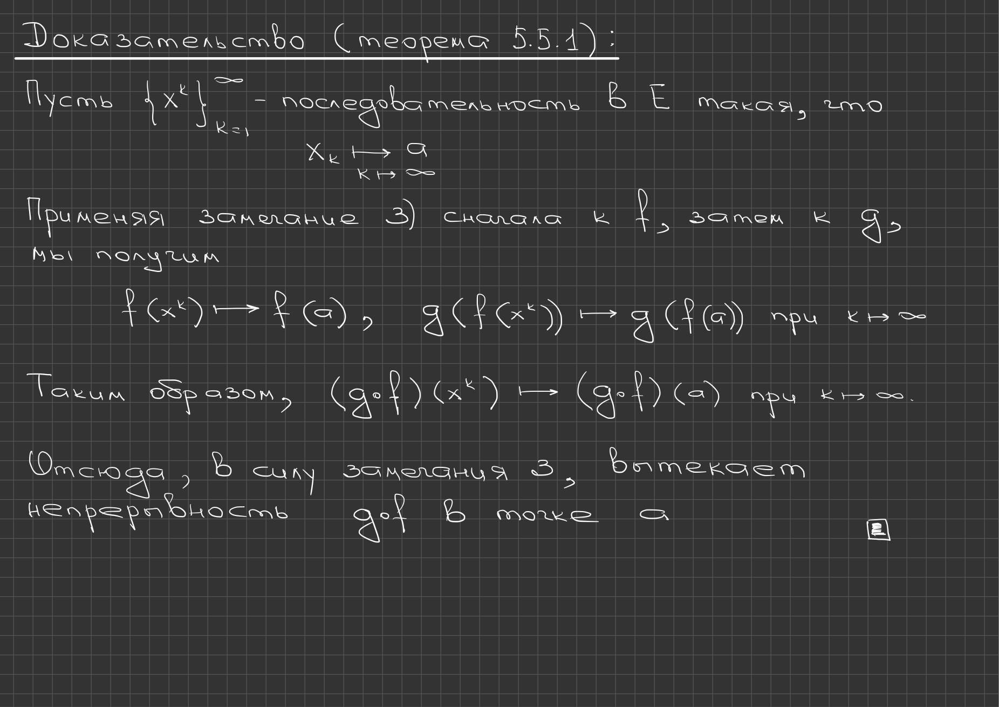
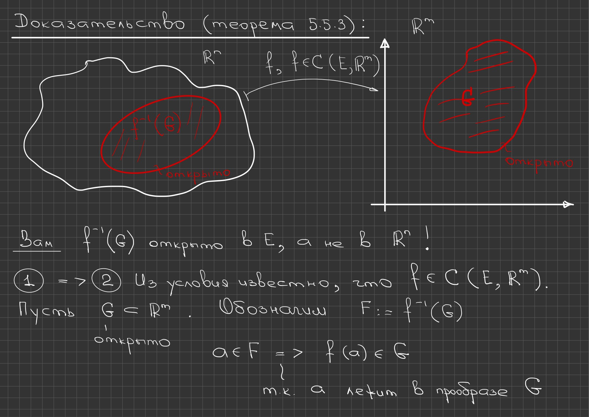
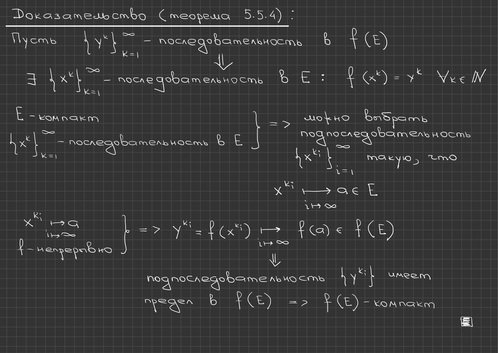
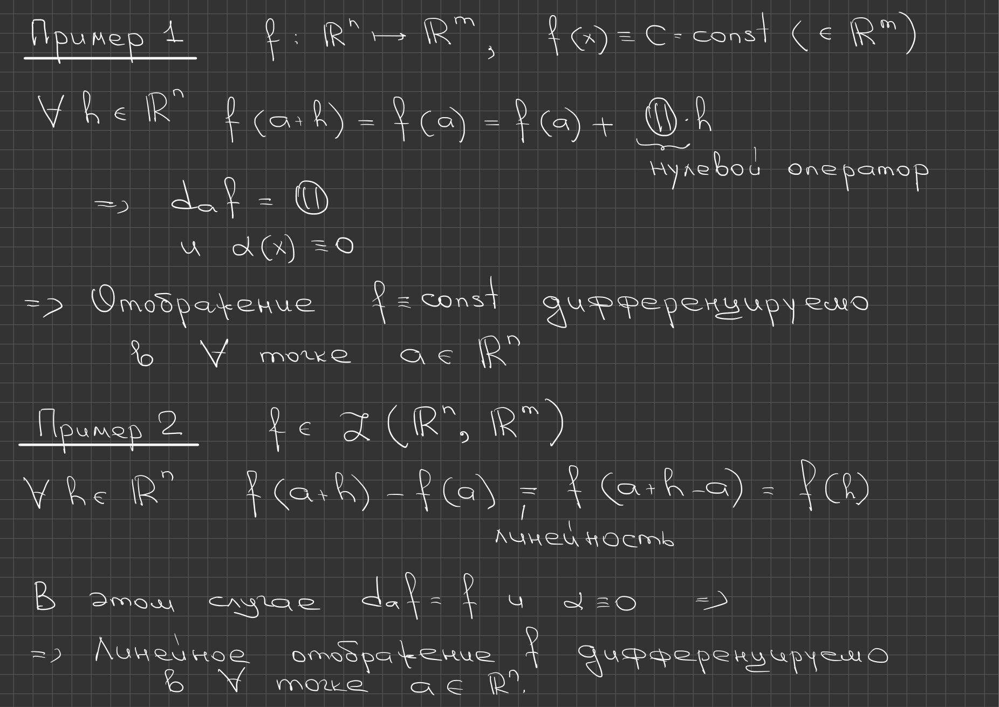

# Лекции 59–60 — непрерывные отображения и дифференцируемость в точке

[Индекс лекций](index.md) · [English](../../en/lectures-2025-26/lecture-59-60.md) · [Español](../../es/lectures-2025-26/lecture-59-60.md) · [Назад: 57–58](lecture-57-58.md)

> **Источник и охват.** `ma25_26-lectures_59-60_notes.pdf.txt`: 28 страниц PDF, 17 печатных слайдов и 11 рукописных страниц; дата 14 мая 2026. Печатные слайды 1–6 занимают страницы PDF 1–6; далее слайд 7 — страница 8, слайд 8 — 10, слайд 9 — 14, слайд 10 — 16, слайд 11 — 18, слайд 12 — 21, слайд 13 — 22, слайд 14 — 23, слайд 15 — 24, слайд 16 — 26 и слайд 17 — 27. Рукописные страницы PDF 7, 9, 11, 12, 13, 15, 17, 19, 20, 25 и 28 включены. Рукописные пометки на слайдах 15 и 16 отнесены к своим слайдам. Использован только PDF из чата; исходная папка не просматривалась, поэтому архивные имена и ссылки не указываются.

> **Дублирование семестра 2.** Лекции тематически пересекаются с [§5.5](../../ru/lectures/13-continuity-rn-5-5.md) и [§6.1](../../ru/lectures/14-differentiability-6-1.md); см. также [регистр](../../ru/lectures/index.md). Семестр 2 охватывает лекции 33–64.

## Печатный слайд 1 (стр. PDF 1) — Титульный слайд

«Математический анализ», лекции 59–60; Д. Е. Апушкинская, РУДН; 14 мая 2026.

## Печатный слайд 2 (стр. PDF 2) — Цитата дня

«В жизни человеку должно повезти как минимум 3 раза: 1 от кого родиться, 2 у кого учиться, 3 и на ком жениться».

## Печатный слайд 3 (стр. PDF 3) — Цель лекции

Определяется понятие непрерывности для отображений нескольких переменных, и для них обобщается ряд одномерных утверждений. Вводится понятие дифференцируемости отображения нескольких переменных в точке.

## Печатный слайд 4 (стр. PDF 4) — §5. Непрерывные отображения нескольких переменных — определение 5.5.1

**Определение 5.5.1.** Пусть $E\subset\mathbb R^n$, $a\in E$, $f:E\to\mathbb R^m$. Отображение $f$ называется непрерывным в точке $a$, если

$$
\forall\varepsilon>0\ \ \exists\delta>0\ \ \forall x\in V_\delta(a)\cap E\ \ f(x)\in V_\varepsilon(f(a)).
$$

Это определение можно переписать и на языке неравенств:

$$
\forall\varepsilon>0\ \ \exists\delta>0\ \ \forall x\in E:\ \ \|x-a\|<\delta\ \Rightarrow\ \|f(x)-f(a)\|<\varepsilon.
$$

## Печатный слайд 5 (стр. PDF 5) — Замечания о непрерывности в точке

1) Пусть точка $a$ является предельной для $E$. Тогда непрерывность $f$ в точке $a$ эквивалентна равенству $\lim_{x\to a}f(x)=f(a)$. 2) Если $a$ — изолированная точка множества $E$, то отображение $f$ непрерывно в точке $a$. 3) Непрерывность отображения $f$ в точке $a$ равносильна следующему утверждению: для любой последовательности $\{x^k\}_{k=1}^{\infty}\subset E$ из $x^k\to a$ следует $f(x^k)\to f(a)$ при $k\to\infty$.

$$
\lim_{x\to a}f(x)=f(a)
$$

## Печатный слайд 6 (стр. PDF 6) — Непрерывность композиции

**Теорема 5.5.1.** Пусть $E\subset\mathbb R^n$, $F\subset\mathbb R^m$, $a\in E$, $f:E\to F$, $g:F\to\mathbb R^s$. Если $f$ непрерывно в точке $a$ и $g$ непрерывно в точке $f(a)$, то $g\circ f$ непрерывно в точке $a$.

## Рукописная страница (стр. PDF 7) — Доказательство теоремы 5.5.1

Пусть $\{x^k\}_{k=1}^{\infty}$ — последовательность в $E$ такая, что $x^k\to a$ при $k\to\infty$. Применяя замечание 3 сначала к $f$, затем к $g$, мы получим

$$
f(x^k)\to f(a),\qquad g\left(f(x^k)\right)\to g\left(f(a)\right)\quad\text{при } k\to\infty.
$$

Таким образом, $(g\circ f)(x^k)\to(g\circ f)(a)$ при $k\to\infty$. Отсюда в силу замечания 3 вытекает непрерывность $g\circ f$ в точке $a$.

$$
(g\circ f)(x^k)\to(g\circ f)(a)\quad\text{при } k\to\infty
$$

## Печатный слайд 7 (стр. PDF 8) — Непрерывность и арифметические операции

**Теорема 5.5.2.** Пусть $E\subset\mathbb R^n$, $a\in E$, отображения $f,g:E\to\mathbb R^m$ непрерывны в точке $a$. Тогда справедливы следующие утверждения. 1) Отображение $f+g$ непрерывно в точке $a$. 2) Если функция $\lambda:E\to\mathbb R$ непрерывна в точке $a$, то отображение $\lambda f$ непрерывно в точке $a$. 3) Отображение $f\cdot g$ непрерывно в точке $a$. 4) Если $m=1$ и $g(a)\ne0$, то функция $\frac fg$ непрерывна в точке $a$.

## Рукописная страница (стр. PDF 9) — Доказательство теоремы 5.5.2

Если $a$ — предельная точка $E$, то все утверждения вытекают из теоремы 5.4.2, а для изолированной точки они верны в силу замечания 2.

$$
\left.\begin{aligned} &a\ \text{— предельная точка } E\\ &\text{теорема 5.4.2}\end{aligned}\right\}\Longrightarrow\ \text{все утверждения теоремы 5.5.2}
$$

## Печатный слайд 8 (стр. PDF 10) — Непрерывность отображения на множестве

**Определение 5.5.2.** Пусть $E\subset\mathbb R^n$, $f:E\to\mathbb R^m$. Отображение $f$ называется непрерывным на множестве $E$, если оно непрерывно в любой точке $E$.

**Теорема 5.5.3.** Пусть $E\subset\mathbb R^n$, $f:E\to\mathbb R^m$. Тогда равносильны следующие утверждения. 1) Отображение $f$ непрерывно на $E$. 2) Если множество $G$ открыто в $\mathbb R^m$, то $f^{-1}(G)$ открыто в $E$.

Таким образом, непрерывность $f$ на $E$ означает, что прообраз любого открытого в $\mathbb R^m$ множества открыт в $E$.

$$
f^{-1}(G)
$$

## Рукописная страница (стр. PDF 11) — Доказательство теоремы 5.5.3: 1) ⇒ 2)

На рисунке: множество $E$ в $\mathbb R^n$, его образ при непрерывном отображении $f\in C(E,\mathbb R^m)$ и открытое в $\mathbb R^m$ множество $G$; прообраз $f^{-1}(G)$ отмечен как открытое в $E$ множество.

Из условия известно, что $f\in C(E,\mathbb R^m)$. Пусть $G\subset\mathbb R^m$ открыто; обозначим $F:=f^{-1}(G)$. Если $a\in F$, то $f(a)\in G$, так как $a$ лежит в прообразе $G$.

**Важно:** $f^{-1}(G)$ открыто в $E$, а не в $\mathbb R^n$!

$$
F:=f^{-1}(G),\qquad a\in F\ \Rightarrow\ f(a)\in G
$$

## Рукописная страница (стр. PDF 12) — Окончание 1) ⇒ 2)

Так как $f(a)\in G$, а $G$ открыто, по свойству открытого множества $\exists\varepsilon>0$: $V_\varepsilon(f(a))\subset G$. Поскольку $f$ непрерывно, $\exists\delta>0$:

$$
f\left(V_\delta(a)\cap E\right)\subset V_\varepsilon\left(f(a)\right).
$$

Тогда

$$
V_\delta(a)\cap E\subset f^{-1}\left(V_\varepsilon(f(a))\right)\subset f^{-1}(G)=F,
$$

то есть $\forall a\in F$ является внутренней точкой для $F$ в $E$; следовательно, $F$ открыто в $E$.

$$
V_\delta(a)\cap E\subset f^{-1}\left(V_\varepsilon(f(a))\right)\subset f^{-1}(G)=F
$$

## Рукописная страница (стр. PDF 13) — Доказательство 2) ⇒ 1) и замечание

Пусть $a\in E$ и $\varepsilon>0$. Тогда $f^{-1}\left(V_\varepsilon(f(a))\right)$ открыто в $E$ в силу 2), откуда $\exists\delta>0$:

$$
V_\delta(a)\cap E\subset f^{-1}\left(V_\varepsilon(f(a))\right),
$$

то есть $f\left(V_\delta(a)\cap E\right)\subset V_\varepsilon\left(f(a)\right)$. Следовательно, $f$ непрерывно в точке $a$.

**Ваш:** утверждение 2) теоремы 5.5.3 не изменится, если предполагать, что $G$ открыто в $f(E)$, а не в $\mathbb R^m$.

$$
f\left(V_\delta(a)\cap E\right)\subset V_\varepsilon\left(f(a)\right)
$$

## Печатный слайд 9 (стр. PDF 14) — Непрерывный образ компакта

**Теорема 5.5.4.** Пусть $E\subset\mathbb R^n$, $f\in C(E,\mathbb R^m)$. Если множество $E$ компактно, то $f(E)$ также компактно.

**Следствие.** Пусть $a,b\in\mathbb R^n$. Тогда множество

$$
\Delta_{a,b}:=\{a+t(b-a):\ t\in[0,1]\}
$$

компактно в $\mathbb R^n$.

**Замечание.** Если $n=1$, то $\Delta_{a,b}=[a,b]$.

$$
\Delta_{a,b}:=\{a+t(b-a):\ t\in[0,1]\}
$$

## Рукописная страница (стр. PDF 15) — Доказательство теоремы 5.5.4

Пусть $\{y^k\}_{k=1}^{\infty}$ — последовательность в $f(E)$. Тогда $\exists\{x^k\}_{k=1}^{\infty}$ — последовательность в $E$ такая, что $f(x^k)=y^k$ для всех $k\in\mathbb N$. Так как $E$ компактно и $\{x^k\}_{k=1}^{\infty}$ — последовательность в $E$, можно выбрать подпоследовательность $\{x^{k_i}\}_{i=1}^{\infty}$ такую, что $x^{k_i}\to a\in E$ при $i\to\infty$. Отсюда, поскольку $f$ непрерывно, $y^{k_i}=f(x^{k_i})\to f(a)\in f(E)$ при $i\to\infty$. Значит, у последовательности $\{y^{k_i}\}$ есть предел в $f(E)$, то есть $f(E)$ компактно.

$$
x^{k_i}\to a\in E\ \Longrightarrow\ y^{k_i}=f(x^{k_i})\to f(a)\in f(E)
$$

## Печатный слайд 10 (стр. PDF 16) — Теорема Вейерштрасса

**Теорема 5.5.5.** Пусть множество $E\subset\mathbb R^n$ компактно, $f\in C(E,\mathbb R^m)$. Тогда справедливы следующие утверждения. 1) Отображение $f$ ограничено на $E$. 2) Если $m=1$ (то есть $f$ является функцией), то $f$ достигает на $E$ своего наибольшего и наименьшего значения.

## Рукописная страница (стр. PDF 17) — Доказательство теоремы 5.5.5

Положим $F=f(E)$. По теореме 5.5.4 множество $F$ компактно и, значит, ограничено в $\mathbb R^m$. Тем самым доказана ограниченность $f$.

Проверим утверждение 2) ($m=1$, то есть $f:E\to\mathbb R^1$). Положим $M=\sup_E f$. Множество $F$ ограничено в $\mathbb R$, поэтому $M\in\mathbb R$. Тогда

$$
\forall k\in\mathbb N\ \ \exists y^k\in F:\ \ M-\frac1k<y^k\le M.
$$

По теореме о сжатой последовательности $y^k\to M$ при $k\to\infty$. Так как $F$ замкнуто (теорема 5.3.1), то $M\in F$, то есть $M\in f(E)$. Включение $\inf_E f\in f(E)$ доказывается аналогично.

$$
\forall k\in\mathbb N\ \ \exists y^k\in F:\ \ M-\frac1k<y^k\le M
$$

## Печатный слайд 11 (стр. PDF 18) — Равномерная непрерывность и теорема Кантора

**Определение 5.5.3.** Пусть $E\subset\mathbb R^n$, $f:E\to\mathbb R^m$. Отображение $f$ называется равномерно непрерывным на $E$, если

$$
\forall\varepsilon>0\ \ \exists\delta>0\ \ \forall x,y\in E:\ \ \|x-y\|<\delta\ \Rightarrow\ \|f(x)-f(y)\|<\varepsilon.
$$

**Теорема 5.5.6.** Пусть $E$ — компактное подмножество $\mathbb R^n$, $f\in C(E,\mathbb R^m)$. Тогда $f$ равномерно непрерывно на $E$.

## Рукописная страница (стр. PDF 19) — Доказательство теоремы 5.5.6, начало

Пусть $\varepsilon>0$. Найдём $\delta>0$, удовлетворяющее определению 5.5.3. Сначала для каждой точки имеем утверждение ✳:

$$
\forall a\in E\ \ \exists\delta_a>0:\ \ \|x-a\|<2\delta_a\ \Rightarrow\ \|f(x)-f(a)\|<\frac{\varepsilon}{2}.
$$

Семейство $\left\{V_{\delta(a)}(a)\right\}_{a\in E}$ образует открытое покрытие $E$; так как $E$ компактно, из него можно выбрать конечное подпокрытие, то есть $\exists$ конечное подмножество $F\subset E$:

$$
E\subset\bigcup_{a\in F}V_{\delta_a}(a).
$$

Положим $\delta=\min_{a\in F}\delta_a$. Так как $F$ конечно, то $\delta>0$ и корректно определено. Покажем, что $\delta$ — искомое.

$$
E\subset\bigcup_{a\in F}V_{\delta_a}(a),\qquad \delta=\min_{a\in F}\delta_a>0
$$

> **Обозначения рукописи.** В семействе покрытия и в объединении на доске написано $V_{\delta(a)}(a)$ и $V_{\delta_a}(a)$ — две разные записи одного и того же радиуса; в формуле ниже используется $\delta_a$, согласованное с минимумом $\delta=\min_{a\in F}\delta_a$.

## Рукописная страница (стр. PDF 20) — Доказательство теоремы 5.5.6, окончание

Действительно, пусть $x,y\in E$, $\|x-y\|<\delta$. Тогда $\exists a\in F$: $\|x-a\|<\delta_a$. Далее,

$$
\|y-a\|\le\|y-x\|+\|x-a\|<\delta+\delta_a\le 2\delta_a.
$$

Применяя ✳, получаем

$$
\|f(x)-f(y)\|\le\|f(x)-f(a)\|+\|f(y)-f(a)\|<\frac{\varepsilon}{2}+\frac{\varepsilon}{2}=\varepsilon.
$$

Значит, $f$ равномерно непрерывно на $E$.

$$
\|y-a\|\le\|y-x\|+\|x-a\|<\delta+\delta_a\le 2\delta_a
$$

$$
\|f(x)-f(y)\|\le\|f(x)-f(a)\|+\|f(y)-f(a)\|<\frac{\varepsilon}{2}+\frac{\varepsilon}{2}=\varepsilon
$$

## Печатный слайд 12 (стр. PDF 21) — Глава 6. Дифференциальное исчисление

На слайде объявлена глава 6: «Дифференциальное исчисление отображений нескольких переменных». Колонтитул при этом несёт другую формулировку — «Дифференциальное исчисление-2»; расхождение колонтитула и заголовка слайда отмечено, но не исправлено.

## Печатный слайд 13 (стр. PDF 22) — §1. Дифференцируемость отображения в точке — определение 6.1.1

**Определение 6.1.1.** Пусть $E\subset\mathbb R^n$, точка $a\in\mathbb R^n$ является предельной для $E$, $f:E\to\mathbb R^m$, $N\in\mathbb N$. Положим $\alpha(x)=f(x)\cdot\|x-a\|^{-N}=\frac{f(x)}{\|x-a\|^N}$. 1) Если отображение $\alpha(x)$ ограничено в некоторой проколотой окрестности $\dot V(a)$ точки $a$, то говорят, что $f(x)=O(\|x-a\|^N)$ при $x\to a$. 2) Если $\lim_{x\to a}\alpha(x)=0$, то говорят, что $f(x)=o(\|x-a\|^N)$ при $x\to a$.

$$
f(x)=O(\|x-a\|^N)\quad (x\to a),\qquad f(x)=o(\|x-a\|^N)\quad (x\to a)
$$

## Печатный слайд 14 (стр. PDF 23) — Замечания о символах $o$ и $O$

Пусть $a\in E$. Хотя в определении символа $o$ значение $\alpha(a)$ несущественно, удобно полагать $\alpha(a)=0$, то есть считать отображение $\alpha$ непрерывным в точке $a$. В дальнейшем мы всегда будем это делать. Если $N=1$, то вместо $o(\|x-a\|)$ мы будем просто писать $o(x-a)$, как в случае функций одной переменной. Это замечание относится и к символу $O$.

$$
o(x-a):=o(\|x-a\|)
$$

## Печатный слайд 15 (стр. PDF 24) — Дифференцируемость в точке — определения 6.1.2 и 6.1.3

**Определение 6.1.2.** Пусть $E\subset\mathbb R^n$, $a$ — внутренняя точка $E$, $f:E\to\mathbb R^m$. Отображение $f$ называется дифференцируемым в точке $a$, если $\exists$ линейный оператор $T\in\mathcal L(\mathbb R^n,\mathbb R^m)$, для которого

$$
f(x)=f(a)+T(x-a)+o(x-a)\qquad\text{при } x\to a. \tag{6.1.1}
$$

Оператор $T$ называется дифференциалом $f$ в точке $a$ и обозначается символом $d_af$.

**Определение 6.1.3.** Пусть отображение $T:\mathbb R^n\to\mathbb R^m$ удовлетворяет условию линейности: $T(\lambda x+\mu y)=\lambda T(x)+\mu T(y)$ при всех $x,y\in\mathbb R^n$ и $\lambda,\mu\in\mathbb R$. Тогда $T$ называется линейным оператором.

Рукописная пометка на слайде: «Обозначение $T\in\mathcal L(\mathbb R^n,\mathbb R^m)$» со стрелкой к записи $\mathcal L(\mathbb R^n,\mathbb R^m)$ в определении 6.1.2.

$$
T(\lambda x+\mu y)=\lambda T(x)+\mu T(y)
$$

## Рукописная страница (стр. PDF 25) — Пояснение к определению 6.1.2

Запись (6.1.1) эквивалентна представлению

$$
f(x)=f(a)+T(x-a)+\beta(x),
$$

где

$$
\frac{\beta(x)}{\|x-a\|}\to0\qquad\text{при } x\to a,\ x\ne a.
$$

$$
\frac{\beta(x)}{\|x-a\|}\to0\qquad (x\to a,\ x\ne a)
$$

## Печатный слайд 16 (стр. PDF 26) — Замечания к формуле (6.1.1)

Формулу (6.1.1) часто записывают с помощью приращения аргумента $h$:

$$
f(a+h)=f(a)+d_af(h)+o(h)\qquad (h\to0) \tag{6.1.2}
$$

или, более подробно,

$$
f(a+h)=f(a)+d_af(h)+\alpha(h)\|h\|, \tag{6.1.3}
$$

где отображение $\alpha$ непрерывно в нуле и $\alpha(0)=0$.

В случае $n=1$ оператор $d_af$ представляет собой линейную вектор-функцию, то есть отображение вида $h\mapsto k\cdot h$, где $k\in\mathbb R^m$. Коэффициент $k$ называется производной $f$ в точке $a$ и обозначается символом $f'(a)$.

Рукописная пометка внизу слайда: $h=x-a$.

$$
f(a+h)=f(a)+d_af(h)+\alpha(h)\|h\|
$$

## Печатный слайд 17 (стр. PDF 27) — Дифференцируемость влечёт непрерывность

**Замечание.** Из дифференцируемости отображения $f$ в точке $a$ вытекает его непрерывность в точке $a$. Действительно, по формуле (6.1.3)

$$
f(a+h)-f(a)=d_af(h)+\alpha(h)\cdot\|h\|\to0\qquad (h\to0)
$$

в силу непрерывности $d_af$ и теоремы 6.4.2.

Как и в одномерном случае, из непрерывности **НЕ СЛЕДУЕТ** дифференцируемость!

$$
f(a+h)-f(a)=d_af(h)+\alpha(h)\cdot\|h\|\to0\qquad (h\to0)
$$

> **Ссылка на ещё не изученное утверждение.** Здесь цитируется «теорема 6.4.2», которая в этом курсе до данного места не формулировалась; по-видимому, имеется в виду свойство линейного оператора быть непрерывным (или ограниченность линейного оператора). Ссылка сохранена как в источнике.

## Рукописная страница (стр. PDF 28) — Примеры 1 и 2

**Пример 1.** Пусть $f:\mathbb R^n\to\mathbb R^m$, $f(x)=C=\text{const}$ (где $C\in\mathbb R^m$). Тогда $\forall h\in\mathbb R^n$

$$
f(a+h)=f(a)=f(a)+\mathbf{0}\cdot h,
$$

где $\mathbf{0}$ — нулевой оператор. Следовательно, $d_af=\mathbf{0}$ и $\alpha(x)\equiv0$. Значит, отображение $f=\text{const}$ дифференцируемо в любой точке $a\in\mathbb R^n$.

**Пример 2.** Пусть $f\in\mathcal L(\mathbb R^n,\mathbb R^m)$. Тогда $\forall h\in\mathbb R^n$

$$
f(a+h)-f(a)=f(a+h-a)=f(h)
$$

в силу линейности. В этом случае $d_af=f$ и $\alpha\equiv0$, следовательно, линейное отображение $f$ дифференцируемо в любой точке $a\in\mathbb R^n$.

$$
f(a+h)=f(a)+\mathbf{0}\cdot h,\qquad d_af=\mathbf{0}
$$

$$
f(a+h)-f(a)=f(h),\qquad d_af=f
$$

---

[Индекс лекций](index.md) · [English](../../en/lectures-2025-26/lecture-59-60.md) · [Español](../../es/lectures-2025-26/lecture-59-60.md) · [Назад: 57–58](lecture-57-58.md)
