# Лекции 63–64 — непрерывная дифференцируемость и производные высших порядков

> **Источник и нумерация.** Расшифровка выполнена исключительно по приложенному PDF `ma25_26-lectures_63-64_notes.pdf.txt`; исходная папка не просматривалась. Разделы идут по физическим страницам PDF 1–42. Номера «печатных слайдов» — номера в нижнем колонтитуле 1–21; они отделены от страниц PDF, а рукописным страницам номер слайда не приписывается. Печатные слайды сверялись со слоем текста и изображениями; рукописные доказательства, примеры и пометки читались по рендерам. См. [инвентарь страниц, хеш источника и происхождение иллюстраций](../../assets/lectures-2025-26/provenance-61-64.md) и [машиночитаемый манифест](../../assets/lectures-2025-26/figures-61-64.json).
>
> **Дублирование материала семестра 2.** Эти заметки пересекаются с тематическим регистром по §§6.3–6.4; последовательная расшифровка PDF сохраняется отдельно намеренно. Семестр 2 охватывает лекции **33–64**. См. [указатель регистра](../../ru/lectures/index.md), [§6.3](../../ru/lectures/16-continuous-differentiability-6-3.md) и [§6.4](../../ru/lectures/17-higher-derivatives-6-4.md).

## Печатный слайд 1 (стр. PDF 1). Титульный слайд

Математический анализ, лекции 63–64; 28 мая 2026 года.

## Печатный слайд 2 (стр. PDF 2). Цитата дня

«На экзамене хорошо смеётся тот, кто его принимает».

## Печатный слайд 3 (стр. PDF 3). Цели лекции

Продолжается изучение непрерывной дифференцируемости и доказывается формула представления приращения многомерной функции через частные производные. Вводятся частные производные и дифференциалы высших порядков для отображений нескольких переменных, устанавливается связь между ними.

## Печатный слайд 4 (стр. PDF 4). Лемма о приращении по координатам — лемма 6.3.1

Пусть $E\subset\mathbb R^n$, $a\in E$, $\delta>0$, $V_\delta(a)\subset E$, $h\in V_\delta(0)$. Предположим, что все первые частные производные скалярной функции $f:E\to\mathbb R$ определены на $V_\delta(a)$. Тогда существуют $c_1,\ldots,c_n\in V_\delta(a)$ такие, что

$$
f(a+h)-f(a)=\sum_{k=1}^{n}\frac{\partial f}{\partial x_k}(c_k)h_k.
$$

## Рукописная страница (стр. PDF 5). Доказательство приращениями по координатам

Начнём с $x^1=a$ и будем менять координаты по одной, получая последовательные точки $x^2,x^3,\ldots,x^{n+1}=a+h$. На $k$-м отрезке рассмотрим

$$
F_k(t)=f(x^k+t h_k e^k),\qquad t\in[0,1].
$$

По теореме Лагранжа для функций одной переменной найдутся $\theta_k\in(0,1)$ и $c_k=x^k+\theta_kh_ke^k$, для которых приращение на этом отрезке равно $\frac{\partial f}{\partial x_k}(c_k)h_k$. Суммирование телескопических приращений даёт формулу леммы 6.3.1. Поскольку $\|h\|<\delta$, все используемые точки остаются в $V_\delta(a)$.

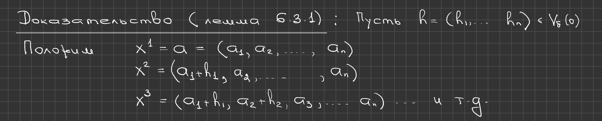

## Рукописная страница (стр. PDF 6). Следствие леммы о приращении: непрерывность

Достаточно рассмотреть скалярную функцию; для отображения $f:E\to\mathbb R^m$ аргумент применяется к каждой координатной функции. Непрерывность первых частных производных в $a$ обеспечивает их ограниченность в некоторой окрестности точки $a$. Лемма 6.3.1, применённая к близким точкам, оценивает приращение величиной, пропорциональной сумме изменений координат; эта величина стремится к нулю вместе с приращением. Значит, $f$ непрерывна во всей достаточно малой окрестности $a$.

## Печатный слайд 5 (стр. PDF 7). Непрерывная дифференцируемость влечёт дифференцируемость — теорема 6.3.1

Пусть $E\subset\mathbb R^n$, $a$ — внутренняя точка, а $f:E\to\mathbb R^m$ непрерывно дифференцируемо в $a$. Тогда:

1. $f$ непрерывно в некоторой окрестности $V(a)$ точки $a$;
2. $f$ дифференцируемо в точке $a$.

## Рукописная страница (стр. PDF 8). Доказательство локальной непрерывности

Достаточно доказать утверждение для скалярной функции; векторный случай сводится к координатам. В некоторой окрестности $V(a)$ частные производные ограничены числом $M$. Для $x\in V(a)$ выберем достаточно малый шар $V_{\|h\|}(x)\subset V(a)$; лемма о координатном приращении и теорема Лагранжа дают

$$
f(x+h)-f(x)=\sum_{k=1}^{n}\frac{\partial f}{\partial x_k}(c_k)h_k,
$$

где все $c_k$ лежат в этой окрестности. Поэтому $|f(x+h)-f(x)|\le M\sum_{k=1}^{n}|h_k|\to0$ при $h\to0$. На рукописном слайде синим и жёлтым показаны малый шар около точки внутри большей окрестности $V(a)$.

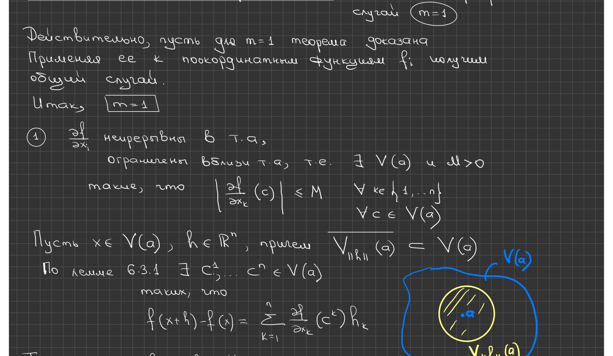

## Рукописная страница (стр. PDF 9). Доказательство дифференцируемости: остаток

Применим лемму о координатном приращении в точке $a$ и обозначим $c_k=c_k(h)$. Вычтем предполагаемую линейную часть приращения:

$$
R(h)=f(a+h)-f(a)-\sum_{k=1}^{n}\frac{\partial f}{\partial x_k}(a)h_k
=\sum_{k=1}^{n}\left[\frac{\partial f}{\partial x_k}(c_k)-\frac{\partial f}{\partial x_k}(a)\right]h_k.
$$

При $h\to0$ каждая точка $c_k(h)\to a$. Непрерывность частных производных в $a$ позволит получить $R(h)=o(\|h\|)$.

## Рукописная страница (стр. PDF 10). Оценка остатка и следствие

Для $\varepsilon>0$ выберем $h$ настолько малым, чтобы модуль каждой разности в квадратных скобках был не больше $\varepsilon/\sqrt n$. По неравенству Коши–Буняковского

$$
|R(h)|\le\sqrt{\sum_{k=1}^{n}\left(\frac{\varepsilon}{\sqrt n}\right)^2}\,\sqrt{\sum_{k=1}^{n}h_k^2}=\varepsilon\|h\|.
$$

Следовательно, $R(h)=o(\|h\|)$ и $f$ дифференцируемо в $a$. В частности, если $E$ открыто и $f\in C^1(E,\mathbb R^m)$, то $f$ дифференцируемо на $E$.

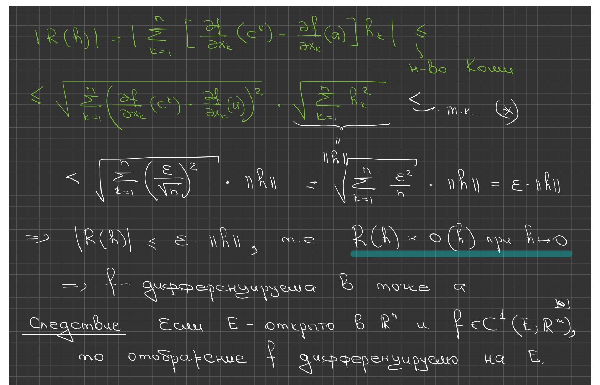

## Печатный слайд 6 (стр. PDF 11). Частные производные высших порядков — определение 6.4.1

Пусть $E\subset\mathbb R^n$, $a$ — внутренняя точка, $f:E\to\mathbb R^m$, $s\in\mathbb N$, $\ell\in\{1,\ldots,s\}$, $i_\ell\in\{1,\ldots,n\}$. Значение

$$
\frac{\partial^s f}{\partial x_{i_1}\cdots\partial x_{i_s}}(a)
$$

называется частной производной порядка $s$ по указанным переменным. Если все индексы совпадают, производная называется чистой; иначе — смешанной. В синих рукописных примерах $\frac{\partial^3 f}{\partial x_2^3}$ отнесена к чистым производным, а $\frac{\partial^2 f}{\partial x_1\partial x_2}$ — к смешанным.

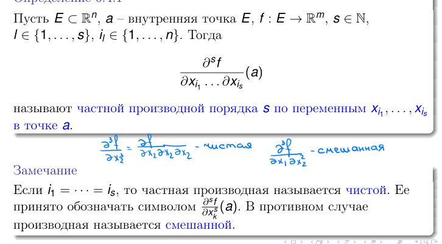

## Печатный слайд 7 (стр. PDF 12). Многократная дифференцируемость — определение 6.4.2

На слайде определение сформулировано для $E\subset\mathbb R^n$, внутренней точки $a$, отображения $f:E\to\mathbb R^n$ и $s\in\mathbb N$. Копируем кодомен именно так, как он напечатан; в определении 6.4.1 и лемме 6.4.1 на следующих слайдах используется общий кодомен $\mathbb R^m$, поэтому здесь, по-видимому, имеется несогласованность обозначений в источнике.

Отображение $f$ называется $s$ раз дифференцируемым в точке $a$, если:

1. все частные производные порядков $0,\ldots,s-2$ дифференцируемы в некоторой окрестности $a$;
2. все частные производные порядка $s-1$ дифференцируемы в точке $a$.

Если $E$ открыто и $f$ $s$ раз дифференцируемо в каждой точке $E$, то оно $s$ раз дифференцируемо на $E$. Отображение, дифференцируемое на $E$ любое число раз, называется бесконечно дифференцируемым.

## Рукописная страница (стр. PDF 13). Пример для $s=4$ и случай $s=1$

Для $f:\mathbb R^2\to\mathbb R$ рукописная запись раскрывает условие четырёхкратной дифференцируемости в $a$: $f$, её первые частные производные и четыре упорядоченные частные производные второго порядка должны быть дифференцируемы в окрестности $a$; все восемь упорядоченных частных производных третьего порядка должны быть дифференцируемы в точке $a$. Внизу отмечено, что при $s=1$ первое условие пусто, а второе совпадает с обычной дифференцируемостью в точке.

## Печатный слайд 8 (стр. PDF 14). Производные низших порядков — лемма 6.4.1

Пусть $E\subset\mathbb R^n$, $a$ — внутренняя точка, $s\in\mathbb Z_+$, $f:E\to\mathbb R^m$, и все частные производные $f$ порядка $s$ дифференцируемы на некоторой окрестности $V(a)$. Тогда для каждого $k\in\{0,\ldots,s\}$ все частные производные $f$ порядка $k$ также дифференцируемы на $V(a)$.

## Рукописная страница (стр. PDF 15). Доказательство леммы 6.4.1

Применим нисходящую индукцию по $k$. Случай $k=s$ является предположением. Пусть $0\le k<s$ и производные порядка $k+1$ дифференцируемы на $V(a)$. Тогда каждая производная порядка $k$ имеет на $V(a)$ все первые частные производные и дифференцируема там. Это доказывает утверждение для всех порядков ниже $s$, вплоть до порядка $0$.

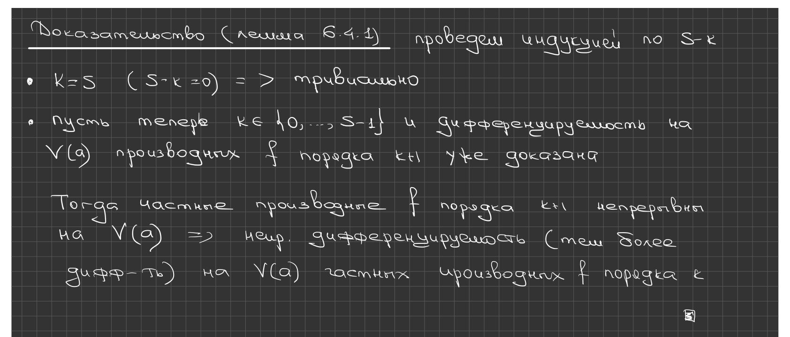

## Печатный слайд 9 (стр. PDF 16). Непрерывная дифференцируемость порядка $s$

Для открытого $E\subset\mathbb R^n$, $F\subset\mathbb R^m$ и $s\in\mathbb Z_+$ через $C^s(E,F)$ обозначается класс отображений из $E$ в $F$ с непрерывными частными производными до порядка $s$. Положим

$$
C^\infty(E,F)=\bigcap_{s=0}^{\infty}C^s(E,F).
$$

Для $k,s\in\mathbb N$, $k<s$, на слайде сформулирована равносильность:

1. $f\in C^s(E,\mathbb R^m)$;
2. каждая частная производная $f$ порядка $k$ принадлежит $C^{s-k}(E,\mathbb R^m)$.

## Рукописная страница (стр. PDF 17). Замечания о классах $C^s$

Например, если $E\subset\mathbb R^2$ и $f\in C^3(E,\mathbb R)$, то каждая частная производная второго порядка принадлежит $C^1(E,\mathbb R)$. Также записаны замечания:

1. случай $s=1$ соответствует непрерывно дифференцируемому отображению;
2. частная производная нулевого порядка — это сама функция $f$;
3. $f$ непрерывно дифференцируемо $s$ раз в точке $a$ тогда и только тогда, когда каждая координатная функция $f$ непрерывно дифференцируема $s$ раз в $a$.

## Печатный слайд 10 (стр. PDF 18). Вложения классов гладкости — лемма 6.4.2

Пусть $E\subset\mathbb R^n$ открыто. Тогда:

1. если $k,s\in\mathbb Z_+\cup\{\infty\}$ и $k\le s$, то $C^s(E,\mathbb R^m)\subset C^k(E,\mathbb R^m)$;
2. если $s\in\mathbb N$ и $f\in C^s(E,\mathbb R^m)$, то $f$ $s$ раз дифференцируемо на $E$.

Нарисованные от руки вложенные полосы иллюстрируют включения классов.

## Рукописная страница (стр. PDF 19). Доказательство включения классов

Для конечного $s$ первое утверждение доказывается индукцией по разности $s-k$. При $k=s$ оно очевидно. Если $k<s$ и $f\in C^{k+1}(E,\mathbb R^m)$, то каждая частная производная порядка $k$ непрерывно дифференцируема, а значит, непрерывна; поэтому $f\in C^k(E,\mathbb R^m)$. Отсюда $C^s(E,\mathbb R^m)\subset C^k(E,\mathbb R^m)$.

## Рукописная страница (стр. PDF 20). Доказательство того, что $C^s$ влечёт многократную дифференцируемость

Зафиксируем $k\in\{0,\ldots,s-1\}$. По первому утверждению леммы 6.4.2, $f\in C^{k+1}(E,\mathbb R^m)$. Следовательно, все частные производные порядка $k$ непрерывно дифференцируемы на $E$. Последовательное применение этого рассуждения для порядков до $s-1$ доказывает, что $f$ $s$ раз дифференцируемо на $E$.

## Печатный слайд 11 (стр. PDF 21). Симметрия смешанных производных

Пусть $E\subset\mathbb R^2$, $a$ — внутренняя точка и $f:E\to\mathbb R$. Обозначим переменные через $x,y$ и предположим, что смешанные производные второго порядка $\frac{\partial^2 f}{\partial x\partial y}(a)$ и $\frac{\partial^2 f}{\partial y\partial x}(a)$ определены. Обязаны ли они быть равными?

## Рукописная страница (стр. PDF 22). Контрпример к равенству без дополнительных условий

Рассмотрим функцию

$$
f(x,y)=\begin{cases}xy\,\dfrac{x^2-y^2}{x^2+y^2},&(x,y)\ne(0,0),\\0,&(x,y)=(0,0).\end{cases}
$$

В рукописной части вычисляются производные вне начала координат, а затем смешанные производные в $(0,0)$. Первые частные производные в начале координат равны нулю, но смешанные производные различаются; их значения вычислены на следующей странице.

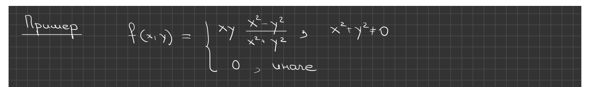

## Рукописная страница (стр. PDF 23). Смешанные производные имеют разные значения

Для предыдущей функции

$$
\frac{\partial f}{\partial x}(0,0)=\frac{\partial f}{\partial y}(0,0)=0,
$$

$$
\frac{\partial^2 f}{\partial x\partial y}(0,0)=\lim_{y\to0}\frac{-y}{y}=-1,\qquad
\frac{\partial^2 f}{\partial y\partial x}(0,0)=\lim_{x\to0}\frac{x}{x}=1.
$$

Таким образом, обе смешанные производные существуют, но не совпадают.

## Печатный слайд 12 (стр. PDF 24). Двойное приращение

Смешанные производные, вычисленные в разном порядке, в общем случае могут различаться, но для достаточно регулярных функций они совпадают. Достаточно потребовать либо непрерывность смешанных производных, либо двукратную дифференцируемость.

Для $a=(x_0,y_0)$ определим двойное приращение

$$
\Delta_a^2f(u,v)=f(x_0+u,y_0+v)-f(x_0+u,y_0)-f(x_0,y_0+v)+f(x_0,y_0).
$$

## Печатный слайд 13 (стр. PDF 25). Двойное приращение и смешанные производные — лемма 6.4.3

Пусть $E\subset\mathbb R^2$, $a=(x_0,y_0)$ — внутренняя точка, $f:E\to\mathbb R$, $\delta>0$, первые частные производные $f$ определены на $V_\delta(a)$, $(u,v)\in V_\delta(0,0)$. Тогда:

1. существует $\theta\in(0,1)$ такое, что

$$
\Delta_a^2f(u,v)=\left(\frac{\partial f}{\partial x}(x_0+\theta u,y_0+v)-\frac{\partial f}{\partial x}(x_0+\theta u,y_0)\right)u;
$$

2. если обе смешанные производные также определены на $V_\delta(a)$, то существуют $\theta_x,\theta_y\in(0,1)$ такие, что

$$
\Delta_a^2f(u,v)=\frac{\partial^2f}{\partial x\partial y}(x_0+\theta_xu,y_0+\theta_yv)uv.
$$

## Рукописная страница (стр. PDF 26). Доказательство леммы 6.4.3

Сначала зафиксируем $y=y_0+v$ и применим теорему Лагранжа к приращению $f(x_0+u,y_0+v)-f(x_0,y_0+v)$ по $x$, вычитая соответствующее приращение при $y_0$. Получаем пункт 1. Затем применим теорему Лагранжа по $y$ к возникшей разности $f_x$; это даёт формулу со смешанной производной из пункта 2 и промежуточными координатами $x_0+\theta_xu$, $y_0+\theta_yv$.

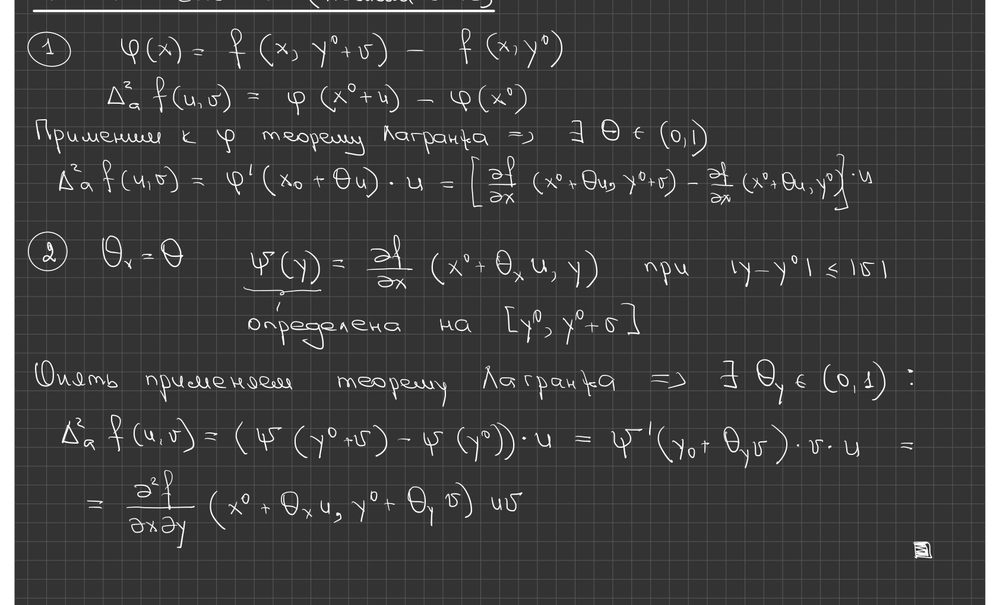

## Печатный слайд 14 (стр. PDF 27). Симметричная форма леммы 6.4.3

Перестановка ролей $x$ и $y$ в доказательстве даёт $\tilde\theta,\tilde\theta_x,\tilde\theta_y\in(0,1)$ такие, что

$$
\Delta_a^2f(u,v)=\left(\frac{\partial f}{\partial y}(x_0+u,y_0+\tilde\theta v)-\frac{\partial f}{\partial y}(x_0,y_0+\tilde\theta v)\right)v,
$$

$$
\Delta_a^2f(u,v)=\frac{\partial^2f}{\partial y\partial x}(x_0+\tilde\theta_xu,y_0+\tilde\theta_yv)uv.
$$

## Печатный слайд 15 (стр. PDF 28). Критерий равенства — лемма 6.4.4

Пусть у функции $f:E\to\mathbb R$, $E\subset\mathbb R^2$, в точке $a$ определены обе смешанные производные второго порядка. Если при $(u,v)\to(0,0)$

$$
\Delta_a^2f(u,v)=\frac{\partial^2f}{\partial x\partial y}(a)uv+o(u^2+v^2),
$$

$$
\Delta_a^2f(u,v)=\frac{\partial^2f}{\partial y\partial x}(a)uv+o(u^2+v^2),
$$

то

$$
\frac{\partial^2f}{\partial x\partial y}(a)=\frac{\partial^2f}{\partial y\partial x}(a).
$$

## Рукописная страница (стр. PDF 29). Доказательство леммы 6.4.4

Вычтем два разложения. При $D=\frac{\partial^2f}{\partial x\partial y}(a)-\frac{\partial^2f}{\partial y\partial x}(a)$ получаем $Duv=o(u^2+v^2)$. Положим $u=v=t$; тогда $Dt^2=o(2t^2)$, следовательно, $D=0$ и смешанные производные равны.

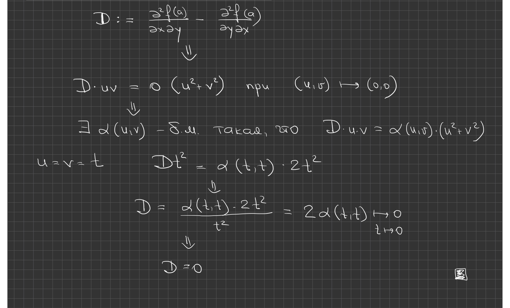

## Печатный слайд 16 (стр. PDF 30). Достаточные условия равенства — теорема 6.4.1

Пусть $E\subset\mathbb R^2$, $a$ — внутренняя точка, $f:E\to\mathbb R$. Если выполнено одно из условий:

1. обе производные $\frac{\partial^2f}{\partial x\partial y}$ и $\frac{\partial^2f}{\partial y\partial x}$ определены в окрестности $a$ и непрерывны в точке $a$;
2. функция $f$ дважды дифференцируема в точке $a$,

то

$$
\frac{\partial^2f}{\partial x\partial y}(a)=\frac{\partial^2f}{\partial y\partial x}(a).
$$

## Рукописная страница (стр. PDF 31). Теорема 6.4.1 при условии 1

По лемме 6.4.3

$$
\Delta_a^2f(u,v)=\frac{\partial^2f}{\partial x\partial y}(x_0+\theta_xu,y_0+\theta_yv)uv.
$$

Из непрерывности в $a$ следует

$$
\Delta_a^2f(u,v)=\frac{\partial^2f}{\partial x\partial y}(a)uv+\alpha(u,v)uv,\qquad\alpha(u,v)\to0.
$$

Поскольку $|uv|\le\frac12(u^2+v^2)$, последнее слагаемое есть $o(u^2+v^2)$. Переставляя $x,y$, получаем аналогичное разложение с $f_{yx}(a)$; лемма 6.4.4 завершает доказательство.

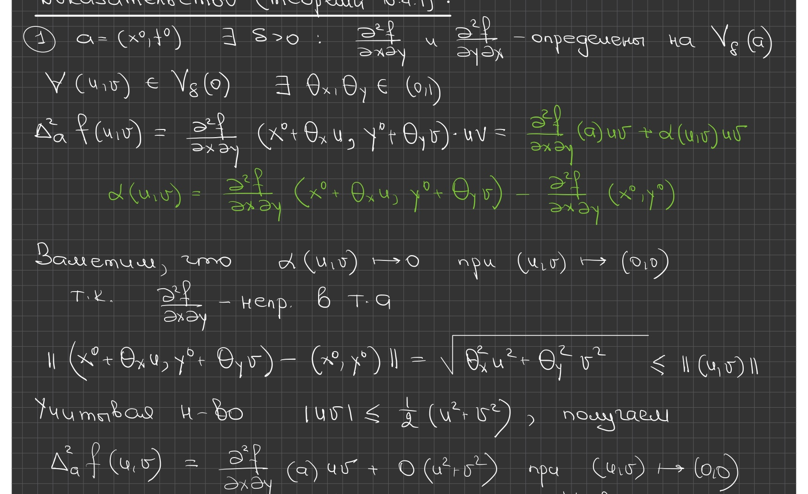

## Рукописная страница (стр. PDF 32). Теорема 6.4.1 при условии 2: разложение

Теперь предположим, что $f$ дважды дифференцируема в $a$. Применим первое равенство леммы 6.4.3 и разложим дифференцируемую функцию $f_x$ в точке $a$. Приращение имеет вид

$$
\Delta_a^2f(u,v)=\frac{\partial^2f}{\partial x\partial y}(a)uv+\beta(u,v)u,
$$

где остаток возникает из разложений дифференцируемости $f_x$ в точках $(x_0+\theta u,y_0+v)$ и $(x_0+\theta u,y_0)$.

## Рукописная страница (стр. PDF 33). Оценка остатка при условии 2

В рукописном доказательстве остаток записан так:

$$
\beta(u,v)=\alpha(\theta u,v)\sqrt{\theta^2u^2+v^2}-\alpha(\theta u,0)|\theta u|,
$$

где $\alpha(h)\to0$. Поскольку $|\theta u|\,|u|\le u^2\le u^2+v^2$ и $|u|\sqrt{\theta^2u^2+v^2}\le u^2+v^2$, получаем

$$
\beta(u,v)u=o(u^2+v^2).
$$

Значит, $\Delta_a^2f(u,v)=\frac{\partial^2f}{\partial x\partial y}(a)uv+o(u^2+v^2)$. Перестановка $x,y$ даёт разложение с $f_{yx}(a)$, после чего лемма 6.4.4 завершает доказательство.

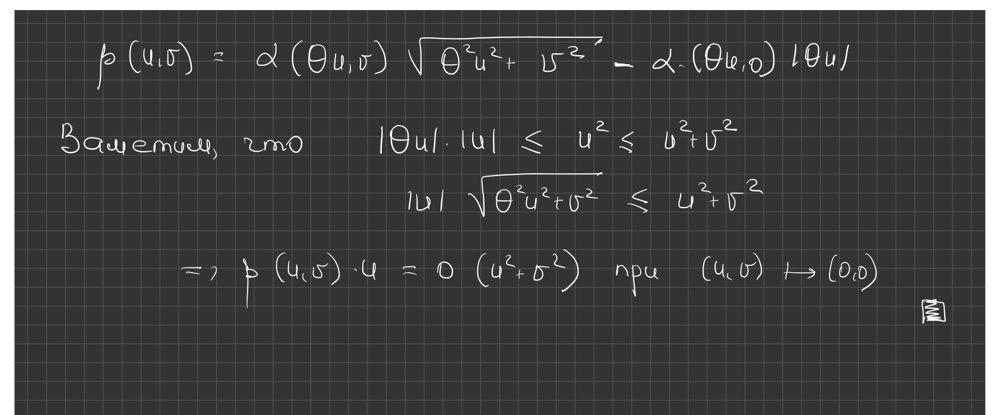

## Печатный слайд 17 (стр. PDF 34). Непрерывные производные второго порядка — следствие

Если $f$ дважды непрерывно дифференцируема в точке $a$, то

$$
\frac{\partial^2f}{\partial x\partial y}(a)=\frac{\partial^2f}{\partial y\partial x}(a).
$$

## Печатный слайд 18 (стр. PDF 35). Замечания к теореме 6.4.1

Ни одно из двух условий теоремы 6.4.1 не является необходимым для симметрии смешанных производных. Условия 1 и 2 независимы: ни одно не следует из другого. На слайде красным выделены слова «не является необходимым».

## Рукописная страница (стр. PDF 36). Пример: смешанные производные могут быть неограниченными

Пусть

$$
\varphi(t)=\begin{cases}t^2\sin(1/t^2),&t\ne0,\\0,&t=0,\end{cases}\qquad f(x,y)=\varphi(x)\varphi(y).
$$

Функция $\varphi$ дифференцируема на $\mathbb R$, причём

$$
\varphi'(t)=\begin{cases}2\left(t\sin(1/t^2)-\frac1t\cos(1/t^2)\right),&t\ne0,\\0,&t=0.\end{cases}
$$

Все частные производные первого и второго порядков функции $f$ в $(0,0)$ равны нулю. Однако

$$
\frac{\partial^2f}{\partial x\partial y}\left(\frac1{\sqrt{2\pi k}},\frac1{\sqrt{2\pi k}}\right)=\left(\varphi'\left(\frac1{\sqrt{2\pi k}}\right)\right)^2=8\pi k\to+\infty.
$$

Следовательно, смешанная производная не ограничена вблизи начала координат, и условие 1 теоремы 6.4.1 не выполнено.

## Рукописная страница (стр. PDF 37). Первая частная производная может быть недифференцируема

Для $f(x,y)=\varphi(x)\varphi(y)$ рукописная оценка вдоль $(t,t)$ имеет вид

$$
\frac{f_x(t,t)}{\|(t,t)\|}=\sqrt2\left(t^2\sin^2(1/t^2)-\sin(1/t^2)\cos(1/t^2)\right)\not\to0.
$$

Если бы $f_x$ была дифференцируема в $(0,0)$, то из $f_x(0,0)=0$ следовало бы, что это отношение стремится к нулю. Поэтому $f_x$ не дифференцируема в начале координат и $f$ не является дважды дифференцируемой там.

## Рукописная страница (стр. PDF 38). Примеры, разделяющие условия регулярности

Для той же функции $\varphi$ и $a=(0,0)$ приведены два примера:

1. $f(x,y)=\varphi(x)+\varphi(y)$ имеет непрерывные смешанные производные в $a$, но не является дважды дифференцируемой в $a$.
2. $g(x,y)=\varphi(x)\varphi(y)$ дифференцируема в $a$, но её смешанные производные не ограничены вблизи $a$.

Эти примеры иллюстрируют достаточный, а не необходимый характер условий теоремы 6.4.1. Вторую конструкцию рукописная страница обозначает как упражнение.

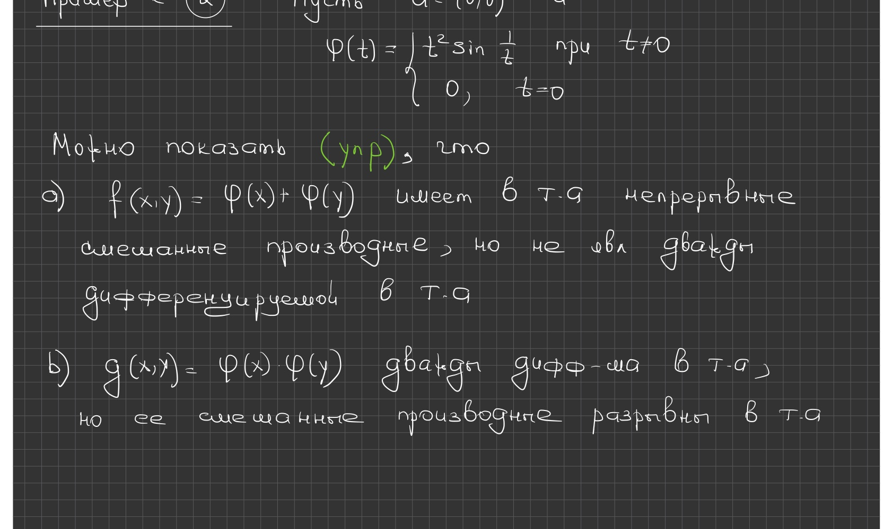

## Печатный слайд 19 (стр. PDF 39). Дифференциалы высших порядков — определение 6.4.3

Пусть $E\subset\mathbb R^n$, $a$ — внутренняя точка, $f:E\to\mathbb R^m$.

1. Положим $d_a^0f(h)=f(a)$ при всех $h\in\mathbb R^n$. Отображение $d_a^0f$ называется дифференциалом нулевого порядка в точке $a$. Для каждого $h$ отображение $x\mapsto d_x^0f(h)$, определённое по крайней мере в точке $a$, называется дифференциалом нулевого порядка на приращении $h$ и обозначается $d^0f(h)$. На слайде красным выделены слова «по крайней мере в точке $a$».
2. Пусть $s\in\mathbb N$ и дифференциал $d^{s-1}f(h)$ уже определён. Если для каждого $h\in\mathbb R^n$ отображение $x\mapsto d_x^{s-1}f(h)$ задано в окрестности $a$ и дифференцируемо в $a$, положим

$$
d_a^sf(h)=d_a\bigl(d^{s-1}f(h)\bigr)(h)\qquad\text{при всех }h\in\mathbb R^n.
$$

## Печатный слайд 20 (стр. PDF 40). Дифференциалы высших порядков — определение 6.4.3 (продолжение)

Отображение $d_a^sf$ называется дифференциалом порядка $s$ в точке $a$. Для каждого $h\in\mathbb R^n$ отображение $x\mapsto d_x^sf(h)$, определённое по крайней мере в точке $a$, называется дифференциалом порядка $s$ на приращении $h$ и обозначается $d^sf(h)$.

## Печатный слайд 21 (стр. PDF 41). Вычисление дифференциалов высших порядков — теорема 6.4.2

Если отображение $f:E\to\mathbb R^m$ $s$ раз дифференцируемо во внутренней точке $a\in E\subset\mathbb R^n$, то дифференциал порядка $s$ существует и

$$
d_a^sf(h)=\sum_{(i_1,\ldots,i_s)\in I_s}\frac{\partial^sf(a)}{\partial x_{i_1}\cdots\partial x_{i_s}}h_{i_1}\cdots h_{i_s}\qquad(h\in\mathbb R^n),
$$

$$
d_a^sf(h)=\sum_{\alpha\in M_s}\frac{s!}{\alpha!}\frac{\partial^\alpha f(a)}{\partial x^\alpha}h^\alpha\qquad(h\in\mathbb R^n).
$$

**Поправка к источнику.** Вторая формула на печатном слайде не содержит множитель $h^\alpha$. Он восстановлен: без него мультииндексная формула не совпадает с первой и не является однородной по $h$ степени $s$.

## Рукописная страница (стр. PDF 42). Мультииндексы и второй дифференциал

Мультииндекс — это $\alpha=(\alpha_1,\ldots,\alpha_n)$, где $|\alpha|=\alpha_1+\cdots+\alpha_n=s$. Его факториал равен $\alpha!=\alpha_1!\cdots\alpha_n!$, $x^\alpha=x_1^{\alpha_1}\cdots x_n^{\alpha_n}$ и $h^\alpha=h_1^{\alpha_1}\cdots h_n^{\alpha_n}$. Частная производная $\partial^\alpha f/\partial x^\alpha$ означает

$$
\frac{\partial^{|\alpha|}f}{\partial x_1^{\alpha_1}\cdots\partial x_n^{\alpha_n}}(a).
$$

Если $\alpha_k=0$, дифференцирование по $x_k$ не выполняется. На этой же рукописной странице записано

$$
d_a^2f(h)=\sum_{i=1}^{n}\sum_{j=1}^{n}\frac{\partial^2f}{\partial x_i\partial x_j}(a)h_ih_j\qquad(h\in\mathbb R^n).
$$

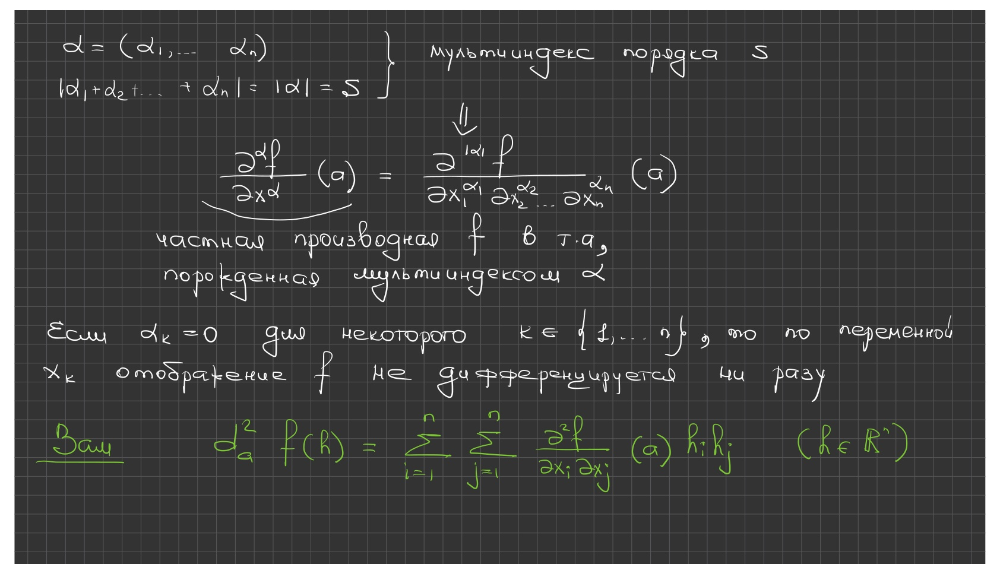

## Перекрёстные ссылки

Эта расшифровка дублирует соответствующие тематические главы семестра 2 (лекции 33–64): [§6.3 — непрерывная дифференцируемость](../../ru/lectures/16-continuous-differentiability-6-3.md) и [§6.4 — производные и дифференциалы высших порядков](../../ru/lectures/17-higher-derivatives-6-4.md). Общая навигация — [указатель русского регистра](../../ru/lectures/index.md).
