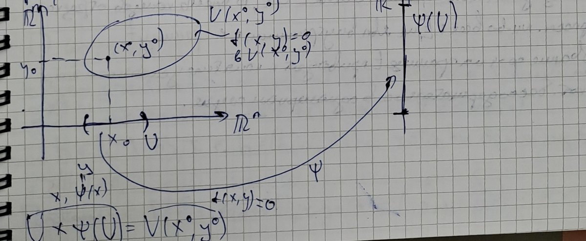

# Лекции 65–66 — формула Тейлора для отображений нескольких переменных, неявные отображения, необходимое условие экстремума

[← Лекции 63–64](lecture-63-64.md) · [Указатель лекций](index.md) · [Лекции 67–68 →](lecture-67-68.md) · [Термины и теоремы](../term-index.md) · [English](../../en/lectures-2025-26/lecture-65-66.md) · [Español](../../es/lectures-2025-26/lecture-65-66.md)

> **Источник и нумерация.** Конспект переписан с рукописной тетради (стр. p001–p011; сырой текст страниц — в [`ocr/raw/`](../../../ocr/raw/p001.md)) и сверен со сканами этих страниц. Дата в рамке на стр. p001 — «3 сентября». План пары, записанный в тетради: существование и единственность многомерного многочлена Тейлора; формулы Тейлора–Пеано и Тейлора–Лагранжа; [неявная функция](../16-implicit-functions-extrema.md#sec-16-3); экстремумы. Нижняя половина стр. p005 (утверждение (∗) и его доказательство) в расшифровке страницы отсутствует и набрана по скану. Доказательство [теоремы 6.7.1](#thm-6-7-1) начато на стр. p011 и заканчивается в начале [лекций 67–68](lecture-67-68.md). Нумерация определений и теорем — лекторская (сверена со слайдами курса 2024/25). Описки конспекта исправлены и отмечены блоками «Поправка к источнику», утраченные места восстановлены и отмечены блоками «Восстановлено»; номера пометок соответствуют [`ocr/RESOLVED.md`](../../../ocr/RESOLVED.md). Места, которые нужно сверить с тетрадью, перечислены в [`ocr/ISSUES.md`](../../../ocr/ISSUES.md).

## §6.5. Формула Тейлора

<a id="p001"></a>

Пусть $`f:E\subset\mathbb R^n\to\mathbb R^m`$, $`a`$ — [внутренняя точка](lecture-57-58.md#def-5-3-3) $`E`$, $`s\in\mathbb Z_+`$. Надо построить многочлен $`p:\mathbb R^n\to\mathbb R^m`$ степени не выше $`s`$, для которого
```math
p(a)=f(a),\qquad f(x)=p(x)+o(\|x-a\|^s)\quad(x\to a).\qquad(6.5.1)
```
Здесь $`\|x-a\|=\sqrt{(x_1-a_1)^2+(x_2-a_2)^2+\ldots+(x_n-a_n)^2}`$ — [евклидова норма](lecture-54.md#def-5-1-1).

**Замечание.** Напомним понятия, нужные для записи многочленов от нескольких переменных.

- Всякий вектор $`\alpha=(\alpha_1,\ldots,\alpha_n)\in\mathbb Z_+^n`$ называется мультииндексом размерности $`n`$. Порядком мультииндекса $`\alpha`$ называется величина $`|\alpha|=\alpha_1+\ldots+\alpha_n`$.
- Пусть $`M`$ — конечное множество мультииндексов размерности $`n`$, $`\{C_\alpha\}_{\alpha\in M}`$ — семейство элементов $`\mathbb R^m`$. Тогда отображение
```math
p(x)=\sum_{\alpha\in M}C_\alpha x^\alpha=\sum_{\alpha\in M}C_\alpha x_1^{\alpha_1}x_2^{\alpha_2}\cdots x_n^{\alpha_n}\qquad(x\in\mathbb R^n)
```
называется многочленом $`n`$ переменных со значениями в $`\mathbb R^m`$.

**Пример.** Пусть $`n=3`$, $`m=1`$, $`s=3`$, $`x=(x_1,x_2,x_3)\in\mathbb R^3`$, и многочлен $`p:\mathbb R^3\to\mathbb R`$ имеет степень не выше $`3`$:
```math
p(x)=p(x_1,x_2,x_3)=C_{I}x_1^3+C_{II}x_2x_3+C_{III}x_1^2x_2+C_{IV}x_1x_2x_3 .
```
Здесь $`M=\{(3,0,0),(0,1,1),(2,1,0),(1,1,1)\}`$, порядки этих мультииндексов равны соответственно $`3`$, $`2`$, $`3`$, $`3`$, а $`\{C_\alpha\}_{\alpha\in M}=\{C_I,C_{II},C_{III},C_{IV}\}`$, где все $`C_i\in\mathbb R`$. Если взять $`M_1=M\cup\{(2,1,1)\}`$, то максимальный порядок мультииндекса станет равным $`4`$: многочлен $`p_1(x)=C_Vx_1^2x_2x_3+p(x)`$ при $`C_V\ne0`$ имеет степень $`4`$.

<a id="p002"></a>

### Многочлен Тейлора

**Замечание.** Если $`p\ne0`$, то степенью многочлена $`p`$ называется число
```math
\deg p=\max\{|\alpha|:\ \alpha\in M,\ C_\alpha\ne0\}.
```
В противном случае мы полагаем степень $`p`$ равной $`-\infty`$.

<a id="def-6-5-1"></a>**Определение 6.5.1.** Пусть $`E\subset\mathbb R^n`$, $`a`$ — внутренняя точка $`E`$, $`f:E\to\mathbb R^m`$, $`s\in\mathbb Z_+`$. Многочлен $`p:\mathbb R^n\to\mathbb R^m`$ степени не выше $`s`$, удовлетворяющий условию (6.5.1), называется многочленом Тейлора $`f`$ порядка $`s`$ в точке $`a`$ и обозначается $`T_{a,s}f`$.

**Замечание.** Если многочлен Тейлора существует, то он единственный.

**Доказательство.** Пусть существуют многочлены $`p`$ и $`q`$, $`\deg p\le s`$, $`\deg q\le s`$, для которых при $`x\to a`$
```math
p(a)=f(a),\quad f(x)=p(x)+o(\|x-a\|^s);\qquad q(a)=f(a),\quad f(x)=q(x)+o(\|x-a\|^s).
```
Положим $`r:=p-q`$; надо показать, что $`r\equiv0`$. Не умаляя общности, считаем $`a=0`$ (сдвиг $`x\mapsto x-a`$ переводит многочлены степени не выше $`s`$ в многочлены степени не выше $`s`$). Вычитая равенства, получаем $`0=r(x)+o(\|x\|^s)`$, т. е. $`r(x)=o(\|x\|^s)`$ при $`x\to0`$. Значит, $`r(x)=\alpha(x)\,\|x\|^s`$, где $`\alpha(x)\to0`$ при $`x\to0`$.

Многочлен $`\hat p`$ называется однородным степени $`k`$, если все его мономы имеют порядок $`k`$; тогда $`\hat p(tx)=t^k\hat p(x)`$ при всех $`t\in\mathbb R`$, $`x\in\mathbb R^n`$. Сгруппировав мономы многочлена $`r`$ по порядкам, запишем $`r(x)=\sum_{k=0}^{s}r_k(x)`$, где $`r_k`$ — однородный многочлен степени $`k`$ со значениями в $`\mathbb R^m`$. Тогда при $`t\in\mathbb R`$, $`x\in\mathbb R^n`$
```math
\sum_{k=0}^{s}r_k(x)\,t^k=\sum_{k=0}^{s}r_k(tx)=r(tx)=\alpha(tx)\,\|tx\|^s=|t|^s\,\alpha(tx)\,\|x\|^s .
```
Зафиксируем $`x`$. Слева стоит векторнозначный многочлен по $`t`$ степени не выше $`s`$, а правая часть есть $`o(|t|^s)`$ при $`t\to0`$; поэтому каждая координатная функция этого многочлена есть $`o(t^s)`$ при $`t\to0`$. Но скалярный многочлен $`c_0+c_1t+\ldots+c_st^s`$, равный $`o(t^s)`$, тождественно равен нулю: если бы $`c_j`$ был его первым ненулевым коэффициентом, то после деления на $`t^j`$ получилось бы $`c_j+O(t)=o(t^{s-j})\to0`$, т. е. $`c_j=0`$. Следовательно, $`r_k(x)=0`$ при всех $`k\in\{0,1,\ldots,s\}`$ и всех $`x`$, т. е. $`r\equiv0`$. $`\square`$

<a id="p003"></a>

### Существование многочлена Тейлора

- При $`s=0`$ соотношение (6.5.1) равносильно непрерывности $`f`$ в точке $`a`$: многочлен степени $`0`$ — это постоянная $`p\equiv f(a)`$, и $`f(x)=p(x)+o(\|x-a\|^0)=p(x)+o(1)`$.
- При $`s=1`$ соотношение (6.5.1) равносильно дифференцируемости $`f`$ в точке $`a`$: $`f(x)=p(x)+o(\|x-a\|)`$.
- Случай $`s\ge2`$ исследуется сложнее.
- Для функций одной переменной известно, что существование $`T_{a,s}f`$ вытекает из $`s`$-кратной дифференцируемости $`f`$ в точке $`a`$. Аналогичный результат будет справедлив и в многомерном случае ([теорема 6.5.1](#thm-6-5-1)).

> **Поправка к источнику** (T516). В расшифровке страницы последний пункт записан наоборот: «существование $`T_{a,s}f`$ влечёт существование $`s`$-кратной дифференцируемости». В тетради (и на слайде курса 2024/25) — «вытекает из». Обратное утверждение при $`s\ge2`$ неверно: для $`f(x)=x^3\sin\frac1x`$, $`f(0)=0`$, имеем $`f(x)=o(x^2)`$, т. е. $`T_{0,2}f=0`$ существует, но $`f''(0)`$ не существует.

<a id="lem-6-5-1"></a>**Лемма 6.5.1.** Пусть $`E\subset\mathbb R^n`$, $`a`$ — внутренняя точка $`E`$, $`s\in\mathbb N`$, отображение $`f:E\to\mathbb R^m`$ $`s`$ раз дифференцируемо в точке $`a`$, причём $`f`$ и все его частные производные порядка не выше $`s`$ равны нулю в точке $`a`$. Тогда $`f(a+h)=o(\|h\|^s)`$ при $`h\to0`$.

> **Поправка к источнику** (M511). В расшифровке страницы условие леммы записано как «$`f`$ дифференцируемо в точке $`a`$» — без слов «$`s`$ раз». В тетради (и на слайде курса 2024/25) стоит «$`s`$ раз дифференцируемо». Это условие существенно: оно используется в шаге [индукции](../01-logic-sets-functions.md#example-induction), а при одной лишь дифференцируемости лемма неверна уже при $`s=2`$. Например, у функции $`f(x,y)=\frac{x^2y^2}{x^2+y^2}`$, $`f(0,0)=0`$, все [частные производные](lecture-61-62.md#def-6-1-5) порядка не выше $`2`$ в точке $`(0,0)`$ равны нулю и $`f`$ дифференцируема в этой точке, но $`f(t,t)=\frac{t^2}{2}\ne o(t^2)`$.

**Доказательство.** Достаточно проверить утверждение для координатных функций $`f_1,\ldots,f_m`$: условия леммы выполняются для каждой из них, а $`\|f(a+h)\|\le\sum_{i=1}^{m}|f_i(a+h)|`$, так что из $`f_i(a+h)=o(\|h\|^s)`$ при всех $`i`$ следует $`f(a+h)=o(\|h\|^s)`$. Поэтому можно считать $`m=1`$.

Доказательство проведём индукцией по $`s`$.

*База:* $`s=1`$. Так как $`f`$ дифференцируема в точке $`a`$, а $`f(a)=0`$ и $`\frac{\partial f}{\partial x_k}(a)=0`$ по условию,
```math
f(a+h)=f(a)+\sum_{k=1}^{n}\frac{\partial f}{\partial x_k}(a)h_k+o(\|h\|)=o(\|h\|)\qquad(h\to0).
```

*Индукционное предположение:* утверждение верно для некоторого $`s`$.

*Индукционный переход* $`s\mapsto s+1`$. Пусть $`f`$ дифференцируема $`s+1`$ раз в точке $`a`$ и все её частные производные порядка не выше $`s+1`$ равны нулю в точке $`a`$. Тогда все частные производные $`f`$ первого порядка определены в некоторой окрестности точки $`a`$ и $`s`$ раз дифференцируемы в точке $`a`$, а все их частные производные порядка не выше $`s`$ равны нулю в точке $`a`$. Применим к частным производным $`f`$ первого порядка индукционное предположение:
```math
\frac{\partial f}{\partial x_k}(a+h)=o(\|h\|^s)\qquad(h\to0)
```
при всех $`k\in\{1,\ldots,n\}`$. Применяя определение символа $`o`$ с $`\frac{\varepsilon}{n}`$ вместо $`\varepsilon`$ и беря наименьшее из $`n`$ полученных чисел $`\delta`$, получаем: для любого $`\varepsilon>0`$ существует $`\delta>0`$ такое, что $`V_\delta(a)\subset E`$ и при всех $`k\in\{1,\ldots,n\}`$ и всех $`h\in V_\delta(0)`$
```math
\left|\frac{\partial f}{\partial x_k}(a+h)\right|\le\frac{\varepsilon}{n}\|h\|^s .
```
Пусть $`h\in V_\delta(0)`$. По [лемме 6.3.1](lecture-63-64.md#lem-6-3-1) (о приращении по координатам) существуют $`c^1,\ldots,c^n\in V_\delta(a)`$, причём $`\|c^k-a\|\le\|h\|`$, такие, что

<a id="p004"></a>

```math
f(a+h)=f(a+h)-f(a)=\sum_{k=1}^{n}\frac{\partial f}{\partial x_k}(c^k)h_k
```
(здесь $`f(a)=0`$ по условию).

> **Поправка к источнику** (T512). В конспекте здесь ссылка «по [лемме 6.4.1](lecture-63-64.md#lem-6-4-1)». Представление приращения через частные производные в промежуточных точках — это [лемма 6.3.1](lecture-63-64.md#lem-6-3-1) о приращении по координатам (лекции 63–64); [лемма 6.4.1](lecture-63-64.md#lem-6-4-1) — о дифференцируемости производных низших порядков. Оценка $`\|c^k-a\|\le\|h\|`$ в конспекте не оговорена, но используется ниже; она видна из доказательства [леммы 6.3.1](lecture-63-64.md#lem-6-3-1): $`c^k-a=(h_1,\ldots,h_{k-1},\theta_kh_k,0,\ldots,0)`$, $`\theta_k\in(0,1)`$.

Тогда, поскольку $`\|c^k-a\|\le\|h\|`$ и $`|h_k|\le\|h\|`$,
```math
|f(a+h)|=\left|\sum_{k=1}^{n}\frac{\partial f}{\partial x_k}(c^k)h_k\right|\le\sum_{k=1}^{n}\left|\frac{\partial f}{\partial x_k}(c^k)\right||h_k|\le\sum_{k=1}^{n}\frac{\varepsilon}{n}\|h\|^s\,\|h\|=\varepsilon\|h\|^{s+1}.
```
Так как $`\varepsilon>0`$ произвольно, $`f(a+h)=o(\|h\|^{s+1})`$ при $`h\to0`$. $`\square`$

### Формула Тейлора–Пеано

<a id="thm-6-5-1"></a>**Теорема 6.5.1 (формула Тейлора–Пеано).** Пусть $`E\subset\mathbb R^n`$, $`a`$ — внутренняя точка $`E`$, $`s\in\mathbb Z_+`$, отображение $`f:E\to\mathbb R^m`$ $`s`$ раз дифференцируемо в точке $`a`$. Тогда справедливо равенство
```math
f(x)=\sum_{|\alpha|\le s}\frac{1}{\alpha!}\frac{\partial^\alpha f}{\partial x^\alpha}(a)(x-a)^\alpha+o(\|x-a\|^s)\qquad(x\to a).
```
Иными словами, многочлен Тейлора $`f`$ порядка $`s`$ в точке $`a`$ существует и вычисляется по формуле
```math
T_{a,s}f(x)=\sum_{|\alpha|\le s}\frac{1}{\alpha!}\frac{\partial^\alpha f}{\partial x^\alpha}(a)(x-a)^\alpha .
```
Суммирование здесь ведётся по всем мультииндексам порядка не выше $`s`$.

> **Поправка к источнику** (M515). В конспекте (и на слайде курса 2024/25) $`s\in\mathbb Z_+`$, но «$`0`$ раз дифференцируемое» отображение не определено ([определение 6.4.2](lecture-63-64.md#def-6-4-2) дано для $`s\in\mathbb N`$), а без дополнительного условия утверждение при $`s=0`$ неверно. При $`s=0`$ условие теоремы следует понимать как непрерывность $`f`$ в точке $`a`$: тогда формула $`f(x)=f(a)+o(1)`$ и есть непрерывность (первый пункт выше). Доказательство ниже относится к $`s\in\mathbb N`$.

Обозначения:
```math
\frac{\partial^\alpha f}{\partial x^\alpha}(a)=\frac{\partial^{|\alpha|}f}{\partial x_1^{\alpha_1}\partial x_2^{\alpha_2}\cdots\partial x_n^{\alpha_n}}(a),\qquad\alpha=(\alpha_1,\alpha_2,\ldots,\alpha_n)
```
(если $`\alpha_k=0`$, то по переменной $`x_k`$ не дифференцируют), а также
```math
\alpha!=\alpha_1!\,\alpha_2!\cdots\alpha_n!,\qquad|\alpha|=\alpha_1+\alpha_2+\ldots+\alpha_n,\qquad(x-a)^\alpha=(x_1-a_1)^{\alpha_1}\cdots(x_n-a_n)^{\alpha_n}.
```

> **Поправка к источнику** (A021). В конспекте: «$`\frac{1}{\alpha!}=\frac{1}{|\alpha|!}=\frac{1}{1\cdot2\cdots|\alpha|}`$». Исправлено: $`\alpha!=\alpha_1!\,\alpha_2!\cdots\alpha_n!`$ — так факториал мультииндекса определён в лекциях 63–64 ([теорема 6.4.2](lecture-63-64.md#thm-6-4-2)), и только с этим определением формула Тейлора верна. Например, для $`f(x_1,x_2)=x_1x_2`$, $`a=0`$, $`\alpha=(1,1)`$ слагаемое $`\frac{1}{\alpha!}\frac{\partial^2f}{\partial x_1\partial x_2}(0)\,x_1x_2`$ равно $`x_1x_2=f(x)`$, а с множителем $`\frac{1}{|\alpha|!}=\frac12`$ получилось бы $`\frac12x_1x_2\ne f(x)`$.

**Пример.** Пусть $`n=4`$, $`\alpha=(0,2,3,1)`$, $`|\alpha|=6`$. Тогда
```math
\frac{\partial^{(0,2,3,1)}f}{\partial x^{(0,2,3,1)}}=\frac{\partial^0}{\partial x_1^0}\,\frac{\partial^2}{\partial x_2^2}\,\frac{\partial^3}{\partial x_3^3}\,\frac{\partial^1}{\partial x_4^1}\,f=\frac{\partial^6f}{\partial x_2^2\,\partial x_3^3\,\partial x_4}
```
(по $`x_1`$ не дифференцируем). Для функции $`u`$ двух переменных матрица вторых производных ([матрица Гессе](../15-multivariable-differentiation.md#sec-15-4)) имеет вид
```math
D^2u=\begin{pmatrix}\dfrac{\partial^2u}{\partial x_1^2}&\dfrac{\partial^2u}{\partial x_1\partial x_2}\\[2mm]\dfrac{\partial^2u}{\partial x_2\partial x_1}&\dfrac{\partial^2u}{\partial x_2^2}\end{pmatrix}.
```

**Доказательство [теоремы 6.5.1](#thm-6-5-1).** Положим
```math
p(x)=\sum_{|\alpha|\le s}\frac{1}{\alpha!}\frac{\partial^\alpha f}{\partial x^\alpha}(a)(x-a)^\alpha,\qquad F:=f-p .
```
Для мультииндексов $`\alpha,\beta`$ производная $`\frac{\partial^\alpha}{\partial x^\alpha}(x-a)^\beta`$ в точке $`a`$ равна $`\alpha!`$ при $`\beta=\alpha`$ и нулю при $`\beta\ne\alpha`$; поэтому $`\frac{\partial^\alpha p}{\partial x^\alpha}(a)=\frac{\partial^\alpha f}{\partial x^\alpha}(a)`$. Значит, если $`\alpha`$ — мультииндекс порядка не выше $`s`$, то
```math
\frac{\partial^\alpha F}{\partial x^\alpha}(a)=\frac{\partial^\alpha f}{\partial x^\alpha}(a)-\frac{\partial^\alpha p}{\partial x^\alpha}(a)=0 .
```
Отображение $`F`$ $`s`$ раз дифференцируемо в точке $`a`$ ($`p`$ — многочлен), а у $`s`$ раз дифференцируемого в точке $`a`$ отображения частные производные порядка не выше $`s`$ в точке $`a`$ не зависят от порядка дифференцирования (следствие [теоремы 6.4.1](lecture-63-64.md#thm-6-4-1)). Поэтому все частные производные $`F`$ порядка не выше $`s`$ равны нулю в точке $`a`$. Применим к $`F`$ [лемму 6.5.1](#lem-6-5-1) с $`h=x-a`$. Получим
```math
F(x)=f(x)-p(x)=F\bigl(a+(x-a)\bigr)=o(\|x-a\|^s)\qquad(x\to a).
```
Это и есть утверждение теоремы. $`\square`$

<a id="p005"></a>

**Замечание.**

- Отображение $`R_{a,s}f=f-T_{a,s}f`$ называют остатком в формуле Тейлора.
- Таким образом, утверждение [теоремы 6.5.1](#thm-6-5-1) можно записать как $`R_{a,s}f(x)=o(\|x-a\|^s)`$ $`(x\to a)`$.
- Многочлен Тейлора можно выразить через дифференциалы высших порядков (по [теореме 6.4.2](lecture-63-64.md#thm-6-4-2)):
```math
T_{a,s}f(x)=\sum_{k=0}^{s}\frac{d_a^kf(x-a)}{k!}.
```
- Если отображение $`f`$ есть многочлен степени не выше $`s`$, то $`R_{a,s}f\equiv0`$ (сам $`f`$ удовлетворяет условию (6.5.1), и по единственности $`T_{a,s}f=f`$), т. е.
```math
f(x)=\sum_{|\alpha|\le s}\frac{1}{\alpha!}\frac{\partial^\alpha f}{\partial x^\alpha}(a)(x-a)^\alpha .
```

> **Поправка к источнику** (T022). Во втором пункте в конспекте: «$`R_{a,s}f(x)=O(\|x-a\|^s)`$». Исправлено на $`o(\|x-a\|^s)`$: [теорема 6.5.1](#thm-6-5-1) утверждает, что остаток — [бесконечно малая](lecture-09-10.md#def-2-2-1) более высокого порядка, чем $`\|x-a\|^s`$; оценка $`O(\|x-a\|^s)`$ слабее (на слайде курса 2024/25 тоже $`o`$).

### Формула Тейлора–Лагранжа для функций

Положим
```math
\Delta_{a,b}=\{a+t(b-a):\ t\in[0,1]\},\qquad\hat{\Delta}_{a,b}=\Delta_{a,b}\setminus\{a,b\}
```
— отрезок с концами $`a`$, $`b`$ и тот же отрезок без концов.

<a id="thm-6-5-2"></a>**Теорема 6.5.2 (формула Тейлора–Лагранжа).** Пусть множество $`E`$ открыто в $`\mathbb R^n`$, $`s\in\mathbb Z_+`$, функция $`f:E\to\mathbb R`$ дифференцируема $`s+1`$ раз на $`E`$, точки $`a,x\in E`$, причём $`a\ne x`$ и $`\Delta_{a,x}\subset E`$. Тогда существует $`c\in\hat{\Delta}_{a,x}`$, для которой
```math
f(x)=\sum_{k=0}^{s}\frac{d_a^kf(x-a)}{k!}+\frac{d_c^{s+1}f(x-a)}{(s+1)!}.
```
Здесь $`d_c^{s+1}f(x-a)`$ — дифференциал порядка $`s+1`$ в точке $`c`$ на приращении $`h=x-a`$ ([определение 6.4.3](lecture-63-64.md#def-6-4-3)).

> **Поправка к источнику** (T023). В конспекте перед условием $`s\in\mathbb Z_+`$ стоит ещё одно включение для $`s`$ (в расшифровке — «$`s\in\mathbb N`$»), а точки $`a`$, $`x`$ не введены. Оставлено $`s\in\mathbb Z_+`$ (как на слайде курса 2024/25), добавлено $`a,x\in E`$ (как в [теореме 6.5.4](#thm-6-5-4)).

**Доказательство.** Положим $`h:=x-a`$ и $`F(t)=f(a+th)`$, $`t\in[0,1]`$. Тогда $`F(t)=d^0_{a+th}f(h)`$.

> **Восстановлено** (по скану тетради, стр. p005: нижняя половина страницы отсутствует в расшифровке; то же доказательство — на слайдах курса 2024/25, ФС p41; S513). Покажем, что при всех $`t\in[0,1]`$
> ```math
> F^{(k)}(t)=d^k_{a+th}f(h)\qquad\forall k\in\{0,1,\ldots,s+1\}.\qquad(*)
> ```
> Доказательство проведём индукцией по $`k`$. База $`k=0`$ очевидна.
>
> Индукционное предположение: пусть $`k\in\{1,\ldots,s+1\}`$ и равенство (∗) доказано для $`k-1`$. Индукционный переход $`k-1\mapsto k`$. Заметим, что:
>
> 1. отображение $`y\mapsto d^{k-1}_yf(h)`$ дифференцируемо на $`E`$ (его коэффициенты — частные производные $`f`$ порядка $`k-1\le s`$, а $`f`$ дифференцируема $`s+1`$ раз на $`E`$);
> 2. вектор-функция $`\varphi(t)=a+th`$ дифференцируема по $`t`$, причём $`d_t\varphi(dt)=h\,dt`$ при всех $`t\in[0,1]`$ и всех $`dt\in\mathbb R`$.
>
> По индукционному предположению $`F^{(k-1)}(t)=d^{k-1}_{a+th}f(h)=\bigl(d^{k-1}f(h)\bigr)\circ\varphi(t)`$. По теореме о дифференцировании композиции $`F^{(k-1)}`$ дифференцируема на $`[0,1]`$, и при всех $`t\in[0,1]`$
> ```math
> F^{(k)}(t)=d_tF^{(k-1)}(1)=d_{\varphi(t)}\bigl(d^{k-1}f(h)\bigr)\bigl(d_t\varphi(1)\bigr)=d_{a+th}\bigl(d^{k-1}f(h)\bigr)(h)=d^k_{a+th}f(h)
> ```
> (последнее равенство — [определение 6.4.3](lecture-63-64.md#def-6-4-3)). Тем самым (∗) доказано.

> **Поправка к источнику** (T514). В тетради (∗) сформулировано и доказано для $`k\in\{0,1,\ldots,s\}`$, а ниже используется при $`k=s+1`$. Шаг индукции проходит и для $`k=s+1`$, поскольку $`f`$ дифференцируема $`s+1`$ раз; поэтому диапазон расширен до $`k\in\{0,1,\ldots,s+1\}`$.

<a id="p006"></a>

Теперь, имея (∗), можно сказать, что $`F`$ дифференцируема $`s+1`$ раз на $`[0,1]`$ и $`F^{(k)}(t)=d^k_{a+th}f(h)`$. Применим к $`F`$ одномерную формулу Тейлора с остаточным членом в форме Лагранжа: существует $`\theta\in(0,1)`$, для которого
```math
F(1)=\sum_{k=0}^{s}\frac{F^{(k)}(0)}{k!}(1-0)^k+\frac{F^{(s+1)}(\theta)}{(s+1)!}(1-0)^{s+1}.
```
Здесь $`F(1)=f(a+h)=f(x)`$ и
```math
\sum_{k=0}^{s}\frac{F^{(k)}(0)}{k!}(1-0)^k=\sum_{k=0}^{s}\frac{d_a^kf(x-a)}{k!},\qquad\frac{F^{(s+1)}(\theta)}{(s+1)!}(1-0)^{s+1}=\frac{d_{a+\theta h}^{s+1}f(x-a)}{(s+1)!}.
```
Следовательно,
```math
f(x)=\sum_{k=0}^{s}\frac{d_a^kf(x-a)}{k!}+\frac{d_{a+\theta h}^{s+1}f(x-a)}{(s+1)!}.
```
Осталось положить $`c=a+\theta h`$; так как $`\theta\in(0,1)`$, точка $`c`$ лежит в $`\hat{\Delta}_{a,x}`$. $`\square`$

**Следствие.** В условиях [теоремы 6.5.2](#thm-6-5-2) справедлива оценка
```math
|R_{a,s}f(x)|\le\sup_{c\in\hat{\Delta}_{a,x}}\frac{|d_c^{s+1}f(x-a)|}{(s+1)!}.
```

### Теорема о среднем

<a id="thm-6-5-3"></a>**Теорема 6.5.3 (о среднем).** Пусть множество $`E`$ открыто в $`\mathbb R^n`$, функция $`f:E\to\mathbb R`$ дифференцируема на $`E`$, $`a,b\in E`$, причём $`a\ne b`$ и $`\Delta_{a,b}\subset E`$. Тогда существует $`c\in\hat{\Delta}_{a,b}`$, для которой
```math
f(b)-f(a)=d_cf(b-a).
```
Это частный случай [теоремы 6.5.2](#thm-6-5-2), соответствующий $`s=0`$.

**Пример.** Для отображений (со значениями в $`\mathbb R^m`$, $`m\ge2`$) неверны и [теорема 6.5.2](#thm-6-5-2), и [теорема 6.5.3](#thm-6-5-3). Пусть вектор-функция $`f:\mathbb R\to\mathbb R^2`$ задана формулой $`f(x)=(\cos x,\sin x)`$, $`x\in\mathbb R`$. Тогда отображение $`f`$ дифференцируемо на $`\mathbb R`$ и $`f'(x)=(-\sin x,\cos x)`$ при всех $`x\in\mathbb R`$.

> **Восстановлено** (по конспекту 2022, М3С p15; в тетради пример обрывается на формуле для $`f'`$). Положим $`a=0`$, $`b=2\pi`$. Тогда $`f(b)-f(a)=(0,0)`$, но при любом $`c\in(a,b)`$
> ```math
> \|d_cf(b-a)\|=\|f'(c)\|\,(b-a)=2\pi\sqrt{\sin^2c+\cos^2c}=2\pi\ne0 .
> ```
> Значит, ни для какой точки $`c\in\hat{\Delta}_{a,b}`$ равенство $`f(b)-f(a)=d_cf(b-a)`$ не выполняется: [теорема 6.5.3](#thm-6-5-3), а с ней и [теорема 6.5.2](#thm-6-5-2) (при $`s=0`$), для отображений неверны.

<a id="p007"></a>

### Формула Тейлора–Лагранжа для отображений

> **Восстановлено** (по слайдам курса 2024/25, ФС p42). Хотя [теорема 6.5.2](#thm-6-5-2) для отображений неверна, вытекающее из неё следствие остаётся справедливым и для отображений, если заменить в его формулировке модули на нормы. В этом и заключается общий вариант формулы Тейлора–Лагранжа.

<a id="thm-6-5-4"></a>**Теорема 6.5.4 (формула Тейлора–Лагранжа для отображений).** Пусть множество $`E`$ открыто в $`\mathbb R^n`$, $`s\in\mathbb Z_+`$, отображение $`f:E\to\mathbb R^m`$ дифференцируемо $`s+1`$ раз на $`E`$, $`a,x\in E`$, причём $`a\ne x`$ и $`\Delta_{a,x}\subset E`$. Тогда
```math
\left\|f(x)-\sum_{k=0}^{s}\frac{d_a^kf(x-a)}{k!}\right\|\le\frac{1}{(s+1)!}\sup_{c\in\hat{\Delta}_{a,x}}\left\|d_c^{s+1}f(x-a)\right\|.\qquad(6.5.2)
```

> **Восстановлено** (по стандартному доказательству, ср. Зорич; в тетради доказательства нет).
>
> **Доказательство.** Обозначим $`v=f(x)-\sum_{k=0}^{s}\frac{d_a^kf(x-a)}{k!}`$. Если $`v=0`$, доказывать нечего. Иначе положим $`e=\frac{v}{\|v\|}`$ и рассмотрим функцию $`g(y)=\langle f(y),e\rangle`$, $`y\in E`$. Она — линейная комбинация координатных функций $`f`$, поэтому дифференцируема $`s+1`$ раз на $`E`$ и $`d^k_yg(h)=\langle d^k_yf(h),e\rangle`$ при всех $`k\le s+1`$. По [теореме 6.5.2](#thm-6-5-2) найдётся $`c\in\hat{\Delta}_{a,x}`$, для которой
> ```math
> \|v\|=\langle v,e\rangle=g(x)-\sum_{k=0}^{s}\frac{d_a^kg(x-a)}{k!}=\frac{d_c^{s+1}g(x-a)}{(s+1)!}=\frac{\langle d_c^{s+1}f(x-a),e\rangle}{(s+1)!}\le\frac{\|d_c^{s+1}f(x-a)\|}{(s+1)!}
> ```
> (последнее — [неравенство Коши–Буняковского](lecture-47-48.md#thm-4-4-6), $`\|e\|=1`$). Остаётся заменить правую часть её [супремумом](lecture-11-12.md#def-2-3-1) по $`c\in\hat{\Delta}_{a,x}`$. $`\square`$

### Оценка остатка в формуле Тейлора

В условиях [теоремы 6.5.4](#thm-6-5-4) неясно, будет ли правая часть (6.5.2) конечна. Ответ на этот вопрос положителен для отображений класса $`C^{s+1}(E,\mathbb R^m)`$.

<a id="thm-6-5-5"></a>**Теорема 6.5.5 (оценка остатка).** Пусть множество $`E`$ открыто в $`\mathbb R^n`$, $`s\in\mathbb Z_+`$, $`f\in C^{s+1}(E,\mathbb R^m)`$, $`a,x\in E`$, причём $`a\ne x`$ и $`\Delta_{a,x}\subset E`$. Положим
```math
M=\max_{\alpha\in M_{s+1}}\ \sup_{c\in\hat{\Delta}_{a,x}}\left\|\frac{\partial^\alpha f}{\partial x^\alpha}(c)\right\|,
```
где $`M_{s+1}`$ — множество мультииндексов размерности $`n`$ порядка $`s+1`$. Тогда $`M<+\infty`$ и справедливо неравенство
```math
\|R_{a,s}f(x)\|\le\frac{M}{(s+1)!}\bigl(\sqrt n\,\|x-a\|\bigr)^{s+1}.
```

> **Восстановлено** (по стандартному доказательству; в тетради доказательства нет).
>
> **Доказательство.** Каждая производная $`\frac{\partial^\alpha f}{\partial x^\alpha}`$, $`|\alpha|=s+1`$, непрерывна на $`E`$ и потому ограничена на [компактном](lecture-57-58.md#def-5-3-7) отрезке $`\Delta_{a,x}\subset E`$, а множество $`M_{s+1}`$ конечно; значит, $`M<+\infty`$. Пусть $`c\in\hat{\Delta}_{a,x}`$, $`h=x-a`$. По [теореме 6.4.2](lecture-63-64.md#thm-6-4-2)
> ```math
> d_c^{s+1}f(h)=\sum_{i_1,\ldots,i_{s+1}=1}^{n}\frac{\partial^{s+1}f}{\partial x_{i_1}\cdots\partial x_{i_{s+1}}}(c)\,h_{i_1}\cdots h_{i_{s+1}},
> ```
> и каждая из этих частных производных совпадает с $`\frac{\partial^\alpha f}{\partial x^\alpha}(c)`$ для подходящего $`\alpha\in M_{s+1}`$ (для $`f\in C^{s+1}`$ порядок дифференцирования не важен), так что её норма не больше $`M`$. Поэтому, с учётом неравенства $`|h_1|+\ldots+|h_n|\le\sqrt n\,\|h\|`$ (Коши–Буняковский),
> ```math
> \|d_c^{s+1}f(h)\|\le M\sum_{i_1,\ldots,i_{s+1}=1}^{n}|h_{i_1}|\cdots|h_{i_{s+1}}|=M\bigl(|h_1|+\ldots+|h_n|\bigr)^{s+1}\le M\bigl(\sqrt n\,\|h\|\bigr)^{s+1}.
> ```
> Так как $`f\in C^{s+1}(E,\mathbb R^m)`$ дифференцируемо $`s+1`$ раз на $`E`$, применима [теорема 6.5.4](#thm-6-5-4), и из (6.5.2) получаем требуемую оценку. $`\square`$

## §6.6. Неявные отображения

Пусть дано $`f:E\subset\mathbb R^2\to\mathbb R`$. Рассмотрим уравнение относительно переменных $`x`$ и $`y`$
```math
f(x,y)=0,\qquad(x,y)\in E.\qquad(6.6.1)
```
Уравнение (6.6.1) задаёт зависимость между $`x`$ и $`y`$, которая называется неявной. Предположим, что из (6.6.1) можно однозначно выразить одну переменную через другую (например, $`y`$ через $`x`$). Тогда множество решений (6.6.1) представляет собой график некоторой функции $`\varphi`$, т. е. имеет вид
```math
\{(x,y)\in E:\ y=\varphi(x)\}.
```
Такую функцию $`\varphi`$ называют неявной функцией, порождённой уравнением (6.6.1).

**Пример.** Уравнение $`x^2+y^2=1`$ не задаёт $`y`$ как функцию от $`x`$ на всей плоскости: при $`|x|<1`$ ему удовлетворяют два значения $`y`$. Но в полуплоскости $`y>0`$ оно равносильно равенству $`y=\sqrt{1-x^2}`$, а в полуплоскости $`y<0`$ — равенству $`y=-\sqrt{1-x^2}`$; в каждой из полуплоскостей множество решений — график функции $`y=\varphi(x)`$.

<a id="p008"></a>

- Вопрос о существовании неявной функции весьма сложен.
- Во многих приложениях достаточно рассматривать (6.6.1) не на всём множестве $`E`$, а только в некоторой окрестности какой-либо точки множества $`E`$.
- Если вблизи любой точки $`E`$ уравнение (6.6.1) порождает неявную функцию, то оно называется локально разрешимым, а сама неявная функция — локальной.
- Для изучения локальной разрешимости удобно использовать средства дифференциального исчисления.

Пусть $`a=(x^0,y^0)`$ — внутренняя точка множества $`E`$, $`f(x^0,y^0)=0`$ и $`f`$ дифференцируема в точке $`a`$. Если $`f(x,y)=0`$ и точка $`(x,y)`$ достаточно близка к $`a`$, то можно записать
```math
0=f(x,y)-f(x^0,y^0)\approx\frac{\partial f}{\partial x}(a)(x-x^0)+\frac{\partial f}{\partial y}(a)(y-y^0).
```
Рассмотрим линейное уравнение
```math
\frac{\partial f}{\partial x}(a)(x-x^0)+\frac{\partial f}{\partial y}(a)(y-y^0)=0 .
```
Из него можно однозначно выразить $`y`$ через $`x`$, если $`\frac{\partial f}{\partial y}(a)\ne0`$, и $`x`$ через $`y`$, если $`\frac{\partial f}{\partial x}(a)\ne0`$. Поэтому достаточным условием однозначной разрешимости (6.6.1) вблизи $`a`$ является соотношение $`\operatorname{grad}f(a)\ne(0,0)`$ (это вывод на уровне линейного приближения; точное утверждение для $`f`$ класса $`C^s`$ — [теорема 6.6.1](#thm-6-6-1) ниже).

### Задача о неявной функции

Обобщим теперь постановку задачи о неявной функции. Пусть $`m,n\in\mathbb N`$, $`f:E\subset\mathbb R^{n+m}\to\mathbb R^m`$. Рассмотрим систему уравнений
```math
\begin{cases}f_1(x_1,\ldots,x_n,y_1,\ldots,y_m)=0,\\ \ldots\ldots\ldots\ldots\ldots\ldots\\ f_m(x_1,\ldots,x_n,y_1,\ldots,y_m)=0.\end{cases}\qquad(6.6.2)
```
Будем записывать элементы $`\mathbb R^{n+m}`$ в виде $`(x,y)`$, где $`x\in\mathbb R^n`$, $`y\in\mathbb R^m`$. Тогда система (6.6.2) эквивалентна векторному уравнению относительно двух векторных переменных:
```math
f(x,y)=0,\qquad(x,y)\in E.\qquad(6.6.3)
```

### Локальная разрешимость (6.6.3) относительно y

Пусть $`a=(x^0,y^0)`$ — внутренняя точка множества $`E`$, удовлетворяющая (6.6.3), а отображение $`f`$ дифференцируемо в точке $`a`$. Заметим, что для любого вектора $`(dx,dy)\in\mathbb R^n\times\mathbb R^m`$

<a id="p009"></a>

```math
d_af(dx,dy)=\sum_{i=1}^{n}\frac{\partial f}{\partial x_i}(a)\,dx_i+\sum_{j=1}^{m}\frac{\partial f}{\partial y_j}(a)\,dy_j=f'_x(a)\,dx+f'_y(a)\,dy,\qquad(6.6.4)
```
где
```math
f'_x(a)=\left(\frac{\partial f_k}{\partial x_i}(a)\right),\qquad f'_y(a)=\left(\frac{\partial f_k}{\partial y_j}(a)\right)
```
— матрицы размеров $`m\times n`$ и $`m\times m`$ (номер строки $`k`$ — номер координатной функции $`f_k`$, номер столбца — номер переменной). Если $`(x,y)`$ — решение уравнения (6.6.3), достаточно близкое к $`a`$, то
```math
0=f(x,y)-f(x^0,y^0)\approx d_af(x-x^0,y-y^0).
```
Это приводит к линейной системе
```math
f'_x(a)(x-x^0)+f'_y(a)(y-y^0)=0 .
```
Эта система разрешима относительно $`y`$, если матрица $`f'_y(a)`$ обратима: $`y=y^0-[f'_y(a)]^{-1}f'_x(a)(x-x^0)`$. Оказывается, что при этом условии уравнение (6.6.3) также однозначно разрешимо вблизи точки $`a`$ относительно $`y`$.

### Теорема о неявном отображении

<a id="thm-6-6-1"></a>**Теорема 6.6.1 (о неявном отображении).** Пусть множество $`E`$ открыто в $`\mathbb R^{n+m}`$, $`(x^0,y^0)\in E`$, $`s\in\mathbb N`$, $`f\in C^s(E,\mathbb R^m)`$, причём $`f(x^0,y^0)=0`$ и $`\det f'_y(x^0,y^0)\ne0`$. Тогда существуют окрестность $`V(x^0,y^0)`$, открытое в $`\mathbb R^n`$ множество $`U`$, содержащее $`x^0`$, и отображение $`\psi\in C^s(U,\mathbb R^m)`$, для которых
```math
\{(x,y)\in V(x^0,y^0):\ f(x,y)=0\}=\{(x,\psi(x)):\ x\in U\}.
```
Таким образом, множество решений (6.6.3) вблизи $`(x^0,y^0)`$ представляет собой график отображения $`\psi`$, имеющего тот же класс гладкости, что и $`f`$.



*Рисунок в конспекте (стр. p009): по горизонтали — $`\mathbb R^n`$, по вертикали — $`\mathbb R^m`$; в окрестности $`V(x^0,y^0)`$ множество $`\{f(x,y)=0\}`$ совпадает с графиком $`y=\psi(x)`$ над множеством $`U\ni x^0`$; отдельной стрелкой $`\psi`$ показано отображение $`U`$ в $`\psi(U)\subset\mathbb R^m`$. Подпись под рисунком: «$`U\times\psi(U)=V(x^0,y^0)`$».*

> **Поправка к источнику** (G038). Подпись «$`U\times\psi(U)=V(x^0,y^0)`$» неточна: множество $`\psi(U)`$ не обязано быть открытым (например, при постоянном $`\psi`$ это одна точка), поэтому $`U\times\psi(U)`$, вообще говоря, не окрестность. Окрестность в [теореме 6.6.1](#thm-6-6-1) можно выбрать в виде $`V(x^0,y^0)=U\times W`$, где $`W`$ — окрестность точки $`y^0`$; тогда $`\psi(U)\subset W`$.

<a id="p010"></a>

<a id="def-6-6-1"></a>**Определение 6.6.1.** Отображение $`\psi`$, введённое в теореме 6.6.1, называется неявным отображением, порождённым уравнением $`f(x,y)=0`$ в окрестности точки $`(x^0,y^0)`$.

**Замечание.** Пусть в обозначениях [теоремы 6.6.1](#thm-6-6-1) отображение $`f:E\to\mathbb R^m`$ дифференцируемо на $`V(x^0,y^0)`$ и
```math
g(x)=f(x,\psi(x))\qquad(x\in U).
```
Тогда справедлива формула (дифференцирование композиции)
```math
g'(x)=f'_x(x,\psi(x))+f'_y(x,\psi(x))\,\psi'(x).
```

> **Восстановлено** (стандартное следствие [теоремы 6.6.1](#thm-6-6-1), ср. Зорич; в тетради формулы для $`\psi'`$ нет). Поскольку $`f(x,\psi(x))=0`$ при всех $`x\in U`$, функция $`g`$ тождественно равна нулю на $`U`$, поэтому $`g'(x)=0`$:
> ```math
> f'_x(x,\psi(x))+f'_y(x,\psi(x))\,\psi'(x)=0\qquad(x\in U).
> ```
> Матрица $`f'_y(x^0,y^0)`$ обратима, а $`f'_y`$ и $`\psi`$ непрерывны; поэтому $`\det f'_y(x,\psi(x))\ne0`$ для всех $`x\in U`$, достаточно близких к $`x^0`$, и для таких $`x`$
> ```math
> \psi'(x)=-\bigl[f'_y(x,\psi(x))\bigr]^{-1}f'_x(x,\psi(x)).
> ```
> В частности, $`\psi'(x^0)=-[f'_y(x^0,y^0)]^{-1}f'_x(x^0,y^0)`$; при $`n=m=1`$ это формула $`\psi'(x)=-\frac{\partial f}{\partial x}(x,\psi(x))\Big/\frac{\partial f}{\partial y}(x,\psi(x))`$.

## §6.7. Экстремумы функций нескольких переменных

Для исследования функции одной переменной на экстремум:

1. с помощью необходимого условия отбрасываются точки, в которых экстремума заведомо не может быть;
2. затем для каждой из оставшихся точек с помощью достаточного условия проверяется, есть ли в ней экстремум и какого он типа.

Аналогичная схема реализуется и для функций нескольких переменных.

Другая важная задача — нахождение наибольшего и наименьшего значений функции, заданной на компактном множестве в $`\mathbb R^n`$. Для нахождения экстремума (наибольшего и наименьшего значений) функции на отрезке сравнивают её значения в критических точках и на концах отрезка. Если функция задана на компактном множестве $`E\subset\mathbb R^n`$, то вместо концов отрезка нужно рассматривать множество всех точек $`E`$, не являющихся внутренними, т. е. границу $`E`$. Исследование функции на границе $`E`$ приводит к понятию [условного экстремума](../16-implicit-functions-extrema.md#sec-16-4), которое бессодержательно в одномерном случае (граница отрезка состоит из двух точек).

<a id="p011"></a>

### Экстремум функции

<a id="def-6-7-1"></a>**Определение 6.7.1.** Предположим, что $`E\subset\mathbb R^n`$, $`a\in E`$, $`f:E\to\mathbb R`$.

- Если существует такая окрестность $`V(a)`$ точки $`a`$, что $`f(x)\ge f(a)`$ при всех $`x\in V(a)\cap E`$, то $`a`$ называется точкой минимума $`f`$.
- Если для некоторой окрестности $`V(a)`$ выполнено $`f(x)\le f(a)`$ при всех $`x\in V(a)\cap E`$, то $`a`$ называется точкой максимума $`f`$.
- Если существует такая окрестность $`V(a)`$ точки $`a`$, что $`f(x)>f(a)`$ при всех $`x\in\mathring{V}(a)\cap E`$ ($`\mathring{V}(a)`$ — [проколотая окрестность](lecture-14.md#def-2-4-2)), то $`a`$ называется точкой строгого минимума $`f`$.
- Если для некоторой окрестности $`V(a)`$ выполнено $`f(x)<f(a)`$ при всех $`x\in\mathring{V}(a)\cap E`$, то $`a`$ называется точкой строгого максимума $`f`$.
- Если $`a`$ является точкой минимума или максимума $`f`$, то её называют точкой экстремума $`f`$.

### Необходимое условие экстремума функции нескольких переменных

<a id="thm-6-7-1"></a>**Теорема 6.7.1 (необходимое условие экстремума).** Пусть $`E\subset\mathbb R^n`$, $`a`$ — внутренняя точка $`E`$, функция $`f:E\to\mathbb R`$ дифференцируема в точке $`a`$. Если $`a`$ является точкой экстремума $`f`$, то $`d_af=0`$.

**Замечание.** Утверждение теоремы означает, что $`\operatorname{grad}f(a)=0`$, или, более подробно,
```math
\frac{\partial f}{\partial x_k}(a)=0\qquad\forall k\in\{1,\ldots,n\}.
```
Такую точку $`a`$ называют стационарной точкой функции $`f`$.

**Доказательство.** Будем считать для определённости, что $`a`$ — точка минимума $`f`$ (для максимума достаточно заменить $`f`$ на $`-f`$). Тогда существует $`\delta>0`$ такое, что $`V_\delta(a)\subset E`$ и $`f(x)\ge f(a)`$ при всех $`x\in V_\delta(a)`$. Пусть $`h\in\mathbb R^n\setminus\{0\}`$, т. е. $`h=(h_1,\ldots,h_n)`$ и хотя бы одна из координат $`h_i\ne0`$; тогда $`\|h\|\ne0`$. Положим
```math
F(t)=f(a+th),\qquad t\in\left(-\frac{\delta}{\|h\|},\frac{\delta}{\|h\|}\right).
```
*Окончание доказательства — в [лекциях 67–68](lecture-67-68.md).*

## Перекрёстные ссылки

- Тема в курсе: [глава 15 «Дифференцирование отображений нескольких переменных»](../15-multivariable-differentiation.md), [глава 16 «Обратные и неявные функции; экстремумы»](../16-implicit-functions-extrema.md); одномерная формула Тейлора — [глава 7 «Теоремы о среднем, формула Тейлора и выпуклость»](../07-taylor-convexity.md).
- Используемые факты из [лекций 63–64](lecture-63-64.md): [лемма 6.3.1](lecture-63-64.md#lem-6-3-1) о приращении по координатам, [определение 6.4.2](lecture-63-64.md#def-6-4-2) ($`s`$ раз [дифференцируемое отображение](lecture-59-60.md#def-6-1-2)), [теорема 6.4.1](lecture-63-64.md#thm-6-4-1) о равенстве [смешанных производных](lecture-63-64.md#thm-6-4-1), [определение 6.4.3](lecture-63-64.md#def-6-4-3) и [теорема 6.4.2](lecture-63-64.md#thm-6-4-2) (дифференциалы высших порядков, мультииндексы); тематический регистр семестра 2: [§6.3](../lectures/16-continuous-differentiability-6-3.md), [§6.4](../lectures/17-higher-derivatives-6-4.md).
- Продолжение: окончание доказательства [теоремы 6.7.1](#thm-6-7-1), достаточные условия экстремума, условный экстремум и начало главы 7 «[Числовые ряды](../04-numeric-series.md#sec-4-1)» — [лекции 67–68](lecture-67-68.md).

---

[← Лекции 63–64](lecture-63-64.md) · [Указатель лекций](index.md) · [Лекции 67–68 →](lecture-67-68.md) · [Термины и теоремы](../term-index.md) · [English](../../en/lectures-2025-26/lecture-65-66.md) · [Español](../../es/lectures-2025-26/lecture-65-66.md)
