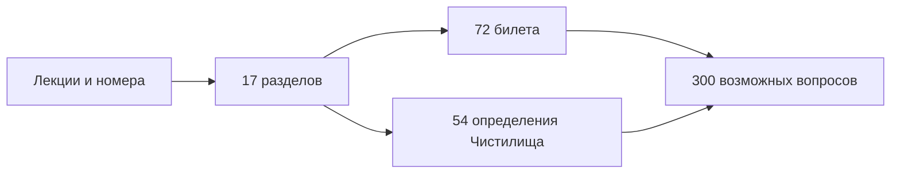

# Лекционный курс: указатель и нумерация

[Основное оглавление](../index.md) · [Термины](terms.md) · [72 билета](../exam/index.md) · [Чистилище](../purgatory/definitions.md)

## Редакционный принцип

1. **Первичный источник истины и нумерации — `source/MathInMind/МАТАН_Л/`.** Номера не пересчитываются заново.
2. Формулировки аккуратно переписаны в переносимом Markdown. Очевидные опечатки индексов, пределов и пропущенные множители исправлены с пояснением в соответствующем разделе.
3. Доказательства, пояснения и примеры, добавленные редактором, не получают новых лекционных номеров.
4. `МАТАН_Б/` используется как источник формулировок билетов, но при любом расхождении приоритет остаётся за лекциями.
5. Существующие [21 глава общего курса](../index.md) служат фоновым справочником и не изменяют лекционную нумерацию.

## Карта лекций

| Раздел | Лекции | Содержание | Билеты | Нумерованные элементы |
|---|---:|---|---:|---:|
| [§3.8](01-convexity-3-8.md) | 33–35 | Выпуклость, опорные прямые, перегибы | 1–7 | 14 |
| [§4.1](02-antiderivatives-4-1.md) | 36–38 | Первообразная и неопределённый интеграл | 8–14 | 9 |
| [§4.2](03-riemann-integral-4-2.md) | 37–42 | Суммы Римана и Дарбу, критерии интегрируемости | 15–21 | 18 |
| [§4.3](04-riemann-properties-4-3.md) | 43–45 | Свойства, среднее, Ньютон–Лейбниц | 21–23 | 7 + ненумерованные свойства |
| [§4.4](05-taylor-wallis-inequalities-4-4.md) | 45–48 | Тейлор, Валлис, Бонне, неравенства | 24–28 | 8 |
| [§4.5](06-improper-integrals-4-5.md) | 47–50 | Несобственные интегралы | 29–34 | 16 |
| [§4.6](07-measure-paths-4-6.md) | 51–52 | Площадь, объём, пути и длина | 35–36 | 10 |
| [§4.7](08-integral-applications-4-7.md) | 51–53 | Площади, длины, объёмы, работа | 37–40 | 4 |
| [§5.1](09-rn-foundations-5-1.md) | 54 | Норма и окрестности в $\mathbb R^n$ | 41 | 2 |
| [§5.2](10-vector-sequences-5-2.md) | 54–56 | Векторные последовательности | 42–47 | 11 |
| [§5.3](11-topology-rn-5-3.md) | 55–58 | Множества, относительная топология, компакты | 47–51 | 12 |
| [§5.4](12-mapping-limits-5-4.md) | 57–58 | Пределы по Коши и Гейне | 52–54 | 6 + следствия |
| [§5.5](13-continuity-rn-5-5.md) | 59–60 | Непрерывность, компакты, Кантор | 55–58 | 9 |
| [§6.1](14-differentiability-6-1.md) | 59–62 | $o,O$, дифференциал, Якоби, градиент | 59–62 | 11 |
| [§6.2](15-differentiation-rules-6-2.md) | 61–62 | Композиция, арифметика, обратное отображение | 63–64 | 3 |
| [§6.3](16-continuous-differentiability-6-3.md) | 61–64 | $C^1$ и формула приращений | 65–66, 69 | 4 |
| [§6.4](17-higher-derivatives-6-4.md) | 63–64 | Высшие производные и дифференциалы | 67–72 | 4 + восстановленная теорема 6.4.1 |

Всего в исходных лекциях явно встречается **148 уникальных нумерованных элементов**: 60 определений, 65 теорем, 14 лемм и 9 следствий. Теорема 6.4.1 дополнительно восстановлена по ссылкам внутри лекции 63–64. Пропуск 4.3.4 оставлен как в источнике.

## Как готовить ответ

1. Начните с точной формулировки под номером из таблицы.
2. Назовите все условия: область, ограниченность, непрерывность, гладкость, монотонность, компактность.
3. Воспроизведите доказательство или его основную цепочку.
4. Приведите один пример и, где возможно, контрпример, показывающий необходимость условия.
5. Завершите связью с билетом и типовой задачей.

Примеры в разделах оригинальные и составлены по типам задач Демидовича, Фихтенгольца, Зорича и Рудина. Они не выдаются за дословные задачи с выдуманными номерами.
