# Чистилище: 54 определения и теоремы

[Лекционный указатель](../lectures/index.md) · [72 билета](../exam/index.md) · [300 возможных вопросов](questions.md)

> **Состав архива.** В `опрМат/` находятся **53 изображения** с номерами 0–53; изображение 15 отсутствует. Ниже 53 скана сопровождаются пояснениями, а пункт 15 восстановлен по [теореме 4.2.5](../lectures/03-riemann-integral-4-2.md#thm-4-2-5) ([критерий Лебега](../lectures/03-riemann-integral-4-2.md#thm-4-2-5)) из лекций 41–42. Это даёт запрошенные 54 пунктов без выдумывания отсутствующего изображения.
>
> **Порядок изучения.** Сначала воспроизведите формулировку, затем объясните обозначения и условия, после этого раскройте скан и сверьте себя. Ссылки ведут к доказательствам и примерам в лекционных разделах.

## 00. Выпуклая и строго выпуклая функция

**Лекционный источник:** [определение 3.8.1](../lectures/01-convexity-3-8.md#def-3-8-1) · [Перейти к разделу](../lectures/01-convexity-3-8.md)

Для любых $`a,b`$ промежутка и $`\lambda\in(0,1)`$:

```math
f(\lambda a+(1-\lambda)b)\le\lambda f(a)+(1-\lambda)f(b).
```

При $`a\ne b`$ и строгом неравенстве функция строго выпукла. Хорда между точками графика лежит не ниже самого графика.

**Быстрая проверка / пример:** $`x^2`$ строго выпукла; $`|x|`$ выпукла, но на каждом луче совпадает с прямой, поэтому не строго выпукла.

<details>
<summary>Показать исходный скан 00</summary>


</details>

## 01. Точка перегиба

**Лекционный источник:** [определение 3.8.3](../lectures/01-convexity-3-8.md#def-3-8-3) · [Перейти к разделу](../lectures/01-convexity-3-8.md)

[Внутренняя точка](../lectures/11-topology-rn-5-3.md#def-5-3-3) $`a`$ — [точка перегиба](../lectures/01-convexity-3-8.md#def-3-8-3), если $`f`$ непрерывна в $`a`$, имеет там [производную](../lectures-2025-26/lecture-22-23.md#def-3-1-1) из $`\overline{\mathbb R}`$ и на двух соседних односторонних промежутках имеет разный характер [выпуклости](../lectures/01-convexity-3-8.md#def-3-8-1): выпукла с одной стороны и вогнута с другой.

Равенство $`f''(a)=0`$ не входит в определение и само по себе ничего не доказывает.

**Быстрая проверка / пример:** Ноль — перегиб $`x^3`$, но не $`x^4`$, хотя у обеих $`f''(0)=0`$.

<details>
<summary>Показать исходный скан 01</summary>

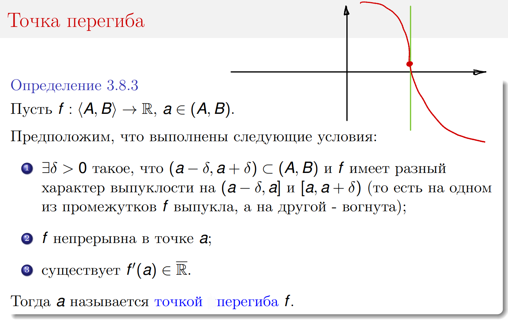

</details>

## 02. Опорная прямая

**Лекционный источник:** [определение 3.8.2](../lectures/01-convexity-3-8.md#def-3-8-2) · [Перейти к разделу](../lectures/01-convexity-3-8.md)

Прямая $`g(x)=f(a)+k(x-a)`$ опорна для $`f`$ в $`a`$, если $`f(x)\ge g(x)`$ для всех $`x`$ области. Если при $`x\ne a`$ неравенство строгое, она строго опорная.

Для выпуклой функции во внутренней точке допустимые наклоны образуют $`[f'_-(a),f'_+(a)]`$.

**Быстрая проверка / пример:** У $`|x|`$ в нуле опорны прямые $`y=kx`$ только с $`-1\le k\le1`$.

<details>
<summary>Показать исходный скан 02</summary>

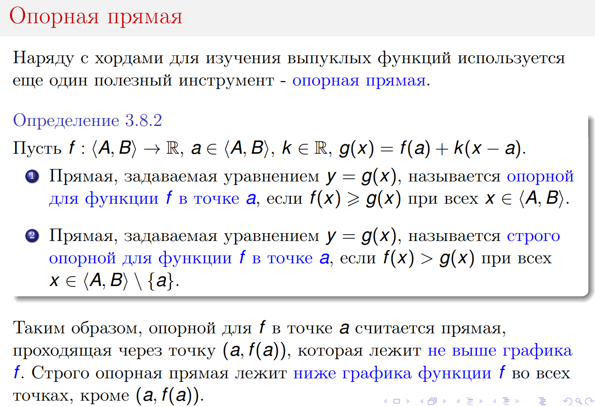

</details>

## 03. Первообразная функции

**Лекционный источник:** [определение 4.1.1](../lectures/02-antiderivatives-4-1.md#def-4-1-1) · [Перейти к разделу](../lectures/02-antiderivatives-4-1.md)

$`F`$ называется [первообразной](../lectures/02-antiderivatives-4-1.md#def-4-1-1) $`f`$ на промежутке, если $`F`$ [дифференцируема](../lectures-2025-26/lecture-22-23.md#def-3-2-1) и $`F'(x)=f(x)`$ во всех его точках. На концах используются [односторонние производные](../06-derivatives.md#sec-6-1).

Все первообразные на промежутке отличаются на константу.

**Быстрая проверка / пример:** $`F(x)=x^3/3`$ — первообразная $`x^2`$ на $`\mathbb R`$; $`x^3/3+C`$ — все остальные.

<details>
<summary>Показать исходный скан 03</summary>


</details>

## 04. Неопределённый интеграл

**Лекционный источник:** [определение 4.1.2](../lectures/02-antiderivatives-4-1.md#def-4-1-2) · [Перейти к разделу](../lectures/02-antiderivatives-4-1.md)

Неопределённый интеграл $`\int f(x)\,dx`$ — совокупность всех первообразных $`f`$ на заданном промежутке. Поэтому ответ записывают как $`F(x)+C`$.

Это семейство функций, а не числовая площадь и не [определённый интеграл](../lectures/03-riemann-integral-4-2.md#def-4-2-6).

**Быстрая проверка / пример:** $`\int\cos x\,dx=\sin x+C`$ на $`\mathbb R`$; проверка — $`(\sin x+C)'=\cos x`$.

<details>
<summary>Показать исходный скан 04</summary>


</details>

## 05. Первообразная на множестве

**Лекционный источник:** [определение 4.1.3](../lectures/02-antiderivatives-4-1.md#def-4-1-3) · [Перейти к разделу](../lectures/02-antiderivatives-4-1.md)

Для $`E\subseteq\mathbb R`$ функция $`F`$ — первообразная $`f`$ на $`E`$, если $`F`$ дифференцируема на $`E`$ и $`F'=f`$ во всех точках $`E`$.

На несвязном $`E`$ не следует автоматически писать одну общую константу: на разных компонентах константы могут различаться.

**Быстрая проверка / пример:** Для $`1/x`$ на $`(-\infty,0)\cup(0,\infty)`$ на каждом луче выбирается своя константа при $`\log|x|`$.

<details>
<summary>Показать исходный скан 05</summary>

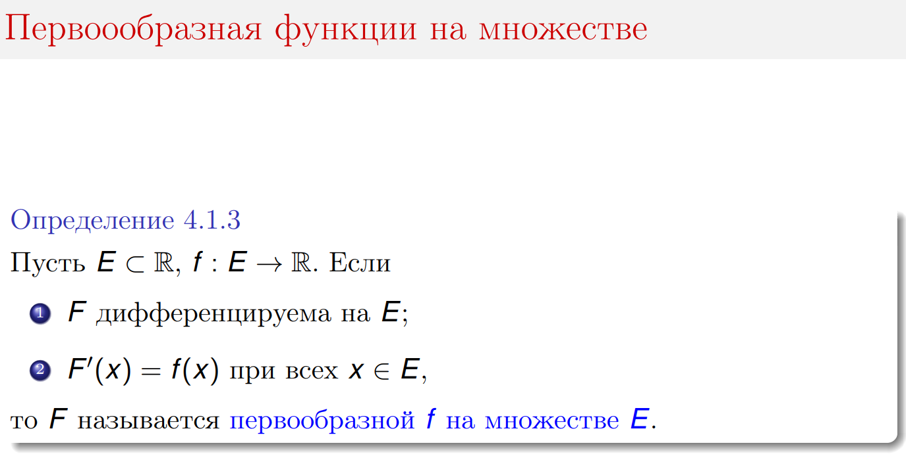

</details>

## 06. Целочисленный промежуток, разбиение и ранг

**Лекционный источник:** [определения 4.2.1](../lectures/03-riemann-integral-4-2.md#def-4-2-1)–[4.2.2](../lectures/03-riemann-integral-4-2.md#def-4-2-2) · [Перейти к разделу](../lectures/03-riemann-integral-4-2.md)

$`[p:q]=[p,q]\cap\mathbb Z`$. [Разбиение](../lectures/03-riemann-integral-4-2.md#def-4-2-2) отрезка:

```math
\tau:a=x_0<x_1<\cdots<x_n=b,\qquad \Delta x_k=x_{k+1}-x_k.
```

Его ранг $`\lambda_\tau=\max_k\Delta x_k`$ — длина наибольшего частичного отрезка.

**Быстрая проверка / пример:** Для $`[0,1]`$ и $`n`$ равных частей $`\Delta x_k=1/n`$, поэтому $`\lambda_\tau=1/n`$.

<details>
<summary>Показать исходный скан 06</summary>

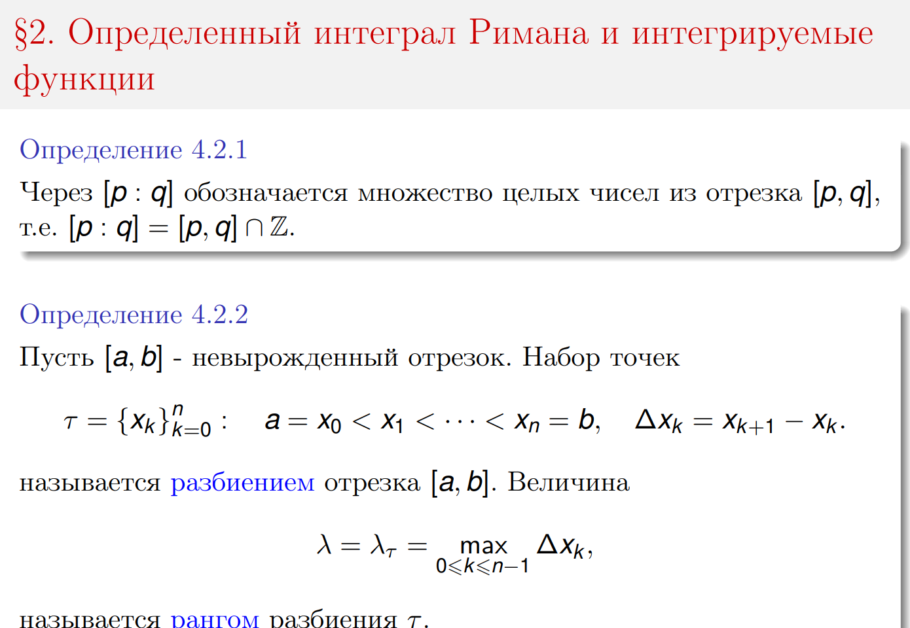

</details>

## 07. Оснащение и сумма Римана

**Лекционный источник:** [определения 4.2.3](../lectures/03-riemann-integral-4-2.md#def-4-2-3)–[4.2.4](../lectures/03-riemann-integral-4-2.md#def-4-2-4) · [Перейти к разделу](../lectures/03-riemann-integral-4-2.md)

[Оснащение](../lectures/03-riemann-integral-4-2.md#def-4-2-4) — выбор $`\xi_k\in[x_k,x_{k+1}]`$. Сумма Римана для оснащённого разбиения:

```math
\sigma_\tau(f,\xi)=\sum_{k=0}^{n-1}f(\xi_k)\Delta x_k.
```

При $`f\ge0`$ она представляет сумму площадей прямоугольников.

**Быстрая проверка / пример:** Для $`f=x`$ на $`[0,1]`$ с правыми концами $`\sigma_n=(n+1)/(2n)`$.

<details>
<summary>Показать исходный скан 07</summary>


</details>

## 08. Предел интегральных сумм

**Лекционный источник:** [определение 4.2.5](../lectures/03-riemann-integral-4-2.md#def-4-2-5) · [Перейти к разделу](../lectures/03-riemann-integral-4-2.md)

$`I`$ — предел сумм Римана при $`\lambda_\tau\to0`$, если для любого $`\varepsilon>0`$ найдётся $`\delta>0`$ такое, что при $`\lambda_\tau<\delta`$ для **любого** оснащения

```math
|\sigma_\tau(f,\xi)-I|<\varepsilon.
```

Единый предел для одной выбранной схемы оснащений ещё не доказывает это определение.

**Быстрая проверка / пример:** Для $`x`$ на $`[0,1]`$ все схемы при мелком разбиении приближаются к $`I=1/2`$.

<details>
<summary>Показать исходный скан 08</summary>


</details>

## 09. Интеграл Римана

**Лекционный источник:** [определение 4.2.6](../lectures/03-riemann-integral-4-2.md#def-4-2-6) · [Перейти к разделу](../lectures/03-riemann-integral-4-2.md)

Если предел интегральных сумм существует, функция интегрируема по Риману на $`[a,b]`$, а число $`I`$ называется определённым интегралом:

```math
I=\int_a^b f(x)\,dx.
```

Переменная интегрирования немая и может быть заменена любой другой буквой.

**Быстрая проверка / пример:** $`\int_0^1x\,dx=1/2`$, что подтверждается и суммами Римана, и [формулой Ньютона–Лейбница](../lectures/04-riemann-properties-4-3.md#thm-4-3-2).

<details>
<summary>Показать исходный скан 09</summary>


</details>

## 10. Верхняя и нижняя суммы Дарбу

**Лекционный источник:** [определение 4.2.7](../lectures/03-riemann-integral-4-2.md#def-4-2-7) · [Перейти к разделу](../lectures/03-riemann-integral-4-2.md)

Для ограниченной $`f`$ на каждом частичном отрезке берут $`m_k=\inf f`$, $`M_k=\sup f`$. Тогда

```math
s_\tau=\sum m_k\Delta x_k,\qquad S_\tau=\sum M_k\Delta x_k.
```

Для любого оснащения $`s_\tau\le\sigma_\tau\le S_\tau`$.

**Быстрая проверка / пример:** Для возрастающей $`f`$ на $`[x_k,x_{k+1}]`$ имеем $`m_k=f(x_k)`$, $`M_k=f(x_{k+1})`$.

<details>
<summary>Показать исходный скан 10</summary>


</details>

## 11. Верхний и нижний интегралы Дарбу

**Лекционный источник:** [определение 4.2.8](../lectures/03-riemann-integral-4-2.md#def-4-2-8) · [Перейти к разделу](../lectures/03-riemann-integral-4-2.md)

```math
I^*=\inf_\tau S_\tau,\qquad I_*=\sup_\tau s_\tau.
```

Всегда $`I_*\le I^*`$. Равенство этих величин равносильно интегрируемости, а их общее значение равно интегралу Римана.

**Быстрая проверка / пример:** У функции Дирихле на $`[0,1]`$ имеем $`I_*=0`$ и $`I^*=1`$, поэтому интегрируемости нет.

<details>
<summary>Показать исходный скан 11</summary>


</details>

## 12. Колебание функции

**Лекционный источник:** [определение 4.2.9](../lectures/03-riemann-integral-4-2.md#def-4-2-9) · [Перейти к разделу](../lectures/03-riemann-integral-4-2.md)

```math
\omega_D(f)=\sup_{x,y\in D}(f(x)-f(y))=\sup_Df-\inf_Df.
```

На частичном отрезке $`\omega_k=M_k-m_k`$, поэтому $`S_\tau-s_\tau=\sum\omega_k\Delta x_k`$.

**Быстрая проверка / пример:** Для $`x^2`$ на $`[0,1]`$ [колебание](../lectures/03-riemann-integral-4-2.md#def-4-2-9) равно $`1`$, а для постоянной функции — нулю.

<details>
<summary>Показать исходный скан 12</summary>

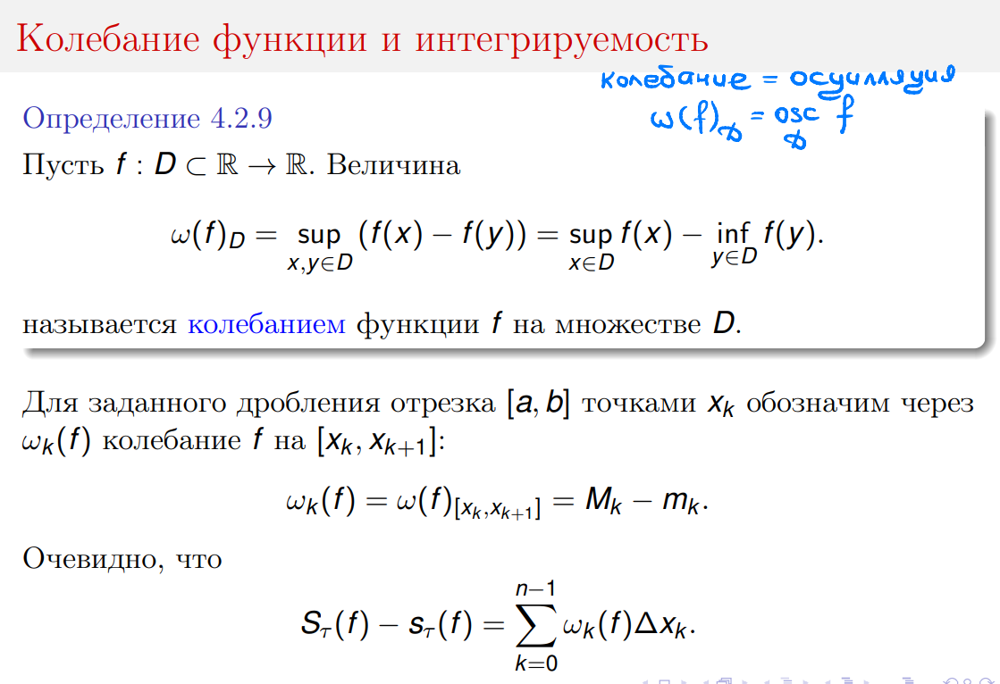

</details>

## 13. Кусочно-непрерывная функция

**Лекционный источник:** [определение 4.2.10](../lectures/03-riemann-integral-4-2.md#def-4-2-10) · [Перейти к разделу](../lectures/03-riemann-integral-4-2.md)

Функция кусочно-непрерывна на $`[a,b]`$, если разрывов конечное число или нет и все они первого рода: существуют конечные [односторонние пределы](../lectures-2025-26/lecture-15.md#def-2-4-5).

Такая функция интегрируема по Риману, а значения в отдельных точках не влияют на интеграл.

**Быстрая проверка / пример:** Ступенька с одним скачком кусочно-непрерывна; $`\sin(1/x)`$ в нуле имеет разрыв другого типа.

<details>
<summary>Показать исходный скан 13</summary>

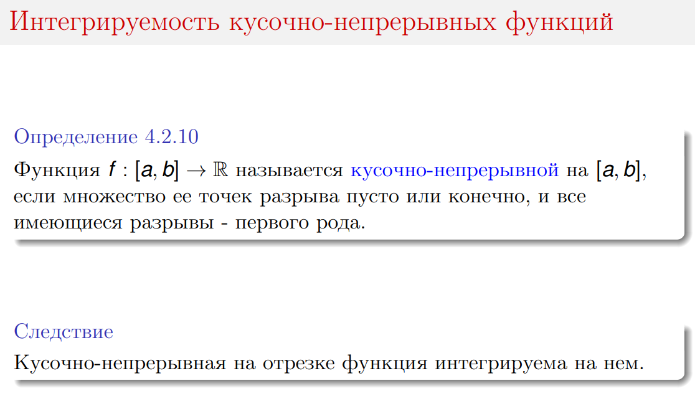

</details>

## 14. Множество нулевой меры

**Лекционный источник:** [определение 4.2.11](../lectures/03-riemann-integral-4-2.md#def-4-2-11) · [Перейти к разделу](../lectures/03-riemann-integral-4-2.md)

$`E\subset\mathbb R`$ имеет нулевую [меру](../19-measure-theory.md#sec-19-2), если для любого $`\varepsilon>0`$ его можно покрыть не более чем [счётным](../lectures-2025-26/lecture-01-02.md#def-1-2-5) семейством интервалов суммарной длины меньше $`\varepsilon`$.

Конечные и счётные множества имеют нулевую меру; [несчётное](../lectures-2025-26/lecture-03.md#thm-1-2-5) множество также может её иметь.

**Быстрая проверка / пример:** $`\mathbb Q\cap[0,1]`$ имеет нулевую меру, хотя плотно в $`[0,1]`$.

<details>
<summary>Показать исходный скан 14</summary>

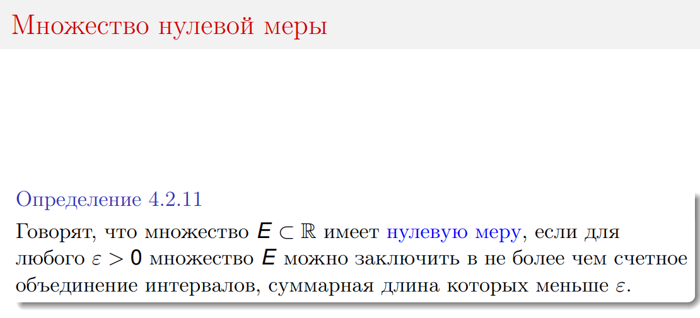

</details>

## 15. Критерий Лебега — восстановленный пункт

**Лекционный источник:** [теорема 4.2.5](../lectures/03-riemann-integral-4-2.md#thm-4-2-5) · [Перейти к разделу](../lectures/03-riemann-integral-4-2.md)

Ограниченная функция интегрируема по Риману на $`[a,b]`$ тогда и только тогда, когда множество её точек разрыва имеет нулевую меру.

Ограниченность обязательна. Сам критерий не утверждает непрерывность: допускаются разрывы, если их множество достаточно мало по мере.

**Быстрая проверка / пример:** Ступенька интегрируема, функция Дирихле — нет, поскольку разрывна на всём отрезке.

> **Восстановленный пункт:** исходного скана 15 в архиве нет. Содержание взято из лекции, а не распознано из изображения.

## 16. Формула Тейлора с интегральным остатком

**Лекционный источник:** [теорема 4.4.1](../lectures/05-taylor-wallis-inequalities-4-4.md#thm-4-4-1) · [Перейти к разделу](../lectures/05-taylor-wallis-inequalities-4-4.md)

Для $`f\in C^{n+1}`$:

```math
f(x)=\sum_{k=0}^n\frac{f^{(k)}(a)}{k!}(x-a)^k
+\frac1{n!}\int_a^x f^{(n+1)}(t)(x-t)^n\,dt.
```

Последний интеграл — остаток $`R_n(x)`$. При $`n=0`$ получается формула Ньютона–Лейбница.

**Быстрая проверка / пример:** Для $`e^x`$ и $`a=0`$ остаток равен $`\frac1{n!}\int_0^xe^t(x-t)^n\,dt`$.

<details>
<summary>Показать исходный скан 16</summary>

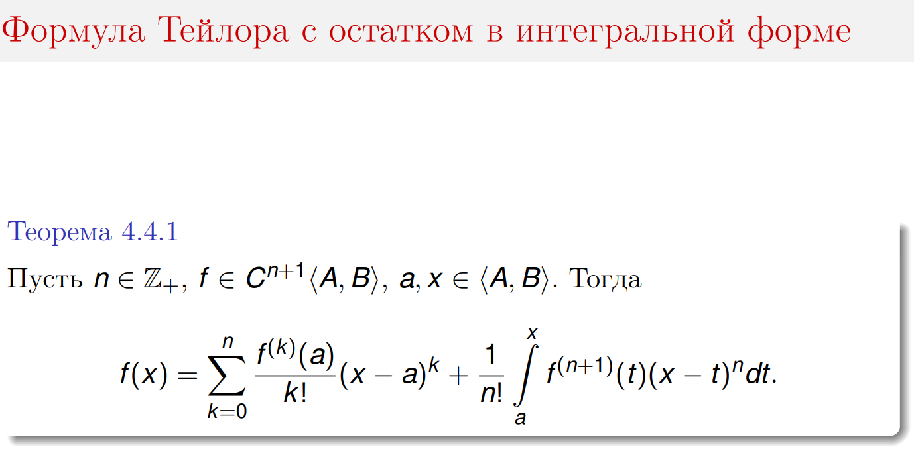

</details>

## 17. Локально интегрируемая функция

**Лекционный источник:** [определение 4.5.1](../lectures/06-improper-integrals-4-5.md#def-4-5-1) · [Перейти к разделу](../lectures/06-improper-integrals-4-5.md)

$`f`$ локально интегрируема на промежутке, если интегрируема по Риману на каждом закрытом отрезке внутри него. Класс обозначается $`\mathcal R_{loc}`$.

Локальная интегрируемость не гарантирует сходимость [несобственного интеграла](../lectures/06-improper-integrals-4-5.md#def-4-5-2) по всему промежутку.

**Быстрая проверка / пример:** $`1/x`$ локально интегрируема на $`(0,1]`$, но $`\int_0^1dx/x`$ расходится.

<details>
<summary>Показать исходный скан 17</summary>


</details>

## 18. Несобственный интеграл

**Лекционный источник:** [определение 4.5.2](../lectures/06-improper-integrals-4-5.md#def-4-5-2) · [Перейти к разделу](../lectures/06-improper-integrals-4-5.md)

Для $`f\in\mathcal R_{loc}[a,b)`$:

```math
\int_a^{\to b}f=\lim_{B\to b^-}\int_a^Bf.
```

Если предел конечен, интеграл сходится. При особенностях на обоих концах нужны две независимо сходящиеся части.

**Быстрая проверка / пример:** $`\int_1^\infty x^{-2}dx=\lim_{R\to\infty}(1-1/R)=1`$.

<details>
<summary>Показать исходный скан 18</summary>


</details>

## 19. Остаток несобственного интеграла

**Лекционный источник:** [определение 4.5.3](../lectures/06-improper-integrals-4-5.md#def-4-5-3) и [лемма 4.5.3](../lectures/06-improper-integrals-4-5.md#lem-4-5-3) · [Перейти к разделу](../lectures/06-improper-integrals-4-5.md)

Остаток после $`A`$ — интеграл $`\int_A^{\to b}f`$. Если полный интеграл сходится, то остаток стремится к нулю при $`A\to b^-`$:

```math
\int_A^{\to b}f=I-\int_a^Af\longrightarrow0.
```

**Быстрая проверка / пример:** Для $`\int_1^\infty x^{-2}dx`$ остаток после $`A`$ равен $`1/A`$.

<details>
<summary>Показать исходный скан 19</summary>

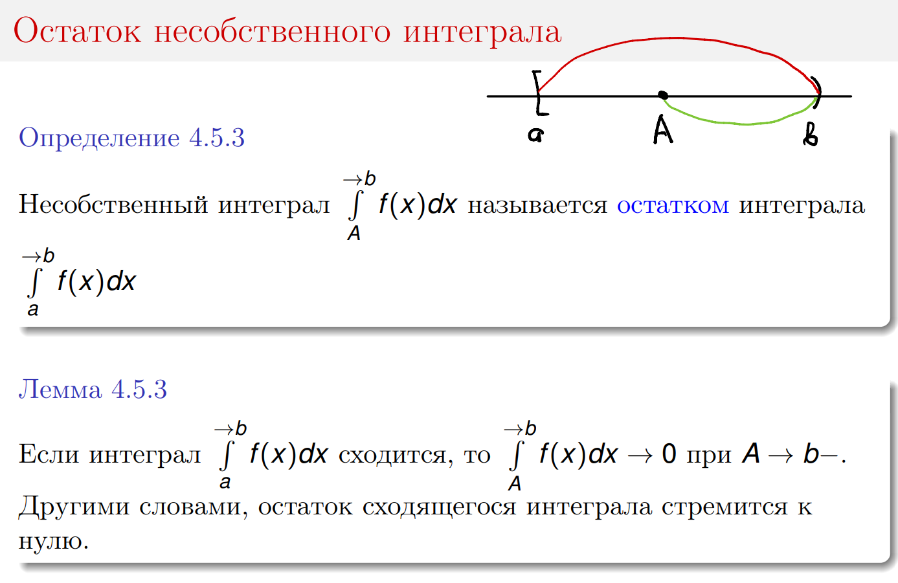

</details>

## 20. Абсолютная и условная сходимость

**Лекционный источник:** [определение 4.5.4](../lectures/06-improper-integrals-4-5.md#def-4-5-4) и [лемма 4.5.6](../lectures/06-improper-integrals-4-5.md#lem-4-5-6) · [Перейти к разделу](../lectures/06-improper-integrals-4-5.md)

Интеграл сходится абсолютно, если сходится $`\int|f|`$. [Абсолютная сходимость](../04-numeric-series.md#sec-4-3) влечёт обычную. Если $`\int f`$ сходится, а $`\int|f|`$ расходится, сходимость условная.

**Быстрая проверка / пример:** $`\int_1^\infty\sin x/x\,dx`$ сходится условно: сам существует, а интеграл модуля расходится.

<details>
<summary>Показать исходный скан 20</summary>


</details>

## 21. Движение пространства

**Лекционный источник:** [определение 4.6.1](../lectures/07-measure-paths-4-6.md#def-4-6-1) · [Перейти к разделу](../lectures/07-measure-paths-4-6.md)

$`U:\mathbb R^n\to\mathbb R^n`$ — движение, если для всех $`A,B`$

```math
\|U(A)-U(B)\|=\|A-B\|.
```

Переносы, повороты и отражения сохраняют расстояния, а значит площадь и объём.

**Быстрая проверка / пример:** $`U(x)=x+c`$ — движение; $`U(x)=2x`$ — нет.

<details>
<summary>Показать исходный скан 21</summary>

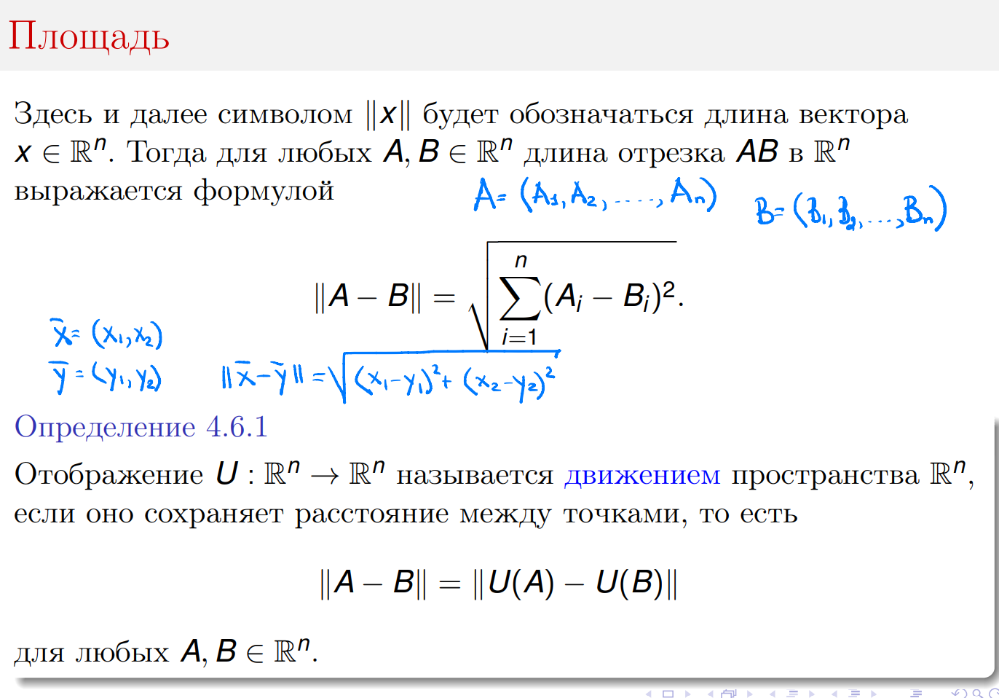

</details>

## 22. Площадь

**Лекционный источник:** [определение 4.6.2](../lectures/07-measure-paths-4-6.md#def-4-6-2) · [Перейти к разделу](../lectures/07-measure-paths-4-6.md)

Площадь $`S`$ — неотрицательная функция на квадрируемых фигурах, аддитивная для непересекающихся фигур, нормированная на прямоугольниках $`S=ab`$ и инвариантная относительно движений.

Эти свойства позволяют вычислять площади через разбиения и пределы.

**Быстрая проверка / пример:** Прямоугольник $`2\times3`$ имеет площадь $`6`$ независимо от поворота.

<details>
<summary>Показать исходный скан 22</summary>


</details>

## 23. Объём

**Лекционный источник:** [определение 4.6.3](../lectures/07-measure-paths-4-6.md#def-4-6-3) · [Перейти к разделу](../lectures/07-measure-paths-4-6.md)

Объём $`V`$ — неотрицательная функция на кубируемых телах, аддитивная для непересекающихся тел, нормированная на параллелепипедах $`V=abc`$ и инвариантная относительно движений.

**Быстрая проверка / пример:** Параллелепипед с рёбрами $`2,3,4`$ имеет объём $`24`$.

<details>
<summary>Показать исходный скан 23</summary>


</details>

## 24. Прямой цилиндр и сечение

**Лекционный источник:** [определения 4.6.4](../lectures/07-measure-paths-4-6.md#def-4-6-4)–[4.6.5](../lectures/07-measure-paths-4-6.md#def-4-6-5) · [Перейти к разделу](../lectures/07-measure-paths-4-6.md)

Прямой цилиндр — $`P\times[0,h]`$ или его образ при движении; $`V=S(P)h`$. Сечение тела $`T`$ координатой $`x`$:

```math
T(x)=\{(y,z):(x,y,z)\in T\}.
```

Площади сечений используются в формуле $`V=\int A(x)\,dx`$.

**Быстрая проверка / пример:** Сечение шара радиуса $`R`$ — круг площади $`\pi(R^2-x^2)`$.

<details>
<summary>Показать исходный скан 24</summary>

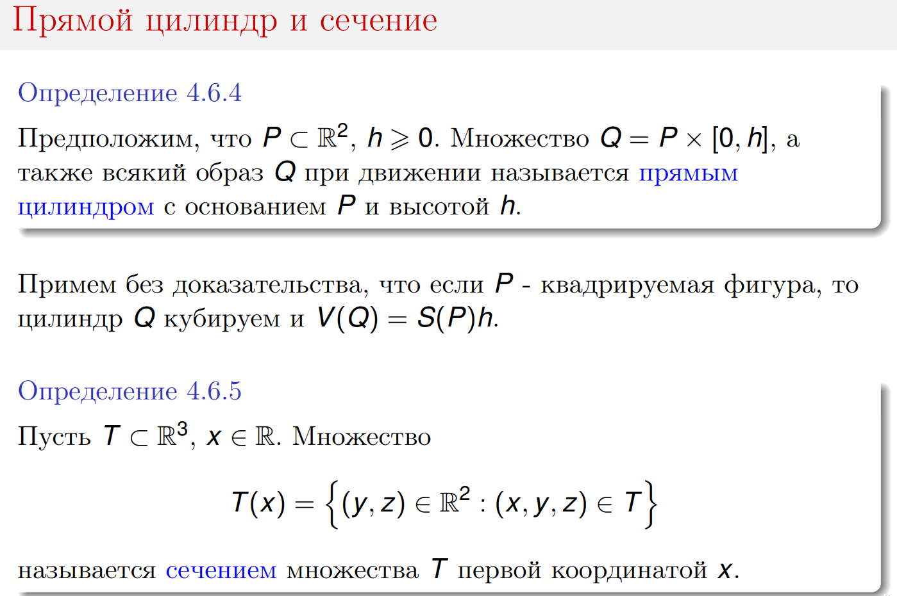

</details>

## 25. Путь

**Лекционный источник:** [определение 4.6.6](../lectures/07-measure-paths-4-6.md#def-4-6-6) · [Перейти к разделу](../lectures/07-measure-paths-4-6.md)

Путь в $`\mathbb R^m`$ — непрерывное отображение $`\gamma:[a,b]\to\mathbb R^m`$. $`\gamma(a)`$ — начало, $`\gamma(b)`$ — конец.

Путь включает параметризацию, а не только геометрический образ.

**Быстрая проверка / пример:** $`\gamma(t)=(\cos t,\sin t)`$ на $`[0,2\pi]`$ — путь по единичной окружности.

<details>
<summary>Показать исходный скан 25</summary>

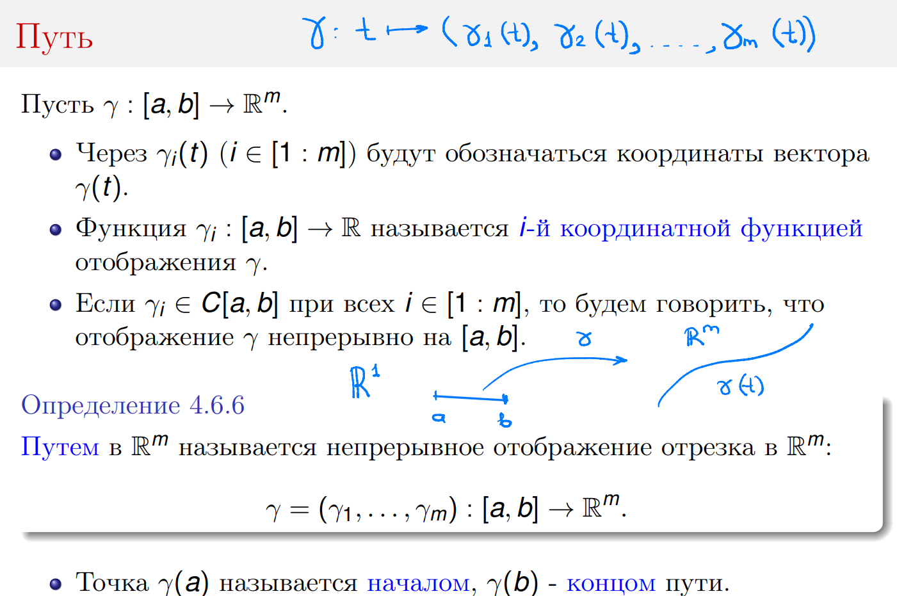

</details>

## 26. Вписанная ломаная

**Лекционный источник:** [определение 4.6.8](../lectures/07-measure-paths-4-6.md#def-4-6-8) · [Перейти к разделу](../lectures/07-measure-paths-4-6.md)

Для разбиения $`a=t_0<\cdots<t_n=b`$ вписанная ломаная соединяет последовательные $`\gamma(t_k)`$ отрезками. Её длина:

```math
\ell_\tau=\sum_{k=0}^{n-1}\|\gamma(t_{k+1})-\gamma(t_k)\|.
```

**Быстрая проверка / пример:** Для прямолинейного пути длина любой вписанной ломаной равна длине всего отрезка.

<details>
<summary>Показать исходный скан 26</summary>


</details>

## 27. Длина пути и спрямляемость

**Лекционный источник:** [определения 4.6.9](../lectures/07-measure-paths-4-6.md#def-4-6-9)–[4.6.10](../lectures/07-measure-paths-4-6.md#def-4-6-10) · [Перейти к разделу](../lectures/07-measure-paths-4-6.md)

[Длина пути](../lectures/08-integral-applications-4-7.md#thm-4-7-1) — $`s_\gamma=\sup_\tau\ell_\tau`$ по всем вписанным ломаным. Если $`s_\gamma<+\infty`$, путь спрямляем.

Непрерывность пути не гарантирует конечную длину; для [гладкого пути](../lectures/07-measure-paths-4-6.md#def-4-6-1) $`s_\gamma=\int_a^b\|\gamma'\|`$.

**Быстрая проверка / пример:** Для $`\gamma(t)=(R\cos t,R\sin t)`$ на $`[0,2\pi]`$ длина равна $`2\pi R`$.

<details>
<summary>Показать исходный скан 27</summary>

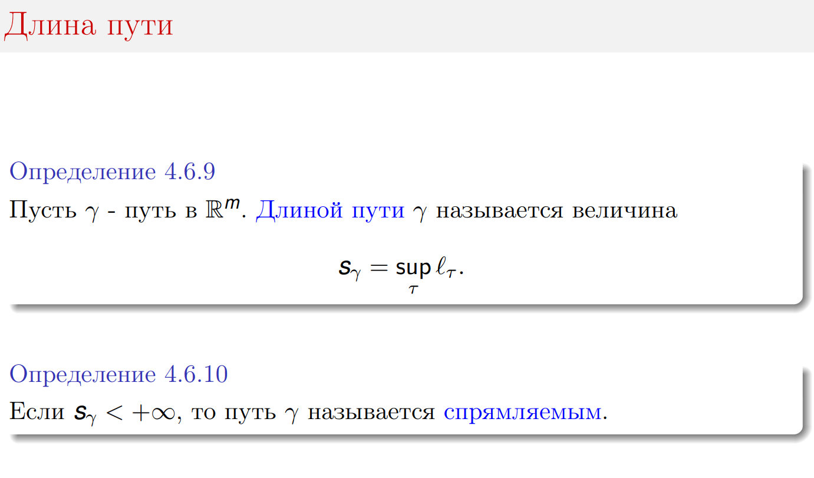

</details>

## 28. Подграфик и криволинейная трапеция

**Лекционный источник:** [определение 4.7.1](../lectures/08-integral-applications-4-7.md#def-4-7-1) · [Перейти к разделу](../lectures/08-integral-applications-4-7.md)

Для $`f\ge0`$ подграфик:

```math
Q_f=\{(x,y):a\le x\le b,\ 0\le y\le f(x)\}.
```

Для непрерывной $`f`$ он называется криволинейной трапецией, а его площадь равна $`\int_a^bf`$.

**Быстрая проверка / пример:** Площадь под $`y=x^2`$ на $`[0,2]`$ равна $`8/3`$.

<details>
<summary>Показать исходный скан 28</summary>


</details>

## 29. Евклидова норма вектора

**Лекционный источник:** [определение 5.1.1](../lectures/09-rn-foundations-5-1.md#def-5-1-1) · [Перейти к разделу](../lectures/09-rn-foundations-5-1.md)

```math
\|x\|=\sqrt{x_1^2+\cdots+x_n^2}.
```

Выполнены положительность, $`\|\lambda x\|=|\lambda|\|x\|`$ и $`\|x+y\|\le\|x\|+\|y\|`$. Расстояние — $`\|x-y\|`$.

**Быстрая проверка / пример:** $`\|(3,4)\|=5`$, $`\|(1,1,\ldots,1)\|=\sqrt n`$.

<details>
<summary>Показать исходный скан 29</summary>

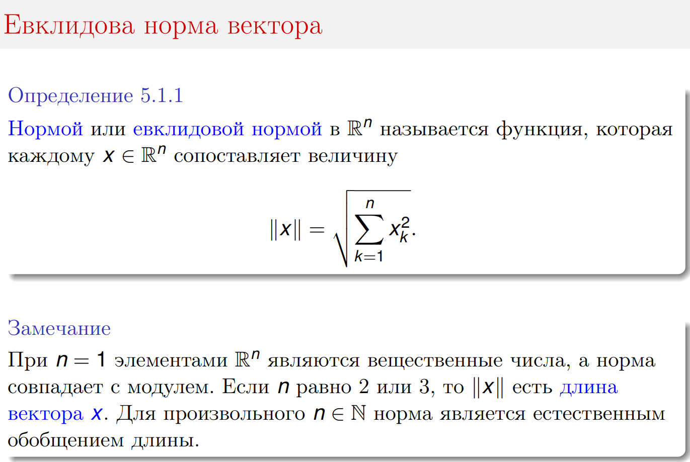

</details>

## 30. Окрестности в расширенном $`\mathbb R^n`$

**Лекционный источник:** [определение 5.1.2](../lectures/09-rn-foundations-5-1.md#def-5-1-2) · [Перейти к разделу](../lectures/09-rn-foundations-5-1.md)

$`V_\delta(a)=\{x:\|x-a\|<\delta\}`$, а $`\dot V_\delta(a)=V_\delta(a)\setminus\{a\}`$. Для бесконечно удалённой точки

```math
V_\delta(\infty)=\{x:\|x\|>\delta\}=\dot V_\delta(\infty).
```

**Быстрая проверка / пример:** При $`n=2`$ окрестность конечной точки — открытый круг; $`V_5(\infty)`$ — внешность круга радиуса $`5`$.

<details>
<summary>Показать исходный скан 30</summary>


</details>

## 31. Предел последовательности векторов

**Лекционный источник:** [определение 5.2.1](../lectures/10-vector-sequences-5-2.md#def-5-2-1) · [Перейти к разделу](../lectures/10-vector-sequences-5-2.md)

$`x^k\to a`$, если для любого $`\varepsilon>0`$ найдётся $`N`$ такое, что $`k>N\implies x^k\in V_\varepsilon(a)`$. Для конечного $`a`$ это $`\|x^k-a\|\to0`$.

Сходимость в $`\mathbb R^n`$ равносильна покоординатной сходимости.

**Быстрая проверка / пример:** $`(1/k,1-1/k)\to(0,1)`$, поскольку [норма](../14-several-variables.md#sec-14-1) разности $`\sqrt2/k\to0`$.

<details>
<summary>Показать исходный скан 31</summary>

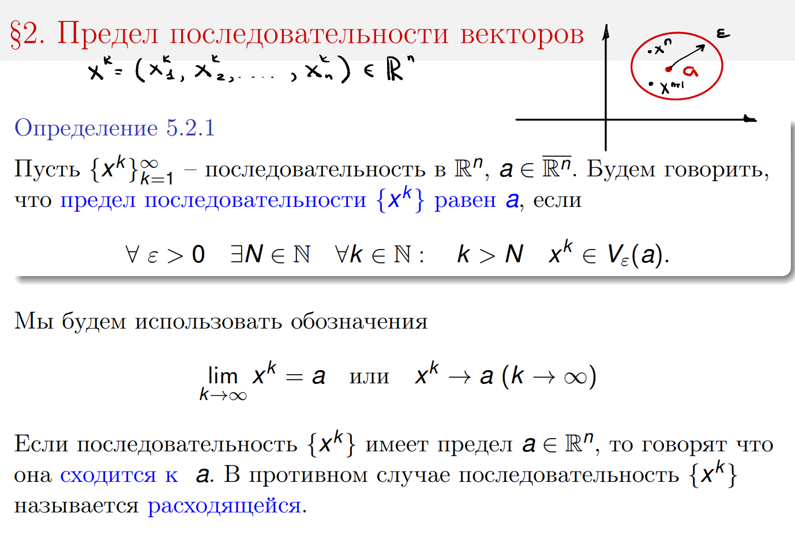

</details>

## 32. Ограниченность в $`\mathbb R^n`$

**Лекционный источник:** [определение 5.2.2](../lectures/10-vector-sequences-5-2.md#def-5-2-2) · [Перейти к разделу](../lectures/10-vector-sequences-5-2.md)

$`E\subseteq\mathbb R^n`$ ограничено, если $`E\subset V_C(0)`$ для некоторого $`C`$. Отображение ограничено, если ограничен его образ $`f(E)`$.

[Сходящаяся последовательность](../lectures-2025-26/lecture-08.md#def-2-1-3) ограничена; обратное неверно.

**Быстрая проверка / пример:** $`((-1)^k,1/k)`$ ограничена, но расходится; $`[0,1]^n`$ ограничен, $`\mathbb R^n`$ — нет.

<details>
<summary>Показать исходный скан 32</summary>

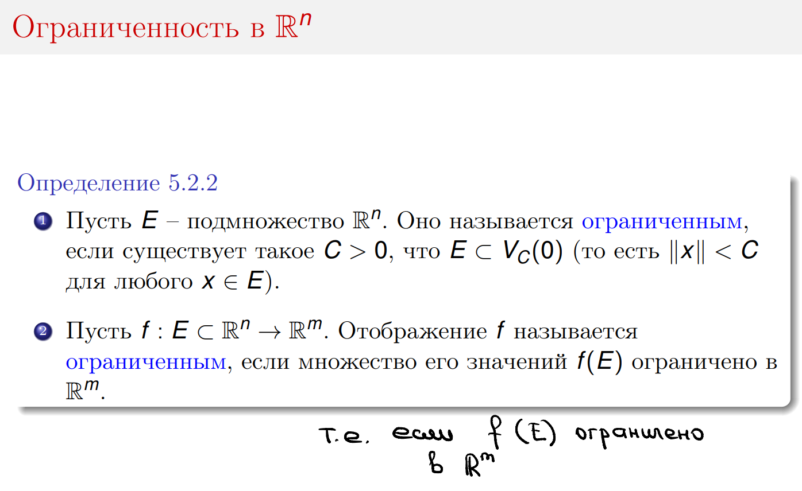

</details>

## 33. Предельная и изолированная точки

**Лекционный источник:** [определение 5.2.3](../lectures/10-vector-sequences-5-2.md#def-5-2-3) · [Перейти к разделу](../lectures/10-vector-sequences-5-2.md)

$`a`$ — [предельная точка](../lectures-2025-26/lecture-14.md#def-2-4-1) $`E`$, если $`E\cap\dot V_\varepsilon(a)\ne\varnothing`$ для любого $`\varepsilon>0`$. Точка $`a\in E`$ изолирована, если существует окрестность с $`E\cap V(a)=\{a\}`$.

Предельная точка характеризуется последовательностью $`x^k\in E\setminus\{a\}`$, $`x^k\to a`$.

**Быстрая проверка / пример:** Ноль предельный для $`\{1/k\}`$; точка $`2`$ изолирована в $`(0,1]\cup\{2\}`$.

<details>
<summary>Показать исходный скан 33</summary>

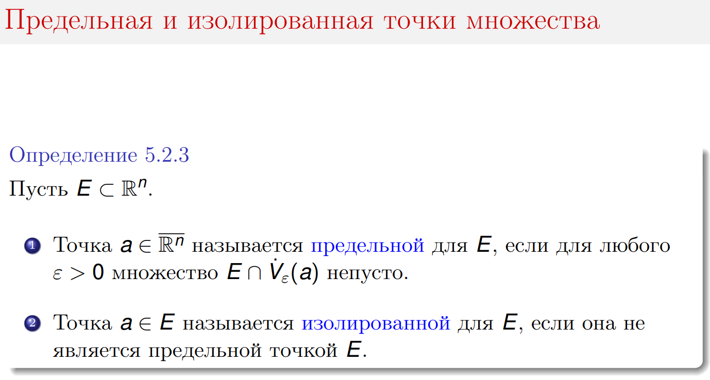

</details>

## 34. Открытые и замкнутые множества

**Лекционный источник:** [определение 5.3.1](../lectures/11-topology-rn-5-3.md#def-5-3-1) · [Перейти к разделу](../lectures/11-topology-rn-5-3.md)

$`a\in E`$ внутренняя, если некоторая её окрестность целиком лежит в $`E`$. $`E`$ открыто, если все его точки внутренние; замкнуто, если $`\mathbb R^n\setminus E`$ открыто.

[Замкнутое множество](../lectures/11-topology-rn-5-3.md#thm-5-3-1) содержит все свои предельные точки.

**Быстрая проверка / пример:** $`(0,1)`$ открыто, $`[0,1]`$ замкнуто, $`(0,1]`$ — ни то ни другое в $`\mathbb R`$.

<details>
<summary>Показать исходный скан 34</summary>

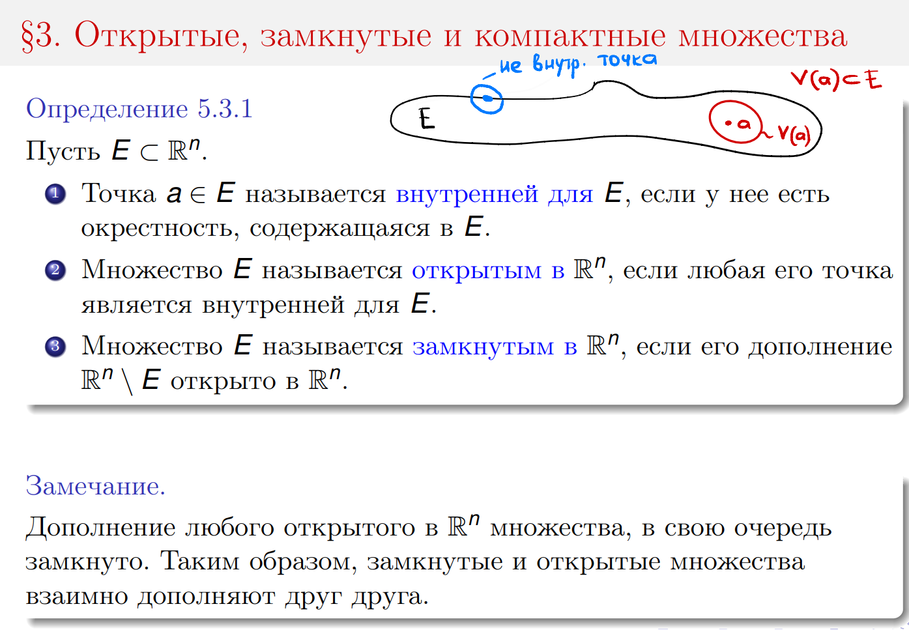

</details>

## 35. Замыкание множества

**Лекционный источник:** [определение 5.3.2](../lectures/11-topology-rn-5-3.md#def-5-3-2) · [Перейти к разделу](../lectures/11-topology-rn-5-3.md)

$`\overline E`$ — наименьшее замкнутое множество, содержащее $`E`$. Оно равно пересечению всех замкнутых множеств, содержащих $`E`$, и состоит из точек $`E`$ и его предельных точек.

**Быстрая проверка / пример:** Для $`E=\{1/k\}`$ [замыкание](../lectures/11-topology-rn-5-3.md#def-5-3-2) равно $`E\cup\{0\}`$.

<details>
<summary>Показать исходный скан 35</summary>

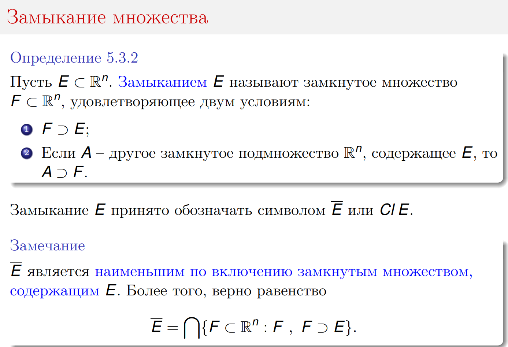

</details>

## 36. Внутренность множества

**Лекционный источник:** [определение 5.3.3](../lectures/11-topology-rn-5-3.md#def-5-3-3) · [Перейти к разделу](../lectures/11-topology-rn-5-3.md)

$`\operatorname{Int}E`$ — множество всех внутренних точек $`E`$ и одновременно наибольшее [открытое множество](../lectures/11-topology-rn-5-3.md#def-5-3-1), содержащееся в $`E`$.

**Быстрая проверка / пример:** $`\operatorname{Int}[0,1]=(0,1)`$ в $`\mathbb R`$, а $`\operatorname{Int}\mathbb Q=\varnothing`$.

<details>
<summary>Показать исходный скан 36</summary>


</details>

## 37. Граница множества

**Лекционный источник:** [определение 5.3.4](../lectures/11-topology-rn-5-3.md#def-5-3-4) · [Перейти к разделу](../lectures/11-topology-rn-5-3.md)

```math
\partial E=\overline E\setminus\operatorname{Int}E.
```

Граница замкнута. Для шара граница — сфера; для $`\mathbb Q`$ в $`\mathbb R`$ граница равна $`\mathbb R`$.

**Быстрая проверка / пример:** Для $`(0,1)`$ граница $`\{0,1\}`$; для $`[0,1]`$ она та же.

<details>
<summary>Показать исходный скан 37</summary>

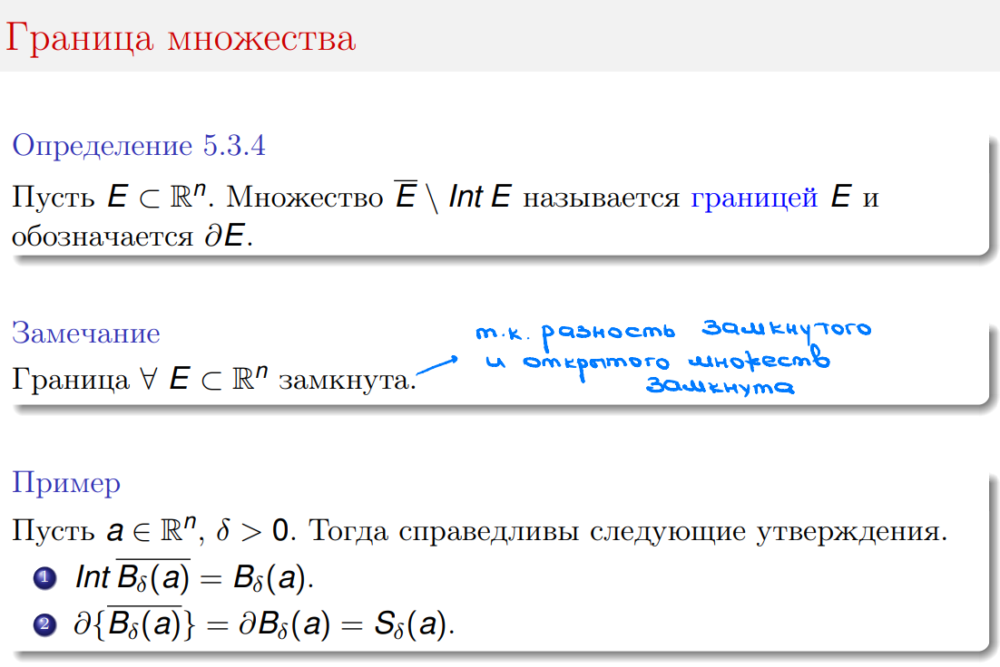

</details>

## 38. Открытые и замкнутые подмножества в $`E`$

**Лекционный источник:** [определение 5.3.5](../lectures/11-topology-rn-5-3.md#def-5-3-5) и [теорема 5.3.4](../lectures/11-topology-rn-5-3.md#thm-5-3-4) · [Перейти к разделу](../lectures/11-topology-rn-5-3.md)

$`F\subseteq E`$ открыто в $`E`$, если у каждой $`a\in F`$ есть окрестность с $`V_\delta(a)\cap E\subseteq F`$. Равносильно, $`F=E\cap G`$ для открытого $`G`$ в окружающем пространстве.

Это относительная топология, а не обязательная открытость в $`\mathbb R^n`$.

**Быстрая проверка / пример:** $`[0,1/2)`$ открыто в $`[0,1]`$, но не в $`\mathbb R`$.

<details>
<summary>Показать исходный скан 38</summary>


</details>

## 39. Покрытие и компакт

**Лекционный источник:** [определения 5.3.6](../lectures/11-topology-rn-5-3.md#def-5-3-6)–[5.3.7](../lectures/11-topology-rn-5-3.md#def-5-3-7) · [Перейти к разделу](../lectures/11-topology-rn-5-3.md)

Семейство $`\Omega`$ покрывает $`E`$, если его объединение содержит $`E`$. $`E`$ [компактно](../lectures/11-topology-rn-5-3.md#def-5-3-7), если из любого открытого покрытия можно выбрать конечное подпокрытие.

В $`\mathbb R^n`$ компактность равносильна замкнутости и ограниченности.

**Быстрая проверка / пример:** $`[0,1]`$ компактен; $`(0,1)`$ — нет, поскольку не замкнут.

<details>
<summary>Показать исходный скан 39</summary>


</details>

## 40. Предел отображения по Коши

**Лекционный источник:** [определение 5.4.1](../lectures/12-mapping-limits-5-4.md#def-5-4-1) · [Перейти к разделу](../lectures/12-mapping-limits-5-4.md)

$`f(x)\to A`$ при $`x\to a`$, если для любого $`\varepsilon>0`$ найдётся $`\delta>0`$ такое, что

```math
x\in\dot V_\delta(a)\cap E\implies f(x)\in V_\varepsilon(A).
```

Для конечных точек это обычная запись через $`\|f(x)-A\|<\varepsilon`$.

**Быстрая проверка / пример:** $`(x^3+y^3)/(x^2+y^2)\to0`$ в нуле: модуль не превосходит $`2\sqrt{x^2+y^2}`$.

<details>
<summary>Показать исходный скан 40</summary>

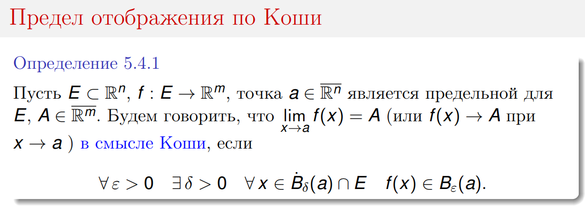

</details>

## 41. Предел отображения по Гейне

**Лекционный источник:** [определение 5.4.2](../lectures/12-mapping-limits-5-4.md#def-5-4-2) · [Перейти к разделу](../lectures/12-mapping-limits-5-4.md)

$`f(x)\to A`$, если для любой последовательности $`x^k\in E\setminus\{a\}`$ с $`x^k\to a`$ выполняется $`f(x^k)\to A`$.

По [теореме 5.4.1](../lectures/12-mapping-limits-5-4.md#thm-5-4-1) это равносильно [определению по Коши](../lectures-2025-26/lecture-14.md#def-2-4-4).

**Быстрая проверка / пример:** Для $`xy/(x^2+y^2)`$ две последовательности дают $`0`$ и $`1/2`$, поэтому предела нет.

<details>
<summary>Показать исходный скан 41</summary>

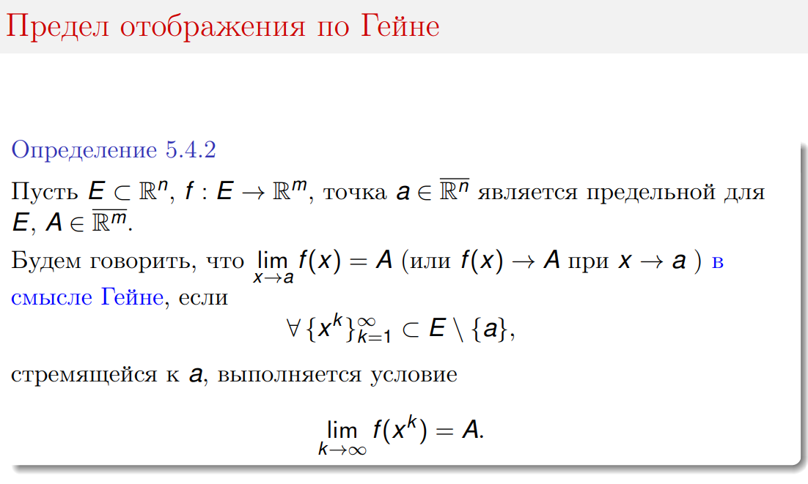

</details>

## 42. Непрерывность отображения в точке

**Лекционный источник:** [определение 5.5.1](../lectures/13-continuity-rn-5-5.md#def-5-5-1) · [Перейти к разделу](../lectures/13-continuity-rn-5-5.md)

$`f`$ непрерывна в $`a\in E`$, если для любого $`\varepsilon>0`$ найдётся $`\delta>0`$ с

```math
x\in V_\delta(a)\cap E\implies f(x)\in V_\varepsilon(f(a)).
```

Для предельной точки это $`\lim_{x\to a}f(x)=f(a)`$.

**Быстрая проверка / пример:** Многочлены непрерывны в каждой точке; $`1/(x^2+y^2)`$ непрерывна только вне нуля.

<details>
<summary>Показать исходный скан 42</summary>


</details>

## 43. Непрерывность отображения на множестве

**Лекционный источник:** [определение 5.5.2](../lectures/13-continuity-rn-5-5.md#def-5-5-2) и [теорема 5.5.3](../lectures/13-continuity-rn-5-5.md#thm-5-5-3) · [Перейти к разделу](../lectures/13-continuity-rn-5-5.md)

$`f`$ непрерывна на $`E`$, если непрерывна в каждой его точке. Равносильный критерий: прообраз любого открытого множества открыт в относительной топологии $`E`$.

**Быстрая проверка / пример:** Для $`f(x)=x`$ на $`[0,1]`$ прообраз $`(-1,1/2)`$ равен $`[0,1/2)`$, открыт в $`[0,1]`$.

<details>
<summary>Показать исходный скан 43</summary>


</details>

## 44. Равномерная непрерывность

**Лекционный источник:** [определение 5.5.3](../lectures/13-continuity-rn-5-5.md#def-5-5-3) · [Перейти к разделу](../lectures/13-continuity-rn-5-5.md)

$`f`$ [равномерно непрерывна](../lectures-2025-26/lecture-17-18.md#def-2-5-7) на $`E`$, если один $`\delta`$ работает для всех пар точек:

```math
\|x-y\|<\delta\implies\|f(x)-f(y)\|<\varepsilon.
```

На компакте любая непрерывная функция равномерно непрерывна по теореме Кантора.

**Быстрая проверка / пример:** $`1/x`$ равномерно непрерывна на $`[1,\infty)`$, но не на $`(0,1)`$.

<details>
<summary>Показать исходный скан 44</summary>

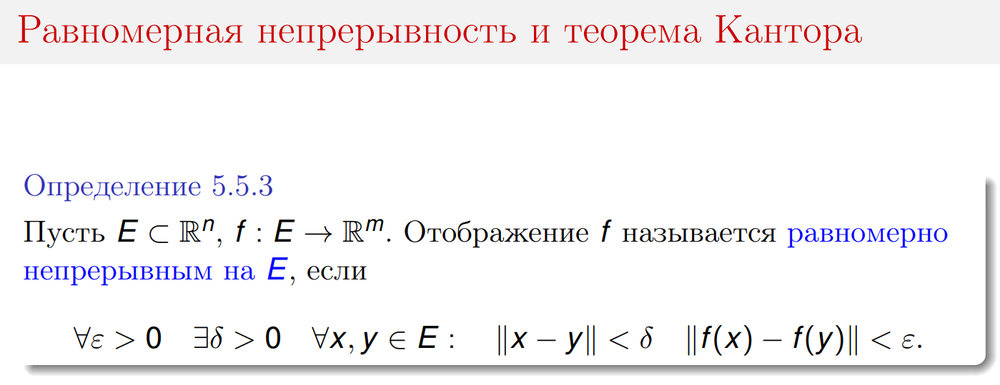

</details>

## 45. Символы Ландау $`O`$ и $`o`$

**Лекционный источник:** [определение 6.1.1](../lectures/14-differentiability-6-1.md#def-6-1-1) · [Перейти к разделу](../lectures/14-differentiability-6-1.md)

$`f=O(\|x-a\|^N)`$, если $`f/\|x-a\|^N`$ ограничено в [проколотой окрестности](../lectures-2025-26/lecture-14.md#def-2-4-2). $`f=o(\|x-a\|^N)`$, если это отношение стремится к нулю.

Для векторной функции используются нормы. $`o(g)`$ сильнее $`O(g)`$.

**Быстрая проверка / пример:** $`x^2=o(x)`$ при $`x\to0`$, но $`x=O(x)`$ и $`x\ne o(x)`$.

<details>
<summary>Показать исходный скан 45</summary>

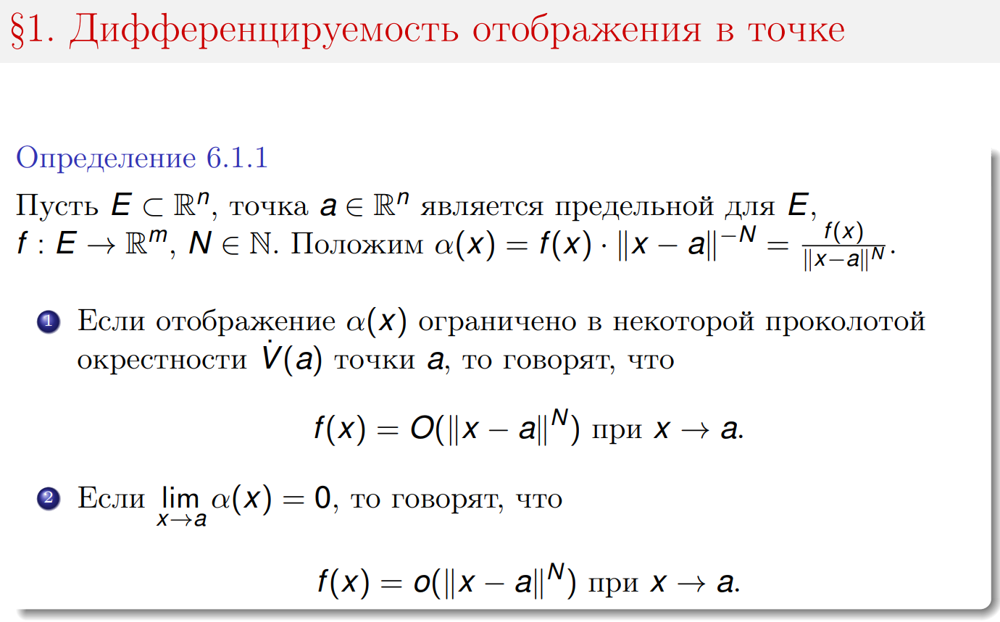

</details>

## 46. Дифференцируемость и линейный оператор

**Лекционный источник:** [определения 6.1.2](../lectures/14-differentiability-6-1.md#def-6-1-2)–[6.1.3](../lectures/14-differentiability-6-1.md#def-6-1-3) · [Перейти к разделу](../lectures/14-differentiability-6-1.md)

$`f`$ дифференцируема в $`a`$, если существует линейный $`T`$:

```math
f(a+h)=f(a)+Th+o(\|h\|).
```

$`T=d_af`$ — [дифференциал](../lectures-2025-26/lecture-24-25-26.md#def-3-3-1). Линейность означает $`T(\lambda x+\mu y)=\lambda T(x)+\mu T(y)`$.

**Быстрая проверка / пример:** Для $`f(x)=x^2`$ в $`a`$ имеем $`d_af(h)=2ah`$, поскольку $`(a+h)^2=a^2+2ah+h^2`$ и $`h^2=o(h)`$.

<details>
<summary>Показать исходный скан 46</summary>

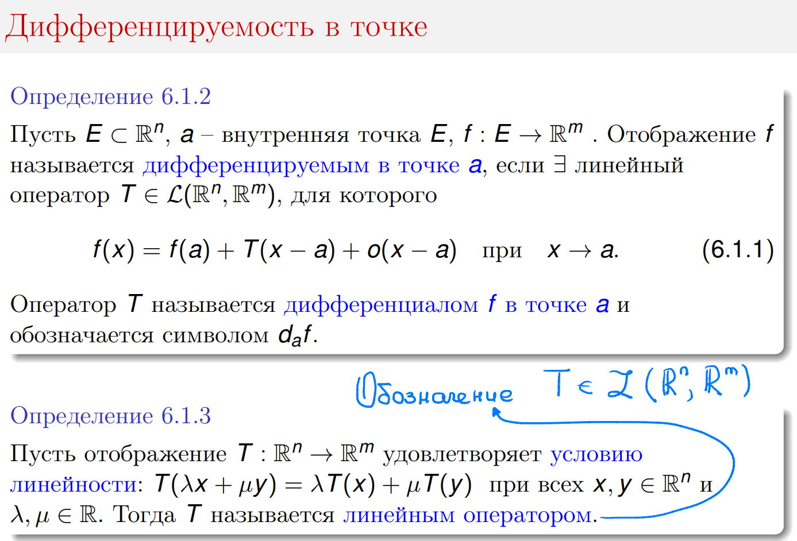

</details>

## 47. Производная по вектору

**Лекционный источник:** [определение 6.1.4](../lectures/14-differentiability-6-1.md#def-6-1-4) · [Перейти к разделу](../lectures/14-differentiability-6-1.md)

Для $`e\ne0`$:

```math
\frac{\partial f}{\partial e}(a)=\lim_{t\to0}\frac{f(a+te)-f(a)}t.
```

При $`\|e\|=1`$ это [производная по направлению](../lectures/14-differentiability-6-1.md#def-6-1-4). При дифференцируемости она равна $`d_af(e)`$.

**Быстрая проверка / пример:** Для $`f=x^2+y^2`$ в $`(1,2)`$ по $`e=(1,0)`$ производная равна $`2`$.

<details>
<summary>Показать исходный скан 47</summary>


</details>

## 48. Частная производная

**Лекционный источник:** [определение 6.1.5](../lectures/14-differentiability-6-1.md#def-6-1-5) · [Перейти к разделу](../lectures/14-differentiability-6-1.md)

[Частная производная](../lectures/14-differentiability-6-1.md#def-6-1-5) по $`x_k`$ — производная по базисному вектору $`e^k`$:

```math
\partial_kf(a)=\lim_{t\to0}\frac{f(a+te^k)-f(a)}t.
```

Остальные переменные фиксируются. Существование всех частных не гарантирует дифференцируемость.

**Быстрая проверка / пример:** Для $`f=x^2y`$ имеем $`f_x=2xy`$, $`f_y=x^2`$.

<details>
<summary>Показать исходный скан 48</summary>


</details>

## 49. Матрица Якоби и градиент

**Лекционный источник:** [определение 6.1.6](../lectures/14-differentiability-6-1.md#def-6-1-6) · [Перейти к разделу](../lectures/14-differentiability-6-1.md)

[Матрица Якоби](../lectures/14-differentiability-6-1.md#def-6-1-6) состоит из $`\partial f_i/\partial x_j`$ и представляет дифференциал. Для скалярной $`f`$ градиент:

```math
\nabla f=(f_{x_1},\ldots,f_{x_n}),\qquad d_af(h)=\nabla f\cdot h.
```

Он задаёт направление наискорейшего возрастания.

**Быстрая проверка / пример:** Для $`f=x^2e^y`$ в $`(1,0)`$ градиент равен $`(2,1)`$.

<details>
<summary>Показать исходный скан 49</summary>


</details>

## 50. Дифференцируемость и непрерывная дифференцируемость

**Лекционный источник:** [определения 6.3.1](../lectures/16-continuous-differentiability-6-3.md#def-6-3-1)–[6.3.2](../lectures/16-continuous-differentiability-6-3.md#def-6-3-2) · [Перейти к разделу](../lectures/16-continuous-differentiability-6-3.md)

Дифференцируемость на $`E`$ — дифференцируемость в каждой точке. Непрерывная дифференцируемость в $`a`$ требует существования частных производных в окрестности и их непрерывности в $`a`$.

Класс $`C^1`$ сильнее простой дифференцируемости; по [теореме 6.3.1](../lectures/16-continuous-differentiability-6-3.md#thm-6-3-1) он влечёт её.

**Быстрая проверка / пример:** $`x^2\sin(1/x)`$ дифференцируема везде после доопределения нулём, но не принадлежит $`C^1`$ около нуля.

<details>
<summary>Показать исходный скан 50</summary>

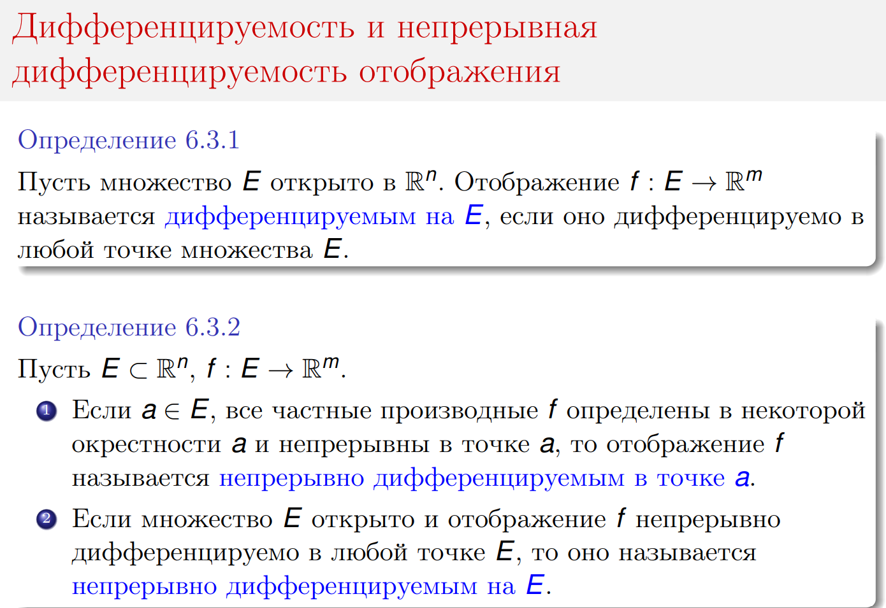

</details>

## 51. Частные производные высших порядков

**Лекционный источник:** [определение 6.4.1](../lectures/17-higher-derivatives-6-4.md#def-6-4-1) · [Перейти к разделу](../lectures/17-higher-derivatives-6-4.md)

Производная порядка $`s`$ записывается как

```math
\frac{\partial^sf}{\partial x_{i_1}\cdots\partial x_{i_s}}(a).
```

Если все $`i_l`$ совпадают, она чистая, иначе смешанная. $`f_{xy}=(f_x)_y`$ и $`f_{yx}=(f_y)_x`$ могут различаться без условий регулярности.

**Быстрая проверка / пример:** Для $`x^3y^2`$ производная $`\partial^5f/(\partial x^3\partial y^2)=12`$.

<details>
<summary>Показать исходный скан 51</summary>

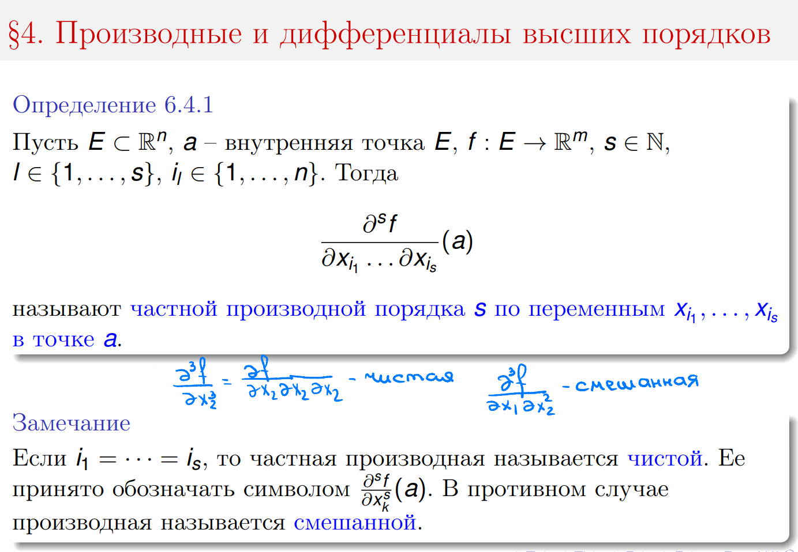

</details>

## 52. Многократная дифференцируемость

**Лекционный источник:** [определение 6.4.2](../lectures/17-higher-derivatives-6-4.md#def-6-4-2) · [Перейти к разделу](../lectures/17-higher-derivatives-6-4.md)

$`f`$ $`s`$ раз дифференцируема в $`a`$, если частные производные порядков $`0,\ldots,s-2`$ дифференцируемы в окрестности, а порядка $`s-1`$ — в самой точке $`a`$.

Класс $`C^s`$ с непрерывными производными сильнее; $`C^\infty`$ означает выполнение для любого $`s`$.

**Быстрая проверка / пример:** Многочлены бесконечно дифференцируемы; существования одной старшей производной для $`C^s`$ недостаточно.

<details>
<summary>Показать исходный скан 52</summary>


</details>

## 53. Дифференциалы высших порядков

**Лекционный источник:** [определение 6.4.3](../lectures/17-higher-derivatives-6-4.md#def-6-4-3) и [теорема 6.4.2](../lectures/17-higher-derivatives-6-4.md#thm-6-4-2) · [Перейти к разделу](../lectures/17-higher-derivatives-6-4.md)

Рекурсивно $`d_a^sf(h)=d_a(d^{s-1}f(h))(h)`$, начиная с $`d_a^0f(h)=f(a)`$. Для $`C^2`$:

```math
d_a^2f(h)=\sum_{i,j}f_{x_ix_j}(a)h_ih_j.
```

Общая формула: $`d_a^sf(h)=\sum_{|\alpha|=s}\frac{s!}{\alpha!}\partial^\alpha f(a)h^\alpha`$.

**Быстрая проверка / пример:** Для $`f=x^2e^y`$ в $`(1,0)`$: $`d^2f(h,k)=2h^2+4hk+k^2`$.

<details>
<summary>Показать исходный скан 53</summary>

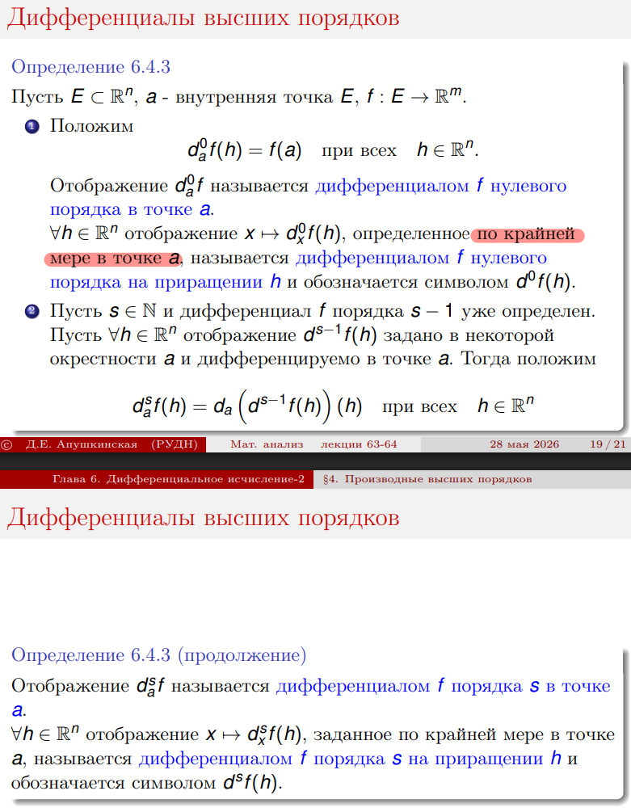

</details>
