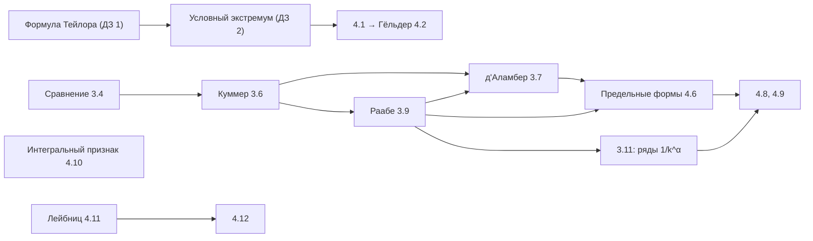

# Семинар NM-204, семестр 3: решения домашних заданий и конспекты семинаров

**Русский** · [English](../../en/seminar-sem3/index.md) · [Español](../../es/seminar-sem3/index.md)

[Оглавление курса](../index.md) · [Лекции 2025/26](../lectures-2025-26/index.md) · [Экзамен, семестр 3](../exam-sem3/EXAM_SEM3.md)

Решения домашних заданий 1–4 по дисциплине «Математический анализ» (NM-204, 2026). Каждая задача оформлена одинаково: краткое условие, решение или доказательство, ответ и абзац **«Почему так»** — объяснение, на чём держится результат и что будет, если изменить условие. Условия сверены с исходными PDF; численные ответы и разложения проверены подстановкой.

Задачи переходят из задания в задание под теми же номерами, поэтому каждая решена один раз.

| Задание | Файл | Задачи | Тема |
|---|---|---|---|
| ДЗ 1 | [Формула Тейлора](hw1-taylor.md) | 1.1–1.4 | многочлен Тейлора в $`\mathbb R^n`$, остаток Лагранжа |
| ДЗ 2 | [Условный экстремум](hw2-conditional-extremum.md) | 2.1–2.3, 2'.1–2'.3 | множители Лагранжа, достаточные условия |
| ДЗ 3 | [Числовые ряды](hw3-numerical-series.md) | 3.1–3.11 | сравнение, Куммер, д'Аламбер, Раабе |
| ДЗ 4 | [Ряды, неравенства, базы](hw4-series-inequalities-bases.md) | 4.1–4.12 | Гёльдер, базы, предельные признаки, интегральный признак, Лейбниц |

**Контрольная 1.** [Как готовиться](test1-guide.md) — вероятная структура, алгоритмы по каждому заданию, типичные ошибки и план на три дня; [пробные варианты](test1-variants.md) — три варианта в формате 1.1, 1.2, 2.1, 2.2, 3, 4 с решениями.

## Конспекты семинаров

Записи досок с 04.09 по 11.11.2026, переработанные из OCR-транскрипции в папке [`sem3_notes`](../../../sem3_notes/README.md). Номера утверждений сохранены как на доске, рассуждения переписаны понятнее, ошибки распознавания исправлены и перечислены в конце каждой части, у каждого утверждения есть ссылка на задачу ДЗ. В решениях ДЗ у таких задач стоит обратная пометка «На семинаре».

| Часть | Даты | Что внутри |
|---|---|---|
| [1. Формула Тейлора и условный экстремум](notes-1-taylor-extremum.md) | 04.09–20.09 | Тейлор в $`\mathbb R^n`$, теорема об окаймлённом гессиане с таблицей знаков, разбор задач 1.1, 1.4, 2.1, 2.3 |
| [2. Основы теории рядов](notes-2-series-basics.md) | 02.10–07.10 | сходимость, критерий Коши, неотрицательные ряды, признак сравнения, признак Коши, обобщённый признак сравнения |
| [3. Признаки Куммера, д'Аламбера и Раабе](notes-3-kummer-dalembert-raabe.md) | 16.10–28.10 | Куммер и его частные случаи, почему не годится «для бесконечно многих $`n`$», ряды $`\sum\frac{c_k}{k^d}`$ |
| [4. Примеры и сравнение признаков](notes-4-examples-tests.md) | 28.10–11.11 | суммы синусов и косинусов, задачи 4.4, 4.6–4.8, какой признак сильнее |

**Какой семинар к какой задаче.**

| Дата | Что разобрано | Задачи ДЗ |
|---|---|---|
| 04.09 | Тейлор для $`x^3+y^3+z^3-3xyz`$, определение условного экстремума | [1.1](hw1-taylor.md#p-1-1) |
| 09.09 | теорема об условном экстремуме (окаймлённый гессиан) | весь [ДЗ 2](hw2-conditional-extremum.md) |
| 18.09 | Тейлор для $`x^2\sin(xy)e^{y+z}`$; $`x^3+y^3-3xy`$ на прямой | [1.4](hw1-taylor.md#p-1-4), [2.1](hw2-conditional-extremum.md#p-2-1) |
| 20.09 | экстремум в $`\mathbb R^4`$ с двумя связями | [2.3](hw2-conditional-extremum.md#p-2-3), вариант с $`y^2`$ |
| 02.10, 03.10 | необходимое условие, неотрицательные ряды, признак сравнения | (Ф1)–(Ф3), [3.1](hw3-numerical-series.md#p-3-1), [3.5](hw3-numerical-series.md#p-3-5) |
| 07.10 | $`\sum\sin(kx_0)`$, признак Коши, обобщённый признак сравнения | [3.3](hw3-numerical-series.md#p-3-3), [3.4](hw3-numerical-series.md#p-3-4) |
| 16.10 | $`\sum\frac1{k!}`$, Куммер, д'Аламбер, ряд из $`2^{-k}`$ и $`3^{-k}`$ | [3.5](hw3-numerical-series.md#p-3-5)–[3.8](hw3-numerical-series.md#p-3-8) |
| 21.10 | признак Раабе, условие «для бесконечно многих $`n`$» | [3.9](hw3-numerical-series.md#p-3-9), [3.10](hw3-numerical-series.md#p-3-10) |
| 28.10 | $`\sum\frac{c_k}{k^d}`$, ограниченность сумм синусов | [3.11](hw3-numerical-series.md#p-3-11), [3.2](hw3-numerical-series.md#p-3-2) |
| 30.10 | $`\sum\frac{\beta^kk!}{k^k}`$, $`\sum\frac{\sqrt{k+1}-\sqrt{k-1}}{k^d}`$, суммы косинусов | [4.8](hw4-series-inequalities-bases.md#p-4-8), [3.3](hw3-numerical-series.md#p-3-3) |
| 11.11 | ряд с $`c_k\to1`$, Раабе ⟹ д'Аламбер, предельные формы | [4.7](hw4-series-inequalities-bases.md#p-4-7), [4.4](hw4-series-inequalities-bases.md#p-4-4), [4.6](hw4-series-inequalities-bases.md#p-4-6) |

## Ответы одной страницей

**ДЗ 1.** Обозначение: $`h`$ — приращение от точки разложения.

- 1.1. В $`(1;1;1)`$: $`3(h_1^2+h_2^2+h_3^2-h_1h_2-h_1h_3-h_2h_3)+h_1^3+h_2^3+h_3^3-3h_1h_2h_3`$. В $`(1;-1;2)`$: $`14+9h_1-3h_2+15h_3+3h_1^2-3h_2^2+6h_3^2-6h_1h_2+3h_1h_3-3h_2h_3+h_1^3+h_2^3+h_3^3-3h_1h_2h_3`$.
- 1.2. $`322-448h_1-42h_2+254h_1^2+94h_1h_2+36h_2^2-60h_1^3-16h_1^2h_2+24h_1h_2^2+24h_2^3+5h_1^4-4h_1^2h_2^2+3h_2^4`$.
- 1.3. $`e^9\bigl[1+L+\bigl(\tfrac{L^2}2+Q\bigr)+\bigl(\tfrac{L^3}6+LQ\bigr)\bigr]+R_3`$, где $`L=-2h_2+6h_3`$, $`Q=h_1h_2+h_3^2`$, $`R_3=\tfrac1{24}e^{9+L\theta+Q\theta^2}\bigl[(L+2Q\theta)^4+12Q(L+2Q\theta)^2+12Q^2\bigr]`$.
- 1.4. $`e^{\pi+2}\bigl[-\pi h_1+h_2+2\pi h_1^2+h_2^2-(3+\pi)h_1h_2-\pi h_1h_3+h_2h_3\bigr]+R_2`$, остаток $`R_2=\tfrac16d^3_cf(h)`$ выписан в решении.

**ДЗ 2.**

- 2.1. $`(0;0)`$ — условный локальный максимум ($`f=0`$), $`(1;1)`$ — условный локальный минимум ($`f=-1`$).
- 2.2. $`\pm\sqrt{a/6}\,(1;1;1)`$: максимум $`e^{\sqrt{6a}}`$ и минимум $`e^{-\sqrt{6a}}`$.
- 2.3. Точек условного экстремума нет (стационарные точки есть, но мешает слагаемое $`2x^3`$). В варианте с $`y^2`$ ответ другой, он разобран в замечании.
- 2'.1. $`\max=\frac1{3\sqrt6}`$ в точках $`\frac1{\sqrt6}(1;1;2)`$, $`\frac1{\sqrt6}(1;-2;-1)`$, $`\frac1{\sqrt6}(-2;1;-1)`$; $`\min=-\frac1{3\sqrt6}`$ в противоположных точках.
- 2'.2. При $`m=1`$ функция постоянна на $`M`$. При $`n,m\ge2`$ единственная точка экстремума — $`(\frac an;\dots;\frac an)`$, минимум $`\frac{a^m}{n^{m-1}}`$ (глобальный при чётном $`m`$, локальный при нечётном).
- 2'.3. Локальный максимум в точке $`x_k=\frac{a\,m_k}{m_1+\dots+m_n}`$; кроме того, точки с нулевыми координатами, у которых все соответствующие $`m_k`$ чётны, — экстремумы со значением $`0`$.

**ДЗ 3.**

- 3.3. Ряд $`\sum\cos(kx_0)`$ расходится всегда; частичные суммы ограничены тогда и только тогда, когда $`x_0\notin2\pi\mathbb Z`$.
- 3.7 и 3.9. Признак Куммера с $`x_n=1`$ и $`x_n=n`$.
- 3.10. Пример — ряд из 3.8.
- 3.11. Сходится тогда и только тогда, когда $`\alpha>1`$.

**ДЗ 4.**

- 4.1. Максимум $`1`$ в точке $`x_k=b_k^{\,p'-1}`$; минимум $`\min_kb_k`$ — в вершинах $`e_j`$ (или $`0`$ на грани, где $`b_k=0`$).
- 4.5. $`a_{2m}=\frac1{m!}`$, $`a_{2m-1}=\bigl(1+\frac1{2m-1}\bigr)\frac1{m!}`$.
- 4.7. Первые два ряда сходятся, третий расходится ($`c_k\to1`$).
- 4.8. $`\sum a_k`$ сходится при $`\alpha>\frac12`$; $`\sum b_k`$ сходится при $`\beta<e`$.
- 4.9. $`\sum a_k`$ и $`\sum d_k`$ сходятся, $`\sum b_k`$ и $`\sum c_k`$ расходятся.
- 4.11$`^*`$. Да, при $`a_ka_{k+1}\le0`$ утверждение остаётся верным.

## Что стоит уточнить у преподавателя

1. **Задача 4.3, семейства $`\mathcal M_3`$ и $`\mathcal M_5`$.** При параметре $`r\in(0;+\infty)`$ их объединения равны $`\mathbb R\setminus\{0\}`$ и $`(0;+\infty)`$, а не $`\mathbb R`$, так что первое условие определения базы на $`\mathbb R`$ буквально не выполнено. В решении доказано то, что верно, и указано, как поправить условие.
2. **Задача 2.3.** В ДЗ 2 стоит $`y^3`$, в укороченном файле ДЗ 3 — $`y^2`$. Ответы различаются; решены оба варианта, основным взят $`y^3`$. На семинаре 20.09 разобран именно вариант с $`y^2`$ ([пример 5.1](notes-1-taylor-extremum.md#ex-5-1)), так что $`y^3`$ в ДЗ 2 может быть опечаткой.
3. **Задача 2'.2, подсказка.** «Тривиальный случай $`k=1`$» прочитан как $`m=1`$ ($`k`$ в условии — индекс суммирования).

## Как устроены задания: одна линия

Знакопостоянные ряды исследуются одним инструментом — ограниченностью частичных сумм — и цепочкой всё более тонких эталонов: геометрическая прогрессия (Коши, д'Аламбер), степенные ряды $`\sum k^{-\alpha}`$ (Раабе). Знакопеременные ряды сходятся по другой причине — из-за сокращений, и для них нужен отдельный признак (Лейбниц).
