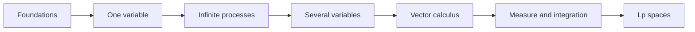

# MATAN — Mathematical Analysis / Математический анализ / Análisis matemático

A comprehensive, trilingual mathematical analysis course written in portable Markdown for **Obsidian** and **GitHub**.

## Open the course

- [English course](MathInMind/en/index.md)
- [Курс на русском](MathInMind/ru/index.md)
- [Curso en español](MathInMind/es/index.md)

Open the `MathInMind` folder as an Obsidian vault, or browse the same files directly on GitHub. No plugins or build step are required.

## What is included

The 21 chapters move from logic and the real numbers to sequences, series, differential and integral calculus, functions of several variables, vector calculus, measure theory, Lebesgue integration, and $L^p$ spaces. Every chapter contains learning goals, precise definitions, core theorems, examples, common mistakes, and exercises with short answers. Each language also has a notation guide, formula sheet, and glossary.



## Compatibility conventions

- Inline mathematics uses `$...$`; display mathematics uses `$$...$$`.
- Links are ordinary relative Markdown links, so they work in Obsidian and on GitHub.
- Diagrams use simple Mermaid `flowchart` blocks without custom styling.
- Definitions and theorems use Markdown blockquotes rather than platform-specific callouts.
- Formulas use standard MathJax commands and define notation locally; no global macros are needed.

GitHub renders mathematics and Mermaid in Markdown previews. In Obsidian, enable core **MathJax** support if it has been disabled; Mermaid rendering is built in.

## Source archive

The supplied `MathInMind.zip.txt` was a ZIP archive and has been unpacked unchanged into [`source/MathInMind`](source/README.md). Those Russian lectures and diagrams are retained as reference material. The trilingual course in `MathInMind` is a newly structured presentation, not a mechanical translation of those files or a reproduction of any textbook.

## Quality checks

Run the dependency-free validation script:

```bash
python3 scripts/validate_course.py
```

It checks language parity, YAML metadata, local links, balanced code fences and display-math delimiters, and basic Mermaid safety.

## References and authorship

See [recommended references](REFERENCES.md) for further study and [authorship](AUTHORS.md) for project credits. The course is licensed under the repository's [MIT License](LICENSE).
