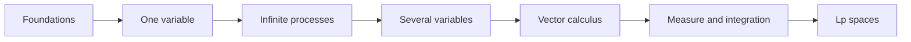

# MATAN — Mathematical Analysis / Математический анализ / Análisis matemático

A comprehensive, trilingual mathematical analysis course written in portable Markdown for **Obsidian** and **GitHub**.

## Open the course

- [English course](MathInMind/en/index.md)
- [Курс на русском](MathInMind/ru/index.md)
- [Curso en español](MathInMind/es/index.md)

Open the `MathInMind` folder as an Obsidian vault, or browse the same files directly on GitHub. No plugins or build step are required.

## Lecture notes 2025/26

Full illustrated transcriptions of the 2025/26 Mathematical Analysis **lectures 0–54**, including handwritten proofs and examples, are available in three languages:

- [Русский](MathInMind/ru/lectures-2025-26/index.md)
- [English](MathInMind/en/lectures-2025-26/index.md)
- [Español](MathInMind/es/lectures-2025-26/index.md)

Typed slides were extracted from the PDF text layers; handwritten pages were transcribed from images, and their figures are embedded as illustrations from [`MathInMind/assets/lectures-2025-26/`](MathInMind/assets/lectures-2025-26/).

**Semester boundary:** semester 1 ends with lecture 32; semester 2 spans lectures 33–64. The files for lectures 33–54 are complete, not pointers, and cross-reference their thematic overlap with the existing [Russian semester-2 lecture folder](MathInMind/ru/lectures/index.md). The transcriptions for 33–50 preserve previously established archive links. Lectures 51–54 were prepared only from the PDFs attached in chat; the source folder was not consulted and no archive filenames are claimed for that batch.

Lectures 31–38 cover 123 PDF pages with 17 shared crops ([manifest](MathInMind/assets/lectures-2025-26/figures-31-38.json), [review notes](MathInMind/assets/lectures-2025-26/provenance-31-38.md)); lectures 39–44 add 94 pages and 17 crops ([manifest](MathInMind/assets/lectures-2025-26/figures-39-44.json), [review notes](MathInMind/assets/lectures-2025-26/provenance-39-44.md)). All 217 pages in the 31–44 batches, from eight PDFs, were reviewed, and every final JPEG was checked individually. The 45–50 batch adds 84 reviewed pages from three PDFs and four individually reviewed crops; the 51–54 batch adds 85 pages from three attached PDFs and eight individually reviewed source-page images. Across lectures 31–54, the transcriptions cover 386 pages from 14 PDFs with 46 shared images. Source hashes, page attribution and crop geometry are recorded; source PDFs, temporary renders and dependencies stay out of Git. See the [51–54 manifest](MathInMind/assets/lectures-2025-26/figures-51-54.json) and [review log](MathInMind/assets/lectures-2025-26/provenance-51-54.md).

## What is included

The 21 chapters move from logic and the real numbers to sequences, series, differential and integral calculus, functions of several variables, vector calculus, measure theory, Lebesgue integration, and $L^p$ spaces. Every chapter contains learning goals, precise definitions, core theorems, examples, common mistakes, and exercises with short answers. Each language also has a notation guide, formula sheet, and glossary.



## Compatibility conventions

- Inline mathematics uses `$...$`; display mathematics uses `$$...$$`.
- Links are ordinary relative Markdown links, so they work in Obsidian and on GitHub.
- Diagrams use simple Mermaid `flowchart` blocks without custom styling.
- Definitions and theorems use Markdown blockquotes rather than platform-specific callouts.
- Formulas use standard MathJax commands and define notation locally; no global macros are needed.

GitHub renders mathematics and Mermaid in Markdown previews. In Obsidian, enable core **MathJax** support if it has been disabled; Mermaid rendering is built in.

## Lecture-aligned exam track

The Russian exam track uses `МАТАН_Л` as its primary source and preserves lecture numbering:

- [17 lecture sections and 148 original numbered items](MathInMind/ru/lectures/index.md), plus a clearly labelled reconstruction of Theorem 6.4.1;
- [72 individual exam-ticket answers](MathInMind/ru/exam/index.md) with worked examples;
- [54 Purgatory definitions](MathInMind/ru/purgatory/definitions.md) linked to 53 supplied scans and a transparent reconstruction for missing scan 15;
- [300 possible Purgatory question themes](MathInMind/ru/purgatory/questions.md).

## Source archive

The supplied `MathInMind.zip.txt` was a ZIP archive and has been unpacked unchanged into [`source/MathInMind`](source/README.md). Those Russian lectures and diagrams are retained as reference material. The trilingual course in `MathInMind` is a newly structured presentation, not a mechanical translation of those files or a reproduction of any textbook.

## Quality checks

Run the dependency-free validation scripts:

```bash
python3 scripts/validate_course.py
python3 scripts/validate_exam_track.py
python3 -m unittest discover -s scripts -p 'test_*.py'
```

They check language and index parity, continuous 2025/26 lecture coverage (0–54), semester metadata and duplicate-material links for 33–54, figure provenance and translation parity for all illustrated batches (31–38, 39–44, 45–50 and 51–54), all 72 tickets, Purgatory assets and numbering, YAML metadata, local links, balanced code fences and math delimiters, and basic Mermaid safety.

## References and authorship

See [recommended references](REFERENCES.md) for further study and [authorship](AUTHORS.md) for project credits. The course is licensed under the repository's [MIT License](LICENSE).
