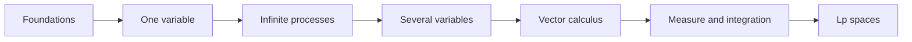

# MATAN — Mathematical Analysis / Математический анализ / Análisis matemático

A trilingual mathematical analysis course: 21 concise chapters, full illustrated notes of the 2025/26 lectures (0–64) and a Russian exam track. Every term and theorem is linked to the place where it is defined.

## Start here

| | English | Русский | Español |
|---|---|---|---|
| Course, 21 chapters | [Course index](MathInMind/en/index.md) | [Оглавление курса](MathInMind/ru/index.md) | [Índice del curso](MathInMind/es/index.md) |
| Lectures 2025/26, 0–64 | [Lecture index](MathInMind/en/lectures-2025-26/index.md) | [Указатель лекций](MathInMind/ru/lectures-2025-26/index.md) | [Índice de lecciones](MathInMind/es/lectures-2025-26/index.md) |
| Terms and theorems | [Index](MathInMind/en/term-index.md) | [Указатель](MathInMind/ru/term-index.md) | [Índice](MathInMind/es/term-index.md) |
| Exam track | — | [72 билета](MathInMind/ru/exam/index.md) · [реестр лекций](MathInMind/ru/lectures/index.md) | — |

## Two views: GitHub and Obsidian

The same notes are published twice, each in the form its viewer renders best:

| | [`MathInMind/`](MathInMind/README.md) — GitHub view | [`MathInMind-Obsidian/`](MathInMind-Obsidian/README.md) — Obsidian view |
|---|---|---|
| How to open | browse this repository | Obsidian → **Open folder as vault** → `MathInMind-Obsidian` |
| Links | relative links to `#anchors` on every definition and theorem | `[[wikilinks]]` to block ids: hover preview, backlinks, graph |
| Formulas | `` $`...`$ `` and ```` ```math ```` (GitHub's Markdown pass otherwise drops `\{`, `\|`, `\,` and can turn `a<b>c` into HTML) | `$...$` and `$$...$$` (MathJax) |
| Definitions and theorems | blockquotes with a bold label | coloured callouts: `[!definition]`, `[!theorem]`, `[!lemma]`, … |
| Exercise answers | `<details>` blocks | folded `[!answer]-` callouts |

`MathInMind/` is the source of both. After editing it, rebuild the views:

```bash
python3 scripts/build_views.py           # converts math, adds anchors and links, regenerates the Obsidian vault
python3 scripts/build_views.py --check   # fails if either view is out of date
```

Plain `$...$` math is fine in new text; the build converts it. Never edit `MathInMind-Obsidian/` by hand. To link a new term, add it to [`scripts/term_registry.py`](scripts/term_registry.py).

## What is included

The 21 chapters move from logic and the real numbers to sequences, series, differential and integral calculus, functions of several variables, vector calculus, measure theory, Lebesgue integration, and $`L^p`$ spaces. Every chapter contains learning goals, precise definitions, core theorems, examples, common mistakes, and exercises with short answers. Each language also has a notation guide, formula sheet, glossary and an index of terms and theorems.



## Lecture notes 2025/26

Full illustrated transcriptions of the 2025/26 lectures 0–64 in Russian, English and Spanish, including handwritten proofs and examples. Typed slides were extracted from the PDF text layers; handwritten pages were transcribed from images, and their figures are embedded from [`MathInMind/assets/lectures-2025-26/`](MathInMind/assets/lectures-2025-26/).

**Semester 1** ends with lecture 32; **semester 2** spans lectures 33–64. The files for 33–64 are complete, not pointers, and cross-reference their overlap with the Russian [semester-2 register](MathInMind/ru/lectures/index.md). The transcriptions for 33–50 keep the previously established archive links. Lectures 51–64 were prepared only from the PDFs attached in chat; the source folder was not consulted and no archive filenames are claimed for those batches.

For lectures 31–64 every page was reviewed and every final image checked individually. Source hashes, page attribution and crop geometry are recorded; source PDFs, temporary renders and dependencies stay out of Git.

| Lectures | PDF pages | PDFs | Shared images | Manifest | Review log |
|---|---|---|---|---|---|
| 31–38 | 123 | 5 | 17 | [figures-31-38.json](MathInMind/assets/lectures-2025-26/figures-31-38.json) | [provenance-31-38.md](MathInMind/assets/lectures-2025-26/provenance-31-38.md) |
| 39–44 | 94 | 3 | 17 | [figures-39-44.json](MathInMind/assets/lectures-2025-26/figures-39-44.json) | [provenance-39-44.md](MathInMind/assets/lectures-2025-26/provenance-39-44.md) |
| 45–50 | 84 | 3 | 4 | [figures-45-50.json](MathInMind/assets/lectures-2025-26/figures-45-50.json) | [provenance-45-50.md](MathInMind/assets/lectures-2025-26/provenance-45-50.md) |
| 51–54 | 85 | 3 | 8 | [figures-51-54.json](MathInMind/assets/lectures-2025-26/figures-51-54.json) | [provenance-51-54.md](MathInMind/assets/lectures-2025-26/provenance-51-54.md) |
| 55–60 | 96 | 3 | 20 | [figures-55-60.json](MathInMind/assets/lectures-2025-26/figures-55-60.json) | [provenance-55-60.md](MathInMind/assets/lectures-2025-26/provenance-55-60.md) |
| 61–64 | 82 | 2 | 26 | [figures-61-64.json](MathInMind/assets/lectures-2025-26/figures-61-64.json) | [provenance-61-64.md](MathInMind/assets/lectures-2025-26/provenance-61-64.md) |
| **31–64** | **564** | **19** | **92** | | |

## Lecture-aligned exam track (Russian)

The Russian exam track uses `МАТАН_Л` as its primary source and keeps the lecture numbering:

- [17 lecture sections and 148 original numbered items](MathInMind/ru/lectures/index.md), plus a clearly labelled reconstruction of Theorem 6.4.1;
- [72 individual exam-ticket answers](MathInMind/ru/exam/index.md) with worked examples;
- [54 Purgatory definitions](MathInMind/ru/purgatory/definitions.md) linked to 53 supplied scans and a transparent reconstruction for missing scan 15;
- [300 possible Purgatory question themes](MathInMind/ru/purgatory/questions.md).

## Source archive

The supplied `MathInMind.zip.txt` was a ZIP archive and has been unpacked unchanged into [`source/MathInMind`](source/README.md). Those Russian lectures and diagrams are kept as reference material. The trilingual course in `MathInMind` is a newly structured presentation, not a mechanical translation of those files or a reproduction of any textbook.

## Quality checks

Run the dependency-free checks:

```bash
python3 scripts/build_views.py --check
python3 scripts/validate_course.py
python3 scripts/validate_exam_track.py --source-safe
python3 -m unittest discover -s scripts -p 'test_*.py'
```

They check that both views are up to date and that every Obsidian wikilink resolves to an existing note, block or heading; language and index parity; continuous 2025/26 lecture coverage (0–64); semester metadata and duplicate-material links for 33–64; figure provenance and translation parity for all illustrated batches; all 72 tickets; Purgatory assets and numbering; YAML metadata; local links; balanced code fences and math delimiters; and basic Mermaid safety.

## References and authorship

See [recommended references](REFERENCES.md) for further study and [authorship](AUTHORS.md) for project credits. The course is licensed under the repository's [MIT License](LICENSE).
