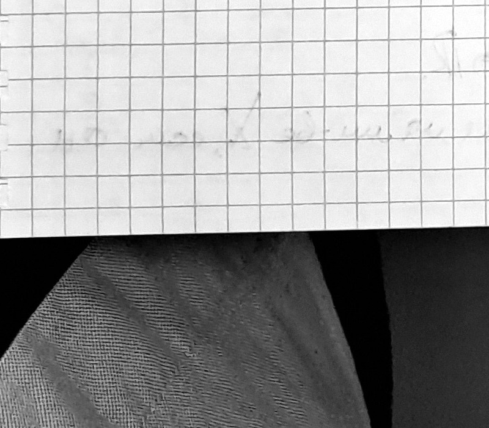

# Лекции 71–72 — Равномерная сходимость, предельный переход, функциональные ряды

> [!info] Происхождение текста
> Текст переписан со страниц `p030`–`p041` рукописной тетради
> (см. [`ocr/raw/`](../../ocr/raw), [`ocr/MANIFEST.md`](../../ocr/MANIFEST.md)).
> В тетради материал помечен как «Лекции 71–72»: пара лекций не разделена.
> Страницы приведены в исходном порядке, без перестановки и без добавления текста.
> Один файл на пару: ранее созданные одиночные файлы заменены этим файлом,
> их содержимое перенесено без изменений.
> Решений в `My decision` (`ocr/ISSUES.md`) нет, поэтому все пометки остаются `open`
> и продублированы предупреждениями. Ничего не добавлено: ни доказательств,
> ни примеров, ни «пропущенных шагов».

## p030

### Пример:

$\sum\limits_{k=1}^{\infty}\dfrac{(-1)^{k-1}}{k}=1-1/2+1/3-1/4+\ldots$

$S_n=\sum\limits_{k=1}^{\infty}\dfrac{(-1)^{k-1}}{k}$

$T_n$ - частичная сумма ряда, полученного перестановкой.

$1-1/2-1/4+1/3-1/6-1/8+1/5-\dfrac{1}{10}-\dfrac{1}{12}+\ldots=:T_n$ ⟦U123⟧

$T_{3m}=\sum\limits_{k=1}^{m}\left(\dfrac{1}{2k-1}-\dfrac{1}{4k-2}-\dfrac{1}{4k}\right)=\sum\limits_{k=1}^{m}\left(\dfrac{1}{4k-2}-\dfrac{1}{4k}\right)=\dfrac{1}{2}\sum\limits_{k=1}^{m}\left(\dfrac{1}{2k-1}-\dfrac{1}{2k}\right)=\dfrac{1}{2}S_{2m}$ ⟦M124⟧
> [!note] На полях
> [первое слагаемое в первой скобке обведено овалом] $\dfrac{1}{2k-1}$ ⟦S125⟧
> [!note] На полях
> [ниже, отдельной строкой с выносом] $\left(1-\dfrac{1}{2}-\dfrac{1}{4}\right)+\left(\dfrac{1}{3}-\dfrac{1}{6}-\dfrac{1}{8}\right)+\ldots$

$S_n\to\ln 2$

$T_{3m}=\dfrac{1}{2}S_{2m}\to\dfrac{1}{2}\ln 2$
$T_{3m+1}=T_{3m}+\dfrac{1}{2m+1}\to\dfrac{1}{2}\ln 2$
$T_{3m+2}=T_{3m+1}-\dfrac{1}{4m+2}\to\dfrac{1}{2}\ln 2$ ⟦S126⟧

### Переместительные св-ва рядов

1) Положительные ряды обладают переместительным св-вом
2) Абсолютно-сх-ся ряды обладают переместительным св-вом
3) Т. Римана: Если ряд сх-ся условно, то он переместительным св-вом не обладает. Более того, $\forall B\in\overline{\mathbb{R}}\ \exists\sigma:\mathbb{N}\to\mathbb{N}\ \sum\limits_{n=1}^{\infty}a_{\sigma(n)}=B$. ⟦S127⟧

> [!note] На полях
> [справа, отдельным блоком; начало следующей лекции] **_Лекции 71–72_**

· Функциональные ряды
· Равномер. сх-ть для функций посл-ти
· крит. Б-К и пр. Вейерштрасса
· Св-ва равном. сх-ся функц. рядов ⟦U128⟧

### Функциональные посл-ти и ряды. Равномерная сх-ть.

Рассм. посл-ть ф-ций $(f_n)_{n\in\mathbb{N}}$, $f_n: X\to\overline{\mathbb{R}}$, $\overline{\mathbb{R}}:=\mathbb{R}\cup\{\pm\infty\}$. Рассм. $f: X\to\overline{\mathbb{R}}$. ⟦S129⟧

> [!warning] Неразрешённые пометки страницы p030 (см. [`ocr/ISSUES.md`](../../ocr/ISSUES.md))
> U123: нечитаемо (illegible), см. `ocr/ISSUES.md`
> M124: математическое несоответствие (mathematical inconsistency), см. `ocr/ISSUES.md`
> S125: неясная структура (unclear structure), см. `ocr/ISSUES.md`
> S126: неясная структура (unclear structure), см. `ocr/ISSUES.md`
> S127: неясная структура (unclear structure), см. `ocr/ISSUES.md`
> U128: нечитаемо (illegible), см. `ocr/ISSUES.md`
> S129: неясная структура (unclear structure), см. `ocr/ISSUES.md`

## p031

### Опр (8.1.1)

Будем говорить, что $(f_n)$ сх-ся в $X$ к $f$ **_поточечно_**, если:
$\forall x\in X\ f_n(x)=:a_n\to a:=f(x)$ при $n\to\infty$

### Опр (8.1.1а) ⟦S130⟧

$f_n\to f$ **_поточечно на мн-ве_** $E\subset X$, если:
$\forall x\in E\subset X\ \forall\varepsilon>0\ \exists N=N(x,\varepsilon)\ \forall n>N\ |f_n(x)-f(x)|<\varepsilon$

### Опр (8.1.2)

$f_n\to f$ **_равномерно на мн-ве_** $E\subset X$, если
$\forall\varepsilon>0\ \exists N=N(\varepsilon)\ \forall x\in E\ \forall n>N\ |f_n(x)-f(x)|<\varepsilon$

Обозн.: $f_n\rightrightarrows f$ - равномерная сх-ть; $f_n\to f$ - поточечная сх-ть ⟦S131⟧
$\exists E=X\ f_n\rightrightarrows f$ на $X\Rightarrow f_n\to f$ поточечно на $X$
> [!note] На полях
> [справа от следования, две вставки со стрелками] $\Rightarrow$ равномерная сх-ть $\Rightarrow$ поточечная сх-ть

**_Обратное, вообще говоря, неверно!_**

### Пример:

> [!warning] Неразрешённые пометки страницы p031 (см. [`ocr/ISSUES.md`](../../ocr/ISSUES.md))
> S130: неясная структура (unclear structure), см. `ocr/ISSUES.md`
> S131: неясная структура (unclear structure), см. `ocr/ISSUES.md`

## p032

> [!note] Технический дубликат
> Повторная съёмка страницы `p030` (тот же текст: пример с перестановкой ряда, «Переместительные св-ва рядов», заголовок «Лекции 71–72»).
> Сравнение по dHash даёт для пары p030/p032 расстояние 41 из 256 при лучшем из 16 поворотов; у всех остальных пар минимум 84, то есть эти два кадра — один и тот же лист.
> Транскрипция здесь не дублируется, чтобы не удваивать пометки в `ocr/ISSUES.md`.

> [!note] Пометок неопределённости на этой странице нет.

## p033

> [!note] Технический дубликат
> Повторная съёмка страницы `p031` (тот же текст: Опр. 8.1.1, 8.1.1а, 8.1.2, обозначение $f_n\rightrightarrows f$, пример с $f_n(x)=x^n$ и рисунки «$\varepsilon$-трубки»).
> Сравнение по dHash: минимальное расстояние для этой пары среди всех пар кадров.
> Транскрипция здесь не дублируется, чтобы не удваивать пометки в `ocr/ISSUES.md`.

> [!note] Пометок неопределённости на этой странице нет.

## p034

❶ $\exists X\subset\mathbb{R}$, $\forall n$ $f_n$ - непрерывна (в т. или на мн-ве). Будет ли $f$ непрерывна?
❷ $\exists X\subset\mathbb{R}$, $\forall n$ $f_n$ - дифф-ма (в т. или на мн-ве). Будет ли $f$ дифф-ма? Если да, то верно ли, что $f_n'\to f'$?
❸ Пусть $f_n$ интегрируемы на $[a,b]$. Будет ли интегрируема $f$? Если да, то верно ли, что $\int_a^b f_n\to\int_a^b f$? ⟦S132⟧

### Равномерная сх-ть в терминах $\varepsilon$-окрестности ⟦U133⟧

Рассм. ф-ии $f,g: X\to\mathbb{R}$

**Опр (8.3)** $\rho(f,g)=\sup\limits_{x\in X}|f(x)-g(x)|$ - равномерное уклонение ⟦A134⟧

### Опр (8.1.4)

$f_n\rightrightarrows f$, если $\forall\varepsilon>0\ \exists N\ \forall n>N\ \rho(f_n,f)<\varepsilon$

### Опр (8.1.4а)

$f_n\to f$, если $\rho(f_n,f)\to0$ при $n\to\infty$

### Равномерная сх-ть и св-ва предельных ф-ций

$f_n\to f$ на мн-ве $X$
· все $f_n$ обладают некоторым св-вом
· Спрашивается, будет ли предельная ф-ция $f$ обладать этими же св-вами?

### Непрер-ть предельной ф-ции

### Теорема (8.2.1) (о непрер-ти предельной ф-ции)

Пусть: ❶ $f_n$, $f_n\in C([a,b])$
❷ $f_n\rightrightarrows f$ на $[a,b]$.
Тогда $f\in C([a,b])$. ⟦S135⟧

> [!warning] Неразрешённые пометки страницы p034 (см. [`ocr/ISSUES.md`](../../ocr/ISSUES.md))
> S132: неясная структура (unclear structure), см. `ocr/ISSUES.md`
> U133: нечитаемо (illegible), см. `ocr/ISSUES.md`
> A134: неоднозначный символ (ambiguous symbol), см. `ocr/ISSUES.md`
> S135: неясная структура (unclear structure), см. `ocr/ISSUES.md`

## p035

### Д-во (т. 8.2.1):

Рассм. произвольную т. $x_0\in[a,b]$.
Докажем, что $f$ непрер. в т. $x_0$, т.е. покажем, что
$\forall\varepsilon>0\ \exists\delta>0:\ \forall x\ |x-x_0|<\delta\Rightarrow|f(x)-f(x_0)|<\varepsilon$

Возьмём $\forall\varepsilon>0$
$\exists N=N\left(\dfrac{\varepsilon}{3}\right):\ \forall n>N\ \forall x\in[a,b]\Rightarrow|f_n(x)-f(x)|<\varepsilon/3$
> [!note] На полях
> [под строкой, со стрелкой к ней] т.к. $f_n\rightrightarrows f$

◉ Рассмотрим $n$: $f_n$ (напомним, что все $f_n$ непрер. в т. $x_0$)
$\exists\delta=\delta(\varepsilon/3)\ \forall x:|x-x_0|<\delta\Rightarrow|f_n(x)-f_n(x_0)|<\varepsilon/3$

Далее, $\forall x:|x-x_0|<\delta\Rightarrow$
$\Rightarrow|f(x)-f(x_0)|=|f(x)-f_n(x)+f_n(x)-f_n(x_0)+f_n(x_0)-f(x_0)|\le$
$\le|f(x)-f_n(x)|+|f_n(x)-f_n(x_0)|+|f_n(x_0)-f(x_0)|<\varepsilon$
> [!note] На полях
> [под тремя модулями соответственно] $<\varepsilon/3$; $<\varepsilon/3$; $<\varepsilon/3$

$\\blacksquare$

### Следствие

Пусть: ❶ $f_n$, $f_n\in C([a,b])$
❷ $f_n\rightrightarrows f$ на $[a,b]$
Тогда $\lim\limits_{x\to x_0}\lim\limits_{n\to\infty}f_n(x)=\lim\limits_{n\to\infty}\lim\limits_{x\to x_0}f_n(x)$

### Д-во (сл.):

$\lim\limits_{n\to\infty}f_n(x)=f(x)$
> [!note] На полях
> [под строкой] т.к. $f_n\rightrightarrows f$, а из равномерной сх-ти следует поточечная
$\lim\limits_{x\to x_0}f(x)=f(x_0)$
> [!note] На полях
> [под строкой] в силу непрер-ти $f$, кот. следует из т. 8.2.1
$\Rightarrow\lim\limits_{x\to x_0}\lim\limits_{n\to\infty}f_n(x)=f(x_0)$

С др. стороны, имеем:
$\lim\limits_{x\to x_0}f_n(x)=f_n(x_0)$
> [!note] На полях
> [под строкой] в силу непрер-ти $f_n$
$\lim\limits_{n\to\infty}f_n(x_0)=f(x_0)$
> [!note] На полях
> [под строкой] $f_n\rightrightarrows f$, а из равномерной сх-ти следует поточечная
$\Rightarrow\lim\limits_{n\to\infty}\lim\limits_{x\to x_0}f_n(x)=f(x_0)$. $\\blacksquare$ ⟦S136⟧

> [!warning] Неразрешённые пометки страницы p035 (см. [`ocr/ISSUES.md`](../../ocr/ISSUES.md))
> S136: неясная структура (unclear structure), см. `ocr/ISSUES.md`

## p036

### Предельный переход под знаком интеграла

### Теорема (8.2.2) (о предельном переходе под знаком интеграла)

Пусть: ❶ $f_n$, $f_n\in C([a,b])$
❷ $f_n\rightrightarrows f$ на $[a,b]$.
Тогда: $\int_a^b f_n(x)\,dx\to\int_a^b f(x)\,dx$ при $n\to\infty$,
или $\lim\limits_{n\to\infty}\int_a^b f_n(x)\,dx=\int_a^b\left(\lim\limits_{n\to\infty}f_n(x)\right)dx$.

### Д-во (т. 8.2.2):

По т. 8.2.1 $\Rightarrow f\in C([a,b])$
$\left|\int_a^b f_n-\int_a^b f\right|=\left|\int_a^b(f_n-f)\right|\le\int_a^b|f_n-f|$
> [!note] На полях
> [под интегралом] $<\varepsilon(b-a)$ ⟦S137⟧

По усл. теоремы $f_n\rightrightarrows f$ на $[a,b]$, т.е.
$\forall\varepsilon>0\ \exists N:\ \forall n>N\ \forall x\in[a,b]\Rightarrow|f_n(x)-f(x)|<\dfrac{\varepsilon}{b-a}$
$\Rightarrow\left|\int_a^b f_n-\int_a^b f\right|\le\int_a^b|f_n-f|<\int_a^b\dfrac{\varepsilon}{b-a}\,dx=\dfrac{\varepsilon}{b-a}(b-a)=\varepsilon$

Т.е. $\int_a^b f_n\to\int_a^b f$ при $n\to\infty$. $\\blacksquare$

### Замечание

Для доказательства т. 8.2.2 была важна не только поточечная сх-ть, но и равномерная сх-ть.

### Пример:

❶ $f_n(x)=n^2x(1-x^2)^n$, $x\in[0,1]$
$f_n(x)\xrightarrow[n\to\infty]{}0\ \forall x\in[0,1]$
> [!note] На полях
> [под стрелкой, подпись к скобке] т.е. посл-ть $f_n$ поточечно сходится к 0 на $[0,1]$

В то же время
$\int_0^1 f_n=n^2\int_0^1 x(1-x^2)^n\,dx=\dfrac{n^2}{2}\int_0^1(1-x^2)^n\,d(x^2)=-\dfrac{n^2}{2}\left.\dfrac{(1-x^2)^{n+1}}{n+1}\right|_0^1=$
$=\dfrac{n^2}{2(n+1)}\xrightarrow[n\to\infty]{}+\infty$
Противоречие. ⟦S138⟧

> [!warning] Неразрешённые пометки страницы p036 (см. [`ocr/ISSUES.md`](../../ocr/ISSUES.md))
> S137: неясная структура (unclear structure), см. `ocr/ISSUES.md`
> S138: неясная структура (unclear structure), см. `ocr/ISSUES.md`

## p037

❷ $f_n(x)=nx(1-x^2)^n$, $x\in[0,1]$
$f_n$ поточечно сходится к 0 на $[0,1]$
$\int_0^1 f_n=n\int_0^1 x(1-x^2)^n\,dx=\dfrac{n}{2(n+1)}\xrightarrow[n\to\infty]{}1/2$ ⟦S139⟧

❸ $f_n(x)=x^n$ на $[0,1]$
Предельная функция $f(x)=\begin{cases}0, & x\in[0,1)\\1, & x=1\end{cases}$

$\sup\limits_{[0,1]}|f_n-f|=\sup\limits_{[0,1]}x^n=1\ne0\Rightarrow f_n\ne\rightrightarrows0$ на $[0,1]$.

Но! Для любого $q\in(0,1)$
$\sup\limits_{[0,q]}|f_n-f|=\sup\limits_{[0,q]}x^n=q^n\xrightarrow[n\to\infty]{}0$
Поэтому $f_n\rightrightarrows0$ на $[0,q]$. ⟦S140⟧

❹ $f_n:[0,1]\to\mathbb{R}$
$f_n(x)=\begin{cases}0, & x>\dfrac{1}{n}\\ ?[?], & x\in(0,1/n)\\ 0, & x=0\end{cases}$ ⟦U141⟧

> [!note] На полях
> [слева от ❹ — график: оси; треугольный «зубец» с основанием $[0,1/n]$, вершиной высоты $n$; подпись по оси ординат $n$] ⟦G142⟧

> [!warning] Неразрешённые пометки страницы p037 (см. [`ocr/ISSUES.md`](../../ocr/ISSUES.md))
> S139: неясная структура (unclear structure), см. `ocr/ISSUES.md`
> S140: неясная структура (unclear structure), см. `ocr/ISSUES.md`
> U141: нечитаемо (illegible), см. `ocr/ISSUES.md`
> G142: нетривиальный рисунок (non-obvious figure), см. `ocr/ISSUES.md`

## p038

### Дифференцирование предельной ф-ции

### Теорема (8.2.3) (о диффер-нии предельной ф-ции)

Пусть: ❶ $\forall n$ $f_n\in C^1([a,b])$
❷ $f_n\to f$ при $n\to\infty$
❸ $f\in C^1([a,b])$ ⟦A143⟧
❹ $f_n'\rightrightarrows\varphi$ на $[a,b]$.
Тогда $\varphi\in C([a,b])$ и $f'=\varphi$,
или $\dfrac{d}{dx}\left(\lim\limits_{n\to\infty}f_n(x)\right)=\lim\limits_{n\to\infty}\left(\dfrac{d}{dx}f_n(x)\right)$. ⟦S144⟧

### Д-во (т. 8.2.3):

$\int_a^b f_n'=f_n(b)-f_n(a)$

$\int_a^x f_n'=f_n(x)-f_n(a)\ \forall x\in[a,b]$
$f_n(x)=f_n(a)+\int_a^x f_n'$
> [!note] На полях
> [под $f_n(a)$, стрелка вниз] $\downarrow$
> [!note] На полях
> [под $f_n(a)$, ниже] $f(a)$
> [!note] На полях
> [под интегралом, стрелка вниз] $\downarrow$
> [!note] На полях
> [под интегралом, ниже] $\int_a^x\varphi$
> [!note] На полях
> [справа] при $n\to\infty$ ⟦S145⟧

$f(x)=f(a)+\int_a^x\varphi$
> [!note] На полях
> [слева под строкой] по т. 8.2.2 о предельном переходе под знаком интеграла ⟦S146⟧

### Функциональные ряды ⟦A147⟧

### Опр (8.3.1)

Имеется посл-ть ф-ций $u_n(x): X\to\mathbb{R}$, $\forall n\in\mathbb{N}$
$\sum\limits_{n=1}^{\infty}u_n(x)$ - функциональный ряд.
$S_n(x)=\sum\limits_{k=1}^{n}u_k(x)$, $S(x)=\lim\limits_{n\to\infty}S_n(x)$, $S: X\to\mathbb{R}$.
Функциональный ряд сходится на мн-ве $X$, если он сх-ся в каждой т. этого мн-ва. ⟦S148⟧

> [!warning] Неразрешённые пометки страницы p038 (см. [`ocr/ISSUES.md`](../../ocr/ISSUES.md))
> A143: неоднозначный символ (ambiguous symbol), см. `ocr/ISSUES.md`
> S144: неясная структура (unclear structure), см. `ocr/ISSUES.md`
> S145: неясная структура (unclear structure), см. `ocr/ISSUES.md`
> S146: неясная структура (unclear structure), см. `ocr/ISSUES.md`
> A147: неоднозначный символ (ambiguous symbol), см. `ocr/ISSUES.md`
> S148: неясная структура (unclear structure), см. `ocr/ISSUES.md`

## p039

$\forall x>0\ \forall n>1/x$ $f_n(x)=0\Rightarrow f_n\xrightarrow[n\to\infty]{}0\Rightarrow f=\lim\limits_{n\to\infty}f_n=0$.
$\int_0^1 f_n(x)\,dx=\dfrac{1}{2}\cdot\dfrac{1}{n}\cdot n=\dfrac{1}{2}\not\to0$ ⟦M149⟧
$\int_0^1 f(x)\,dx=0$
$\Rightarrow\int_0^1 f_n\not\to\int_0^1 f$ ⟦S150⟧

> [!warning] Неразрешённые пометки страницы p039 (см. [`ocr/ISSUES.md`](../../ocr/ISSUES.md))
> M149: математическое несоответствие (mathematical inconsistency), см. `ocr/ISSUES.md`
> S150: неясная структура (unclear structure), см. `ocr/ISSUES.md`

## p040

$\Rightarrow|S_n(x)-S_m(x)|=|S_n(x)-S(x)+S(x)-S_m(x)|\le$
$\le|S_n(x)-S(x)|+|S(x)-S_m(x)|<\varepsilon$
> [!note] На полях
> [под первым модулем] $<\varepsilon/2$
> [!note] На полях
> [под вторым модулем] $<\varepsilon/2$

⟲ Фикс. $x\in E\Rightarrow(S_n(x))_{n\in\mathbb{N}}$ - числовая посл-ть Коши
$\Rightarrow$ По крит. Б-К для числовой посл-ти $\Rightarrow$
$\Rightarrow\exists S(x):S_n(x)\to S(x)$
$S(x)$ - ф-я, т.к. фиксированное $x\in E$ было выбрано произвольно.

$\forall\varepsilon>0\ \exists N\ \forall x\in E\ \forall n>m>N\ |S_n(x)-S_m(x)|<\varepsilon$
перейдём в нер-ве $|S_n(x)-S_m(x)|<\varepsilon$ к пределу при $n\to\infty$
> [!note] На полях
> [под $|S_n(x)-S_m(x)|$, стрелка вниз] $\downarrow$
> [!note] На полях
> [под $\varepsilon$ второй строки, стрелка вниз] $\downarrow$
> [!note] На полях
> [между стрелками] $n\to\infty$
> [!note] На полях
> [ниже] $|S(x)-S_m(x)|\le\varepsilon<2\varepsilon$
> [!note] На полях
> [внизу] предельный переход в нер-ве ⟦S151⟧

**Критерий Б-К:** $\sum\limits_{n=1}^{\infty}u_n(x)$ равномерно сх-ся на $E\Leftrightarrow$
$\Leftrightarrow\forall\varepsilon>0\ \exists N\ \forall n>m>N\ |S_n(x)-S_m(x)|<\varepsilon$, где $S_n(x)=\sum\limits_{k=1}^{n}u_k(x)$
$S_m(x)=\sum\limits_{k=1}^{m}u_k(x)$

обычно используется для опровержения равномерной сх-ти ряда ⟦S152⟧

**Пример:** $\sum\limits_{k=0}^{\infty}x^k$ сх-ся к $\dfrac{1}{1-x}$ неравномерно на $[0,1)$, т.к. $x^k\not\rightrightarrows0$ на $[0,1)$

### Признак Вейерштрасса

Имеется посл-ть ф-ций $u_n(x): X\to\mathbb{R}$, $\forall n\in\mathbb{N}$ и посл-ть $(C_n)_{n\in\mathbb{N}}$, $C_n>0$ такие, что:
❶ $|u_n(x)|\le C_n$, $\forall x\in E\subset X$, $\forall n\in\mathbb{N}$
❷ Ряд $\sum\limits_{n=1}^{\infty}C_n$ сх-ся
Тогда $\sum\limits_{n=1}^{\infty}u_n(x)$ равномерно сх-ся на $E$.

### Д-во (пр. Вейерштрасса):

> [!warning] Неразрешённые пометки страницы p040 (см. [`ocr/ISSUES.md`](../../ocr/ISSUES.md))
> S151: неясная структура (unclear structure), см. `ocr/ISSUES.md`
> S152: неясная структура (unclear structure), см. `ocr/ISSUES.md`

## p041

$\left|\sum\limits_{n=m+1}^{m+p}u_n(x)\right|\le\sum\limits_{n=m+1}^{m+p}|u_n(x)|\le\sum\limits_{n=m+1}^{m+p}C_n$ ⟦S153⟧
> [!note] На полях
> [под последней суммой, мелко] $p\in\mathbb{N}$, $p>1$
> [!note] На полях
> [слева внизу] $\left|\sum\limits_{n=m+1}^{m+p}u_n(x)\right|\le\sum\limits_{n=m+1}^{m+p}|u_n(x)|\le\sum\limits_{n=m+1}^{m+p}C_n$

По усл. $\sum\limits_{n=1}^{\infty}C_n$ - сх-ся $\Rightarrow\forall\varepsilon>0\ \exists N\ \forall m>N\ \left|\sum\limits_{n=m+1}^{m+p}C_n\right|<\varepsilon$
$\Rightarrow\left|\sum\limits_{n=m+1}^{m+p}u_n(x)\right|\le\left|\sum\limits_{k=m+1}^{m+p}u_k(x)\right|<\varepsilon$

**Замечание**: Ранее мы здесь в крит. Б-К $n=m+p$ ($\forall n=m+p>m>N$)
$\Rightarrow$ согласно крит. Б-К для функциональных рядов
$\sum\limits_{n=1}^{\infty}u_n(x)$ равномерно сх-ся на $E$. $\\blacksquare$ ⟦S154⟧

### Примеры:

$\sum\limits_{k=1}^{\infty}\dfrac{\sin(kx)}{k^2}$ и $\sum\limits_{k=1}^{\infty}\dfrac{\cos(kx)}{k^2}$ равномерно сх-ся на $\mathbb{R}$ по пр. Вейерштрасса, т.к. $\forall x\in\mathbb{R}$ ($E=\mathbb{R}$) $\left|\dfrac{\sin(kx)}{k^2}\right|\le\dfrac{1}{k^2}$, $\left|\dfrac{\cos(kx)}{k^2}\right|\le\dfrac{1}{k^2}$, а ряд $\sum\dfrac{1}{k^2}$ сх-ся ⟦S155⟧

### Замечание

Призн. пр. Вейерштрасса ряд $\sum\limits_{k=1}^{\infty}u_k(x)$ сх-ся на $E$ не только равномерно, но и абсолютно.
Более того, $\sum\limits_{k=1}^{\infty}|u_k(x)|$ сх-ся равномерно на мн-ве $E$, т.к. он тогда тоже удовл. усл. пр. Вейерштрасса. ⟦S156⟧

### Замечание

Случаи:
❶ Ряды, кот. сх-ся абсолютно, но не равномерно.
Например, $\sum\limits_{k=0}^{\infty}x^k$ на $(-1;1)$
❷ Ряды, кот. сх-ся равномерно, но не абсолютно.
Например, любой условно-сх-ся числовой ряд, кот. мы рассматриваем как функциональный. ⟦S157⟧

### Непрерывность суммы (равномерно сх-ся) ряда ⟦U158⟧

### Теорема (8.3.1)

Имеется ряд из ф-ций $u_n\in C([a,b])$, $\forall n\in\mathbb{N}$ и $\sum\limits_{n=1}^{\infty}u_n(x)=S(x)$. Если $\sum\limits_{n=1}^{\infty}u_n(x)$ равномерно сх-ся на $[a,b]$, то $S\in C([a,b])$

### Д-во (т. 8.3.1):

$S_n(x)=u_1(x)+u_2(x)+\ldots+u_n(x)\Rightarrow S_n(x)\in C([a,b])\ \forall n\in\mathbb{N}$
$S(x)=\lim\limits_{n\to\infty}S_n(x)\ \forall x\in[a,b]$
По усл. $\sum\limits_{k=1}^{\infty}u_k(x)$ - равномерно сх-ся на $[a,b]\Rightarrow S_n\rightrightarrows S$ на $[a,b]$.
По т. 8.2.1 (о непрер-ти предельной ф-ции) имеем: $S\in C([a,b])$. $\\blacksquare$

> [!warning] Неразрешённые пометки страницы p041 (см. [`ocr/ISSUES.md`](../../ocr/ISSUES.md))
> S153: неясная структура (unclear structure), см. `ocr/ISSUES.md`
> S154: неясная структура (unclear structure), см. `ocr/ISSUES.md`
> S155: неясная структура (unclear structure), см. `ocr/ISSUES.md`
> S156: неясная структура (unclear structure), см. `ocr/ISSUES.md`
> S157: неясная структура (unclear structure), см. `ocr/ISSUES.md`
> U158: нечитаемо (illegible), см. `ocr/ISSUES.md`

---

Source: pages p030–p041
