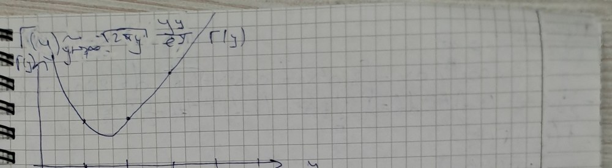

# Лекция 79 — Гамма-функция, её свойства, формула Стирлинга, бета-интеграл Эйлера

> [!info] Происхождение текста
> Текст переписан со страниц `p067`–`p070` рукописной тетради
> (см. [`ocr/raw/`](../../ocr/raw), [`ocr/MANIFEST.md`](../../ocr/MANIFEST.md)).
> В тетради этот материал помечен как «Лекции 79–80»: пара лекций не разделена.
> Разбиение на отдельные файлы L79 и L80 проведено по границе p070/p071 (смена темы); текст не переставлялся и не дополнялся.
> Решений в `My decision` (`ocr/ISSUES.md`) нет, поэтому все пометки остаются `open`
> и продублированы предупреждениями. Ничего не добавлено: ни доказательств,
> ни примеров, ни «пропущенных шагов».

## p067

> [!note] На полях
> [в рамке, сверху] 22 октября
> [!note] На полях
> [красным, отдельным блоком; начало следующей лекции] **_Лекции:_** ⟦U322⟧
· Гамма-ф-я
· инт. Римана на n-мерном прямоуг-ке ⟦A323⟧
· инт. Римана по мн-ву
· пер-во тож-ва интегрирования ⟦U324⟧

### Гамма-функция

### Опр (9.3.1)

Гамма-функцией б.ч. указ. ф-я, задаваемая формулой
$\Gamma(y)=\int_0^\infty x^{y-1}e^{-x}\,dx$ $(y>0)$ ⟦U325⟧

$\int_0^\infty e^{-x}x^{y-1}\,dx=\int_0^ae^{-x}x^{y-1}\,dx+\int_a^\infty e^{-x}x^{y-1}\,dx$

$x^{y-1}e^{-x}\sim x^{y-1}=x^{\frac1{y-2}}\Rightarrow 1-y<1\Rightarrow y>0\Rightarrow$ ⟦M326⟧

$\Rightarrow\int_0^\infty e^{-x}v^{y-1}\,dx$ — сх-ся по пр. сравнения при $y>0$ ⟦A327⟧

> [!note] На полях
> [красным] если $y\in(0,1)$, то $e^{-x}\cdot x^{y-1}\to0$ ⟦S328⟧

$x\to\infty\ e^{-x}\cdot x^{y-1}=o\left(\dfrac1{x^2}\right)$ при $y>1$ ⟦A329⟧

$\dfrac{x^{y-1}e^{-x}}{1/x^2}=\dfrac{x^{y+1}}{e^x}\to0\Rightarrow\int_a^\infty e^{-x}x^{y-1}\,dx\to0$ ⟦M330⟧

### Св-ва Гамма-функции

① $\Gamma(1)=1$
② $\Gamma(1/2)=\sqrt\pi$
③ $\Gamma(y+1)=y\Gamma(y)$
④ $\Gamma(n+1)=n\Gamma(n)=\ldots=n!$
⑤ $\Gamma(n+\tfrac12)=\dfrac{(2n-1)!!}{2^n}\sqrt\pi=\dfrac{(2n-1)!}{2^n}\sqrt\pi$ ⟦T331⟧
⑥ $\Gamma'(y)=\int_0^\infty x^{y-1}e^{-x}\ln x\,dx$

> [!warning] Неразрешённые пометки страницы p067 (см. [`ocr/ISSUES.md`](../../ocr/ISSUES.md))
> U322: нечитаемо (illegible), см. `ocr/ISSUES.md`
> A323: неоднозначный символ (ambiguous symbol), см. `ocr/ISSUES.md`
> U324: нечитаемо (illegible), см. `ocr/ISSUES.md`
> U325: нечитаемо (illegible), см. `ocr/ISSUES.md`
> M326: математическое несоответствие (mathematical inconsistency), см. `ocr/ISSUES.md`
> A327: неоднозначный символ (ambiguous symbol), см. `ocr/ISSUES.md`
> S328: неясная структура (unclear structure), см. `ocr/ISSUES.md`
> A329: неоднозначный символ (ambiguous symbol), см. `ocr/ISSUES.md`
> M330: математическое несоответствие (mathematical inconsistency), см. `ocr/ISSUES.md`
> T331: возможная описка в конспекте (probable typo in the notes), см. `ocr/ISSUES.md`

## p068

⑦ $\Gamma''(y)=\int_0^\infty x^{y-1}e^{-x}\ln^2x\,dx>0$
⑧ $\Gamma(y+1)\sim\sqrt{2\pi y}\,\dfrac{y^y}{e^y}$, $y\to\infty$
⑨ $\Gamma(y)\Gamma(1-y)=\dfrac{\pi}{\sin(\pi y)}$, $0<y<1$
⑩ $\dfrac{\Gamma(y)}{t^y}=\int_0^\infty u^{y-1}e^{-ut}\,du$ ⟦A332⟧

### Д-во (св. 6): ⟦T333⟧

① $\Gamma(1)=\int_0^{+\infty}e^{-x}x^{1-1}\,dx=\int_0^{+\infty}e^{-x}\,dx=-\left.e^{-x}\right|_0^{+\infty}=1$

② $\Gamma(1/2)=\int_0^{+\infty}e^{-x}x^{-1/2}\,dx=\int_0^{+\infty}\dfrac{e^{-x}}{\sqrt x}\,dx$:
$[x=t^2]=\int_0^\infty e^{-t^2}2\,dt=2\int_0^\infty e^{-t^2}dt=\sqrt\pi$ ⟦T334⟧

③ $\Gamma(y+1)=\int_0^{+\infty}e^{-x}x^{(y+1)-1}\,dx=\int_0^{+\infty}e^{-x}x^y\,dx=-\int_0^\infty x^y\,de^{-x}=$
$=\int_0^\infty yx^{y-1}e^{-x}\,dx-\left.x^ye^{-x}\right|_0^\infty=y\Gamma(y)$

④ В ③ вместо $y$ подставляем $n$. Т.е. следствие ③

⑤ $\Gamma\left(\tfrac32\right)=\tfrac12\Gamma(1/2)=\tfrac12\sqrt\pi$

$\Gamma\left(\tfrac52\right)=\tfrac32\Gamma\left(\tfrac32\right)=\tfrac32\cdot\tfrac12\sqrt\pi$

$n\in\mathbb{N}$ $\Gamma\left(n+\tfrac12\right)=\left(n-\tfrac12\right)\left(n-\tfrac32\right)\ldots\tfrac12\sqrt\pi=$
$=\dfrac{(2n-1)(2n-3)\ldots1}{2^n}\sqrt\pi=\dfrac{(2n-1)!!}{2^n}\sqrt\pi$ ⟦M335⟧

⑥ $\Gamma'(y)=\int_0^\infty x^{y-1}e^{-x}\ln x\,dx$

обоснуем правомерность перехода

Возвращаясь к 0 ⟦S336⟧

Проверим, что $\exists\forall\delta(y)$, в кот. или интеграл сх-ся равно-
мерно. Мы взяли разбиение $\delta>0$ такое, что $\delta\le y$ ⟦U337⟧

$x^{y-1}=x^{\delta-1}x^{y-\delta}$

$y=\delta+\delta$ ⟦T338⟧

$\left|x^{y-1}e^{-x}\ln x\right|\le x^{\delta/2-1}\left|x^{y-\delta/2}\ln x\right|$ ⟦M339⟧

Замечательный предел: $x^p\ln x\to0\ \forall p>0$

$y\ge\delta\Rightarrow y-\delta/2\ge\delta/2>0\Rightarrow$

② $x^{\delta/2-1}\ln x$ ⟦S340⟧

> [!warning] Неразрешённые пометки страницы p068 (см. [`ocr/ISSUES.md`](../../ocr/ISSUES.md))
> A332: неоднозначный символ (ambiguous symbol), см. `ocr/ISSUES.md`
> T333: возможная описка в конспекте (probable typo in the notes), см. `ocr/ISSUES.md`
> T334: возможная описка в конспекте (probable typo in the notes), см. `ocr/ISSUES.md`
> M335: математическое несоответствие (mathematical inconsistency), см. `ocr/ISSUES.md`
> S336: неясная структура (unclear structure), см. `ocr/ISSUES.md`
> U337: нечитаемо (illegible), см. `ocr/ISSUES.md`
> T338: возможная описка в конспекте (probable typo in the notes), см. `ocr/ISSUES.md`
> M339: математическое несоответствие (mathematical inconsistency), см. `ocr/ISSUES.md`
> S340: неясная структура (unclear structure), см. `ocr/ISSUES.md`

## p069

$\int_0^\infty x^{\delta/2-1}\,dx<+\infty$

вывод: имеем сходящуюся мажоранту ⇒ пр. Вейерштрасса ⇒
есть равномерная сх-ть

2) Возрастание $\infty$. $y\le C$

$\left|x^{y-1}e^{-x}\ln x\right|\le x^{C-1}e^{-x}\ln x\to0\Rightarrow$ ограниченность ⇒

$\Rightarrow$ Абсолютная мажоранта ⇒ пр. Вейерштрасса ⇒ есть равномерная
сх-ть

$\Gamma'(y)=\int_0^\infty e^{-x}x^{y-1}\ln x\,dx$

$(\Gamma'(y))'_y=\left(\int_0^\infty e^{-x}x^{y-1}\,dx\right)'_y=\int_0^\infty e^{-x}\dfrac{d}{dy}\left(x^{y-1}\right)dx=\int_0^\infty e^{-x}x^{y-1}\ln x\,dx$ ⟦T341⟧

③ $\Gamma'(y)>0\Rightarrow\Gamma(y)$ — выпукла. Доказывается из ⑥ путём
повторения доказательства ⑥ ⟦T342⟧

⑧ при $y\in\mathbb{N}$ $\Gamma(n+1)=n!$ и $\dfrac{n!\sqrt{2\pi n}}{n^ne^{-n}}$ ⟦U343⟧

$\Gamma(y+1)=\int_0^\infty x^ye^{-x}\,dx=[x=yt]=y^{y+1}\int_0^\infty e^{-yt}t^y\,dt=$

$=[\varphi(t):=\ln t-t+1]=y^{y+1}e^{-y}\int_0^\infty e^{y\varphi(t)}\,dt$ ⟦A344⟧

$\varphi'(t)=\dfrac1t-1$, $\varphi'(1)=0\Rightarrow\varphi=1-\dfrac1t-1=0\Rightarrow e^\varphi=1$ —
единственный кандидат на критическую точку ⟦M345⟧

$\varphi''(t)=-\dfrac1{t^2}>0\Rightarrow t=1$ — max ф-ции $\varphi$ на $(0,\infty)$

Разложим $\varphi(t)$ по Тейлору в окрестности т. с max

$\varphi(t)=\varphi(1)+\varphi'(1)(t-1)+\dfrac12\varphi''(1)(t-1)^2+O((t-1)^2)=-\dfrac12/(t-1)^2+O((t-1)^2)$ ⟦T346⟧

$e^{y\varphi}dx=\int_0^\infty e^{-y\frac12(t-1)^2}\,dt=\sqrt{\dfrac{2\pi}{y}}$ (получилось по Гауссу) ⟦U347⟧

$\Gamma(y+1)\sim y^{y+1}e^{-y}\sqrt{\dfrac{2\pi}{y}}$

Рассмотрим как ведет себя ф-я на границе области задания

$y\in(0,+\infty)$

$\forall y>0\ \exists\delta(y)=\dfrac{y}{\Gamma(y+1)}=\dfrac1y$ ⟦U348⟧

$\Gamma(y+1)\xrightarrow[y\to0+]{}1$ ⟦U349⟧

> [!warning] Неразрешённые пометки страницы p069 (см. [`ocr/ISSUES.md`](../../ocr/ISSUES.md))
> T341: возможная описка в конспекте (probable typo in the notes), см. `ocr/ISSUES.md`
> T342: возможная описка в конспекте (probable typo in the notes), см. `ocr/ISSUES.md`
> U343: нечитаемо (illegible), см. `ocr/ISSUES.md`
> A344: неоднозначный символ (ambiguous symbol), см. `ocr/ISSUES.md`
> M345: математическое несоответствие (mathematical inconsistency), см. `ocr/ISSUES.md`
> T346: возможная описка в конспекте (probable typo in the notes), см. `ocr/ISSUES.md`
> U347: нечитаемо (illegible), см. `ocr/ISSUES.md`
> U348: нечитаемо (illegible), см. `ocr/ISSUES.md`
> U349: нечитаемо (illegible), см. `ocr/ISSUES.md`

## p070

> [!note] На полях
> [сверху] $\Gamma(y)\sim\sqrt{2\pi y}\,\dfrac{y^y}{e^y}$ — $\Gamma(y)$

> [!note] На полях
> [график $\Gamma(y)$: ось $y$ с отметками 1, 2, 3, 4, 5; минимум между 1 и 2, точки на кривой] ⟦G350⟧

⑩ $\Gamma(y)=\int_0^\infty x^{y-1}e^{-x}\,dx=[x=bu,\ b>0,\ dx=b\,du]=$

$=b^y\int_0^\infty u^{y-1}e^{-ub}\,du\Rightarrow$

$\Rightarrow$ формула Эйлера: $\dfrac{\Gamma(y)}{b^y}=\int_0^\infty u^{y-1}e^{-ub}\,du$

⑨ Скл. ⟦U351⟧

Возьмем $y,z>0$ и сделаем замену $y\mapsto y+z$, $b\mapsto b+1$

$\dfrac{\Gamma(y+z)}{(b+1)^{y+z}}=\int_0^\infty t^{y+z-1}e^{-(b+1)t}\,dt=\int_0^\infty\left(\int_0^\infty u^{y-1}e^{-ub}\,t^{y+z-1}e^{-t}\,du\right)dt$ ⟦M352⟧

$=\int_0^\infty u^{y-1}e^{-ub}\left(\int_0^\infty t^{y+z-1}e^{-ut}\,dt\right)du=\int u^{y-1}e^{-ub}\dfrac{\Gamma(y+z)}{u^{y+z}}\,du=$

$\Rightarrow\dfrac{\Gamma(y+z)}{\Gamma(z)}\int_0^\infty\dfrac{b^{z-1}}{(b+1)^{y+z}}\,db=\ldots=B(y,z)-$ ⟦U353⟧

$\left[b+1=\dfrac{1}{1-x},\ b+1=\dfrac1{1-x},\ db=\dfrac{dx}{(1-x)^2}\right]$

$=\int_0^1\dfrac{x^{y-1}-(1-x)^{y+z}}{(1-x)^2}=\int_0^1x^{y-1}(1-x)^{z-1}\,dx=:B(y,z)-$

$=$ Второв интеграл ⟦U354⟧

$B(y,z)=\int_0^1x^{y-1}(1-x)^{z-1}\,dx=\dfrac{\Gamma(y)\Gamma(z)}{\Gamma(y+z)}$

> [!warning] Неразрешённые пометки страницы p070 (см. [`ocr/ISSUES.md`](../../ocr/ISSUES.md))
> G350: нетривиальный рисунок (non-obvious figure), см. `ocr/ISSUES.md`
> U351: нечитаемо (illegible), см. `ocr/ISSUES.md`
> M352: математическое несоответствие (mathematical inconsistency), см. `ocr/ISSUES.md`
> U353: нечитаемо (illegible), см. `ocr/ISSUES.md`
> U354: нечитаемо (illegible), см. `ocr/ISSUES.md`

---

Source: pages p067–p070
