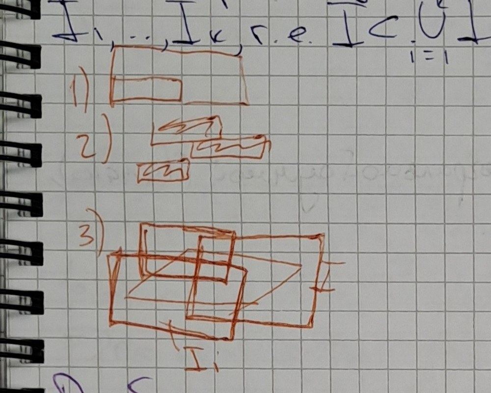

# Лекция 80 — Кратные интегралы: промежуток, мера, разбиения, интегральная сумма и интеграл Римана

> [!info] Происхождение текста
> Текст переписан со страниц `p071`–`p073` рукописной тетради
> (см. [`ocr/raw/`](../../ocr/raw), [`ocr/MANIFEST.md`](../../ocr/MANIFEST.md)).
> В тетради этот материал помечен как «Лекции 79–80»: пара лекций не разделена.
> Разбиение на отдельные файлы L79 и L80 проведено по границе p073/p074 (смена темы); текст не переставлялся и не дополнялся.
> Решений в `My decision` (`ocr/ISSUES.md`) нет, поэтому все пометки остаются `open`
> и продублированы предупреждениями. Ничего не добавлено: ни доказательств,
> ни примеров, ни «пропущенных шагов».

## p071

### Пример:

$\int_0^{\pi/2}\sin^\alpha x\cos^\beta x\,dx$ $(\alpha,\beta>0)$

$[\sin^2x=t,\ \cos^2x=1-t,\ dt=2\sin x\cos x\,dx]$

$=\dfrac12\int_0^1t^{\frac{\alpha+1}{2}-1}(1-t)^{\frac{\beta+1}{2}-1}\,dt=\dfrac12B\left(\dfrac{\alpha+1}{2},\dfrac{\beta+1}{2}\right)=$

$=\dfrac{\Gamma\left(\frac{\alpha+1}{2}\right)\Gamma\left(\frac{\beta+1}{2}\right)}{2\Gamma\left(\frac{\alpha+\beta}{2}+1\right)}$

### Кратные интегралы

$f'(x), x\in\mathbb{R}\mapsto\dfrac{\partial f}{\partial x_i}(x_1,\ldots,x_n)$, $x=(x_1,\ldots,x_n)\in\mathbb{R}^n$

$\int_a^bf(x)\,dx,\ \int f(x)\,dx\mapsto\int f(x_1,\ldots,x_n)\,dx_1\ldots dx_n$, $\Omega\subset\mathbb{R}^n$

### Интеграл Римана или n-мерном промежутке ⟦T355⟧

### Опр (10.1.1)

Мн-во $I=I_{a,b}=\{x\in\mathbb{R}^n: a_i\le x_i\le b_i,\ i=\overline{1,n}\}$
назов. промежутком в $\mathbb{R}^n$

### Опр (10.1.2)

Прямоуг-ку $I=\{x\in\mathbb{R}^n: a_i<x_i<b_i,\ i=\overline{1,n}\}$ ставится
в соответствие число $\mu(I):=\prod\limits_{i=1}^n(b_i-a_i)$ наз. мерой промежутка. ⟦A356⟧

$a=(a_1,a_2,\ldots,a_n)\in\mathbb{R}^n$

$b=(b_1,b_2,\ldots,b_n)\in\mathbb{R}^n$

$n=2$ $I_{a,b}=(a_1,b_1)\times(a_2,b_2)$

$\mu(I)=(b_1-a_1)\cdot(b_2-a_2)=$ площадь прямоугольника

> [!note] На полях
> [справа, рисунок: прямоугольник со сторонами $a_1$, $b_1$, $a_2$, $b_2$, заштрихован $I_{ab}$] ⟦G357⟧

> [!warning] Неразрешённые пометки страницы p071 (см. [`ocr/ISSUES.md`](../../ocr/ISSUES.md))
> T355: возможная описка в конспекте (probable typo in the notes), см. `ocr/ISSUES.md`
> A356: неоднозначный символ (ambiguous symbol), см. `ocr/ISSUES.md`
> G357: нетривиальный рисунок (non-obvious figure), см. `ocr/ISSUES.md`

## p072

### Св-ва меры промежутка

Мера промежутка в $\mathbb{R}^n$:

- однородна, т.е. $\forall\lambda>0\ \mu(I_{\lambda a,\lambda b})=\lambda^n\mu(I_{a,b})$ ⟦A358⟧
- аддитивна, т.е. если промежутки $I,I_1,\ldots,I_k$ таковы, что
  $I=\bigcup_{i=1}^kI_i$, $I_i\cap I_j=\varnothing$, то $\mu(I)=\sum\limits_{i=1}^k\mu(I_i)$
- если промежуток $I$ покрыт конечной системой прямоугольников
  $I_1,\ldots,I_k$, т.е. $I\subset\bigcup_{i=1}^kI_i$, то $\mu(I)\le\sum\limits_{i=1}^k\mu(I_i)$

> [!note] На полях
> [три маленьких рисунка: 1) промежуток; 2) промежуток с наложением; 3) покрытие прямоугольниками] ⟦G359⟧

### Разбиение промежутка

Раздр прямоуг-ка $I_{a,b}$. Разбиения координатных отрезков $[a_i,b_i]=I_i$,
индуцируют разбиение $I$ на более мелкие промежутки, получающиеся,
если взять проф-ия разбиений промежутков разбиения указанных коор-
динатных отрезков ⟦U360⟧

### Опр (10.1.3)

Описанное выше представление промежутка $I$ (в виде объединения
$I=\bigcup_{j=1}^kI_j$ более мелких прямоуг-ков $I_j$) будем наз. разбиением про-
межутка $I$ и обознач. символом $P$. ⟦S361⟧

> [!note] На полях
> [рисунок: прямоугольник, разбитый сеткой, $n=2$] $n=2$, partition — разбиение ⟦G362⟧

### Разбиение с отмеченными точками

> [!note] На полях
> [рисунок: прямоугольник с точками внутри ячеек] оснащение ⟦G363⟧

> [!warning] Неразрешённые пометки страницы p072 (см. [`ocr/ISSUES.md`](../../ocr/ISSUES.md))
> A358: неоднозначный символ (ambiguous symbol), см. `ocr/ISSUES.md`
> G359: нетривиальный рисунок (non-obvious figure), см. `ocr/ISSUES.md`
> U360: нечитаемо (illegible), см. `ocr/ISSUES.md`
> S361: неясная структура (unclear structure), см. `ocr/ISSUES.md`
> G362: нетривиальный рисунок (non-obvious figure), см. `ocr/ISSUES.md`
> G363: нетривиальный рисунок (non-obvious figure), см. `ocr/ISSUES.md`

## p073

### Опр (10.1.4)

Если в каждом промежутке $I_j$ разбиения $P$ фиксирована некоторая
т. $\xi_j\in I_j$, то говорят, что имеется разбиение с отмеченными точками.

### Интегральная сумма и интеграл

Пусть $f:I\to\mathbb{R}$ — заданная ф-я, а $P=\{I_1,\ldots,I_k\}$ — разбиение
этого промежутка с отмеченными точками $\xi=\{\xi_1,\ldots,\xi_k\}$

### Опр (10.1.5)

А прим $\sigma(f,P,\xi):=\sum\limits_{i=1}^kf(\xi_i)\mu(I_i)$ наз. интегральной
суммой (Р, наконец) ф-ции $f$, соотв. разбиению прямоуг-ка $I$. ⟦U364⟧

> [!note] На полях
> [рисунок: объёмный столбик над ячейкой с точкой $\xi_i$, подпись $f(\xi_i)$, $I\subset\mathbb{R}^2$] ⟦G365⟧

**Опр (10.1.6)** ($I\subset\mathbb{R}^n$)

Величина $\int_If(x)\,dx:=\lim\limits_{\lambda(P)\to0}\sigma(f,P,\xi)=\lim\limits_{\lambda(P)\to0}\sum\limits_{i=1}^kf(\xi_i)\mu(I_i)$,
если указанный предел сумм, наз. интегралом (Римана) от ф-ции $f$ по промежутку $I$. ⟦S366⟧

### Опр (10.1.7)

Если ф-я $f:I\to\mathbb{R}$ указанной в опр (10.1.6) конечный предел существует,
то $f$ наз. интегрируемой (по Риману) ф-цией на промежутке $I$. Мн-во всех
таких ф-ций обознач. символом $R(I)$ ⟦S367⟧

### Необходимое усл интегрируемости

### Теорема (10.1.1)

$f\in R(I)\Rightarrow f$ ограничена на $I$.

> [!warning] Неразрешённые пометки страницы p073 (см. [`ocr/ISSUES.md`](../../ocr/ISSUES.md))
> U364: нечитаемо (illegible), см. `ocr/ISSUES.md`
> G365: нетривиальный рисунок (non-obvious figure), см. `ocr/ISSUES.md`
> S366: неясная структура (unclear structure), см. `ocr/ISSUES.md`
> S367: неясная структура (unclear structure), см. `ocr/ISSUES.md`

---

Source: pages p071–p073
