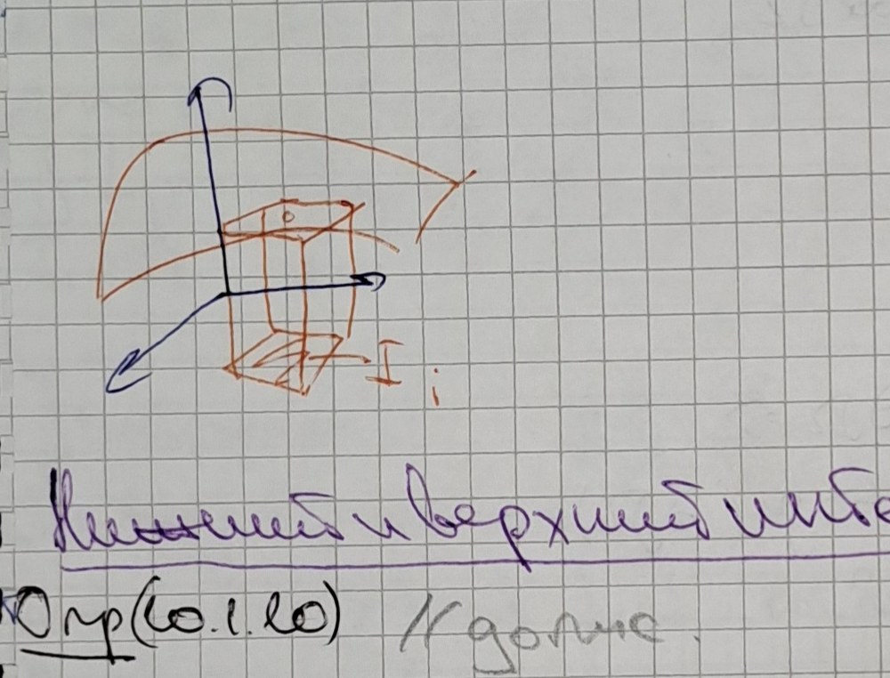

# Лекции 81–82 — Критерий Лебега, интеграл по множеству, суммы Дарбу

> [!info] Происхождение текста
> Текст переписан со страниц `p074`–`p082` рукописной тетради
> (см. [`ocr/raw/`](../../ocr/raw), [`ocr/MANIFEST.md`](../../ocr/MANIFEST.md)).
> В тетради материал помечен как «Лекции 81–82»: пара лекций не разделена.
> Страницы приведены в исходном порядке, без перестановки и без добавления текста.
> Один файл на пару: ранее созданные одиночные файлы заменены этим файлом,
> их содержимое перенесено без изменений.
> Решений в `My decision` (`ocr/ISSUES.md`) нет, поэтому все пометки остаются `open`
> и продублированы предупреждениями. Ничего не добавлено: ни доказательств,
> ни примеров, ни «пропущенных шагов».

## p074

### Д-во (т. 10.1.1):

$P$ — некое разбиение $I$. If неогр $I\Rightarrow$

> [!note] На полях
> [рисунок: прямоугольник с сеткой, выделен $I_{i0}$] ⟦G368⟧

$\exists I_{i0}\in P$ такое, что $f$ неогр. на $I_{i0}$

$\xi'$ — один набор выделенных точек для $P$
$\xi''$ — другой набор выделенных т. для $P$

(для простоты) $\xi'$ отличается от $\xi''$ только выбором точек в $I_{i0}$:
$\xi'_0$ и $\xi''_0$.

$|\sigma(f,P,\xi')-\sigma(f,P,\xi'')|=|f(\xi'_0)-f(\xi''_0)|\cdot\mu(I_{i0})$

Зафиксируем $\xi'_0$, а $\xi''_0$ будем облетать по $I_{i0}$, т.к. $f$ неогр
по $I_{i0}\Rightarrow|f(\xi'_0)-f(\xi''_0)|$ может стать сколь большой

$\Rightarrow$ По крит. Коши предел интегральных сумм не существует. $\square$ ⟦S369⟧

> [!note] На полях
> [в рамке, справа] 20октября ⟦A370⟧
> [!note] На полях
> [красным, справа, отдельным блоком; начало следующей лекции] **_Лекции 81–82_**
· крит. Лебега
· Дарбу
· инт. Римана по мн-ву ⟦U371⟧
· мера Жордана
· св-ва интеграла
· ? Фубини и её св-ва ⟦U372⟧
· принцип Кавальери

### Критерий интегрируемости ф-ции по Риману

### Опр (10.1.8)

Будем говорить, что некоторое св-во имеет место почти всюду на $M$,
если подмн-во $M$, где это св-во может нарушаться, имеет меру нуль. ⟦S373⟧

> [!warning] Неразрешённые пометки страницы p074 (см. [`ocr/ISSUES.md`](../../ocr/ISSUES.md))
> G368: нетривиальный рисунок (non-obvious figure), см. `ocr/ISSUES.md`
> S369: неясная структура (unclear structure), см. `ocr/ISSUES.md`
> A370: неоднозначный символ (ambiguous symbol), см. `ocr/ISSUES.md`
> U371: нечитаемо (illegible), см. `ocr/ISSUES.md`
> U372: нечитаемо (illegible), см. `ocr/ISSUES.md`
> S373: неясная структура (unclear structure), см. `ocr/ISSUES.md`

## p075

### Теорема (10.1.2) (крит. Лебега)

$f\in R(I)\Leftrightarrow f$ интегр. почти всюду на $I$ ⟦T374⟧

### Замечание (о множествах меры нуль)

① Точка (или конечное число точек) имеет меру нуль

$n=2$ $I_{a,a}=(a_1,b_1)\times(a_2,b_2)$ ⟦A375⟧

② В $\mathbb{R}^2$ кривая (или конечное число кривых) имеет меру нуль

③ В $\mathbb{R}^3$ Уров-ть (или конечное число поверхностей) имеет меру нуль ⟦U376⟧
> [!note] На полях
> [красным, под ③] в смысле с楼? ⟦U377⟧

④ Объединение конечного или счётного тела меры нуль — мн-во
меры нуль. ⟦U378⟧

⑤ Уподмн-во мн-ва меры нуль имеет меру нуль. ⟦U379⟧

⑥ $I_{a,b}=\{x\in\mathbb{R}^n: a_i\le x_i\le b_i,\ a_i<b_i\}$ — невырожденный
промежуток ⇒ $\mu(I_{a,b})\ne0$

### Д-во (т. 10.1.2):

ⓐ $f\in R(I)\Rightarrow f$ ограничена на $I$.
Т.е. $|f|\le M$ на $I$.

Проверим, что $f$ непрер. почти всюду на $I$. Для этого покажем, что
$E=$ мн-во точек разрыва ф-ции $I\Rightarrow f\in R(I)$. ⟦M380⟧

Рассм. $E_n:=\left\{x\in I:\omega(f,x)\ge\dfrac1n\right\}$

Замечание: $f:I\to\mathbb{R}$, $\omega(f,I)=\sup_{x,y\in I}|f(x)-f(y)|$ — колеблемость — осцилляция ф-ции ⟦S381⟧

$\omega(f,x)=\lim\limits_{\delta\to0}\omega(f,V_\delta(x))$

$E=\bigcup E_n$

Если $\mu(E)\ne0$, то $\exists n_0\in\mathbb{N}:\mu(E_{n_0})\ne0$

Пусть $P$ — разбиение $I$ на интервалы $I_i$:

Разделим $P$ на две группы:
$A=\left\{I_i\in P: I_i\cap E_{n_0}\ne\varnothing\ \text{и}\ \omega(f,I_i)\ge\dfrac1{2n_0}\right\}$ ⟦S382⟧

$B=P\setminus A$ ⟦U383⟧

> [!warning] Неразрешённые пометки страницы p075 (см. [`ocr/ISSUES.md`](../../ocr/ISSUES.md))
> T374: возможная описка в конспекте (probable typo in the notes), см. `ocr/ISSUES.md`
> A375: неоднозначный символ (ambiguous symbol), см. `ocr/ISSUES.md`
> U376: нечитаемо (illegible), см. `ocr/ISSUES.md`
> U377: нечитаемо (illegible), см. `ocr/ISSUES.md`
> U378: нечитаемо (illegible), см. `ocr/ISSUES.md`
> U379: нечитаемо (illegible), см. `ocr/ISSUES.md`
> M380: математическое несоответствие (mathematical inconsistency), см. `ocr/ISSUES.md`
> S381: неясная структура (unclear structure), см. `ocr/ISSUES.md`
> S382: неясная структура (unclear structure), см. `ocr/ISSUES.md`
> U383: нечитаемо (illegible), см. `ocr/ISSUES.md`

## p076

$B=P\setminus A$

Система интервалов $A$ образует покрытие $E_{n_0}$.

Действительно, $\forall y\in E_{n_0}\to y\in I_i\subset A$

$\to y\in$ границе $I_i$: ⟦S384⟧

Выберем набор точек $\xi'$, $\xi''$ так, чтобы:

1) для $I_i\in B\Rightarrow$ диагональные точки совпадают ⟦U385⟧
2) для $I_i\in A\Rightarrow$ точки $\xi'_i$ и $\xi''_i$ выберем так, чтобы
$f(\xi'_i)-f(\xi''_i)\ge\dfrac1{3n_0}$

$|\sigma(f,P,\xi')-\sigma(f,P,\xi'')|=\left|\sum_{I_i\in A}\left(f(\xi'_i)-f(\xi''_i)\right)\right|>\dfrac1{3n_0}\sum_{I_i\in A}\mu(I_i)$ ⟦M386⟧

$\exists\,\text{const}>0$

Т.е. const следует из предположения, что $\mu(E_{n_0})\ne0$, а интервалы
из $A$ образуют покрытие $E_{n_0}$

$P$ — произвольное разбиение ⇒ по крит. Коши суммы Римана
$\sigma(f,P,\xi)$ не имеют предела при $\lambda(P)\to0$. Т.е. $f\notin R(I)$. ⟦S387⟧

ⓑ $f$-ограничена на $I$

$\Leftarrow$ f-непрерывна почти всюду, будем доказывать ⇒ ⟦S388⟧

$\forall\varepsilon>0$, $E_\varepsilon=\{x\in I:\omega(f,x)\ge\varepsilon\}$

Получ. $\mu(E_\varepsilon)=0$

Очевидно, что $E_\varepsilon$ замкнуто в $I\Rightarrow E_\varepsilon$ — компакт! ⟦M389⟧

> [!note] На полях
> [красным] Замечание: А для компактов верно, что из любого покрытия можно выбрать конечное подпокрытие! ⟦S390⟧

$\Rightarrow\exists$ конечный набор промежутков $I_1,I_2,\ldots,I_k$:
$E_\varepsilon\subset\bigcup_{i=1}^kI_i$, $\sum\mu(I_i)<\varepsilon$

Рассм. два разбиения $P'$, $P''$ интервала $I$

$\lambda(P'),\lambda(P'')\to0$

Пусть $P$ — разбиение, получаемое пересечением интервалов разбиения
$P'$ и $P''$: $P=\{I_{ij}=I'_i\cap I''_j\}$ ⟦S391⟧

> [!warning] Неразрешённые пометки страницы p076 (см. [`ocr/ISSUES.md`](../../ocr/ISSUES.md))
> S384: неясная структура (unclear structure), см. `ocr/ISSUES.md`
> U385: нечитаемо (illegible), см. `ocr/ISSUES.md`
> M386: математическое несоответствие (mathematical inconsistency), см. `ocr/ISSUES.md`
> S387: неясная структура (unclear structure), см. `ocr/ISSUES.md`
> S388: неясная структура (unclear structure), см. `ocr/ISSUES.md`
> M389: математическое несоответствие (mathematical inconsistency), см. `ocr/ISSUES.md`
> S390: неясная структура (unclear structure), см. `ocr/ISSUES.md`
> S391: неясная структура (unclear structure), см. `ocr/ISSUES.md`

## p077

Заметим, что $\mu(I'_i)=\sum_j\mu(I_{ij})$

$|\sigma(f,P',\xi')-\sigma(f,P,\xi)|=\left|\sum\left(f(\xi'_i)-f(\xi_{ij})\right)\mu(I_{ij})\right|\le$
$\le\sum_1+\sum_2\left|f(\xi'_i)-f(\xi_{ij})\right|\mu(I_{ij})+\sum\left|f(\xi_i)-f(\xi_{ij})\right|\mu(I_{ij})$ ⟦M392⟧

> [!note] На полях
> [красным] // Сверху задетку, не учитываем эти случаи ⟦U393⟧

$C_1:=\bigcup I_{ij}$ — объединение интервалов $I_{ij}$ с центрами
в $\xi'$ и коор-т ⟦U394⟧

$C_2:=$ объединение конечных $I_{ij}$ с центром в центре $I'_i$,
коорд-ты 2 ⟦U395⟧

$C_3:=$ объединение конечных $I'$, суммарно с цепью $\xi'$ и ⟦U396⟧

$E_\varepsilon\subset C_2\subset C_3$

> [!note] На полях
> [рисунок: прямоугольник с вложенным прямоугольником, подписи $C_2$, $C_3$, «разбитый график»] ⟦G397⟧

Очевидно, что расстояние между границей $C_2$ и $C_3$ строго
положительно.

Берём разбиение $P'$ и $P''$ интервала $I$.

$JP$ — разбиение ⟦A398⟧

ⓑ $\mu(E_\varepsilon)=0\Rightarrow f\in R(I)$

Пиша $\varepsilon>0$, $\mu(E_\varepsilon)=0\Rightarrow\exists$ конечный
набор $I_1,I_2,\ldots,I_k$ покрывающих $E_\varepsilon$ и
$\sum\mu(I_i)<\dfrac{\varepsilon}{4M}$, где $|f|\le M$ на $I$
(если $M=0$, то $f=0$, и интегрируема) ⟦U399⟧

$\Rightarrow$ вне $I_i$ $f$ непрерывна в каждой точке ⇒
$\forall x\in I\ \forall V_\delta$ ∫... ⟦U400⟧

$\Rightarrow\omega(f,D(x))<\dfrac{\varepsilon}{2\mu(I)}$

> [!note] На полях
> [красным] // ФD-ω ф-ции ⟦U401⟧

> [!warning] Неразрешённые пометки страницы p077 (см. [`ocr/ISSUES.md`](../../ocr/ISSUES.md))
> M392: математическое несоответствие (mathematical inconsistency), см. `ocr/ISSUES.md`
> U393: нечитаемо (illegible), см. `ocr/ISSUES.md`
> U394: нечитаемо (illegible), см. `ocr/ISSUES.md`
> U395: нечитаемо (illegible), см. `ocr/ISSUES.md`
> U396: нечитаемо (illegible), см. `ocr/ISSUES.md`
> G397: нетривиальный рисунок (non-obvious figure), см. `ocr/ISSUES.md`
> A398: неоднозначный символ (ambiguous symbol), см. `ocr/ISSUES.md`
> U399: нечитаемо (illegible), см. `ocr/ISSUES.md`
> U400: нечитаемо (illegible), см. `ocr/ISSUES.md`
> U401: нечитаемо (illegible), см. `ocr/ISSUES.md`

## p078

### Интеграл по мн-ву

### Опр (10.2.1)

Мн-во $\Omega\subset\mathbb{R}^n$ наз. допустимым, если оно огр. в $\mathbb{R}^n$
и его граница $\partial\Omega$ есть мн-во меры нуль

### Опр (10.2.2)

Пусть $\Omega\subset\mathbb{R}^n$ — допустимое мн-во. Ф-я
$\chi_\Omega(x)=\begin{cases}1,\ \text{если }x\in\Omega\\0,\ \text{если }x\notin\Omega\end{cases}$
наз. характеристической ф-ей мн-ва $\Omega$.

### Замечание

$\chi_\Omega(x)$ имеет разрыв только на $\partial\Omega\Rightarrow$

$\Rightarrow$ Если $\Omega$ — допустимое мн-во ⇒ $\mu(\partial\Omega)=0\Rightarrow$

$\Rightarrow\chi_\Omega$ непрер. почти всюду в $\mathbb{R}^n$ ⟦S402⟧

### Интеграл по мн-ву

$\Omega=\mathbb{R}^n$, $f:\Omega\to\mathbb{R}$

### Опр (10.2.3) // допис. ⟦U403⟧

Ф-я $f$ определена на мн-ве $\Omega$. Тогда. ⟦U404⟧

### Опр (10.2.4) // допис. ⟦U405⟧

### Замечание

$\exists\Omega\subset I_1$, $\Omega\subset I_2$ ⟦S406⟧

> [!warning] Неразрешённые пометки страницы p078 (см. [`ocr/ISSUES.md`](../../ocr/ISSUES.md))
> S402: неясная структура (unclear structure), см. `ocr/ISSUES.md`
> U403: нечитаемо (illegible), см. `ocr/ISSUES.md`
> U404: нечитаемо (illegible), см. `ocr/ISSUES.md`
> U405: нечитаемо (illegible), см. `ocr/ISSUES.md`
> S406: неясная структура (unclear structure), см. `ocr/ISSUES.md`

## p079

### Интегральные суммы Дарбу

Пусть $f$ — вещественнозначная ф-я на промежутке $I$, а
$P=\{I_i\}$ — разбиение промежутка $I$.
Положим $m_i:=\inf\limits_{x\in I_i}f(x)$, $M_i=\sup\limits_{x\in I_i}f(x)$ ⟦A407⟧

### Опр (10.1.9) // допис. ⟦U408⟧

Величина $s(f,P)=\sum m_i\mu(I_i)$, $S(f,P)$ ⟦U409⟧

> [!note] На полях
> [рисунок: объёмный столбик над ячейкой разбиения, подпись $f(\xi_i)$, $I_i$] ⟦G410⟧

### Нижний и верхний интегралы Дарбу

### Опр (10.1.10) // допис ⟦U411⟧

### Упражнение. Прямоугольники $I$ имеют следующее св-во: // допис ⟦U412⟧

$s$

Замечание: $\sup\inf\le\inf\sup$

### Крит Дарбу интегрируемости вещественнозначной ф-ции

### Теорема (10.1.13) ф-ла ⟦A413⟧

$f\in R(I)\Leftrightarrow\underline{J}=\overline{J}$ ⟦U414⟧

> [!warning] Неразрешённые пометки страницы p079 (см. [`ocr/ISSUES.md`](../../ocr/ISSUES.md))
> A407: неоднозначный символ (ambiguous symbol), см. `ocr/ISSUES.md`
> U408: нечитаемо (illegible), см. `ocr/ISSUES.md`
> U409: нечитаемо (illegible), см. `ocr/ISSUES.md`
> G410: нетривиальный рисунок (non-obvious figure), см. `ocr/ISSUES.md`
> U411: нечитаемо (illegible), см. `ocr/ISSUES.md`
> U412: нечитаемо (illegible), см. `ocr/ISSUES.md`
> A413: неоднозначный символ (ambiguous symbol), см. `ocr/ISSUES.md`
> U414: нечитаемо (illegible), см. `ocr/ISSUES.md`

## p080

### Д-во (т. 10.2.1):

Т. разрыва ф-ции $f\chi_\Omega$ в $\Omega$ ⟦U415⟧

$\sum$. разрыв $f\chi_\Omega$ в $\Omega$ или $\partial\Omega$. ⟦S416⟧

### Мера (объём) допустимого мн-ва

### Опр (10.2.5)

Мерой (Жордана) или объёмом ограниченного мн-ва $\Omega\subset\mathbb{R}^n$ наз.
величина $\mu(\Omega):=\int_I1\,dx$, если указанный интеграл (Римана) сущ. ⟦S417⟧

### Опр (10.2.6)

Мн-во $\Omega\subset\mathbb{R}^n$ назов. мн-вом меры нуль в смысле Жордана
или мн-вом объёма нуль, если $\forall\varepsilon>0$ его можно покрыть такой
конечной системой прямоугольников $I_1,\ldots,I_k$, что
$\sum\limits_{i=1}^k\mu(I_i)<\varepsilon$ ⟦S418⟧

### Замечание:

$\int_I1\,dx=\int_{I\ni\Omega}\chi_\Omega(x)\,dx$

Поскольку т. разрыва $\chi_\Omega$ лежат на $\partial\Omega\Rightarrow\mu(\Omega)$
определена только для допустимых мн-в ⟦S419⟧

### Замечание:

Только допустимые мн-ва явл. измеримыми!

> [!note] На полях
> [в овале, внизу] в смысле меры нуль Лебега или Жордана до информации ⟦U420⟧

> [!warning] Неразрешённые пометки страницы p080 (см. [`ocr/ISSUES.md`](../../ocr/ISSUES.md))
> U415: нечитаемо (illegible), см. `ocr/ISSUES.md`
> S416: неясная структура (unclear structure), см. `ocr/ISSUES.md`
> S417: неясная структура (unclear structure), см. `ocr/ISSUES.md`
> S418: неясная структура (unclear structure), см. `ocr/ISSUES.md`
> S419: неясная структура (unclear structure), см. `ocr/ISSUES.md`
> U420: нечитаемо (illegible), см. `ocr/ISSUES.md`

## p081

Упоминание типа характеристической ф-ции $\int_{I_1}f\chi_\Omega\,dx$ ⟦U421⟧

$\int_{I_1}f\chi_\Omega\,dx$, $\int_{I_2}f\chi_\Omega\,dx$ — Эти интегралы $\sum$ одновременно

Причём если они сущ., то их значения совпадают.

Рассм. $I_1\cap I_2\supset\Omega$

Про можно сказать о разрыве $\chi_\Omega$ ⟦U422⟧

① т. разрыва $f$ вне $\Omega$ ⟦S423⟧
② т. разрыва $\chi_\Omega$

Это всегда т. разрыва $\chi_\Omega\in I_1\cap I_2$ ⟦M424⟧

$\int_{I_1\cap I_2}f\chi_\Omega$, $\int_{I_1}f\chi_\Omega$, $\int_{I_2}f\chi_\Omega$
— три интеграла $\sum$ одновременно.

> [!note] На полях
> [рисунок: два перекрывающихся прямоугольника $I_1$, $I_2$, внутри $\Omega$, заштриховано пересечение] ⟦G425⟧

Интегралы $\sum$

Исключим рассм. только те разбиения $I_1$, $I_2$, кот. получаются
дополнением разбиения $I_1\cap I_2$ ⟦S426⟧

Заметим, что вне $I_1\cap I_2$ ∨ $\chi_\Omega=0\Rightarrow$ Интегральные суммы
для $I_1$ и $I_2$ Это одна и та же интегральная сумма для $I_1\cap I_2$ ⟦T427⟧

$\sum f\chi_\Omega(\xi_i)\mu(I_{1i})=\sum f\chi_\Omega(\xi_i)\mu(I_1\cap I_{2i})$

$\sum f\chi_\Omega(\eta_i)\mu(I_{2i})=\sum f\chi_\Omega(\eta_i)\mu(I_{1i}\cap I_{2i})$

Переходя к пределу с разбиением интегралов ⟦S428⟧

### Крит. интегрируемости по мн-ву

### Теорема (10.2.1) // допис ⟦U429⟧

$\forall_\exists f:\Omega\to\mathbb{R}$ интегрируема на допустимом мн-ве ⟦U430⟧

> [!warning] Неразрешённые пометки страницы p081 (см. [`ocr/ISSUES.md`](../../ocr/ISSUES.md))
> U421: нечитаемо (illegible), см. `ocr/ISSUES.md`
> U422: нечитаемо (illegible), см. `ocr/ISSUES.md`
> S423: неясная структура (unclear structure), см. `ocr/ISSUES.md`
> M424: математическое несоответствие (mathematical inconsistency), см. `ocr/ISSUES.md`
> G425: нетривиальный рисунок (non-obvious figure), см. `ocr/ISSUES.md`
> S426: неясная структура (unclear structure), см. `ocr/ISSUES.md`
> T427: возможная описка в конспекте (probable typo in the notes), см. `ocr/ISSUES.md`
> S428: неясная структура (unclear structure), см. `ocr/ISSUES.md`
> U429: нечитаемо (illegible), см. `ocr/ISSUES.md`
> U430: нечитаемо (illegible), см. `ocr/ISSUES.md`

## p082

### Общие св-ва интеграла

### Теорема (10.3.1)

Пусть $\Omega_1,\Omega_2$ — допустимые мн-ва в $\mathbb{R}^n$, $f$ — ф-я,
определённая на $\Omega_1\cup\Omega_2$. Тогда:

① $\int_{\Omega_1\cup\Omega_2}f(x)\,dx\Leftrightarrow\exists\int_{\Omega_i}f(x)\,dx,\ i=1,2\Rightarrow\exists\int_{\Omega_1\cap\Omega_2}f(x)\,dx$

② Если при $\mu(\Omega_1\cap\Omega_2)=0$, dopри усл. сущ. интегралов имеет
место рав-во: $\int_{\Omega_1\cup\Omega_2}f(x)\,dx=\int_{\Omega_1}f(x)\,dx+\int_{\Omega_2}f(x)\,dx$ ⟦U431⟧

### Д-во (п ① т. 10.3.1):

$\mu(\Omega_1\cap\Omega_2)=0$

$\int_{\Omega_1\cup\Omega_2}f(x)\,dx=\int_{I\supset\Omega_1\cup\Omega_2}f\chi_{\Omega_1\cup\Omega_2}\,dx$

Запишем, что $\chi_{\Omega_1\cup\Omega_2}(x)=\chi_{\Omega_1}(x)+\chi_{\Omega_2}(x)-\chi_{\Omega_1\cap\Omega_2}(x)$

① $\int f\chi_{\Omega_1}(x)\,dx+\int f\chi_{\Omega_2}(x)\,dx-\int f\chi_{\Omega_1\cap\Omega_2}(x)\,dx$

⇔ $\int_{\Omega_1}f\,dx$ ⇔ $\int_{\Omega_2}f\,dx$ − Φ т.к. $\mu(\Omega_1\cap\Omega_2)=0$ ⇔ $0$ ⟦S432⟧

### Оценка интеграла

### Утв (10.3.1)

Если $f\in R(\Omega)$, то $|f|\in R(\Omega)$ и имеет место нер-во:
$\left|\int_\Omega f(x)\,dx\right|\le\int_\Omega|f(x)|\,dx$

### Д-во (утв. 10.3.1):

$|f|\in R(\Omega)\Leftarrow$ опр интеграла по $\Omega$ + крит. Лебега

Переходный переход из нер-ва для интегральных сумм. → ⟦U433⟧

2) чер-во ⟦U434⟧

> [!warning] Неразрешённые пометки страницы p082 (см. [`ocr/ISSUES.md`](../../ocr/ISSUES.md))
> U431: нечитаемо (illegible), см. `ocr/ISSUES.md`
> S432: неясная структура (unclear structure), см. `ocr/ISSUES.md`
> U433: нечитаемо (illegible), см. `ocr/ISSUES.md`
> U434: нечитаемо (illegible), см. `ocr/ISSUES.md`

---

Source: pages p074–p082
