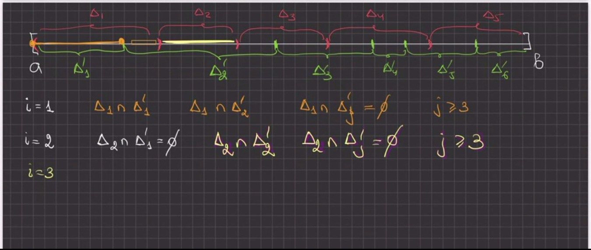
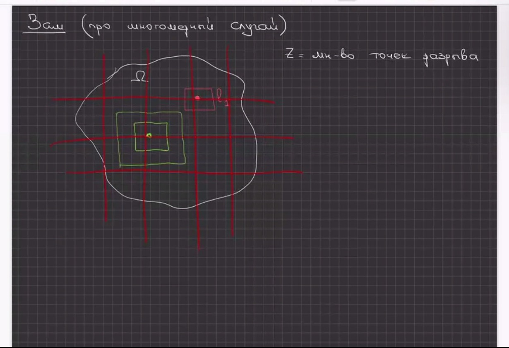
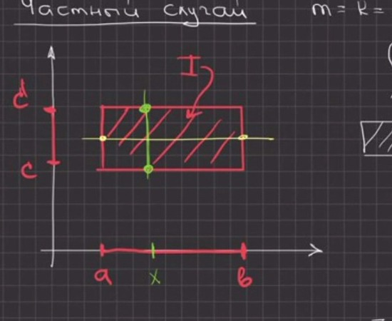

# Лекции 83–84 — Достаточность критерия Лебега, свойства интеграла, теорема Фубини

> [!info] Происхождение текста
> Текст переписан с 42 видеокадров `p083`–`p124` (лекции 83–84, 31 октября 2026):
> снимков экрана Zoom со слайдами PDF `ma26:27-lectures_83-84` и рукописными досками
> (см. [`ocr/raw/`](../../ocr/raw), [`ocr/MANIFEST.md`](../../ocr/MANIFEST.md), часть 4).
> В источнике материал помечен как «лекции 83-84»: пара лекций не разделена.
> Кадры приведены в порядке, восстановленном по номерам слайдов и непрерывности
> записи на доске; строки внутри кадра не переставлялись и не дополнялись.
> Соседние кадры частично перекрываются: повторяющиеся строки сохранены
> и отмечены `> margin:`.
> Решений в `My decision` (`ocr/ISSUES.md`) нет, поэтому все пометки остаются `open`
> и продублированы предупреждениями. Ничего не добавлено: ни доказательств,
> ни примеров, ни «пропущенных шагов»

> [!todo] Недостающие слайды
> В архиве нет кадров слайдов `9 / 10` и `10 / 10`. Принцип Кавальери,
> заявленный в целях лекции (слайд `3 / 10`), ни в одном кадре не сформулирован;
> формулировка не восстановлена (см. `⟦U437⟧`).

## p083

<u>Математический анализ</u>

лекции 83-84 ⟦S435⟧

31 октября 2026

> margin: нижняя полоса слайда: © Д.Е. Апушкинская (РУДН) | Мат. анализ | лекции 83-84 | 31 октября 2026 | 1 / 10

> [!warning] Неразрешённые пометки страницы p083 (см. [`ocr/ISSUES.md`](../../ocr/ISSUES.md))
> S435: неясная структура (unclear structure), см. `ocr/ISSUES.md`

## p084

<u>Цитата дня:</u> ⟦S436⟧

Продам дрова - недавно наломала.

> margin: слайд 2 / 10; нижняя полоса © Д.Е. Апушкинская (РУДН), 31 октября 2026

> [!warning] Неразрешённые пометки страницы p084 (см. [`ocr/ISSUES.md`](../../ocr/ISSUES.md))
> S436: неясная структура (unclear structure), см. `ocr/ISSUES.md`

## p085

<u>Цель лекции</u>

· Докажем достаточность критерия Лебега интегрируемости функции по Риману.
· Продолжим обсуждение свойств многомерного интеграла.
· Разберем теорему Фубини и ряд ее следствий. ⟦S438⟧
· Сформулируем принцип Кавальери. ⟦U437⟧

> margin: в архиве нет кадров со слайдами 9 / 10 и 10 / 10; принцип Кавальери, заявленный в целях лекции, в присланных кадрах не сформулирован

> [!warning] Неразрешённые пометки страницы p085 (см. [`ocr/ISSUES.md`](../../ocr/ISSUES.md))
> S438: неясная структура (unclear structure), см. `ocr/ISSUES.md`
> U437: нечитаемо (illegible), см. `ocr/ISSUES.md`

## p086

<u>Свойства интеграла</u>

Пусть функции $f,g\in\mathcal{R}(\Omega)$. ⟦A439⟧

1. $\forall x\in\Omega\ \ f(x)\geq0\ \Rightarrow\ \int_\Omega f(x)\,dx\geq0$

2. $\forall x\in\Omega\ \ f(x)\leq g(x)\ \Rightarrow\ \int_\Omega f(x)\,dx\leq\int_\Omega g(x)\,dx$

3. $\forall x\in\Omega\ \ m\leq f(x)\leq M\ \Rightarrow\ m\mu(\Omega)\leq\int_\Omega f(x)\,dx\leq M\mu(\Omega)$

> margin: глава 10. Кратные интегралы; слайд 4 / 10; в окошке Zoom — «Егор Летохов»

> [!warning] Неразрешённые пометки страницы p086 (см. [`ocr/ISSUES.md`](../../ocr/ISSUES.md))
> A439: неоднозначный символ (ambiguous symbol), см. `ocr/ISSUES.md`

## p087

<u>Свойства интеграла</u>

4. Если $m=\inf\limits_{x\in\Omega}f(x)$ и $M=\sup\limits_{x\in\Omega}f(x)$, то $\exists\,\theta\in[m,M]$ такое, что

$\int_\Omega f(x)\,dx=\theta\mu(\Omega)$.

5. Если $\Omega$ допустимое связное множество и $f:\Omega\to\mathbb{R}$ непрерывна, то $\exists\,\xi\in\Omega$ такая, что

$\int_\Omega f(x)\,dx=f(\xi)\mu(\Omega)$.

6. $\left.\begin{array}{l}\forall x\in\Omega\quad m\leq f(x)\leq M\\ g(x)\geq0\end{array}\right\}\Rightarrow m\int_\Omega g(x)\,dx\leq\int_\Omega fg(x)\,dx\leq M\int_\Omega g(x)\,dx$ ⟦T441⟧

> margin: [синие чернила поверх слайда] $[mg(x)\leq f(x)\leq Mg(x)]$; слайд 5 / 10 ⟦S440⟧

> [!warning] Неразрешённые пометки страницы p087 (см. [`ocr/ISSUES.md`](../../ocr/ISSUES.md))
> T441: вероятная описка (likely typo), см. `ocr/ISSUES.md`
> S440: неясная структура (unclear structure), см. `ocr/ISSUES.md`

## p088

<u>§4. Теорема Фубини</u>

> margin: [синие чернила] $\mathbb{R}^n=\mathbb{R}^m\times\mathbb{R}^k$, $k+m=n$

<u>Теорема 10.4.1</u>

Пусть $I=I_x\times I_y\subset\mathbb{R}^n$, $I_x$ - промежуток в $\mathbb{R}^m$, $I_y$ - промежуток в $\mathbb{R}^k$, $m+k=n$. Если функция $f$ интегрируема на $I$, а также ⟦S442⟧

<u>$\forall x$ функция $y\mapsto f(x,y)$ интегрируема на $I_y$</u>,

то

$\int_I f(x,y)\,dx\,dy=\int_{I_x}\left(\int_{I_y}f(x,y)\,dy\right)dx$

> margin: красной рамкой обведено условие «$\forall x$ функция $y\mapsto f(x,y)$ интегрируема на $I_y$»; рисунок с $I_x$, $I_y$, $I\subset\mathbb{R}^n$; слайд 6 / 10 ⟦G443⟧

> [!warning] Неразрешённые пометки страницы p088 (см. [`ocr/ISSUES.md`](../../ocr/ISSUES.md))
> S442: неясная структура (unclear structure), см. `ocr/ISSUES.md`
> G443: нетривиальный рисунок (figure), см. `ocr/ISSUES.md`

## p089

<u>Сведение кратного интеграла к повторным</u>

<u>Следствие 10.4.1</u>

Если $I=I_1\times I_2\times\ldots\times I_n\subset\mathbb{R}^n$, $I_i=[a_i,b_i]\subset\mathbb{R}$, то

$\int_I f(x)\,dx=\int_{a_n}^{b_n}dx_n\int_{a_{n-1}}^{b_{n-1}}dx_{n-1}\ldots\int_{a_1}^{b_1} f(x_1,x_2,\ldots,x_n)\,dx_1.$ ⟦S444⟧

> margin: глава 10. Кратные интегралы, §4. Теорема Фубини; слайд 7 / 10

> [!warning] Неразрешённые пометки страницы p089 (см. [`ocr/ISSUES.md`](../../ocr/ISSUES.md))
> S444: неясная структура (unclear structure), см. `ocr/ISSUES.md`

## p090

<u>Следствие 10.4.2</u>

Пусть $\mathcal{D}$ - ограниченное множество в $\mathbb{R}^{n-1}$ и пусть

$\mathcal{E}=\{(x,y)\in\mathbb{R}^n:\ x\in\mathcal{D}\ \text{и}\ \varphi_1(x)\leq y\leq\varphi_2(x)\}$.

Если $f\in\mathcal{R}(\mathcal{E})$, то

$\int_{\mathcal{E}}f(x,y)\,dx\,dy=\int_{\mathcal{D}}dx\int_{\varphi_1(x)}^{\varphi_2(x)}f(x,y)\,dy.$

> margin: [синие чернила под формулой] $=\int\left(\int_{\varphi_1(x)}^{\varphi_2(x)}f(x,y)\,dy\right)dx$; слайд 8 / 10 ⟦S445⟧

> [!warning] Неразрешённые пометки страницы p090 (см. [`ocr/ISSUES.md`](../../ocr/ISSUES.md))
> S445: неясная структура (unclear structure), см. `ocr/ISSUES.md`

## p091

<u>Утв</u> Пусть $f$ определена, ограничена на $[a,b]$ и $f$ непрерывна п.в. на $[a,b]$ $\Rightarrow$ $f\in\mathcal{R}([a,b])$ ⟦A447⟧

<u>Д-во:</u> Будем доказывать, используя критерий Коши.

$Z$ - мн-во точек разрыва $f$ на $[a,b]$ $\Rightarrow$ $\mu(Z)=0$, по опр ⟦M446⟧

$\Rightarrow\forall\varepsilon>0\ \exists$ не более чем счетная система интервалов $\{l_i\}$, покрывающая все $Z$ такая, что

$\sum\limits_i\mu(l_i)<\varepsilon$.

Если $x$ - точка непрерывности $f$ на $[a,b]$, то $\exists\,\delta(x)>0$ такое, что

$f(B_{3\delta}(x)\cap[a,b])\subset B_\varepsilon(f(x))$

> margin: метка страницы доски «4 of 11»; поверх доски видна нижняя полоса слайда 3 / 10

> [!warning] Неразрешённые пометки страницы p091 (см. [`ocr/ISSUES.md`](../../ocr/ISSUES.md))
> A447: неоднозначный символ (ambiguous symbol), см. `ocr/ISSUES.md`
> M446: математическое несоответствие (mathematical inconsistency), см. `ocr/ISSUES.md`

## p092

<u>Д-во:</u> Будем доказывать, используя критерий Коши.

$Z$ - мн-во точек разрыва $f$ на $[a,b]$ $\Rightarrow$ $\mu(Z)=0$, по опр

$\Rightarrow\forall\varepsilon>0\ \exists$ не более чем счетная система интервалов $\{l_i\}$, покрывающая все $Z$ такая, что $\sum\limits_i\mu(l_i)<\varepsilon$.

Если $x$ - <u>точка непрерывности</u> $f$ на $[a,b]$, то $\exists\,\delta(x)>0$ такое, что $f(B_{3\delta}(x)\cap[a,b])\subset B_\varepsilon(f(x))$

$|x-\tilde{x}|<3\delta$ $\Rightarrow$ $|f(x)-f(\tilde{x})|<\varepsilon$ ⟦S448⟧ ⟦A449⟧

> margin: зелёным подчёркнуто «точка непрерывности»; схема отрезка $(x-3\delta,\ x,\ \tilde{x},\ x+3\delta)$; внизу виден заголовок «Глава 10. Кратные интегралы»

> [!warning] Неразрешённые пометки страницы p092 (см. [`ocr/ISSUES.md`](../../ocr/ISSUES.md))
> S448: неясная структура (unclear structure), см. `ocr/ISSUES.md`
> A449: неоднозначный символ (ambiguous symbol), см. `ocr/ISSUES.md`

## p093

Если $x$ - <u>точка непрерывности</u> $f$ на $[a,b]$, то $\exists\,\delta(x)>0$

такое, что $f(B_{3\delta}(x)\cap[a,b])\subset B_\varepsilon(f(x))$

$|x-\tilde{x}|<3\delta$ $\Rightarrow$ $|f(x)-f(\tilde{x})|<\varepsilon$

Таким образом, весь отрезок $[a,b]$ будет покрыт системой интервалов $\{l_i\}$ и $\bigcup\limits_{x\in Z}B_{3\delta(x)}(x)$. ⟦M450⟧

$[a,b]$ - компакт $\Rightarrow$ ⟦S451⟧

> margin: нижняя половина кадра — следующий лист доски, пустой; в окошке Zoom — «Саша Кутнова»

> [!warning] Неразрешённые пометки страницы p093 (см. [`ocr/ISSUES.md`](../../ocr/ISSUES.md))
> M450: математическое несоответствие (mathematical inconsistency), см. `ocr/ISSUES.md`
> S451: неясная структура (unclear structure), см. `ocr/ISSUES.md`

## p094

$[a,b]$ - компакт $\Rightarrow$ из $\forall$ покрытия $[a,b]$ открытыми множествами можно выбрать конечное подпокрытие.

Оно будет иметь вид:

$l_{i_1},\ l_{i_2},\ \ldots,\ l_{i_p},\ B_{\delta(x_1)}(x_1),\ B_{\delta(x_2)}(x_2),\ \ldots,\ B_{\delta(x_q)}(x_q)$

$p$ интервалов ; $q$ интервалов. ⟦M452⟧

Выберем $\delta<\min\limits_{1\leq j\leq q}\delta(x_j)$ и $2\delta p<\varepsilon$ ⟦A453⟧

> margin: под $l_{i_1},\ldots,l_{i_p}$ и под $B_{\delta(x_j)}(x_j)$ проведены скобки с подписями

> [!warning] Неразрешённые пометки страницы p094 (см. [`ocr/ISSUES.md`](../../ocr/ISSUES.md))
> M452: математическое несоответствие (mathematical inconsistency), см. `ocr/ISSUES.md`
> A453: неоднозначный символ (ambiguous symbol), см. `ocr/ISSUES.md`

## p095

Выберем $\delta<\min\limits_{1\leq j\leq q}\delta(x_j)$ и $2\delta p<\varepsilon$

Рассмотрим 2 разбиения $[a,b]$: $\Delta_i$ и $\Delta'_j$. У каждого из них ранг разбиения $<\delta$.

Пусть $\xi=\{\xi_i\}$ - оснащение $\Delta_i$, $\xi'=\{\xi'_j\}$ - оснащение $\Delta'_j$.

$\sigma(f,\xi,\Delta)-\sigma(f,\xi',\Delta')=\sum\limits_i f(\xi_i)\mu(\Delta_i)-$ ⟦A455⟧

$-\sum\limits_j f(\xi'_j)\mu(\Delta'_j)=\sum\limits_i\sum\limits_j\left(f(\xi_i)-f(\xi'_j)\right)\mu(\Delta_i\cap\Delta'_j)$ ⟦M454⟧

> margin: внизу виден заголовок «Глава 10. Кратные интегралы / Свойства интеграла»

> [!warning] Неразрешённые пометки страницы p095 (см. [`ocr/ISSUES.md`](../../ocr/ISSUES.md))
> A455: неоднозначный символ (ambiguous symbol), см. `ocr/ISSUES.md`
> M454: математическое несоответствие (mathematical inconsistency), см. `ocr/ISSUES.md`

## p096

Пусть $\xi=\{\xi_i\}$ - оснащение $\Delta_i$, $\xi'=\{\xi'_j\}$ - оснащение $\Delta'_j$

$\sigma(f,\xi,\Delta)-\sigma(f,\xi',\Delta')=\sum\limits_i f(\xi_i)\mu(\Delta_i)-\sum\limits_j f(\xi'_j)\mu(\Delta'_j)=\sum\limits_i\sum\limits_j\left(f(\xi_i)-f(\xi'_j)\right)\mu(\Delta_i\cap\Delta'_j)$

> margin: ниже — схема двух разбиений отрезка $[a,b]$: красные $\Delta_1,\ldots,\Delta_5$, зелёные $\Delta'_1,\ldots,\Delta'_6$, метки $a$ и $b$, строка $i=1$ ⟦G456⟧

> [!warning] Неразрешённые пометки страницы p096 (см. [`ocr/ISSUES.md`](../../ocr/ISSUES.md))
> G456: нетривиальный рисунок (figure), см. `ocr/ISSUES.md`

## p097

$\sigma(f,\xi,\Delta)-\sigma(f,\xi',\Delta')=\sum\limits_i f(\xi_i)\mu(\Delta_i)-\sum\limits_j f(\xi'_j)\mu(\Delta'_j)=\sum\limits_i\sum\limits_j\left(f(\xi_i)-f(\xi'_j)\right)\mu(\Delta_i\cap\Delta'_j)$

> margin: [рисунок] отрезок $[a,b]$, $\Delta_1,\ldots,\Delta_5$ (красные), $\Delta'_1,\ldots,\Delta'_6$ (зелёные), оранжевый и жёлтый участки у левого края ⟦G457⟧

$i=1$: $\Delta_1\cap\Delta'_1$, $\Delta_1\cap\Delta'_2$, $\Delta_1\cap\Delta'_j=\varnothing$, $j\geq3$

$i=2$: $\Delta_2\cap\Delta'_1=\varnothing$, $\Delta_2\cap\Delta'_2$, $\Delta_2\cap\Delta'_j=\varnothing$, $j\geq3$

$i=3$ ⟦S458⟧

> [!warning] Неразрешённые пометки страницы p097 (см. [`ocr/ISSUES.md`](../../ocr/ISSUES.md))
> G457: нетривиальный рисунок (figure), см. `ocr/ISSUES.md`
> S458: неясная структура (unclear structure), см. `ocr/ISSUES.md`

## p098

$i=1$: $\Delta_1\cap\Delta'_1$, $\Delta_1\cap\Delta'_2$, $\Delta_1\cap\Delta'_j=\varnothing$, $j\geq3$

$i=2$: $\Delta_2\cap\Delta'_1=\varnothing$, $\Delta_2\cap\Delta'_2$, $\Delta_2\cap\Delta'_j=\varnothing$, $j\geq3$

$i=3$

Если $\xi_i\in l_k$, $1\leq k\leq p$, $l_k=(\alpha,\beta)$, то

$\Delta_i\subset(\alpha-\delta,\beta+\delta)$, т.к. $\mu(\Delta_i)<\delta$ ⟦M459⟧

и $\sum\limits_{i,j:\ \xi_i\in\bigcup_k l_k}\sum\limits_j\left|f(\xi_i)-f(\xi'_j)\right|\mu(\Delta_i\cap\Delta'_j)\leq$

$\leq2\sup\limits_{[a,b]}|f|\left(\sum\limits_{k=1}^{p}\mu(l_k)+2\delta p\right)\leq4\varepsilon\sup\limits_{[a,b]}|f|$ ⟦S460⟧

> margin: внизу виден заголовок «Глава 10. Кратные интегралы»

> [!warning] Неразрешённые пометки страницы p098 (см. [`ocr/ISSUES.md`](../../ocr/ISSUES.md))
> M459: математическое несоответствие (mathematical inconsistency), см. `ocr/ISSUES.md`
> S460: неясная структура (unclear structure), см. `ocr/ISSUES.md`

## p099

$\leq2\sup\limits_{[a,b]}|f|\left(\sum\limits_{k=1}^{p}\mu(l_k)+2\delta p\right)\leq4\varepsilon\sup\limits_{[a,b]}|f|$

Если $\xi_i\notin\bigcup\limits_{k=1}^{p}l_k$, то $\Delta_i\subset B_{\delta(\xi_i)}(\xi_i)$.

Если $\Delta_i\cap\Delta'_j\neq\varnothing$, то $\Delta'_j\subset B_{2\delta(\xi_i)}(\xi_i)$ ⟦A461⟧

(если $\Delta_i$ и $\Delta'_j$ пересекаются, то $\mu(\Delta'_j)<\delta<\delta(\xi_i)$ и $\Delta'_j$ уже точно попадает в $B_{2\delta(\xi_i)}(\xi_i)$, если окрестность раздуем еще на $\varepsilon$) ⟦M462⟧

$\Delta'_j\subset B_{2\delta(\xi_i)}(\xi_i)$ $\Rightarrow$ $\xi'_j\in B_{2\delta(\xi_i)}(\xi_i)$ $\Rightarrow$ $f(\xi'_j)\in B_\varepsilon(f(\xi_i))$

> [!warning] Неразрешённые пометки страницы p099 (см. [`ocr/ISSUES.md`](../../ocr/ISSUES.md))
> A461: неоднозначный символ (ambiguous symbol), см. `ocr/ISSUES.md`
> M462: математическое несоответствие (mathematical inconsistency), см. `ocr/ISSUES.md`

## p100

$\Delta'_j\subset B_{2\delta(\xi_i)}(\xi_i)$ $\Rightarrow$ $\xi'_j\in B_{2\delta(\xi_i)}(\xi_i)$ $\Rightarrow$ $f(\xi'_j)\in B_\varepsilon(f(\xi_i))$

$\Rightarrow\sum\limits_{i:\ \xi_i\notin\bigcup_{k=1}^{p}l_k}\sum\limits_j\left|f(\xi_i)-f(\xi'_j)\right|\mu(\Delta_i\cap\Delta'_j)\leq$

$\leq\varepsilon\sum\limits_i\sum\limits_j\mu(\Delta_i\cap\Delta'_j)=\varepsilon(b-a)$ ⟦S463⟧

в этом случае $\xi_i$ - точка непрерывности, а $\xi'_j$ лежит ⟦S464⟧

> margin: зелёным обведено $(\ast)$ у первой строки

> [!warning] Неразрешённые пометки страницы p100 (см. [`ocr/ISSUES.md`](../../ocr/ISSUES.md))
> S463: неясная структура (unclear structure), см. `ocr/ISSUES.md`
> S464: неясная структура (unclear structure), см. `ocr/ISSUES.md`

## p101

$\Rightarrow\sum\limits_{i:\ \xi_i\notin\bigcup_{k=1}^{p}l_k}\sum\limits_j\left|f(\xi_i)-f(\xi'_j)\right|\mu(\Delta_i\cap\Delta'_j)\leq\varepsilon\sum\limits_i\sum\limits_j\mu(\Delta_i\cap\Delta'_j)=\varepsilon(b-a)$

в этом случае $\xi_i$ - точка непрерывности, а $\xi'_j$ лежит рядом с $\xi_i$

Итак, мы получили ⟦S466⟧

$\left|\sigma(f,\xi,\Delta)-\sigma(f,\xi',\Delta')\right|\leq4\varepsilon\sup\limits_{[a,b]}|f|+\varepsilon(b-a)=\mathrm{const}\cdot\varepsilon$ ⟦T465⟧

> margin: зелёным подчёркнуты $\xi_i\notin\bigcup_{k=1}^{p}l_k$ и $\varepsilon(b-a)$; внизу виден заголовок «Свойства интеграла»

> [!warning] Неразрешённые пометки страницы p101 (см. [`ocr/ISSUES.md`](../../ocr/ISSUES.md))
> S466: неясная структура (unclear structure), см. `ocr/ISSUES.md`
> T465: вероятная описка (likely typo), см. `ocr/ISSUES.md`

## p102

<u>Заш</u> (про многомерный случай) ⟦U467⟧

> margin: [рисунок] $\Omega$ — область, $Z$ = мн-во точек разрыва, сетка красных прямых, зелёные вложенные квадраты, красный квадрат $I_\delta$ с точкой разрыва ⟦G468⟧

> [!warning] Неразрешённые пометки страницы p102 (см. [`ocr/ISSUES.md`](../../ocr/ISSUES.md))
> U467: нечитаемо (illegible), см. `ocr/ISSUES.md`
> G468: нетривиальный рисунок (figure), см. `ocr/ISSUES.md`

## p103

<u>Д-во</u> ①

$\int_\Omega f(x)\,dx=\int_{I\supset\Omega}f\chi_\Omega(x)\,dx$

$\chi_\Omega=\begin{cases}1,&x\in\Omega\\0,&x\notin\Omega\end{cases}$ $\Rightarrow$ $f\chi_\Omega(x)\geq0\quad\forall x\in I$ ⟦A469⟧ ⟦S470⟧

$f(x)\geq0$ $\Rightarrow$ $f\chi_\Omega(x)\geq0$ в $\mathbb{R}^n$

> margin: метка страницы доски «10 of 16»; сверху виден слайд «Свойства интеграла» со свойством 3

> [!warning] Неразрешённые пометки страницы p103 (см. [`ocr/ISSUES.md`](../../ocr/ISSUES.md))
> A469: неоднозначный символ (ambiguous symbol), см. `ocr/ISSUES.md`
> S470: неясная структура (unclear structure), см. `ocr/ISSUES.md`

## p104

$\chi_\Omega=\begin{cases}1,&x\in\Omega\\0,&x\notin\Omega\end{cases}$ $\Rightarrow$ $f\chi_\Omega(x)\geq0\quad\forall x\in I$

$f(x)\geq0$ $\Rightarrow$ $f\chi_\Omega(x)\geq0$ в $\mathbb{R}^n$

$\int_I f\chi_\Omega\,dx=\lim$ неотрицательных интегральных сумм. ⟦S471⟧

$\Rightarrow\int_I f\chi_\Omega(x)\,dx\geq0$

> margin: внизу виден слайд «Свойства интеграла» со свойством 4

> [!warning] Неразрешённые пометки страницы p104 (см. [`ocr/ISSUES.md`](../../ocr/ISSUES.md))
> S471: неясная структура (unclear structure), см. `ocr/ISSUES.md`

## p105

$\int_I f\chi_\Omega\,dx=\lim$ неотрицательных сумм. $\Rightarrow$ $\int_I f\chi_\Omega(x)\,dx\geq0$

② $\psi(x):=g(x)-f(x)\geq0$ $\Rightarrow$ $\int\psi(x)\,dx\geq0$ ⟦T472⟧

③ $f(x)\geq m\quad\forall x\in\Omega$ $\Rightarrow$ по ② $\int_\Omega m\,dx\leq\int_\Omega f\,dx$ ⟦S473⟧

> margin: цифры ② и ③ обведены; нижняя полоса «Глава 10. Кратные интегралы»

> [!warning] Неразрешённые пометки страницы p105 (см. [`ocr/ISSUES.md`](../../ocr/ISSUES.md))
> T472: вероятная описка (likely typo), см. `ocr/ISSUES.md`
> S473: неясная структура (unclear structure), см. `ocr/ISSUES.md`

## p106

$\int_I f(x,y)\,dx\,dy$ – многомерный (кратный) интеграл по промежутку $I$

$\int_{I_x}\left(\int_{I_y}f(x,y)\,dy\right)dx=\int_{I_x}dx\int_{I_y}f(x,y)\,dy$ – повторный интеграл

<u>вариант записи</u>

Как мы понимаем $\int_{I_x}\left(\int_{I_y}f(x,y)\,dy\right)dx$ ? ⟦S474⟧

$\forall$ фикс. $x\in I_x$ $\Rightarrow$ вычисляем $F(x)=\int_{I_y}f(x,y)\,dy$

$\Rightarrow$ получаем функцию $F:I_x\to\mathbb{R}$

$\Rightarrow$ интегрируем $F$ по $I_x$

> margin: верхняя полоса слайда 6 / 10; «§4. Теорема Фубини»

> [!warning] Неразрешённые пометки страницы p106 (см. [`ocr/ISSUES.md`](../../ocr/ISSUES.md))
> S474: неясная структура (unclear structure), см. `ocr/ISSUES.md`

## p107

$\int_{I_x}\left(\int_{I_y}f(x,y)\,dy\right)dx=\int_{I_x}dx\int_{I_y}f(x,y)\,dy$ – повторный интеграл

<u>вариант записи</u>

Как мы понимаем $\int_{I_x}\left(\int_{I_y}f(x,y)\,dy\right)dx$ ?

$\forall$ фикс. $x\in I_x$ $\Rightarrow$ вычисляем $F(x)=\int_{I_y}f(x,y)\,dy$

$\Rightarrow$ получаем функцию $F:I_x\to\mathbb{R}$

$\Rightarrow$ интегрируем $F$ по $I_x$

> margin: оверлей «Touch locked»; кадр повторяет предыдущий с большим охватом (строки не переставлены) ⟦S475⟧

> [!warning] Неразрешённые пометки страницы p107 (см. [`ocr/ISSUES.md`](../../ocr/ISSUES.md))
> S475: неясная структура (unclear structure), см. `ocr/ISSUES.md`

## p108

<u>Заш</u> Что случится, если мы уберем требование ⟦U477⟧

$\forall x\in I_x$ функция $y\mapsto f(x,y)$ интегрируема на $I_y$ $(\ast)$

из условий теоремы Фубини ?

Если условия $(\ast)$ нет, то может получиться, что

$F(x)$ не $\exists$ для некоторых $x\in I_x$ ⟦M476⟧

> margin: «фикс.» подписано под $\forall x$; сверху — обрыв предыдущего листа

> [!warning] Неразрешённые пометки страницы p108 (см. [`ocr/ISSUES.md`](../../ocr/ISSUES.md))
> U477: нечитаемо (illegible), см. `ocr/ISSUES.md`
> M476: математическое несоответствие (mathematical inconsistency), см. `ocr/ISSUES.md`

## p109

В таком случае $F(x)$ нужно доопределить для таких $x$.

Доопределить можно так

$F(x):=\forall$ число $\in\left[\underline{J}(x),\overline{J}(x)\right]$, ⟦T478⟧ ⟦A479⟧

но затем надо показать, что мера мн-ва таких $x$ равна $0$ $\Rightarrow$ $F\in\mathcal{R}(I_x)$

> margin: внизу виден заголовок «§4. Теорема Фубини»

> [!warning] Неразрешённые пометки страницы p109 (см. [`ocr/ISSUES.md`](../../ocr/ISSUES.md))
> T478: вероятная описка (likely typo), см. `ocr/ISSUES.md`
> A479: неоднозначный символ (ambiguous symbol), см. `ocr/ISSUES.md`

## p110

<u>Док-во (теорема 10.4.1)</u>

У нас есть прямоуг. $I=I_x\times I_y$ $\Rightarrow$

$\Rightarrow\forall$ разбиение $P$ промежутка $I$ представимо в виде $P=P_x\times P_y$, где $P_x$ - разбиение $I_x$, а $P_y$ - разбиение $I_y$. ⟦S480⟧

> margin: [рисунок] прямоугольник $I$, оси $x$, $y$, $I_x$, $I_y$, заштрихованная ячейка $I_{x_i}\times I_{y_j}$ ⟦G481⟧

Заметим, что $\mu_n(I_{x_i}\times I_{y_j})=\mu_m(I_{x_i})\cdot\mu_k(I_{y_j})$

$s(f,P)=\sum\limits_i\sum\limits_j\inf\limits_{\substack{x\in I_{x_i}\\y\in I_{y_j}}}f(x,y)\cdot\mu_n(I_{x_i}\times I_{y_j})=$

> [!warning] Неразрешённые пометки страницы p110 (см. [`ocr/ISSUES.md`](../../ocr/ISSUES.md))
> S480: неясная структура (unclear structure), см. `ocr/ISSUES.md`
> G481: нетривиальный рисунок (figure), см. `ocr/ISSUES.md`

## p111

$=\sum\limits_{ij}\inf\limits_{\substack{x\in I_{x_i}\\y\in I_{y_j}}}f(x,y)\,\mu_m(I_{x_i})\cdot\mu_k(I_{y_j})\leq$

<u>По свойству inf имеем</u>

$\inf\limits_{\substack{x\in I_{x_i}\\y\in I_{y_j}}}f(x,y)\leq\inf\limits_{x\in I_{x_i}}\left(\inf\limits_{y\in I_{y_j}}f(x,y)\right)$

$\leq\sum\limits_{ij}\inf\limits_{x\in I_{x_i}}\left(\inf\limits_{y\in I_{y_j}}f(x,y)\right)\mu_m(I_{x_i})\mu_k(I_{y_j})=$

$=\sum\limits_{ij}\inf\limits_{x\in I_{x_i}}\left(\inf\limits_{y\in I_{y_j}}f(x,y)\cdot\mu_k(I_{y_j})\right)\mu_m(I_{x_i})$ ⟦M482⟧

> [!warning] Неразрешённые пометки страницы p111 (см. [`ocr/ISSUES.md`](../../ocr/ISSUES.md))
> M482: математическое несоответствие (mathematical inconsistency), см. `ocr/ISSUES.md`

## p112

$\leq\sum\limits_i\inf\limits_{x\in I_{x_i}}\left(\sum\limits_j\inf\limits_{y\in I_{y_j}}f(x,y)\mu_k(I_{y_j})\right)\mu_m(I_{x_i})$

> margin: зелёная скобка под $\sum_j\inf_{y\in I_{y_j}}f\mu_k(I_{y_j})$ с подписью $s(f,P_y)$ ⟦S483⟧

Итак, $s(f,P)\leq\sum\limits_i\inf\limits_{x\in I_{x_i}}\left(s(f,P_y)\right)\cdot\mu_m(I_{x_i})\leq$

$\leq\sum\limits_i\inf\limits_{x\in I_{x_i}}\left(\sup\limits_{P_y}s(f,P_y)\right)\mu_m(I_{x_i})\leq$

> [!warning] Неразрешённые пометки страницы p112 (см. [`ocr/ISSUES.md`](../../ocr/ISSUES.md))
> S483: неясная структура (unclear structure), см. `ocr/ISSUES.md`

## p113

Итак, $s(f,P)\leq\sum\limits_i\inf\limits_{x\in I_{x_i}}\left(s(f,P_y)\right)\cdot\mu_m(I_{x_i})\leq\sum\limits_i\inf\limits_{x\in I_{x_i}}\left(\sup\limits_{P_y}s(f,P_y)\right)\mu_m(I_{x_i})\leq$

$\leq\sum\limits_i\inf\limits_{x\in I_{x_i}}\left(\int_{I_y}f(x,y)\,dy\right)\mu_m(I_{x_i})\leq$ ⟦T484⟧

> margin: [оранжевые чернила] «на самом деле здесь стоит нижний интеграл Дарбу $\underline{I}$»; зелёная скобка под внутренним интегралом ⟦A485⟧

> [!warning] Неразрешённые пометки страницы p113 (см. [`ocr/ISSUES.md`](../../ocr/ISSUES.md))
> T484: вероятная описка (likely typo), см. `ocr/ISSUES.md`
> A485: неоднозначный символ (ambiguous symbol), см. `ocr/ISSUES.md`

## p114

$\leq\sum\limits_i\inf\limits_{x\in I_{x_i}}\left(F(x)\right)\mu_m(I_{x_i})\leq$

$\leq\sum\limits_i\sup\limits_{x\in I_{x_i}}\left(F(x)\right)\mu_m(I_{x_i})\leq\sum\limits_i\sup\limits_{x\in I_{x_i}}\left(\overline{J}\right)\mu_m(I_{x_i})\leq$

<u>Заш</u> $\underline{J}\leq F(x)=\int_{I_y}f(x,y)\,dy\leq\overline{J}$ ⟦M486⟧ ⟦U487⟧

$\leq\sum\limits_i\sup\limits_{x\in I_{x_i}}\left(\sum\limits_j\sup\limits_{y\in I_{y_j}}f(x,y)\mu_k(I_{y_j})\right)\mu_m(I_{x_i})\leq$

> [!warning] Неразрешённые пометки страницы p114 (см. [`ocr/ISSUES.md`](../../ocr/ISSUES.md))
> M486: математическое несоответствие (mathematical inconsistency), см. `ocr/ISSUES.md`
> U487: нечитаемо (illegible), см. `ocr/ISSUES.md`

## p115

$\leq\sum\limits_i\sup\limits_{x\in I_{x_i}}\left(\sum\limits_j\sup\limits_{y\in I_{y_j}}f(x,y)\mu_k(I_{y_j})\right)\mu_m(I_{x_i})\leq$

<u>По свойству sup имеем</u>

$\sup\limits_{x\in I_{x_i}}\left(\sup\limits_{y\in I_{y_j}}f(x,y)\right)\leq\sup\limits_{\substack{x\in I_{x_i}\\y\in I_{y_j}}}f(x,y)$

$\leq\sum\limits_{ij}\sup\limits_{\substack{x\in I_{x_i}\\y\in I_{y_j}}}f(x,y)\,\mu_k(I_{y_j})\mu_m(I_{x_i})=S(x,P)$ ⟦T488⟧

> margin: зелёная скобка под $\mu_k(I_{y_j})\mu_m(I_{x_i})$ с подписью $\mu_n(I_{x_i}\times I_{y_j})$

> [!warning] Неразрешённые пометки страницы p115 (см. [`ocr/ISSUES.md`](../../ocr/ISSUES.md))
> T488: вероятная описка (likely typo), см. `ocr/ISSUES.md`

## p116

$\leq\sum\limits_{ij}\sup\limits_{\substack{x\in I_{x_i}\\y\in I_{y_j}}}f(x,y)\,\mu_k(I_{y_j})\mu_m(I_{x_i})=S(x,P)$

Итак, $s(f,P)\leq\underline{\int}_{I_x}F(x)\,dx\leq\overline{\int}_{I_x}F(x)\,dx\leq S(f,P)$ ⟦A489⟧

> margin: «перейдем к пределу при $\lambda(P)\to0$»; стрелки вниз от $s(f,P)$ и от $S(f,P)$ к $\int_I f(x,y)\,dx\,dy$

$=\int_{I_x}F(x)\,dx=\underline{\int}_{I_x}F(x)\,dx=\int_{I_x}F(x)\,dx=\int_{I_x}\left(\int_{I_y}f(x,y)\,dy\right)dx$ ⟦S490⟧

> margin: метка страницы «20 of 24»; внизу виден заголовок «§4. Теорема Фубини / Сведение кратного интеграла к повторным»

> [!warning] Неразрешённые пометки страницы p116 (см. [`ocr/ISSUES.md`](../../ocr/ISSUES.md))
> A489: неоднозначный символ (ambiguous symbol), см. `ocr/ISSUES.md`
> S490: неясная структура (unclear structure), см. `ocr/ISSUES.md`

## p117

$\Rightarrow$ интегрируем $F$ по $I_x$

<u>Частный случай</u> $m=k=1$ $\Rightarrow$ $m+k=n=2$

> margin: [рисунок] прямоугольник $I=[a,b]\times[c,d]$, точки $x$, заштрихованная ячейка ⟦G491⟧

$\int_I f(x,y)\,dx\,dy=$ ⟦S492⟧

$=\int_a^b\left(\int_c^d f(x,y)\,dy\right)dx$

$=\int_c^d\left(\int_a^b f(x,y)\,dx\right)dy$

> [!warning] Неразрешённые пометки страницы p117 (см. [`ocr/ISSUES.md`](../../ocr/ISSUES.md))
> G491: нетривиальный рисунок (figure), см. `ocr/ISSUES.md`
> S492: неясная структура (unclear structure), см. `ocr/ISSUES.md`

## p118

$\int_I f(x,y)\,dx\,dy=\int_a^b\left(\int_c^d f(x,y)\,dy\right)dx=\int_c^d\left(\int_a^b f(x,y)\,dx\right)dy$

<u>Обозначения</u>

$n=2$: $\int_I f(x,y)\,dx\,dy=\iint_I f(x,y)\,dx\,dy$, $I=I_x\times I_y$ — двойной интеграл ⟦S493⟧

$n=3$: $\int_I f(x,y,z)\,dx\,dy\,dz=\iiint_I f(x,y,z)\,dx\,dy\,dz$ – тройной интеграл

> margin: внизу виден заголовок «Сведение кратного интеграла к повторным»

> [!warning] Неразрешённые пометки страницы p118 (см. [`ocr/ISSUES.md`](../../ocr/ISSUES.md))
> S493: неясная структура (unclear structure), см. `ocr/ISSUES.md`

## p119

<u>Пример</u> $f(x,y,z)=z\cdot\sin(x+y)$

$I=\{(x,y,z):\ 0\leq x\leq\pi,\ |y|\leq\pi/2,\ 0\leq z\leq1\}=$

$=I_x\times I_y\times I_z$, где $I_x=[0,\pi]$, $I_y=[-\pi/2,\pi/2]$,

$I_z=[0,1]$ ; $I\subset\mathbb{R}^3$

$\iiint_I f(x,y,z)\,dx\,dy\,dz=\int_0^1 dz\int_{-\pi/2}^{\pi/2}dy\int_0^\pi z\sin(x+y)\,dx=$ ⟦S494⟧

> [!warning] Неразрешённые пометки страницы p119 (см. [`ocr/ISSUES.md`](../../ocr/ISSUES.md))
> S494: неясная структура (unclear structure), см. `ocr/ISSUES.md`

## p120

$=I_x\times I_y\times I_z$, где $I_x=[0,\pi]$, $I_y=[-\pi/2,\pi/2]$, $I_z=[0,1]$ ; $I\subset\mathbb{R}^3$

$\iiint_I f(x,y,z)\,dx\,dy\,dz=\int_0^1 dz\int_{-\pi/2}^{\pi/2}dy\int_0^\pi z\sin(x+y)\,dx=$

$\int_0^\pi z\sin(x+y)\,dx=z\int_0^\pi\sin(x+y)\,dx=-z\cos(x+y)\Big|_{x=0}^{x=\pi}=$

$=-z\cos(\pi+y)+z\cos y=2z\cos y$ ⟦T495⟧

$\Rightarrow\int_0^1 dz\int_{-\pi/2}^{\pi/2}2z\cos y\,dy$ ⟦S496⟧

$\int_{-\pi/2}^{\pi/2}2z\cos y\,dy=2z\int_{-\pi/2}^{\pi/2}\cos y\,dy=4z$

> margin: [оранжевые чернила] «1» под $\int_{-\pi/2}^{\pi/2}2z\cos y\,dy$; внизу виден заголовок «§4. Теорема Фубини»

> [!warning] Неразрешённые пометки страницы p120 (см. [`ocr/ISSUES.md`](../../ocr/ISSUES.md))
> T495: вероятная описка (likely typo), см. `ocr/ISSUES.md`
> S496: неясная структура (unclear structure), см. `ocr/ISSUES.md`

## p121

$I=\{(x,y,z):\ 0\leq x\leq\pi,\ |y|\leq\pi/2,\ 0\leq z\leq1\}=I_x\times I_y\times I_z$, где $I_x=[0,\pi]$, $I_y=[-\pi/2,\pi/2]$, $I_z=[0,1]$ ; $I\subset\mathbb{R}^3$

$\iiint_I f(x,y,z)\,dx\,dy\,dz=\int_0^1 dz\int_{-\pi/2}^{\pi/2}dy\int_0^\pi z\sin(x+y)\,dx=$

$\int_0^\pi z\sin(x+y)\,dx=z\int_0^\pi\sin(x+y)\,dx=-z\cos(x+y)\Big|_{x=0}^{x=\pi}=$

$=-z\cos(\pi+y)+z\cos y=2z\cos y$

$\Rightarrow\int_0^1 dz\int_{-\pi/2}^{\pi/2}2z\cos y\,dy=\int_0^1 4z\,dz=4\frac{z^2}{2}\Big|_0^1=2$ ⟦S497⟧

> margin: ответ $2$ обведён рамкой; $\int_{-\pi/2}^{\pi/2}2z\cos y\,dy=2z\int_{-\pi/2}^{\pi/2}\cos y\,dy=4z$

> [!warning] Неразрешённые пометки страницы p121 (см. [`ocr/ISSUES.md`](../../ocr/ISSUES.md))
> S497: неясная структура (unclear structure), см. `ocr/ISSUES.md`

## p122

<u>Док-во (следствие 10.4.2 – идея)</u>

$\int_{\mathcal{E}}f(x,y)\,dx\,dy=\int_{I\supset\mathcal{E}} f\cdot\chi_{\mathcal{E}}(x,y)\,dx\,dy=$

> margin: «опр. интеграла по мн-ву» под первым равенством, «Теор. Фубини» под вторым

<u>Заш</u> $\chi_{\mathcal{E}}(x,y)=\begin{cases}1,&(x,y)\in\mathcal{E}\\0,&\text{иначе}\end{cases}$

$\mathcal{E}=\mathcal{D}\times\{\varphi_1(x)\leq y\leq\varphi_2(x)\}$ $\Rightarrow$ $\chi_{\mathcal{E}}(x,y)=\chi_{\mathcal{D}}(x)\cdot\chi_{\mathcal{E}_x}(y)$ ⟦M498⟧

где $\mathcal{E}_x=\{y\in\mathbb{R}^1:\ \varphi_1(x)\leq y\leq\varphi_2(x)\}$ ⟦A499⟧

> [!warning] Неразрешённые пометки страницы p122 (см. [`ocr/ISSUES.md`](../../ocr/ISSUES.md))
> M498: математическое несоответствие (mathematical inconsistency), см. `ocr/ISSUES.md`
> A499: неоднозначный символ (ambiguous symbol), см. `ocr/ISSUES.md`

## p123

$\mathcal{E}=\mathcal{D}\times\{\varphi_1(x)\leq y\leq\varphi_2(x)\}$ $\Rightarrow$ $\chi_{\mathcal{E}}(x,y)=\chi_{\mathcal{D}}(x)\cdot\chi_{\mathcal{E}_x}(y)$

где $\mathcal{E}_x=\{y\in\mathbb{R}^1:\ \varphi_1(x)\leq y\leq\varphi_2(x)\}$

$\mathcal{E}_x$ можно еще понимать так: $\mathcal{E}_x=\varnothing$, если $x\notin\mathcal{D}$

$\Rightarrow$ $\mathcal{E}=\mathcal{D}\cap\mathcal{E}_x$ ⟦T500⟧

$\Rightarrow\int_{I_x\supset\mathcal{D}}dx\int_{I_y\supset\mathcal{E}_x}f\chi_{\mathcal{E}}(x,y)\,dy=\int_{I_x}\left(\int_{I_y}f(x,y)\chi_{\mathcal{E}_x}(y)\,dy\right)\chi_{\mathcal{D}}(x)\,dx$ ⟦S501⟧

> [!warning] Неразрешённые пометки страницы p123 (см. [`ocr/ISSUES.md`](../../ocr/ISSUES.md))
> T500: вероятная описка (likely typo), см. `ocr/ISSUES.md`
> S501: неясная структура (unclear structure), см. `ocr/ISSUES.md`

## p124

$\Rightarrow\int_{I_x\supset\mathcal{D}}dx\int_{I_y\supset\mathcal{E}_x}f\chi_{\mathcal{E}}(x,y)\,dy=\int_{I_x}\left(\int_{I_y}f(x,y)\chi_{\mathcal{E}_x}(y)\,dy\right)\chi_{\mathcal{D}}(x)\,dx$

$=\int_{I_x}\left(\int_{\varphi_1(x)}^{\varphi_2(x)}f(x,y)\,dy\right)\chi_{\mathcal{D}}(x)\,dx=$

$\chi_{\mathcal{E}_x}(y)=\begin{cases}1,&\varphi_1(x)\leq y\leq\varphi_2(x)\\0,&\text{иначе}\end{cases}$ ; $\chi_{\mathcal{D}}(x)=\begin{cases}1,&x\in\mathcal{D}\\0,&\text{иначе}\end{cases}$

$=\int_{\mathcal{D}}\left(\int_{\varphi_1(x)}^{\varphi_2(x)}f(x,y)\,dy\right)dx$

<u>Заш</u> $\int_{\varphi_1(x)}^{\varphi_2(x)}f(x,y)\,dy$ здесь тоже может не $\exists$ ⟦S502⟧

на некотором мн-ве точек $x\in\mathcal{D}$ меры нуль. ⟦U503⟧

> [!warning] Неразрешённые пометки страницы p124 (см. [`ocr/ISSUES.md`](../../ocr/ISSUES.md))
> S502: неясная структура (unclear structure), см. `ocr/ISSUES.md`
> U503: нечитаемо (illegible), см. `ocr/ISSUES.md`

---

Source: pages p083–p124
