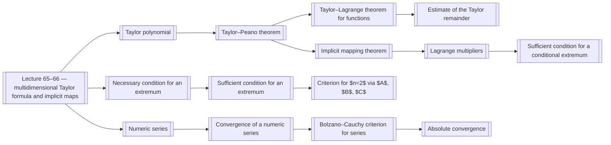

# 00 Map (MOC)

Map of semester 3: lectures and concepts. Every concept is a separate note; the lectures link to them, so the graph is connected.

## Semester 3

- [[Lecture 65–66 — multidimensional Taylor formula and implicit maps]] — multidimensional Taylor formula, Taylor–Peano, Taylor–Lagrange, implicit function, extrema
- [[Lecture 67–68 — extrema, conditional extrema and numeric series]] — extrema, numeric series, convergent and divergent series, Cauchy, d’Alembert
- [[Lecture 65–66 — multidimensional Taylor formula and implicit maps#Outline]] — jump to the outline
- [[Lecture 67–68 — extrema, conditional extrema and numeric series#Outline]] — jump to the outline

### Taylor formula

| Type | Concept | Pages |
|---|---|---|
| definition | [[Multi-index]] | p001 |
| definition | [[Taylor polynomial]] | p001, p002 |
| theorem | [[Uniqueness of the Taylor polynomial]] | p002 |
| lemma | [[Lemma 6.5.1]] | p003, p004 |
| theorem | [[Taylor–Peano theorem]] | p004 |
| theorem | [[Taylor–Lagrange theorem for functions]] | p005, p006 |
| theorem | [[Mean value theorem]] | p006 |
| theorem | [[Taylor–Lagrange theorem for maps]] | p007 |
| theorem | [[Estimate of the Taylor remainder]] | p006, p007 |

### Implicit maps

| Type | Concept | Pages |
|---|---|---|
| definition | [[Implicit function]] | p007, p008, p010 |
| theorem | [[Implicit mapping theorem]] | p009 |
| property | [[Differentiating an implicit map]] | p010 |

### Extrema

| Type | Concept | Pages |
|---|---|---|
| definition | [[Extremum points]] | p011 |
| theorem | [[Necessary condition for an extremum]] | p011, p012 |
| theorem | [[Sufficient condition for an extremum]] | p012 |
| definition | [[Definiteness of a quadratic form on a subspace]] | p017 |
| theorem | [[Criterion for $n=2$ via $A$, $B$, $C$]] | p013 |
| definition | [[Conditional extremum]] | p015 |
| theorem | [[Lagrange multipliers]] | p015, p016, p017 |
| property | [[Lagrange function]] | p017 |
| theorem | [[Sufficient condition for a conditional extremum]] | p018 |

### Numeric series

| Type | Concept | Pages |
|---|---|---|
| definition | [[Numeric series]] | p018 |
| definition | [[Convergence of a numeric series]] | p018, p019 |
| theorem | [[Properties of convergent series]] | p019, p020 |
| theorem | [[Bolzano–Cauchy criterion for series]] | p021 |
| definition | [[Absolute convergence]] | p021 |
| example | [[Harmonic series]] | p019 |

## Dependency diagram

## Other languages

- ru: `ru/00 Карта (MOC).md`
- es: `es/00 Mapa (MOC).md`
