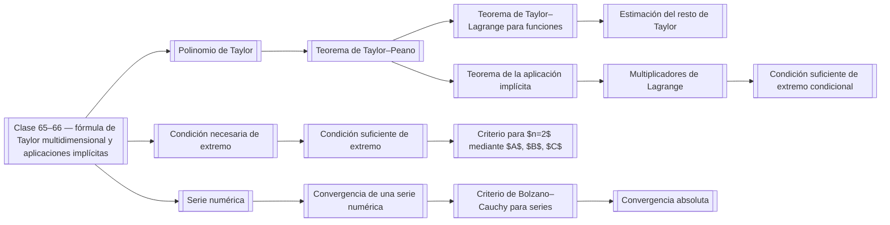

# 00 Mapa (MOC)

Mapa del semestre 3: clases y conceptos. Cada concepto es una nota aparte; las clases enlazan con ellas, por lo que el grafo es conexo.

## Semestre 3

- [[Clase 65–66 — fórmula de Taylor multidimensional y aplicaciones implícitas]] — fórmula de Taylor multidimensional, Taylor–Peano, Taylor–Lagrange, función implícita, extremos
- [[Clase 67–68 — extremos, extremos condicionales y series numéricas]] — extremos, series numéricas, series convergentes y divergentes, Cauchy, d’Alembert
- [[Clase 65–66 — fórmula de Taylor multidimensional y aplicaciones implícitas#Programa]] — ir al programa
- [[Clase 67–68 — extremos, extremos condicionales y series numéricas#Programa]] — ir al programa

### Fórmula de Taylor

| Tipo | Concepto | Páginas |
|---|---|---|
| definición | [[Multiíndice]] | p001 |
| definición | [[Polinomio de Taylor]] | p001, p002 |
| teorema | [[Unicidad del polinomio de Taylor]] | p002 |
| lema | [[Lema 6.5.1]] | p003, p004 |
| teorema | [[Teorema de Taylor–Peano]] | p004 |
| teorema | [[Teorema de Taylor–Lagrange para funciones]] | p005, p006 |
| teorema | [[Teorema del valor medio]] | p006 |
| teorema | [[Teorema de Taylor–Lagrange para aplicaciones]] | p007 |
| teorema | [[Estimación del resto de Taylor]] | p006, p007 |

### Aplicaciones implícitas

| Tipo | Concepto | Páginas |
|---|---|---|
| definición | [[Función implícita]] | p007, p008, p010 |
| teorema | [[Teorema de la aplicación implícita]] | p009 |
| propiedad | [[Derivación de la aplicación implícita]] | p010 |

### Extremos

| Tipo | Concepto | Páginas |
|---|---|---|
| definición | [[Puntos de extremo]] | p011 |
| teorema | [[Condición necesaria de extremo]] | p011, p012 |
| teorema | [[Condición suficiente de extremo]] | p012 |
| definición | [[Definición de una forma cuadrática en un subespacio]] | p017 |
| teorema | [[Criterio para $n=2$ mediante $A$, $B$, $C$]] | p013 |
| definición | [[Extremo condicional]] | p015 |
| teorema | [[Multiplicadores de Lagrange]] | p015, p016, p017 |
| propiedad | [[Función de Lagrange]] | p017 |
| teorema | [[Condición suficiente de extremo condicional]] | p018 |

### Series numéricas

| Tipo | Concepto | Páginas |
|---|---|---|
| definición | [[Serie numérica]] | p018 |
| definición | [[Convergencia de una serie numérica]] | p018, p019 |
| teorema | [[Propiedades de las series convergentes]] | p019, p020 |
| teorema | [[Criterio de Bolzano–Cauchy para series]] | p021 |
| definición | [[Convergencia absoluta]] | p021 |
| ejemplo | [[Serie armónica]] | p019 |

## Diagrama de dependencias

## Otros idiomas

- ru: `ru/00 Карта (MOC).md`
- en: `en/00 Map (MOC).md`
