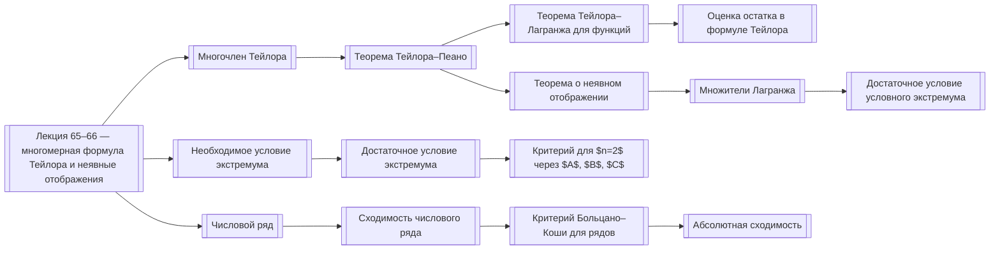

# 00 Карта (MOC)

Карта связей семестра 3: лекции и понятия. Каждое понятие — отдельная заметка; лекции ссылаются на них, поэтому граф связен.

## Семестр 3

- [[Лекция 65–66 — многомерная формула Тейлора и неявные отображения]] — многомерная формула Тейлора, Тейлор–Пеано, Тейлор–Лагранж, неявная функция, экстремумы
- [[Лекция 67–68 — экстремумы, условный экстремум и числовые ряды]] — экстремумы, числовые ряды, сходящиеся и расходящиеся ряды, Коши, Даламбер
- [[Лекция 65–66 — многомерная формула Тейлора и неявные отображения#Программа]] — перейти к программе
- [[Лекция 67–68 — экстремумы, условный экстремум и числовые ряды#Программа]] — перейти к программе

### Формула Тейлора

| Тип | Понятие | Страницы |
|---|---|---|
| определение | [[Мультииндекс]] | p001 |
| определение | [[Многочлен Тейлора]] | p001, p002 |
| теорема | [[Единственность многочлена Тейлора]] | p002 |
| лемма | [[Лемма 6.5.1]] | p003, p004 |
| теорема | [[Теорема Тейлора–Пеано]] | p004 |
| теорема | [[Теорема Тейлора–Лагранжа для функций]] | p005, p006 |
| теорема | [[Теорема о среднем]] | p006 |
| теорема | [[Теорема Тейлора–Лагранжа для отображений]] | p007 |
| теорема | [[Оценка остатка в формуле Тейлора]] | p006, p007 |

### Неявные отображения

| Тип | Понятие | Страницы |
|---|---|---|
| определение | [[Неявная функция]] | p007, p008, p010 |
| теорема | [[Теорема о неявном отображении]] | p009 |
| свойство | [[Дифференцирование неявного отображения]] | p010 |

### Экстремумы

| Тип | Понятие | Страницы |
|---|---|---|
| определение | [[Точки экстремума]] | p011 |
| теорема | [[Необходимое условие экстремума]] | p011, p012 |
| теорема | [[Достаточное условие экстремума]] | p012 |
| определение | [[Определённость квадратичной формы на подпространстве]] | p017 |
| теорема | [[Критерий для $n=2$ через $A$, $B$, $C$]] | p013 |
| определение | [[Условный экстремум]] | p015 |
| теорема | [[Множители Лагранжа]] | p015, p016, p017 |
| свойство | [[Функция Лагранжа]] | p017 |
| теорема | [[Достаточное условие условного экстремума]] | p018 |

### Числовые ряды

| Тип | Понятие | Страницы |
|---|---|---|
| определение | [[Числовой ряд]] | p018 |
| определение | [[Сходимость числового ряда]] | p018, p019 |
| теорема | [[Свойства сходящихся рядов]] | p019, p020 |
| теорема | [[Критерий Больцано–Коши для рядов]] | p021 |
| определение | [[Абсолютная сходимость]] | p021 |
| пример | [[Гармонический ряд]] | p019 |

## Схема зависимостей

## Другие языки

- en: `en/00 Map (MOC).md`
- es: `es/00 Mapa (MOC).md`
