# 00 Карта (MOC)

Карта связей семестра 3: лекции 65–84 и понятия. Каждое понятие — отдельная заметка; лекции встраивают их, поэтому граф связен.

## Лекции 65–84

- [[Лекция 65–66]] — Многомерный полином Тейлора, формулы Тейлора, неявные отображения, экстремумы
- [[Лекция 67–68]] — Условия экстремума, числовые ряды и абсолютная сходимость
- [[Лекция 69–70]] — Свойства рядов, признаки сравнения, признак Лейбница, перестановки
- [[Лекция 71–72]] — Равномерная сходимость, предельный переход, функциональные ряды
- [[Лекция 73–74]] — Степенные ряды, формула Коши–Адамара, теорема Абеля
- [[Лекция 75–76]] — Ряд Тейлора, аналитические функции, интегралы с параметром
- [[Лекция 77–78]] — Несобственные интегралы, признаки сходимости, метод Фейнмана
- [[Лекция 79–80]] — Гамма- и бета-функции, кратные интегралы
- [[Лекция 81–82]] — Критерий Лебега, интеграл по множеству, суммы Дарбу
- [[Лекция 83–84]] — Достаточность критерия Лебега, свойства интеграла, теорема Фубини

- [[Лекция 65–66 — многомерная формула Тейлора и неявные отображения]]
- [[Лекция 67–68 — экстремумы, условный экстремум и числовые ряды]]

## Понятия по темам

### Ряды и равномерная сходимость

| Тип | Понятие | Страницы |
|---|---|---|
| теорема | [[Первый признак сравнения положительных рядов]] | p023 |
| теорема | [[Второй признак сравнения положительных рядов]] | p024 |
| теорема | [[Признак сходимости Даламбера]] | p025 |
| лемма | [[Лемма Коши]] | p026 |
| теорема | [[Признак Лейбница]] | p027 |
| определение | [[Перестановка ряда (Опр 7.5.1)]] | p029 |
| свойство | [[Переместительные свойства рядов]] | p029, p030 |
| определение | [[Равномерная сходимость (Опр 8.1.1)]] | p031 |
| определение | [[Равномерное уклонение (Опр 8.3)]] | p034 |
| теорема | [[Теорема 8.2.1 (о непрерывности предельной функции)]] | p034, p035 |
| теорема | [[Теорема 8.2.2 (предельный переход под знаком интеграла)]] | p036 |
| теорема | [[Теорема 8.2.3 (о дифференцировании предельной функции)]] | p038 |
| определение | [[Функциональный ряд (Опр 8.3.1)]] | p038 |
| теорема | [[Признак Вейерштрасса для рядов]] | p040 |
| теорема | [[Теорема 8.3.1 (непрерывность суммы ряда)]] | p041 |
| теорема | [[Теорема 8.3.2 (интегрирование рядов)]] | p042 |
| теорема | [[Теорема 8.3.3 (дифференцирование рядов)]] | p044 |

### Степенные ряды и ряд Тейлора

| Тип | Понятие | Страницы |
|---|---|---|
| определение | [[Степенной ряд (Опр 8.4.1)]] | p045 |
| определение | [[Радиус сходимости (Опр 8.4.2)]] | p045 |
| теорема | [[Формула Коши – Адамара (Теорема 8.4.1)]] | p046 |
| свойство | [[Интервал сходимости]] | p046 |
| метод | [[Радиус сходимости по признаку Даламбера]] | p047 |
| теорема | [[Теорема 8.4.2 (равномерная сходимость степенных рядов)]] | p047, p048 |
| теорема | [[Теорема Абеля о степенных рядах (8.4.3)]] | p048, p049 |
| теорема | [[Теорема 8.4.4 (интегрирование степенных рядов)]] | p050, p051 |
| теорема | [[Теорема 8.4.5 (о радиусах степенных рядов)]] | p051 |
| теорема | [[Теорема 8.4.6 (дифференцирование степенных рядов)]] | p051, p052 |
| теорема | [[Теорема 8.4.7 (единственность разложения)]] | p052 |
| определение | [[Ряд Тейлора (Опр 8.4.3)]] | p053 |
| определение | [[Многочлен Тейлора функции]] | p053 |
| теорема | [[Теорема 8.4.8 (разложимость в ряд Тейлора)]] | p053, p054 |
| определение | [[Аналитическая функция (Опр 8.4.4)]] | p054 |

### Интегралы, зависящие от параметра

| Тип | Понятие | Страницы |
|---|---|---|
| определение | [[Интеграл, зависящий от параметра (Опр 9.1.1)]] | p056 |
| теорема | [[Теорема 9.1.1 (непрерывность по параметру)]] | p056 |
| теорема | [[Теорема 9.1.2 (дифференцирование по параметру)]] | p057 |
| теорема | [[Теорема 9.1.3 (интегрирование интеграла по параметру)]] | p058 |
| определение | [[Равномерная сходимость несобственного интеграла (Опр 9.2.1)]] | p059 |
| теорема | [[Критерий Больцано – Коши для несобственных интегралов]] | p060 |
| теорема | [[Признак Вейерштрасса для несобственных интегралов]] | p060 |
| теорема | [[Признак Дирихле для несобственных интегралов]] | p061, p062 |
| теорема | [[Признак Абеля для несобственных интегралов]] | p062, p063 |
| теорема | [[Теорема 9.2.1 (непрерывность несобственного интеграла)]] | p065 |
| теорема | [[Теорема 9.2.2 (дифференцирование несобственного интеграла)]] | p065 |
| теорема | [[Теорема 9.2.3 (интегрирование несобственного интеграла)]] | p065 |
| метод | [[Метод Фейнмана вычисления интегралов]] | p066 |

### Гамма- и бета-функции

| Тип | Понятие | Страницы |
|---|---|---|
| определение | [[Гамма-функция (Опр 9.3.1)]] | p067 |
| свойство | [[Свойства гамма-функции]] | p067, p070 |
| определение | [[Бета-функция Эйлера]] | p070 |
| теорема | [[Связь бета- и гамма-функции]] | p070 |
| пример | [[Пример: интеграл от синуса и косинуса]] | p071 |

### Кратные интегралы

| Тип | Понятие | Страницы |
|---|---|---|
| определение | [[Промежуток в R^n (Опр 10.1.1)]] | p071 |
| определение | [[Мера промежутка (Опр 10.1.2)]] | p071 |
| определение | [[Разбиение промежутка (Опр 10.1.3)]] | p072 |
| определение | [[Разбиение с отмеченными точками (Опр 10.1.4)]] | p073 |
| определение | [[Интегральная сумма (Опр 10.1.5)]] | p073 |
| определение | [[Интеграл Римана по промежутку (Опр 10.1.6)]] | p073 |
| определение | [[Интегрируемая по Риману функция (Опр 10.1.7)]] | p073 |
| теорема | [[Теорема 10.1.1 (необходимое условие интегрируемости)]] | p073, p074 |
| определение | [[Почти всюду (Опр 10.1.8)]] | p074 |
| теорема | [[Критерий Лебега (Теорема 10.1.2)]] | p075, p077 |
| определение | [[Интегральные суммы Дарбу (Опр 10.1.9, 10.1.10)]] | p079 |
| теорема | [[Критерий Дарбу (Теорема 10.1.13)]] | p079 |
| определение | [[Допустимое множество (Опр 10.2.1)]] | p078 |
| определение | [[Характеристическая функция (Опр 10.2.2)]] | p078 |
| определение | [[Мера (объём) Жордана (Опр 10.2.5)]] | p080 |
| определение | [[Множество меры нуль по Жордану (Опр 10.2.6)]] | p080 |
| определение | [[Интеграл по множеству (Опр 10.2.3, 10.2.4)]] | p078, p081 |
| теорема | [[Теорема 10.3.1 (аддитивность интеграла)]] | p082 |
| теорема | [[Оценка интеграла (Утв 10.3.1)]] | p082 |

### Теорема Фубини и лекции 83–84

| Тип | Понятие | Страницы |
|---|---|---|
| теорема | [[Достаточность критерия Лебега (Утв)]] | p091–p101 |
| свойство | [[Свойства интеграла (1)–(6)]] | p086–p105 |
| теорема | [[Свойство 4 (среднее значение)]] | p087–p087 |
| теорема | [[Свойство 5 (среднее значение для непрерывной функции)]] | p087–p087 |
| свойство | [[Свойство 6 (оценка интеграла от произведения)]] | p087–p087 |
| теорема | [[Теорема Фубини (10.4.1)]] | p088–p116 |
| определение | [[Повторный (итерированный) интеграл]] | p106–p107 |
| метод | [[Сведение доказательства Фубини к суммам Дарбу]] | p110–p116 |
| теорема | [[Следствие 10.4.1 (сведение к повторным)]] | p089–p089 |
| теорема | [[Следствие 10.4.2 (множество между графиками)]] | p090–p124 |
| определение | [[Обозначения: двойной и тройной интегралы]] | p117–p118 |
| пример | [[Пример: вычисление тройного интеграла]] | p119–p121 |

### Понятия части 1

- [[Абсолютная сходимость]]
- [[Гармонический ряд]]
- [[Дифференцирование неявного отображения]]
- [[Достаточное условие условного экстремума]]
- [[Достаточное условие экстремума]]
- [[Единственность многочлена Тейлора]]
- [[Критерий Больцано–Коши для рядов]]
- [[Критерий для $n=2$ через $A$, $B$, $C$]]
- [[Лемма 6.5.1]]
- [[Многочлен Тейлора]]
- [[Множители Лагранжа]]
- [[Мультииндекс]]
- [[Необходимое условие экстремума]]
- [[Неявная функция]]
- [[Определённость квадратичной формы на подпространстве]]
- [[Оценка остатка в формуле Тейлора]]
- [[Свойства сходящихся рядов]]
- [[Сходимость числового ряда]]
- [[Теорема Тейлора–Лагранжа для отображений]]
- [[Теорема Тейлора–Лагранжа для функций]]
- [[Теорема Тейлора–Пеано]]
- [[Теорема о неявном отображении]]
- [[Теорема о среднем]]
- [[Точки экстремума]]
- [[Условный экстремум]]
- [[Функция Лагранжа]]
- [[Числовой ряд]]

## Схема зависимостей

```mermaid
flowchart LR
    N0["Функциональный ряд (Опр 8.3.1)"] --> N1
    N1["Степенной ряд (Опр 8.4.1)"] --> N2
    N2["Формула Коши – Адамара (Теорема 8.4.1)"] --> N3
    N3["Теорема Абеля о степенных рядах (8.4.3)"] --> N4
    N4["Ряд Тейлора (Опр 8.4.3)"] --> N5
    N5["Интеграл, зависящий от параметра (Опр 9.1.1)"] --> N6
    N6["Метод Фейнмана вычисления интегралов"] --> N7
    N7["Гамма-функция (Опр 9.3.1)"] --> N8
    N8["Промежуток в R^n (Опр 10.1.1)"] --> N9
    N9["Интеграл Римана по промежутку (Опр 10.1.6)"] --> N10
    N10["Критерий Лебега (Теорема 10.1.2)"] --> N11
    N11["Теорема Фубини (10.4.1)"] --> N12
    N12["Следствие 10.4.2 (множество между графиками)"]
```

## Другие языки

- en: `en/00 Map (MOC).md`
- es: `es/00 Mapa (MOC).md`
