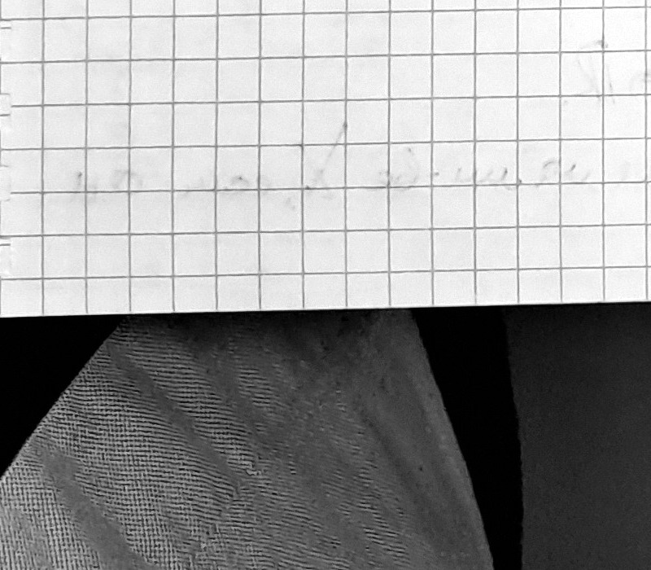

❷ $f_n(x)=nx(1-x^2)^n$, $x\in[0,1]$
$f_n$ поточечно сходится к 0 на $[0,1]$
$\int_0^1 f_n=n\int_0^1 x(1-x^2)^n\,dx=\dfrac{n}{2(n+1)}\xrightarrow[n\to\infty]{}1/2$ ⟦S139⟧

❸ $f_n(x)=x^n$ на $[0,1]$
Предельная функция $f(x)=\begin{cases}0, & x\in[0,1)\\1, & x=1\end{cases}$

$\sup\limits_{[0,1]}|f_n-f|=\sup\limits_{[0,1]}x^n=1\ne0\Rightarrow f_n\ne\rightrightarrows0$ на $[0,1]$.

Но! Для любого $q\in(0,1)$
$\sup\limits_{[0,q]}|f_n-f|=\sup\limits_{[0,q]}x^n=q^n\xrightarrow[n\to\infty]{}0$
Поэтому $f_n\rightrightarrows0$ на $[0,q]$. ⟦S140⟧

❹ $f_n:[0,1]\to\mathbb{R}$
$f_n(x)=\begin{cases}0, & x>\dfrac{1}{n}\\ ?[?], & x\in(0,1/n)\\ 0, & x=0\end{cases}$ ⟦U141⟧

> margin: [слева от ❹ — график: оси; треугольный «зубец» с основанием $[0,1/n]$, вершиной высоты $n$; подпись по оси ординат $n$] ⟦G142⟧
