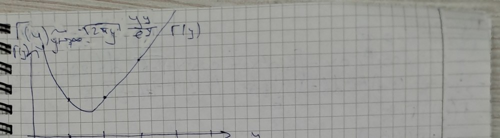

> margin: [сверху] $\Gamma(y)\sim\sqrt{2\pi y}\,\dfrac{y^y}{e^y}$ — $\Gamma(y)$

> margin: [график $\Gamma(y)$: ось $y$ с отметками 1, 2, 3, 4, 5; минимум между 1 и 2, точки на кривой] ⟦G350⟧

⑩ $\Gamma(y)=\int_0^\infty x^{y-1}e^{-x}\,dx=[x=bu,\ b>0,\ dx=b\,du]=$

$=b^y\int_0^\infty u^{y-1}e^{-ub}\,du\Rightarrow$

$\Rightarrow$ формула Эйлера: $\dfrac{\Gamma(y)}{b^y}=\int_0^\infty u^{y-1}e^{-ub}\,du$

⑨ Скл. ⟦U351⟧

Возьмем $y,z>0$ и сделаем замену $y\mapsto y+z$, $b\mapsto b+1$

$\dfrac{\Gamma(y+z)}{(b+1)^{y+z}}=\int_0^\infty t^{y+z-1}e^{-(b+1)t}\,dt=\int_0^\infty\left(\int_0^\infty u^{y-1}e^{-ub}\,t^{y+z-1}e^{-t}\,du\right)dt$ ⟦M352⟧

$=\int_0^\infty u^{y-1}e^{-ub}\left(\int_0^\infty t^{y+z-1}e^{-ut}\,dt\right)du=\int u^{y-1}e^{-ub}\dfrac{\Gamma(y+z)}{u^{y+z}}\,du=$

$\Rightarrow\dfrac{\Gamma(y+z)}{\Gamma(z)}\int_0^\infty\dfrac{b^{z-1}}{(b+1)^{y+z}}\,db=\ldots=B(y,z)-$ ⟦U353⟧

$\left[b+1=\dfrac{1}{1-x},\ b+1=\dfrac1{1-x},\ db=\dfrac{dx}{(1-x)^2}\right]$

$=\int_0^1\dfrac{x^{y-1}-(1-x)^{y+z}}{(1-x)^2}=\int_0^1x^{y-1}(1-x)^{z-1}\,dx=:B(y,z)-$

$=$ Второв интеграл ⟦U354⟧

$B(y,z)=\int_0^1x^{y-1}(1-x)^{z-1}\,dx=\dfrac{\Gamma(y)\Gamma(z)}{\Gamma(y+z)}$
