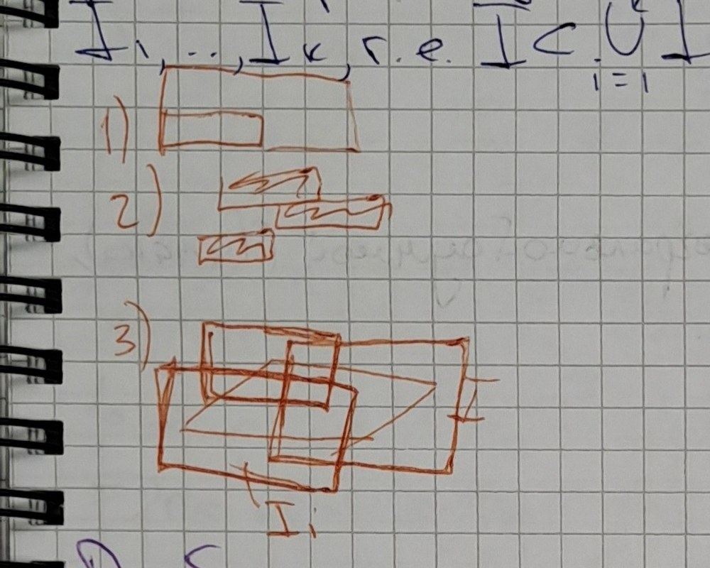

<u>Св-ва меры промежутка</u>

Мера промежутка в $\mathbb{R}^n$:

- однородна, т.е. $\forall\lambda>0\ \mu(I_{\lambda a,\lambda b})=\lambda^n\mu(I_{a,b})$ ⟦A358⟧
- аддитивна, т.е. если промежутки $I,I_1,\ldots,I_k$ таковы, что
  $I=\bigcup_{i=1}^kI_i$, $I_i\cap I_j=\varnothing$, то $\mu(I)=\sum\limits_{i=1}^k\mu(I_i)$
- если промежуток $I$ покрыт конечной системой прямоугольников
  $I_1,\ldots,I_k$, т.е. $I\subset\bigcup_{i=1}^kI_i$, то $\mu(I)\le\sum\limits_{i=1}^k\mu(I_i)$

> margin: [три маленьких рисунка: 1) промежуток; 2) промежуток с наложением; 3) покрытие прямоугольниками] ⟦G359⟧

<u>Разбиение промежутка</u>

Раздр прямоуг-ка $I_{a,b}$. Разбиения координатных отрезков $[a_i,b_i]=I_i$,
индуцируют разбиение $I$ на более мелкие промежутки, получающиеся,
если взять проф-ия разбиений промежутков разбиения указанных коор-
динатных отрезков ⟦U360⟧

<u>Опр (10.1.3)</u>

Описанное выше представление промежутка $I$ (в виде объединения
$I=\bigcup_{j=1}^kI_j$ более мелких прямоуг-ков $I_j$) будем наз. разбиением про-
межутка $I$ и обознач. символом $P$. ⟦S361⟧

> margin: [рисунок: прямоугольник, разбитый сеткой, $n=2$] $n=2$, partition — разбиение ⟦G362⟧

<u>Разбиение с отмеченными точками</u>

> margin: [рисунок: прямоугольник с точками внутри ячеек] оснащение ⟦G363⟧
