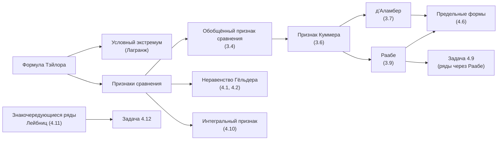

# NM-204 — Математический анализ · карта курса

> [!abstract] О заметке
> Карта (Map of Content) домашних заданий по дисциплине «Математический анализ», NM-204, 2026 г.
> Все заметки набраны в Obsidian Markdown с формулами LaTeX/MathJax (рендерятся ядром Obsidian без плагинов).

## Задания

| Задание | Заметка | Темы | Задач |
| :-- | :-- | :-- | :--: |
| HW 1 | [[NM-204 HW1 - Ряды Тэйлора]] | ряд Тэйлора, остаток Лагранжа | 4 |
| HW 2 | [[NM-204 HW2 - Условный экстремум]] | условный экстремум, Лагранж | 5 |
| HW 3 | [[NM-204 HW3 - Числовые ряды]] | частичные суммы, Куммер, д'Аламбер, Раабе | 16 |
| HW 4 | [[NM-204 HW4 - Ряды, неравенства и базы]] | Гёльдер, базы, интегральный признак, Лейбниц | 22 |

## Сквозная нумерация задач

Задачи переиспользуются между заданиями под одними и теми же номерами, поэтому удобно держать «сквозной» указатель.

| Блок | Задачи | Где встречаются |
| :-- | :-- | :-- |
| Ряды Тэйлора | 1.1, 1.2, 1.3, 1.4 | HW 1; 1.2 и 1.4 повторяются в HW 2, HW 3, HW 4 |
| Условный экстремум | 2.1, 2.2, 2.3; 2'.1, 2'.2, 2'.3 | HW 2 (2.1–2.3), HW 3 и HW 4 (2.2 и 2'-серия) |
| Числовые ряды | 3.1 … 3.11 | HW 3 (полностью), HW 4 (1.2, 2.2, 2'.1–2'.3, 3.1–3.3, 3.10, 3.11) |
| Неравенства, базы, признаки | 4.1 … 4.12 | HW 4 |

## Идейный стержень курса

## Формулы-опоры

**Формула Тэйлора с остатком Лагранжа** (для $f \in C^{k+1}$ в окрестности $x_0$):

$$
f(x_0 + h) = \sum_{j=0}^{k} \frac{d^{j} f(x_0; h)}{j!} + \frac{d^{k+1} f(x_0 + \theta h;\, h)}{(k+1)!}, \qquad \theta \in (0,1).
$$

**Признак Куммера** (задача 3.6): если $a_n, x_n > 0$ финально и

$$
x_n \frac{a_n}{a_{n+1}} - x_{n+1} \geqslant \alpha > 0 ,
$$

то $\sum a_k$ сходится; если же $\sum \frac{1}{x_k}$ расходится и левая часть $\leqslant 0$, то $\sum a_k$ расходится.

**Признак Раабе** (задача 3.9): сходимость при $\dfrac{a_n}{a_{n+1}} \geqslant 1 + \dfrac{1+\gamma}{n}$ $(\gamma>0)$, расходимость при $\dfrac{a_n}{a_{n+1}} \leqslant 1 + \dfrac{1}{n}$.

**Неравенство Гёльдера** (задача 4.2), $\frac{1}{p} + \frac{1}{p'} = 1$:

$$
\sum_{k=1}^{n} a_k b_k \leqslant \left(\sum_{k=1}^{n} a_k^{p}\right)^{1/p}\left(\sum_{k=1}^{n} b_k^{p'}\right)^{1/p'} .
$$

**Интегральный признак** (задача 4.10), $f$ неотрицательна и не возрастает:

$$
\sum_{k=1}^{+\infty} f(k) \ \text{сходится} \iff \int_{N_0}^{+\infty} f(x)\,dx \ \text{сходится}.
$$

## Источники

| Файл | Содержит | Использован в заметке |
| :-- | :-- | :-- |
| `HW 1 (2026 Analysis_ NM-204).pdf` | задачи 1.1–1.4, 2 с. | [[NM-204 HW1 - Ряды Тэйлора]] |
| `HW 2 (2026 Analysis_ NM-204).pdf` | 1.2, 1.4, 2.1–2.3, 2 с. | [[NM-204 HW2 - Условный экстремум]] |
| `HW 3 (2026 Analysis; NM-204) (1).pdf` | 1.2, 2.2, 2'.1–2'.3, 3.1–3.11, 8 с. | [[NM-204 HW3 - Числовые ряды]] |
| `HW 3 (2026 Analysis; NM-204).pdf` | то же без 2'-серии и с обрезанной 3.11, 7 с. | не использован (неполная версия) |
| `HW 4 (2026 Analysis; NM-204) (1).pdf` | старые задачи + 4.1–4.12, 11 с. | [[NM-204 HW4 - Ряды, неравенства и базы]] |

> [!note] Замечание о наборе
> PDF-файлы используют нестандартную кириллическую кодировку шрифта, поэтому исходный текст извлечён с потерей части математических символов. Формулы восстановлены и набраны в LaTeX; спорные места помечены в разделах «Расхождения» соответствующих заметок. Опечатки источника («k = 1» вместо «m = 1», «$(1+\infty)$» вместо «$(1;+\infty)$», дважды использованное $\mathcal{M}_{7,x_0}$) сохранены в примечаниях, но не в тексте условий.

## Статус

- [x] HW 1 — перенесено в Obsidian
- [x] HW 2 — перенесено в Obsidian
- [x] HW 3 — перенесено в Obsidian (по полной версии)
- [x] HW 4 — перенесено в Obsidian
- [ ] написать решения
