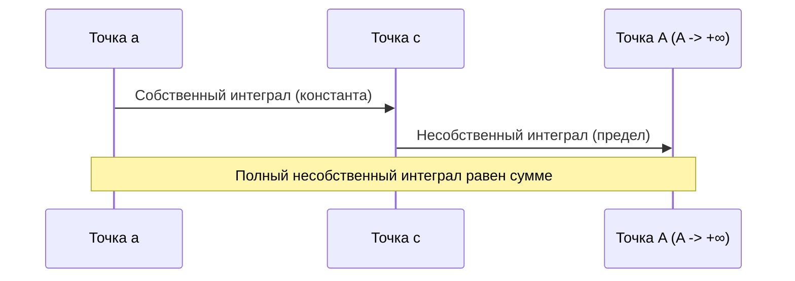

---
tags:
  - матанализ
  - 1_курс
  - подготовка_к_экзамену
тип: конспект
статус: готов
---

# Вопрос №28. Неравенства Коши-Буняковского и Минковского для интегралов.

> [!abstract] Геометрический смысл
> Неравенство Коши-Буняковского является бесконечномерным аналогом оценки скалярного произведения векторов через их длины: $|\langle \vec{a}, \vec{b} \rangle| \le |\vec{a}| |\vec{b}|$. В пространстве интегрируемых функций интегрирование произведения заменяет сумму произведений координат. 
> Неравенство Минковского (для $p=2$) — это прямое следствие, представляющее собой неравенство треугольника для функций: "длина" суммы двух "векторов-функций" не превосходит суммы их "длин".

> [!theorem] Неравенство Коши-Буняковского для интегралов
> Пусть функции $f(x)$ и $g(x)$ интегрируемы по Риману на отрезке $[a, b]$, то есть $f, g \in \mathcal{R}[a,b]$. Тогда их произведение $f(x)g(x)$ и квадраты $f^2(x)$, $g^2(x)$ также интегрируемы на $[a, b]$, и справедливо неравенство:
> $$ \left( \int_a^b f(x)g(x) dx \right)^2 \le \left( \int_a^b f^2(x) dx \right) \left( \int_a^b g^2(x) dx \right) $$

> [!proof]+ Доказательство (Неравенство Коши-Буняковского)
> 1. Интегрируемость произведений $f \cdot g$, $f^2$ и $g^2$ следует из теоремы об интегрируемости произведения функций, интегрируемых по Риману (поскольку пространство $\mathcal{R}[a,b]$ образует алгебру).
> 2. Рассмотрим вспомогательную функцию от вещественной переменной $\lambda \in \mathbb{R}$:
> $$ P(\lambda) = \int_a^b (f(x) + \lambda g(x))^2 dx $$
> 3. Поскольку подынтегральная функция $(f(x) + \lambda g(x))^2 \ge 0$ для любых $x \in [a,b]$ и $\lambda \in \mathbb{R}$, то по свойству монотонности интеграла Римана:
> $$ P(\lambda) \ge 0 \quad \text{для всех } \lambda \in \mathbb{R} $$
> 4. Раскроем квадрат под интегралом и воспользуемся свойством линейности интеграла:
> $$ P(\lambda) = \int_a^b \left( f^2(x) + 2\lambda f(x)g(x) + \lambda^2 g^2(x) \right) dx $$
> $$ P(\lambda) = \left( \int_a^b g^2(x) dx \right) \lambda^2 + 2 \left( \int_a^b f(x)g(x) dx \right) \lambda + \left( \int_a^b f^2(x) dx \right) $$
> 5. Введем обозначения:
> $$ A = \int_a^b g^2(x) dx, \qquad B = \int_a^b f(x)g(x) dx, \qquad C = \int_a^b f^2(x) dx $$
> Таким образом, $P(\lambda) = A\lambda^2 + 2B\lambda + C \ge 0$.
> 6. Возможны два случая:
> **Случай 1:** $A = 0$. Тогда $\int_a^b g^2(x) dx = 0$. Если при этом $B \neq 0$, то линейная функция $2B\lambda + C$ принимала бы значения разных знаков при изменении $\lambda$, что противоречит $P(\lambda) \ge 0$. Следовательно, $B = 0$. Неравенство Коши-Буняковского принимает вид $0 \le 0 \cdot C$, что является верным.
> **Случай 2:** $A > 0$. Квадратный трехчлен не меняет знак (всегда неотрицателен), следовательно, его дискриминант (или четверть дискриминанта) неположителен:
> $$ \frac{D}{4} = B^2 - AC \le 0 $$
> Перенося $AC$ в правую часть, получаем:
> $$ B^2 \le AC $$
> Подставляя обратно интегралы:
> $$ \left( \int_a^b f(x)g(x) dx \right)^2 \le \left( \int_a^b f^2(x) dx \right) \left( \int_a^b g^2(x) dx \right) $$
> Что и требовалось доказать.

> [!theorem] Неравенство Минковского для интегралов (норма $L_2$)
> Пусть $f, g \in \mathcal{R}[a,b]$. Тогда справедливо неравенство:
> $$ \sqrt{\int_a^b (f(x) + g(x))^2 dx} \le \sqrt{\int_a^b f^2(x) dx} + \sqrt{\int_a^b g^2(x) dx} $$

> [!proof]+ Доказательство (Неравенство Минковского)
> 1. Рассмотрим интеграл от квадрата суммы и применим линейность интеграла:
> $$ \int_a^b (f(x) + g(x))^2 dx = \int_a^b \left( f^2(x) + 2f(x)g(x) + g^2(x) \right) dx $$
> $$ \int_a^b (f(x) + g(x))^2 dx = \int_a^b f^2(x) dx + 2\int_a^b f(x)g(x) dx + \int_a^b g^2(x) dx $$
> 2. Оценим среднее слагаемое, используя свойства модуля и только что доказанное неравенство Коши-Буняковского:
> $$ \int_a^b f(x)g(x) dx \le \left| \int_a^b f(x)g(x) dx \right| \le \sqrt{\int_a^b f^2(x) dx} \cdot \sqrt{\int_a^b g^2(x) dx} $$
> 3. Подставим эту оценку в исходное выражение:
> $$ \int_a^b (f(x) + g(x))^2 dx \le \int_a^b f^2(x) dx + 2\sqrt{\int_a^b f^2(x) dx}\sqrt{\int_a^b g^2(x) dx} + \int_a^b g^2(x) dx $$
> 4. Заметим, что правая часть представляет собой полный квадрат суммы:
> $$ \int_a^b (f(x) + g(x))^2 dx \le \left( \sqrt{\int_a^b f^2(x) dx} + \sqrt{\int_a^b g^2(x) dx} \right)^2 $$
> 5. Извлекая арифметический квадратный корень из обеих частей (что законно, так как обе части неотрицательны), получаем требуемое неравенство Минковского.

> [!warning] Важное замечание
> Равенство в неравенстве Коши-Буняковского достигается тогда и только тогда, когда функции $f(x)$ и $g(x)$ линейно зависимы *почти всюду* (в терминах первого курса — отличаются не более чем на множестве точек лебеговой меры нуль; для непрерывных функций — если $\exists \alpha, \beta \in \mathbb{R}, |\alpha|+|\beta|>0: \alpha f(x) + \beta g(x) \equiv 0$).

---

# Вопрос №29. Несобственные интегралы и их свойства.

> [!abstract] Физический смысл
> Работа силы при перемещении тела на бесконечное расстояние или вычисление массы бесконечно длинного стержня с затухающей плотностью. Если предел существует, мы говорим, что бесконечный процесс дает конечное накопление (сходимость).

> [!definition] Несобственный интеграл первого рода (по бесконечному промежутку)
> Пусть функция $f(x)$ определена на полуинтервале $[a, +\infty)$ и интегрируема по Риману (т.е. $f \in \mathcal{R}[a, A]$) на любом конечном отрезке $[a, A]$, где $A > a$.
> **Несобственным интегралом первого рода** от функции $f$ по промежутку $[a, +\infty)$ называется [[Предел функции|предел]]:
> $$ \int_a^{+\infty} f(x) dx = \lim_{A \to +\infty} \int_a^A f(x) dx $$
> Если этот предел существует и конечен, говорят, что несобственный интеграл **сходится**. Если предел не существует или равен бесконечности, интеграл **расходится**.

*(Примечание экзаменатора: Несобственные интегралы второго рода от неограниченной функции $f(x)$ на $[a,b)$ определяются аналогично: $\lim_{\varepsilon \to +0} \int_a^{b-\varepsilon} f(x) dx$. Все свойства ниже переносятся на них дословно.)*

> [!theorem] Базовые свойства несобственных интегралов
> Пусть интегралы $\int_a^{+\infty} f(x) dx$ и $\int_a^{+\infty} g(x) dx$ сходятся. Тогда:
> 1. **Линейность:** Для любых констант $\alpha, \beta \in \mathbb{R}$ сходится интеграл от линейной комбинации, и справедливо:
> $$ \int_a^{+\infty} (\alpha f(x) + \beta g(x)) dx = \alpha \int_a^{+\infty} f(x) dx + \beta \int_a^{+\infty} g(x) dx $$
> 2. **Монотонность:** Если $\forall x \ge a: f(x) \le g(x)$, то:
> $$ \int_a^{+\infty} f(x) dx \le \int_a^{+\infty} g(x) dx $$
> 3. **Интегрирование по частям:** Если $u(x), v(x)$ непрерывно дифференцируемы на $[a, +\infty)$ и существует конечный предел $\lim_{A \to +\infty} u(A)v(A)$, то сходимость интеграла $\int_a^{+\infty} u d(v)$ эквивалентна сходимости $\int_a^{+\infty} v d(u)$.

> [!proof]+ Доказательство (Линейность)
> Обозначим $F(A) = \int_a^A f(x) dx$ и $G(A) = \int_a^A g(x) dx$. По условию, существуют конечные пределы $\lim_{A \to +\infty} F(A) = I_f$ и $\lim_{A \to +\infty} G(A) = I_g$.
> Рассмотрим собственный [[Интеграл Римана]] на $[a, A]$ от линейной комбинации. В силу линейности определенного интеграла:
> $$ \int_a^A (\alpha f(x) + \beta g(x)) dx = \alpha F(A) + \beta G(A) $$
> Перейдем к пределу при $A \to +\infty$. По теореме о пределе линейной комбинации функций:
> $$ \lim_{A \to +\infty} \left( \alpha F(A) + \beta G(A) \right) = \alpha \lim_{A \to +\infty} F(A) + \beta \lim_{A \to +\infty} G(A) = \alpha I_f + \beta I_g $$
> Предел конечен, следовательно, несобственный интеграл сходится и равен $\alpha I_f + \beta I_g$.

> [!theorem] Критерий Коши сходимости несобственного интеграла
> Для того чтобы несобственный интеграл $\int_a^{+\infty} f(x) dx$ сходился, необходимо и достаточно, чтобы:
> $$ \forall \varepsilon > 0 \quad \exists B \ge a \quad \forall A_1, A_2 > B \implies \left| \int_{A_1}^{A_2} f(x) dx \right| < \varepsilon $$

> [!proof]+ Доказательство (Критерий Коши)
> Введем функцию верхнего предела $F(A) = \int_a^A f(x) dx$. По определению, сходимость несобственного интеграла равносильна существованию конечного предела $\lim_{A \to +\infty} F(A)$.
> Согласно [[Критерий Коши|критерию Коши существования предела функции]], предел $\lim_{A \to +\infty} F(A)$ существует тогда и только тогда, когда:
> $$ \forall \varepsilon > 0 \quad \exists B \ge a \quad \forall A_1, A_2 > B \implies |F(A_2) - F(A_1)| < \varepsilon $$
> Запишем разность $F(A_2) - F(A_1)$, предполагая без ограничения общности $A_2 > A_1$:
> $$ F(A_2) - F(A_1) = \int_a^{A_2} f(x) dx - \int_a^{A_1} f(x) dx $$
> По свойству аддитивности определенного интеграла Римана:
> $$ \int_a^{A_2} f(x) dx = \int_a^{A_1} f(x) dx + \int_{A_1}^{A_2} f(x) dx $$
> Отсюда $F(A_2) - F(A_1) = \int_{A_1}^{A_2} f(x) dx$. Подставляя это в неравенство критерия Коши для предела функции, получаем в точности формулировку теоремы:
> $$ \left| \int_{A_1}^{A_2} f(x) dx \right| < \varepsilon $$
> Доказательство завершено.

> [!warning] Важное замечание (Абсолютная и условная сходимость)
> Из сходимости $\int_a^{+\infty} f(x) dx$ **не следует** сходимость $\int_a^{+\infty} |f(x)| dx$. 
> Если сходится интеграл от модуля, интеграл называется **абсолютно сходящимся**. Если сам интеграл сходится, а интеграл от модуля расходится (например, $\int_1^{+\infty} \frac{\sin x}{x} dx$), он называется **условно сходящимся**. Сходимость абсолютно сходящегося интеграла строго доказывается через критерий Коши и неравенство $\left| \int_{A_1}^{A_2} f(x) dx \right| \le \left| \int_{A_1}^{A_2} |f(x)| dx \right|$.

---

# Вопрос №30. Аддитивность несобственного интеграла по промежутку. Остаток несобственного интеграла.

> [!theorem] Теорема об аддитивности несобственного интеграла
> Пусть функция $f \in \mathcal{R}[a, A]$ для любого $A > a$. Пусть задана точка $c > a$.
> Несобственный интеграл $\int_a^{+\infty} f(x) dx$ сходится тогда и только тогда, когда сходится несобственный интеграл $\int_c^{+\infty} f(x) dx$. 
> При этом в случае сходимости справедливо равенство:
> $$ \int_a^{+\infty} f(x) dx = \int_a^c f(x) dx + \int_c^{+\infty} f(x) dx $$

> [!proof]+ Доказательство (Аддитивность)
> 1. Зафиксируем произвольное $A > c$. Так как $f$ интегрируема на $[a, A]$, по свойству аддитивности собственного интеграла Римана:
> $$ \int_a^A f(x) dx = \int_a^c f(x) dx + \int_c^A f(x) dx $$
> 2. Заметим, что слагаемое $\int_a^c f(x) dx$ является числовой константой $C_0$, не зависящей от параметра $A$. Перепишем тождество:
> $$ \int_a^A f(x) dx = C_0 + \int_c^A f(x) dx $$
> 3. **Необходимость ($\implies$):** Пусть сходится интеграл $\int_a^{+\infty} f(x) dx$. Это означает существование конечного предела $\lim_{A \to +\infty} \int_a^A f(x) dx = I$.
> Выразим из тождества правый интеграл:
> $$ \int_c^A f(x) dx = \int_a^A f(x) dx - C_0 $$
> Перейдем к пределу при $A \to +\infty$:
> $$ \lim_{A \to +\infty} \int_c^A f(x) dx = \lim_{A \to +\infty} \int_a^A f(x) dx - C_0 = I - C_0 $$
> Так как $I$ и $C_0$ конечны, предел существует и конечен, следовательно, $\int_c^{+\infty} f(x) dx$ сходится.
> 4. **Достаточность ($\impliedby$):** Пусть сходится интеграл $\int_c^{+\infty} f(x) dx$. Это означает существование конечного предела $\lim_{A \to +\infty} \int_c^A f(x) dx = J$.
> Воспользуемся исходным тождеством и перейдем к пределу при $A \to +\infty$:
> $$ \lim_{A \to +\infty} \int_a^A f(x) dx = C_0 + \lim_{A \to +\infty} \int_c^A f(x) dx = C_0 + J $$
> Предел существует и конечен, интеграл $\int_a^{+\infty} f(x) dx$ сходится.
> 5. Тождество для самих интегралов прямо следует из предельного перехода в пункте 4:
> $$ \int_a^{+\infty} f(x) dx = \int_a^c f(x) dx + \int_c^{+\infty} f(x) dx $$
> Ч.т.д.

> [!definition] Остаток несобственного интеграла
> Пусть несобственный интеграл $\int_a^{+\infty} f(x) dx$ сходится. 
> Для любого $c > a$ **остатком несобственного интеграла** называется величина:
> $$ R_c = \int_c^{+\infty} f(x) dx $$

> [!abstract] Геометрический смысл остатка
> Если полный интеграл — это площадь бесконечной фигуры, то остаток $R_c$ — это площадь «хвоста» этой фигуры, начиная с точки $c$. При отодвигании отсечки $c$ в бесконечность, площадь оставшегося хвоста должна стремиться к нулю.

> [!theorem] Свойство остатка несобственного интеграла
> Несобственный интеграл $\int_a^{+\infty} f(x) dx$ сходится тогда и только тогда, когда существует его остаток $R_c$ при $c \to +\infty$ и выполняется предельное соотношение:
> $$ \lim_{c \to +\infty} R_c = 0 $$

> [!proof]+ Доказательство (Стремление остатка к нулю)
> 6. **Необходимость ($\implies$):** Пусть $\int_a^{+\infty} f(x) dx = I$ сходится.
> По теореме об аддитивности, для любого $c > a$ существует $R_c = \int_c^{+\infty} f(x) dx$, и справедливо:
> $$ I = \int_a^c f(x) dx + R_c $$
> Выразим остаток $R_c$:
> $$ R_c = I - \int_a^c f(x) dx $$
> Перейдем к пределу при $c \to +\infty$. Заметим, что $\lim_{c \to +\infty} \int_a^c f(x) dx$ по определению есть сам несобственный интеграл $I$.
> $$ \lim_{c \to +\infty} R_c = \lim_{c \to +\infty} \left( I - \int_a^c f(x) dx \right) = I - I = 0 $$
> 7. **Достаточность ($\impliedby$):** Пусть известно, что существует $\lim_{c \to +\infty} R_c = 0$, где $R_c = \lim_{A \to +\infty} \int_c^A f(x) dx$. Это означает (в силу условия существования остатка), что интеграл $\int_c^{+\infty}$ сходится для некоторого $c$. По теореме об аддитивности, из сходимости «хвоста» на $[c, +\infty)$ сразу следует сходимость интеграла на всем промежутке $[a, +\infty)$.
> Ч.т.д.

