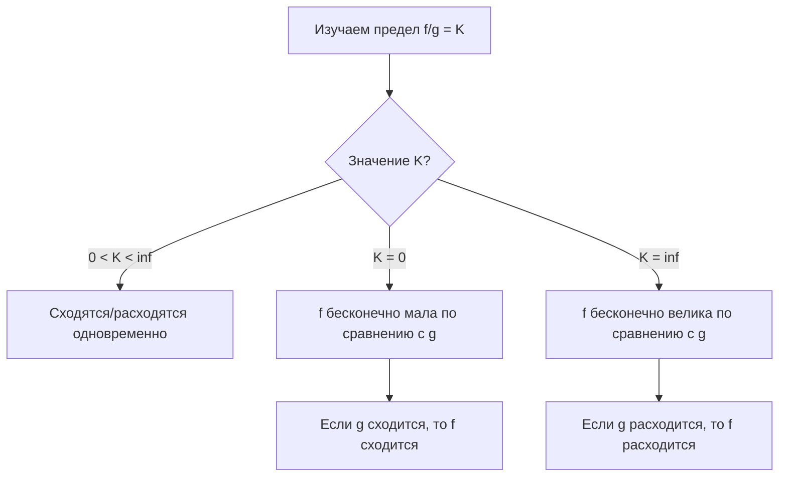

---
tags:
  - матанализ
  - 1_курс
  - подготовка_к_экзамену
тип: конспект
статус: готов
---

> [!warning] Вводные замечания экзаменатора
> В данном конспекте рассматриваются [[Несобственный интеграл|несобственные интегралы]] 1-го рода (по бесконечному промежутку $[a, +\infty)$). Вся теория для интегралов 2-го рода (от неограниченных функций) строится абсолютно аналогично с заменой предела при $x \to +\infty$ на предел при $x \to b-0$. По умолчанию предполагается, что рассматриваемые функции интегрируемы по Риману ([[Интеграл Римана]]) на любом конечном отрезке $[a, A]$.

# Вопрос №31. Линейность несобственного интеграла. Замена переменной и интегрирование по частям в несобственном интеграле.

> [!definition] Несобственный интеграл 1-го рода
> Пусть функция $f(x)$ определена на промежутке $[a, +\infty)$ и интегрируема по Риману на любом отрезке $[a, A]$, где $A > a$. Несобственным интегралом 1-го рода от функции $f$ называется [[Предел функции|предел]]:
> $$ \int_a^{+\infty} f(x) dx = \lim_{A \to +\infty} \int_a^A f(x) dx $$
> Если этот предел существует и конечен, говорят, что интеграл **сходится**. В противном случае — **расходится**.

> [!theorem] Линейность несобственного интеграла
> Пусть интегралы $\int_a^{+\infty} f(x) dx$ и $\int_a^{+\infty} g(x) dx$ сходятся, и пусть $\alpha, \beta \in \mathbb{R}$. Тогда интеграл от линейной комбинации $(\alpha f(x) + \beta g(x))$ также сходится, и справедливо равенство:
> $$ \int_a^{+\infty} (\alpha f(x) + \beta g(x)) dx = \alpha \int_a^{+\infty} f(x) dx + \beta \int_a^{+\infty} g(x) dx $$

> [!proof]+ Доказательство (Линейность)
> 1. В силу условия, функции $f$ и $g$ интегрируемы по Риману на любом $[a, A]$. По свойству линейности определенного [[Интеграл Римана|интеграла Римана]], для любого фиксированного $A > a$ выполнено:
> $$ \int_a^A (\alpha f(x) + \beta g(x)) dx = \alpha \int_a^A f(x) dx + \beta \int_a^A g(x) dx $$
> 2. Перейдем к пределу при $A \to +\infty$ в обеих частях равенства.
> 3. По условию, существуют конечные пределы $\lim_{A \to +\infty} \int_a^A f(x) dx$ и $\lim_{A \to +\infty} \int_a^A g(x) dx$.
> 4. По теореме об арифметических свойствах [[Предел функции|предела функции]], предел суммы равен сумме пределов, а константу можно вынести за знак предела. Следовательно, предел левой части существует и равен линейной комбинации пределов правых частей. Утверждение доказано.

> [!theorem] Интегрирование по частям в несобственном интеграле
> Пусть функции $u(x)$ и $v(x)$ непрерывно дифференцируемы на $[a, +\infty)$ (то есть $u, v \in C^1[a, +\infty)$). Пусть существует конечный предел $\lim_{x \to +\infty} u(x)v(x) = C$.
> Тогда несобственные интегралы $\int_a^{+\infty} u(x)v'(x) dx$ и $\int_a^{+\infty} u'(x)v(x) dx$ сходятся или расходятся одновременно.
> При их сходимости справедлива формула:
> $$ \int_a^{+\infty} u(x)v'(x) dx = \lim_{x \to +\infty} (u(x)v(x)) - u(a)v(a) - \int_a^{+\infty} u'(x)v(x) dx $$

> [!proof]+ Доказательство (Интегрирование по частям)
> 1. Для любого конечного $A > a$ функции $u$ и $v$ удовлетворяют условиям формулы интегрирования по частям для определенного интеграла:
> $$ \int_a^A u(x)v'(x) dx = u(A)v(A) - u(a)v(a) - \int_a^A u'(x)v(x) dx $$
> 2. Рассмотрим предел при $A \to +\infty$. По условию теоремы, предел $\lim_{A \to +\infty} u(A)v(A)$ существует и конечен. Слагаемое $u(a)v(a)$ является константой.
> 3. Если сходится интеграл $\int_a^{+\infty} u'(x)v(x) dx$, то существует конечный предел $\lim_{A \to +\infty} \int_a^A u'(x)v(x) dx$. Тогда в правой части равенства (из пункта 1) все слагаемые имеют конечные пределы при $A \to +\infty$. Значит, существует предел и левой части, то есть $\int_a^{+\infty} u(x)v'(x) dx$ сходится.
> 4. Обратное утверждение доказывается аналогично переносом слагаемого с интегралом в другую часть равенства. Формула получается предельным переходом. Доказательство завершено.

> [!theorem] Замена переменной в несобственном интеграле
> Пусть функция $f(x)$ непрерывна на $[a, +\infty)$. Пусть функция $x = \varphi(t)$ удовлетворяет условиям:
> 1. $\varphi \in C^1[\alpha, \beta)$ (где $\beta$ может быть как конечным числом, так и $+\infty$).
> 2. $\varphi(t)$ строго монотонно возрастает на $[\alpha, \beta)$.
> 3. $\varphi(\alpha) = a$ и $\lim_{t \to \beta-0} \varphi(t) = +\infty$.
> 
> Тогда интегралы $\int_a^{+\infty} f(x) dx$ и $\int_\alpha^\beta f(\varphi(t)) \varphi'(t) dt$ сходятся или расходятся одновременно, и в случае сходимости их значения равны.

> [!proof]+ Доказательство (Замена переменной)
> 4. Зафиксируем произвольное $B \in (\alpha, \beta)$. Пусть $A = \varphi(B)$. В силу строгой монотонности и непрерывности $\varphi$, отрезку $[\alpha, B]$ взаимно однозначно соответствует отрезок $[a, A]$.
> 5. Применим формулу замены переменной для определенного интеграла:
> $$ \int_a^A f(x) dx = \int_\alpha^B f(\varphi(t)) \varphi'(t) dt $$
> 6. В силу строгой монотонности $\varphi(t)$ и того, что $\lim_{t \to \beta-0} \varphi(t) = +\infty$, существует обратная функция $t = \varphi^{-1}(x)$, непрерывная и строго возрастающая, причем $\lim_{A \to +\infty} \varphi^{-1}(A) = \beta$.
> 7. Пусть интеграл $\int_a^{+\infty} f(x) dx$ сходится и равен $I$. По определению предела функции по Гейне ([[Предел функции]]), для любой последовательности $B_n \to \beta-0$, соответствующая последовательность $A_n = \varphi(B_n) \to +\infty$. Значит, предел правой части при $B \to \beta-0$ равен $I$.
> 8. Аналогично, если сходится второй интеграл, то предел левой части при $A \to +\infty$ существует, так как $A \to +\infty \iff B \to \beta-0$. Эквивалентность сходимости строго обоснована непрерывностью композиции предельных переходов при монотонной замене.

---

# Вопрос №32. Признак сходимости несобственных интегралов от неотрицательных функций. Признаки сравнения.

> [!abstract] Геометрический смысл
> Если функция неотрицательна ($f(x) \ge 0$), то площадь под её графиком при увеличении верхнего предела интегрирования $A$ только накапливается. Таким образом, функция "накопленной площади" $\Phi(A) = \int_a^A f(x)dx$ является неубывающей. Она либо упрется в некую "крышу" (супремум), и тогда площадь конечна, либо уйдет в бесконечность.

> [!theorem] Основная теорема (Критерий сходимости для неотрицательных функций)
> Пусть $f(x) \ge 0$ на $[a, +\infty)$ и $f(x)$ интегрируема на любом $[a, A]$. 
> Несобственный интеграл $\int_a^{+\infty} f(x) dx$ сходится тогда и только тогда, когда множество значений функции верхнего предела $\Phi(A) = \int_a^A f(x) dx$ ограничено сверху:
> $$ \exists M > 0 \quad \forall A > a: \quad \int_a^A f(x) dx \le M $$

> [!proof]+ Доказательство (Критерий сходимости)
> 1. Рассмотрим функцию $\Phi(A) = \int_a^A f(x) dx$. Покажем, что она неубывающая.
> 2. Пусть $a < A_1 < A_2$. Тогда $\Phi(A_2) - \Phi(A_1) = \int_a^{A_2} f(x) dx - \int_a^{A_1} f(x) dx = \int_{A_1}^{A_2} f(x) dx$.
> 3. Так как $f(x) \ge 0$ на $[A_1, A_2]$, по свойству интеграла Римана, $\int_{A_1}^{A_2} f(x) dx \ge 0$. Следовательно, $\Phi(A_2) \ge \Phi(A_1)$. Функция $\Phi(A)$ не убывает на $[a, +\infty)$.
> 4. По [[Теорема Вейерштрасса|теореме Вейерштрасса о пределе монотонной функции]], неубывающая функция имеет конечный предел при $A \to +\infty$ тогда и только тогда, когда она ограничена сверху.
> 5. Предел $\lim_{A \to +\infty} \Phi(A)$ по определению является несобственным интегралом. Значит, интеграл сходится $\iff \Phi(A)$ ограничена сверху. Доказательство завершено.

> [!theorem] Первый признак сравнения (в форме неравенства)
> Пусть на промежутке $[a, +\infty)$ заданы функции $f(x)$ и $g(x)$ такие, что:
> $$ 0 \le f(x) \le g(x) \quad \forall x \ge a $$
> Тогда:
> 6. Если $\int_a^{+\infty} g(x) dx$ сходится, то сходится и $\int_a^{+\infty} f(x) dx$.
> 7. Если $\int_a^{+\infty} f(x) dx$ расходится, то расходится и $\int_a^{+\infty} g(x) dx$.

> [!proof]+ Доказательство (Первый признак сравнения)
> 8. Зафиксируем произвольное $A > a$. Проинтегрируем неравенство $0 \le f(x) \le g(x)$ на отрезке $[a, A]$ (свойство монотонности интеграла Римана):
> $$ \int_a^A f(x) dx \le \int_a^A g(x) dx $$
> 9. **Докажем пункт 1.** Пусть $\int_a^{+\infty} g(x) dx$ сходится. По критерию для неотрицательных функций, $\exists M > 0$ такое, что $\int_a^A g(x) dx \le M$ для любого $A > a$.
> Тогда для функции $f$ выполнено: $\int_a^A f(x) dx \le \int_a^A g(x) dx \le M$.
> Множество значений интегралов от $f$ ограничено сверху числом $M$, следовательно, по основной теореме, $\int_a^{+\infty} f(x) dx$ сходится.
> 10. **Докажем пункт 2.** (От противного). Пусть $\int_a^{+\infty} f$ расходится. Так как $f \ge 0$, это означает, что $\lim_{A \to +\infty} \int_a^A f(x) dx = +\infty$.
> Если бы $\int_a^{+\infty} g$ сходился, то по пункту 1 сходился бы и $\int_a^{+\infty} f$, что противоречит условию. Значит, $\int_a^{+\infty} g$ обязан расходиться.

> [!theorem] Второй признак сравнения (в предельной форме)
> Пусть $f(x) \ge 0$ и $g(x) > 0$ для всех $x \ge a$. Пусть существует предел:
> $$ \lim_{x \to +\infty} \frac{f(x)}{g(x)} = K $$
> Тогда:
> 11. Если $0 < K < +\infty$, то интегралы $\int_a^{+\infty} f$ и $\int_a^{+\infty} g$ сходятся или расходятся **одновременно**.
> 12. Если $K = 0$ и $\int_a^{+\infty} g$ сходится, то $\int_a^{+\infty} f$ также сходится.
> 13. Если $K = +\infty$ и $\int_a^{+\infty} g$ расходится, то $\int_a^{+\infty} f$ также расходится.

> [!proof]+ Доказательство (Предельный признак сравнения)
> **Случай 1: $0 < K < +\infty$.**
> 14. Запишем определение предела функции на бесконечности на языке $\varepsilon-\delta$:
> $\forall \varepsilon > 0 \quad \exists M > a \quad \forall x > M: \quad K - \varepsilon < \frac{f(x)}{g(x)} < K + \varepsilon$.
> 15. Выберем $\varepsilon = \frac{K}{2} > 0$. Тогда существует такое $M$, что для всех $x > M$ выполнено:
> $$ \frac{K}{2} < \frac{f(x)}{g(x)} < \frac{3K}{2} $$
> 16. Так как $g(x) > 0$, домножим неравенство на $g(x)$:
> $$ \frac{K}{2} g(x) < f(x) < \frac{3K}{2} g(x) \quad \forall x > M $$
> 17. Интегралы по отрезку $[a, M]$ — это конечные числа (собственные интегралы Римана), они не влияют на сходимость на бесконечности. Рассмотрим интегралы по $[M, +\infty)$.
> 18. Если сходится $\int g$, то сходится и $\int \frac{3K}{2}g$ (линейность). Правое неравенство $f(x) < \frac{3K}{2} g(x)$ вместе с первым признаком сравнения дает сходимость $\int f$.
> 19. Если сходится $\int f$, то левое неравенство $\frac{K}{2} g(x) < f(x)$ дает сходимость $\int \frac{K}{2}g$, а значит и сходимость $\int g$. Эквивалентность доказана.
> 
> **Случай 2: $K = 0$.**
> Из определения предела (для $\varepsilon = 1$) следует, что при достаточно больших $x > M$: $\frac{f(x)}{g(x)} < 1 \implies f(x) < g(x)$. Применяем первый признак.
> 
> **Случай 3: $K = +\infty$.**
> Из определения предела (для $E = 1$) следует, что при $x > M$: $\frac{f(x)}{g(x)} > 1 \implies f(x) > g(x)$. Применяем первый признак (расходимость меньшей функции влечет расходимость большей).



---

# Вопрос №33. Абсолютная сходимость интегралов. Сходимость и абсолютная сходимость.

> [!lemma] [[Критерий Коши]] сходимости несобственного интеграла (База для доказательств)
> Интеграл $\int_a^{+\infty} f(x) dx$ сходится тогда и только тогда, когда:
> $$ \forall \varepsilon > 0 \quad \exists M > a \quad \forall A_1, A_2 > M: \quad \left| \int_{A_1}^{A_2} f(x) dx \right| < \varepsilon $$
> *(Следует напрямую из критерия Коши существования предела для функции $\Phi(A)$).*

> [!definition] Абсолютная и условная сходимость
> Пусть интеграл $\int_a^{+\infty} f(x) dx$ сходится. 
> 1. Если сходится интеграл от модуля функции: $\int_a^{+\infty} |f(x)| dx$, то исходный интеграл называется **абсолютно сходящимся**.
> 2. Если интеграл от функции $\int_a^{+\infty} f(x) dx$ сходится, а интеграл от её модуля $\int_a^{+\infty} |f(x)| dx$ расходится, то исходный интеграл называется **условно сходящимся**.

> [!theorem] Связь абсолютной и обычной сходимости
> Если несобственный интеграл сходится абсолютно, то он сходится и в обычном смысле.
> *(Обратное, вообще говоря, неверно).*

> [!proof]+ Доказательство (Абсолютная сходимость $\implies$ Сходимость)
> 1. По условию, интеграл $\int_a^{+\infty} |f(x)| dx$ сходится.
> 2. Применим к нему [[Критерий Коши]]. Поскольку интеграл сходится, для любого $\varepsilon > 0$ существует такое $M > a$, что для любых $A_2 > A_1 > M$ выполняется:
> $$ \left| \int_{A_1}^{A_2} |f(x)| dx \right| = \int_{A_1}^{A_2} |f(x)| dx < \varepsilon $$
> (Модуль вокруг интеграла можно опустить, так как подынтегральная функция $|f(x)| \ge 0$, а $A_2 > A_1$).
> 3. Оценим модуль интеграла от самой функции $f(x)$ на отрезке $[A_1, A_2]$. По стандартному свойству интеграла Римана, модуль интеграла не превосходит интеграла от модуля:
> $$ \left| \int_{A_1}^{A_2} f(x) dx \right| \le \int_{A_1}^{A_2} |f(x)| dx $$
> 4. Объединяя пункты 2 и 3, получаем, что для выбранного $M$ и любых $A_2 > A_1 > M$:
> $$ \left| \int_{A_1}^{A_2} f(x) dx \right| \le \int_{A_1}^{A_2} |f(x)| dx < \varepsilon $$
> 5. Таким образом, для функции $f(x)$ выполнено условие критерия Коши сходимости несобственного интеграла. Следовательно, интеграл $\int_a^{+\infty} f(x) dx$ сходится. Теорема доказана.

> [!warning] Важное замечание (Контрпример к обратному утверждению)
> Из сходимости интеграла **не следует** его абсолютная сходимость. Классическим контрпримером является **интеграл Дирихле**:
> $$ \int_1^{+\infty} \frac{\sin x}{x} dx $$
> 6. **Сходимость:** По формуле интегрирования по частям:
> $\int_1^A \frac{\sin x}{x} dx = \left. \frac{-\cos x}{x} \right|_1^A - \int_1^A \frac{\cos x}{x^2} dx$. 
> Внеинтегральное слагаемое имеет предел при $A \to +\infty$. Интеграл $\int_1^{+\infty} \frac{\cos x}{x^2} dx$ абсолютно сходится (сравниваем с $\frac{1}{x^2}$, который сходится). Значит, исходный интеграл сходится.
> 7. **Отсутствие абсолютной сходимости:**
> Оценим модуль подынтегральной функции: 
> $\left| \frac{\sin x}{x} \right| \ge \frac{\sin^2 x}{x} = \frac{1 - \cos 2x}{2x} = \frac{1}{2x} - \frac{\cos 2x}{2x}$.
> Интеграл $\int_1^{+\infty} \frac{1}{2x} dx$ расходится (логарифм), а $\int_1^{+\infty} \frac{\cos 2x}{2x} dx$ сходится. Разность расходящегося и сходящегося интегралов расходится. По первому признаку сравнения, $\int_1^{+\infty} \left| \frac{\sin x}{x} \right| dx$ расходится.
> *Вывод:* Интеграл Дирихле сходится **условно**.

```mermaid
venn
title Классы интегрируемых по Риману функций на бесконечности
```
> [!abstract] Структура классов сходимости
> Если представить множество всех функций, то:
> - Самое широкое множество — **расходящиеся** интегралы.
> - Внутри него — функции, интегралы от которых **сходятся** (положительные и отрицательные площади взаимно компенсируются, как у $\frac{\sin x}{x}$).
> - Ещё более узкое подмножество — функции, интегралы от которых **сходятся абсолютно** (само суммирование объемов без учета знака конечно). Любая абсолютно сходящаяся функция автоматически входит в класс сходящихся.

