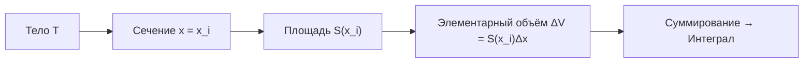
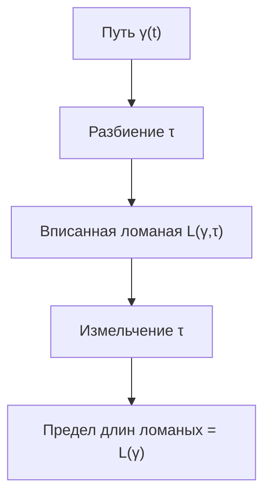

---
tags:
  - матанализ
  - 1_курс
  - подготовка_к_экзамену
тип: конспект
статус: готов
---

# Вопрос №37. Применение интеграла Римана к вычислению площадей

## Общая схема вычисления площадей

> [!abstract] Геометрическая мотивация
> Для вычисления площади плоской фигуры используется идея аппроксимации фигуры прямоугольниками или элементарными фигурами известной площади. Предельный переход при измельчении разбиения приводит к [[Интеграл Римана|интегралу Римана]].

### Площадь как мера множества на плоскости

> [!definition] Квадрируемое множество (мера Жордана на плоскости)
> Ограниченное множество $E \subset \mathbb{R}^2$ называется **квадрируемым** (измеримым по Жордану), если для любого $\varepsilon > 0$ существуют конечные объединения прямоугольников $P_{\text{внутр}}$ и $P_{\text{внеш}}$ такие, что:
> $$P_{\text{внутр}} \subset E \subset P_{\text{внеш}}, \quad S(P_{\text{внеш}}) - S(P_{\text{внутр}}) < \varepsilon,$$
> где $S(\cdot)$ — сумма площадей прямоугольников.
> 
> **Площадь** множества $E$ определяется как общий предел:
> $$S(E) = \sup_{P \subset E} S(P) = \inf_{E \subset Q} S(Q).$$

> [!theorem] Критерий квадрируемости
> Ограниченное множество $E \subset \mathbb{R}^2$ квадрируемо тогда и только тогда, когда его граница $\partial E$ имеет меру нуль (площадь нуль по Жордану).

## Площадь подграфика функции

> [!definition] Подграфик функции
> Пусть $f: [a, b] \to \mathbb{R}$ — ограниченная функция, $f(x) \geqslant 0$ на $[a,b]$. **Подграфиком** функции $f$ называется множество:
> $$\Omega_f = \{(x, y) \in \mathbb{R}^2 : a \leqslant x \leqslant b, \; 0 \leqslant y \leqslant f(x)\}.$$

> [!theorem] Площадь подграфика интегрируемой функции
> Пусть $f: [a,b] \to \mathbb{R}$ — неотрицательная функция, интегрируемая по Риману на $[a,b]$. Тогда множество $\Omega_f$ квадрируемо, и его площадь равна:
> $$S(\Omega_f) = \int\limits_a^b f(x) \, dx.$$

> [!proof]+ Доказательство
> **Шаг 1.** Рассмотрим разбиение $\tau = \{x_0 = a < x_1 < \ldots < x_n = b\}$ отрезка $[a,b]$. Обозначим:
> $$m_i = \inf_{x \in [x_{i-1}, x_i]} f(x), \quad M_i = \sup_{x \in [x_{i-1}, x_i]} f(x), \quad \Delta x_i = x_i - x_{i-1}.$$
> 
> **Шаг 2.** Построим внутреннее покрытие $P_{\text{внутр}}$ прямоугольниками с площадью:
> $$S(P_{\text{внутр}}) = \sum_{i=1}^n m_i \Delta x_i = s(f, \tau),$$
> где $s(f, \tau)$ — нижняя [[Суммы Дарбу|сумма Дарбу]].
> 
> **Шаг 3.** Построим внешнее покрытие $P_{\text{внеш}}$ прямоугольниками с площадью:
> $$S(P_{\text{внеш}}) = \sum_{i=1}^n M_i \Delta x_i = S(f, \tau),$$
> где $S(f, \tau)$ — верхняя сумма Дарбу.
> 
> **Шаг 4.** По определению [[Интегрируемость по Риману|интегрируемости по Риману]], функция $f$ интегрируема на $[a,b]$ тогда и только тогда, когда:
> $$\forall \varepsilon > 0 \; \exists \tau: \quad S(f, \tau) - s(f, \tau) < \varepsilon.$$
> 
> **Шаг 5.** Из условия интегрируемости следует:
> $$S(P_{\text{внеш}}) - S(P_{\text{внутр}}) = S(f, \tau) - s(f, \tau) < \varepsilon,$$
> что означает квадрируемость множества $\Omega_f$ по критерию Жордана.
> 
> **Шаг 6.** Площадь множества $\Omega_f$ есть общий предел верхних и нижних сумм Дарбу:
> $$S(\Omega_f) = \lim_{\lambda(\tau) \to 0} s(f, \tau) = \lim_{\lambda(\tau) \to 0} S(f, \tau) = \int\limits_a^b f(x) \, dx,$$
> где $\lambda(\tau) = \max_i \Delta x_i$ — мелкость разбиения. $\square$

## Площадь криволинейной трапеции

> [!definition] Криволинейная трапеция
> Множество точек вида:
> $$\Omega = \{(x, y) \in \mathbb{R}^2: a \leqslant x \leqslant b, \; g(x) \leqslant y \leqslant f(x)\},$$
> где $f, g: [a,b] \to \mathbb{R}$ — интегрируемые функции, $g(x) \leqslant f(x)$ для всех $x \in [a,b]$.

> [!theorem] Площадь криволинейной трапеции
> Если $f, g \in \mathcal{R}[a,b]$ (класс функций, интегрируемых по Риману на $[a,b]$) и $g(x) \leqslant f(x)$ на $[a,b]$, то:
> $$S(\Omega) = \int\limits_a^b [f(x) - g(x)] \, dx.$$

> [!proof]+ Доказательство
> **Шаг 1.** Представим множество $\Omega$ как разность двух подграфиков:
> $$\Omega = \Omega_f \setminus \Omega_g,$$
> где $\Omega_f$ — подграфик функции $f$, $\Omega_g$ — подграфик функции $g$.
> 
> **Шаг 2.** Так как $f, g$ интегрируемы по Риману, множества $\Omega_f$ и $\Omega_g$ квадрируемы. По свойству меры Жордана (аддитивность для непересекающихся множеств):
> $$S(\Omega) = S(\Omega_f) - S(\Omega_g).$$
> 
> **Шаг 3.** Применяя теорему о площади подграфика:
> $$S(\Omega_f) = \int\limits_a^b f(x) \, dx, \quad S(\Omega_g) = \int\limits_a^b g(x) \, dx.$$
> 
> **Шаг 4.** По линейности [[Интеграл Римана|интеграла Римана]]:
> $$S(\Omega) = \int\limits_a^b f(x) \, dx - \int\limits_a^b g(x) \, dx = \int\limits_a^b [f(x) - g(x)] \, dx. \quad \square$$

## Площадь в полярных координатах

> [!definition] Криволинейный сектор в полярных координатах
> Множество точек в полярной системе координат $(r, \varphi)$:
> $$\Omega = \{(r, \varphi): \alpha \leqslant \varphi \leqslant \beta, \; 0 \leqslant r \leqslant \rho(\varphi)\},$$
> где $\rho: [\alpha, \beta] \to [0, +\infty)$ — интегрируемая функция.

> [!theorem] Площадь в полярных координатах
> Если $\rho \in \mathcal{R}[\alpha, \beta]$ и $\rho(\varphi) \geqslant 0$, то площадь сектора равна:
> $$S(\Omega) = \frac{1}{2} \int\limits_\alpha^\beta \rho^2(\varphi) \, d\varphi.$$

> [!proof]+ Доказательство
> **Шаг 1.** Рассмотрим разбиение $\tau = \{\alpha = \varphi_0 < \varphi_1 < \ldots < \varphi_n = \beta\}$ и обозначим $\Delta \varphi_i = \varphi_i - \varphi_{i-1}$.
> 
> **Шаг 2.** На каждом частичном интервале $[\varphi_{i-1}, \varphi_i]$ определим:
> $$m_i = \inf_{\varphi \in [\varphi_{i-1}, \varphi_i]} \rho(\varphi), \quad M_i = \sup_{\varphi \in [\varphi_{i-1}, \varphi_i]} \rho(\varphi).$$
> 
> **Шаг 3.** Приближаем площадь сектора на $[\varphi_{i-1}, \varphi_i]$ площадью кругового сектора радиуса $\rho_i^*$ и угла $\Delta \varphi_i$:
> $$\Delta S_i \approx \frac{1}{2} (\rho_i^*)^2 \Delta \varphi_i,$$
> где $\rho_i^* \in [m_i, M_i]$ — некоторое промежуточное значение.
> 
> **Шаг 4.** Нижняя и верхняя суммы для площади:
> $$s(\tau) = \frac{1}{2} \sum_{i=1}^n m_i^2 \Delta \varphi_i, \quad S(\tau) = \frac{1}{2} \sum_{i=1}^n M_i^2 \Delta \varphi_i.$$
> 
> **Шаг 5.** Так как $\rho \in \mathcal{R}[\alpha, \beta]$, то и $\rho^2 \in \mathcal{R}[\alpha, \beta]$ (композиция интегрируемой функции с непрерывной функцией $t \mapsto t^2$ интегрируема). Следовательно:
> $$S(\Omega) = \lim_{\lambda(\tau) \to 0} s(\tau) = \lim_{\lambda(\tau) \to 0} S(\tau) = \frac{1}{2} \int\limits_\alpha^\beta \rho^2(\varphi) \, d\varphi. \quad \square$$

## Площадь параметрически заданной фигуры

> [!theorem] Площадь под параметрической кривой
> Пусть кривая задана параметрически:
> $$x = x(t), \quad y = y(t), \quad t \in [\alpha, \beta],$$
> где $x(t)$ — строго монотонная непрерывно дифференцируемая функция, $x(\alpha) = a$, $x(\beta) = b$, и $y(t) \geqslant 0$, $y(t) \in C^1[\alpha, \beta]$. Тогда площадь подграфика равна:
> $$S = \int\limits_\alpha^\beta y(t) \, |x'(t)| \, dt.$$

> [!proof]+ Доказательство
> **Шаг 1.** Так как $x(t)$ строго монотонна, существует обратная функция $t = t(x)$ на $[a, b]$.
> 
> **Шаг 2.** Площадь подграфика в координатах $(x, y)$:
> $$S = \int\limits_a^b y(t(x)) \, dx.$$
> 
> **Шаг 3.** Применим замену переменной $x = x(t)$, откуда $dx = x'(t) \, dt$. При $x = a$ имеем $t = \alpha$, при $x = b$ имеем $t = \beta$.
> 
> **Шаг 4.** По формуле замены переменной в интеграле Римана:
> $$S = \int\limits_\alpha^\beta y(t) \, x'(t) \, dt.$$
> 
> **Шаг 5.** Если $x(t)$ убывает, то $x'(t) < 0$, и нужно учесть модуль:
> $$S = \int\limits_\alpha^\beta y(t) \, |x'(t)| \, dt. \quad \square$$

> [!warning] Важное замечание
> Формула применима только если $x(t)$ **строго монотонна** на $[\alpha, \beta]$. В противном случае кривая может самопересекаться, и необходимо разбивать параметр на интервалы монотонности.

---

# Вопрос №38. Применение интеграла Римана к вычислению объёма. Объёмы тел вращения

## Объём тела по известным площадям сечений

> [!definition] Кубируемое множество (мера Жордана в $\mathbb{R}^3$)
> Ограниченное множество $E \subset \mathbb{R}^3$ называется **кубируемым** (измеримым по Жордану), если для любого $\varepsilon > 0$ существуют конечные объединения параллелепипедов $P_{\text{внутр}}$ и $P_{\text{внеш}}$ такие, что:
> $$P_{\text{внутр}} \subset E \subset P_{\text{внеш}}, \quad V(P_{\text{внеш}}) - V(P_{\text{внутр}}) < \varepsilon,$$
> где $V(\cdot)$ — сумма объёмов параллелепипедов.

> [!theorem] Объём тела по площадям сечений (принцип Кавальери)
> Пусть тело $T \subset \mathbb{R}^3$ ограничено плоскостями $x = a$ и $x = b$. Для каждого $x \in [a, b]$ обозначим через $S(x)$ площадь сечения тела $T$ плоскостью, перпендикулярной оси $Ox$ и проходящей через точку $x$.
> 
> Если $S(x)$ — интегрируемая функция на $[a, b]$ и все сечения квадрируемы, то тело $T$ кубируемо, и его объём равен:
> $$V(T) = \int\limits_a^b S(x) \, dx.$$

> [!proof]+ Доказательство
> **Шаг 1.** Рассмотрим разбиение $\tau = \{x_0 = a < x_1 < \ldots < x_n = b\}$ отрезка $[a,b]$.
> 
> **Шаг 2.** На каждом отрезке $[x_{i-1}, x_i]$ определим:
> $$m_i = \inf_{x \in [x_{i-1}, x_i]} S(x), \quad M_i = \sup_{x \in [x_{i-1}, x_i]} S(x), \quad \Delta x_i = x_i - x_{i-1}.$$
> 
> **Шаг 3.** Приближаем объём части тела между сечениями $x_{i-1}$ и $x_i$ цилиндром с основанием площади $m_i$ (нижняя оценка) или $M_i$ (верхняя оценка) и высотой $\Delta x_i$:
> $$V_{\text{нижн}} = \sum_{i=1}^n m_i \Delta x_i = s(S, \tau), \quad V_{\text{верх}} = \sum_{i=1}^n M_i \Delta x_i = S(S, \tau).$$
> 
> **Шаг 4.** По условию интегрируемости функции $S(x)$ на $[a,b]$:
> $$\forall \varepsilon > 0 \; \exists \tau: \quad S(S, \tau) - s(S, \tau) < \varepsilon.$$
> 
> **Шаг 5.** Из критерия кубируемости (разность верхнего и нижнего покрытий параллелепипедами может быть сделана меньше любого $\varepsilon$) следует кубируемость тела $T$.
> 
> **Шаг 6.** Объём тела есть общий предел сумм Дарбу:
> $$V(T) = \lim_{\lambda(\tau) \to 0} s(S, \tau) = \lim_{\lambda(\tau) \to 0} S(S, \tau) = \int\limits_a^b S(x) \, dx. \quad \square$$

> [!abstract] Геометрический смысл
> Объём тела вычисляется как "сумма" бесконечно тонких срезов известной площади $S(x)$, расположенных вдоль оси $Ox$.

## Объём тела вращения вокруг оси $Ox$

> [!definition] Тело вращения вокруг оси $Ox$
> Пусть $f: [a,b] \to \mathbb{R}$ — неотрицательная интегрируемая функция. **Телом вращения** вокруг оси $Ox$ называется множество:
> $$T = \{(x, y, z) \in \mathbb{R}^3: a \leqslant x \leqslant b, \; y^2 + z^2 \leqslant f^2(x)\}.$$

> [!theorem] Объём тела вращения вокруг оси $Ox$
> Если $f \in \mathcal{R}[a,b]$ и $f(x) \geqslant 0$ на $[a,b]$, то объём тела вращения равен:
> $$V = \pi \int\limits_a^b f^2(x) \, dx.$$

> [!proof]+ Доказательство
> **Шаг 1.** Сечение тела $T$ плоскостью, перпендикулярной оси $Ox$ и проходящей через точку $x \in [a,b]$, есть круг радиуса $r(x) = f(x)$.
> 
> **Шаг 2.** Площадь этого круга:
> $$S(x) = \pi r^2(x) = \pi f^2(x).$$
> 
> **Шаг 3.** Так как $f \in \mathcal{R}[a,b]$, то и $f^2 \in \mathcal{R}[a,b]$ (как композиция интегрируемой функции с непрерывной функцией $t \mapsto t^2$).
> 
> **Шаг 4.** По принципу Кавальери:
> $$V = \int\limits_a^b S(x) \, dx = \int\limits_a^b \pi f^2(x) \, dx = \pi \int\limits_a^b f^2(x) \, dx. \quad \square$$

> [!warning] Важное замечание
> Формула применима для неотрицательных функций. Если $f(x)$ меняет знак, необходимо брать $|f(x)|$ или разбивать интервал интегрирования.

## Объём тела вращения вокруг оси $Oy$

> [!theorem] Объём тела вращения вокруг оси $Oy$
> Пусть функция $x = g(y)$ определена и непрерывна на $[c, d]$, $g(y) \geqslant 0$. Объём тела, полученного вращением графика вокруг оси $Oy$, равен:
> $$V = \pi \int\limits_c^d g^2(y) \, dy.$$

> [!proof]+ Доказательство
> Доказательство аналогично предыдущему: сечение плоскостью $y = \text{const}$ есть круг радиуса $g(y)$, площадь $\pi g^2(y)$, интегрирование по $y \in [c,d]$. $\square$

## Объём тела вращения кольца (между двумя графиками)

> [!theorem] Объём тела вращения между двумя функциями
> Пусть $f, g \in \mathcal{R}[a,b]$, $0 \leqslant g(x) \leqslant f(x)$ на $[a,b]$. Объём тела, образованного вращением криволинейной трапеции между графиками $y = f(x)$ и $y = g(x)$ вокруг оси $Ox$, равен:
> $$V = \pi \int\limits_a^b [f^2(x) - g^2(x)] \, dx.$$

> [!proof]+ Доказательство
> **Шаг 1.** Сечение тела плоскостью $x = \text{const}$ есть кольцо с внешним радиусом $R(x) = f(x)$ и внутренним радиусом $r(x) = g(x)$.
> 
> **Шаг 2.** Площадь кольца:
> $$S(x) = \pi R^2(x) - \pi r^2(x) = \pi [f^2(x) - g^2(x)].$$
> 
> **Шаг 3.** Интегрирование по $x \in [a,b]$:
> $$V = \int\limits_a^b S(x) \, dx = \pi \int\limits_a^b [f^2(x) - g^2(x)] \, dx. \quad \square$$

## Объём тела вращения параметрически заданной кривой

> [!theorem] Объём тела вращения параметрической кривой
> Пусть кривая задана параметрически:
> $$x = x(t), \quad y = y(t), \quad t \in [\alpha, \beta],$$
> где $x(t)$ строго монотонна, $x(t), y(t) \in C^1[\alpha, \beta]$, $y(t) \geqslant 0$. Объём тела вращения вокруг оси $Ox$ равен:
> $$V = \pi \int\limits_\alpha^\beta y^2(t) \, |x'(t)| \, dt.$$

> [!proof]+ Доказательство
> **Шаг 1.** Объём в координатах $(x, y)$:
> $$V = \pi \int\limits_a^b y^2(x) \, dx.$$
> 
> **Шаг 2.** Замена переменной $x = x(t)$, $dx = x'(t) \, dt$:
> $$V = \pi \int\limits_\alpha^\beta y^2(t) \, x'(t) \, dt.$$
> 
> **Шаг 3.** Если $x(t)$ убывает, учитываем модуль:
> $$V = \pi \int\limits_\alpha^\beta y^2(t) \, |x'(t)| \, dt. \quad \square$$

---

# Вопрос №39. Применение интеграла Римана к вычислению длины гладкого пути

## Понятие пути в $\mathbb{R}^n$

> [!definition] Путь (кривая)
> **Путём** (или **кривой**) в $\mathbb{R}^n$ называется непрерывное отображение:
> $$\gamma: [a, b] \to \mathbb{R}^n, \quad \gamma(t) = (x_1(t), x_2(t), \ldots, x_n(t)),$$
> где $x_i: [a,b] \to \mathbb{R}$ — непрерывные функции (координатные функции), $t \in [a,b]$ — параметр.

> [!definition] Ломаная, вписанная в путь
> Пусть $\gamma: [a,b] \to \mathbb{R}^n$ — путь, $\tau = \{a = t_0 < t_1 < \ldots < t_n = b\}$ — разбиение отрезка $[a,b]$. **Ломаной, вписанной в путь $\gamma$ по разбиению $\tau$**, называется ломаная с вершинами в точках $\gamma(t_0), \gamma(t_1), \ldots, \gamma(t_n)$.
> 
> **Длина ломаной** равна:
> $$L(\gamma, \tau) = \sum_{i=1}^n \|\gamma(t_i) - \gamma(t_{i-1})\|,$$
> где $\|\cdot\|$ — евклидова норма в $\mathbb{R}^n$:
> $$\|\gamma(t_i) - \gamma(t_{i-1})\| = \sqrt{\sum_{j=1}^n [x_j(t_i) - x_j(t_{i-1})]^2}.$$

> [!definition] Длина пути (спрямляемость)
> Путь $\gamma: [a,b] \to \mathbb{R}^n$ называется **спрямляемым**, если множество длин всех вписанных ломаных ограничено сверху:
> $$\sup_{\tau} L(\gamma, \tau) < +\infty.$$
> 
> **Длиной пути** $\gamma$ называется:
> $$L(\gamma) = \sup_{\tau} L(\gamma, \tau),$$
> где супремум берётся по всем разбиениям $\tau$ отрезка $[a,b]$.

> [!abstract] Геометрический смысл
> Длина пути — это предел длин ломаных при измельчении разбиения. Интуитивно, кривая приближается всё более точно ломаными, и длина устремляется к некоторому пределу.

## Гладкий путь и его длина

> [!definition] Гладкий путь
> Путь $\gamma: [a,b] \to \mathbb{R}^n$ называется **гладким** (или **регулярным**), если все координатные функции $x_i(t)$ непрерывно дифференцируемы на $[a,b]$ (т.е. $x_i \in C^1[a,b]$, $i = 1, \ldots, n$).
> 
> **Вектор скорости** (касательный вектор) пути в точке $t$:
> $$\gamma'(t) = (x_1'(t), x_2'(t), \ldots, x_n'(t)).$$
> 
> Путь называется **регулярным**, если $\gamma'(t) \neq 0$ для всех $t \in [a,b]$.

> [!theorem] Длина гладкого пути
> Если путь $\gamma: [a,b] \to \mathbb{R}^n$ гладкий (все координатные функции $x_i \in C^1[a,b]$), то он спрямляем, и его длина вычисляется по формуле:
> $$L(\gamma) = \int\limits_a^b \|\gamma'(t)\| \, dt = \int\limits_a^b \sqrt{\sum_{i=1}^n [x_i'(t)]^2} \, dt.$$

> [!proof]+ Доказательство
> **Шаг 1.** Рассмотрим разбиение $\tau = \{a = t_0 < t_1 < \ldots < t_k = b\}$ с мелкостью $\lambda(\tau) = \max_i \Delta t_i$, где $\Delta t_i = t_i - t_{i-1}$.
> 
> **Шаг 2.** Длина звена ломаной от $\gamma(t_{i-1})$ до $\gamma(t_i)$:
> $$\|\gamma(t_i) - \gamma(t_{i-1})\| = \sqrt{\sum_{j=1}^n [x_j(t_i) - x_j(t_{i-1})]^2}.$$
> 
> **Шаг 3.** Так как $x_j \in C^1[a,b]$, по [[Теорема Лагранжа|теореме Лагранжа о конечных приращениях]] существует точка $\xi_{ij} \in (t_{i-1}, t_i)$ такая, что:
> $$x_j(t_i) - x_j(t_{i-1}) = x_j'(\xi_{ij}) \Delta t_i.$$
> 
> **Шаг 4.** Подставляя в формулу длины звена:
> $$\|\gamma(t_i) - \gamma(t_{i-1})\| = \sqrt{\sum_{j=1}^n [x_j'(\xi_{ij})]^2} \cdot \Delta t_i.$$
> 
> **Шаг 5.** Суммарная длина ломаной:
> $$L(\gamma, \tau) = \sum_{i=1}^k \sqrt{\sum_{j=1}^n [x_j'(\xi_{ij})]^2} \cdot \Delta t_i.$$
> 
> **Шаг 6.** Обозначим:
> $$\varphi_i = \sqrt{\sum_{j=1}^n [x_j'(\xi_{ij})]^2}, \quad \varphi(t) = \|\gamma'(t)\| = \sqrt{\sum_{j=1}^n [x_j'(t)]^2}.$$
> 
> **Шаг 7.** Так как $x_j' \in C[a,b]$, функция $\varphi(t)$ непрерывна на компакте $[a,b]$. По [[Теорема Кантора|теореме Кантора]] о равномерной непрерывности:
> $$\forall \varepsilon > 0 \; \exists \delta > 0: \; |t' - t''| < \delta \Rightarrow |\varphi(t') - \varphi(t'')| < \varepsilon.$$
> 
> **Шаг 8.** При $\lambda(\tau) < \delta$ для всех $\xi_{ij} \in (t_{i-1}, t_i)$ и любого $t_i^* \in [t_{i-1}, t_i]$ имеем:
> $$|\varphi_i - \varphi(t_i^*)| < \varepsilon.$$
> 
> **Шаг 9.** Запишем разность между длиной ломаной и [[Интегральная сумма Римана|интегральной суммой]] для функции $\varphi(t)$:
> $$\left| L(\gamma, \tau) - \sum_{i=1}^k \varphi(t_i^*) \Delta t_i \right| = \left| \sum_{i=1}^k [\varphi_i - \varphi(t_i^*)] \Delta t_i \right| \leqslant \sum_{i=1}^k |\varphi_i - \varphi(t_i^*)| \Delta t_i < \varepsilon \sum_{i=1}^k \Delta t_i = \varepsilon (b - a).$$
> 
> **Шаг 10.** Так как $\varphi(t)$ непрерывна на $[a,b]$, она интегрируема по Риману, и интегральные суммы сходятся к интегралу:
> $$\lim_{\lambda(\tau) \to 0} \sum_{i=1}^k \varphi(t_i^*) \Delta t_i = \int\limits_a^b \varphi(t) \, dt = \int\limits_a^b \|\gamma'(t)\| \, dt.$$
> 
> **Шаг 11.** Из неравенства в Шаге 9, устремляя $\lambda(\tau) \to 0$, получаем:
> $$\lim_{\lambda(\tau) \to 0} L(\gamma, \tau) = \int\limits_a^b \|\gamma'(t)\| \, dt.$$
> 
> **Шаг 12.** Так как длина пути определена как супремум длин всех ломаных, и этот супремум достигается как предел при измельчении разбиений:
> $$L(\gamma) = \sup_{\tau} L(\gamma, \tau) = \lim_{\lambda(\tau) \to 0} L(\gamma, \tau) = \int\limits_a^b \|\gamma'(t)\| \, dt. \quad \square$$

> [!warning] Важное замечание
> Формула применима только для **гладких** путей. Если путь кусочно-гладкий (имеет конечное число точек излома), длину вычисляют как сумму длин гладких участков.

## Частные случаи: длина кривой на плоскости

### График функции $y = f(x)$

> [!theorem] Длина графика функции
> Пусть $f: [a,b] \to \mathbb{R}$, $f \in C^1[a,b]$. Длина графика функции $y = f(x)$ при $x \in [a,b]$ равна:
> $$L = \int\limits_a^b \sqrt{1 + [f'(x)]^2} \, dx.$$

> [!proof]+ Доказательство
> **Шаг 1.** Параметризуем график: $\gamma(t) = (t, f(t))$, $t \in [a,b]$.
> 
> **Шаг 2.** Вектор скорости:
> $$\gamma'(t) = (1, f'(t)).$$
> 
> **Шаг 3.** Норма вектора скорости:
> $$\|\gamma'(t)\| = \sqrt{1^2 + [f'(t)]^2} = \sqrt{1 + [f'(t)]^2}.$$
> 
> **Шаг 4.** По теореме о длине гладкого пути:
> $$L = \int\limits_a^b \|\gamma'(t)\| \, dt = \int\limits_a^b \sqrt{1 + [f'(x)]^2} \, dx. \quad \square$$

### Параметрически заданная кривая на плоскости

> [!theorem] Длина параметрической кривой на плоскости
> Пусть кривая задана параметрически:
> $$x = x(t), \quad y = y(t), \quad t \in [\alpha, \beta],$$
> где $x(t), y(t) \in C^1[\alpha, \beta]$. Длина кривой равна:
> $$L = \int\limits_\alpha^\beta \sqrt{[x'(t)]^2 + [y'(t)]^2} \, dt.$$

> [!proof]+ Доказательство
> **Шаг 1.** Путь $\gamma(t) = (x(t), y(t))$ гладкий.
> 
> **Шаг 2.** Вектор скорости:
> $$\gamma'(t) = (x'(t), y'(t)).$$
> 
> **Шаг 3.** Норма:
> $$\|\gamma'(t)\| = \sqrt{[x'(t)]^2 + [y'(t)]^2}.$$
> 
> **Шаг 4.** По теореме о длине гладкого пути:
> $$L = \int\limits_\alpha^\beta \sqrt{[x'(t)]^2 + [y'(t)]^2} \, dt. \quad \square$$

### Кривая в полярных координатах

> [!theorem] Длина кривой в полярных координатах
> Пусть кривая задана в полярной системе координат уравнением $r = r(\varphi)$, $\varphi \in [\alpha, \beta]$, где $r(\varphi) \in C^1[\alpha, \beta]$. Длина кривой равна:
> $$L = \int\limits_\alpha^\beta \sqrt{r^2(\varphi) + [r'(\varphi)]^2} \, d\varphi.$$

> [!proof]+ Доказательство
> **Шаг 1.** Связь полярных и декартовых координат:
> $$x(\varphi) = r(\varphi) \cos \varphi, \quad y(\varphi) = r(\varphi) \sin \varphi.$$
> 
> **Шаг 2.** Дифференцируем по $\varphi$:
> $$x'(\varphi) = r'(\varphi) \cos \varphi - r(\varphi) \sin \varphi,$$
> $$y'(\varphi) = r'(\varphi) \sin \varphi + r(\varphi) \cos \varphi.$$
> 
> **Шаг 3.** Вычисляем $[x'(\varphi)]^2 + [y'(\varphi)]^2$:
> $$[x'(\varphi)]^2 = [r'(\varphi)]^2 \cos^2 \varphi - 2 r(\varphi) r'(\varphi) \cos \varphi \sin \varphi + r^2(\varphi) \sin^2 \varphi,$$
> $$[y'(\varphi)]^2 = [r'(\varphi)]^2 \sin^2 \varphi + 2 r(\varphi) r'(\varphi) \cos \varphi \sin \varphi + r^2(\varphi) \cos^2 \varphi.$$
> 
> **Шаг 4.** Складываем:
> $$[x'(\varphi)]^2 + [y'(\varphi)]^2 = [r'(\varphi)]^2 (\cos^2 \varphi + \sin^2 \varphi) + r^2(\varphi) (\sin^2 \varphi + \cos^2 \varphi) = [r'(\varphi)]^2 + r^2(\varphi).$$
> 
> **Шаг 5.** По формуле длины параметрической кривой:
> $$L = \int\limits_\alpha^\beta \sqrt{[x'(\varphi)]^2 + [y'(\varphi)]^2} \, d\varphi = \int\limits_\alpha^\beta \sqrt{r^2(\varphi) + [r'(\varphi)]^2} \, d\varphi. \quad \square$$

## Инвариантность длины относительно параметризации

> [!theorem] Инвариантность длины пути
> Пусть $\gamma: [a,b] \to \mathbb{R}^n$ — гладкий путь, и $\varphi: [\alpha, \beta] \to [a,b]$ — строго монотонная непрерывно дифференцируемая функция (замена параметра), причём $\varphi(\alpha) = a$, $\varphi(\beta) = b$ (или наоборот).
> 
> Тогда путь $\widetilde{\gamma}(s) = \gamma(\varphi(s))$ имеет ту же длину:
> $$L(\widetilde{\gamma}) = L(\gamma).$$

> [!proof]+ Доказательство
> **Шаг 1.** По определению длины гладкого пути:
> $$L(\gamma) = \int\limits_a^b \|\gamma'(t)\| \, dt.$$
> 
> **Шаг 2.** Вектор скорости нового пути:
> $$\widetilde{\gamma}'(s) = \gamma'(\varphi(s)) \cdot \varphi'(s).$$
> 
> **Шаг 3.** Норма вектора скорости:
> $$\|\widetilde{\gamma}'(s)\| = \|\gamma'(\varphi(s))\| \cdot |\varphi'(s)|.$$
> 
> **Шаг 4.** Длина нового пути:
> $$L(\widetilde{\gamma}) = \int\limits_\alpha^\beta \|\widetilde{\gamma}'(s)\| \, ds = \int\limits_\alpha^\beta \|\gamma'(\varphi(s))\| \cdot |\varphi'(s)| \, ds.$$
> 
> **Шаг 5.** Замена переменной $t = \varphi(s)$, $dt = \varphi'(s) \, ds$. При $s = \alpha$ имеем $t = a$, при $s = \beta$ имеем $t = b$ (или наоборот, в зависимости от монотонности $\varphi$).
> 
> **Шаг 6.** Учитывая модуль в якобиане замены переменной:
> $$L(\widetilde{\gamma}) = \int\limits_a^b \|\gamma'(t)\| \, dt = L(\gamma). \quad \square$$

> [!abstract] Физический смысл
> Длина пути не зависит от скорости его прохождения (выбора параметризации), а определяется только геометрической формой кривой.

---

## Связи между понятиями

- [[Интеграл Римана]]
- [[Суммы Дарбу]]
- [[Интегрируемость по Риману]]
- [[Предел функции]]
- [[Теорема Лагранжа]]
- [[Теорема Кантора]]
- [[Непрерывность функции]]
- [[Супремум]]
- [[Инфинум]]
