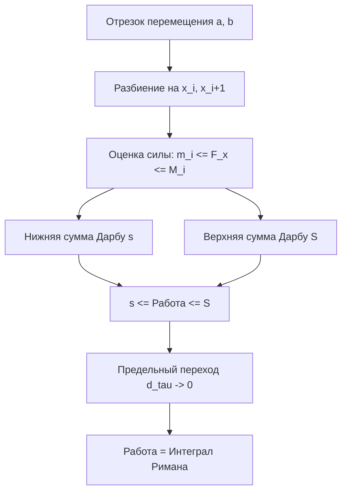
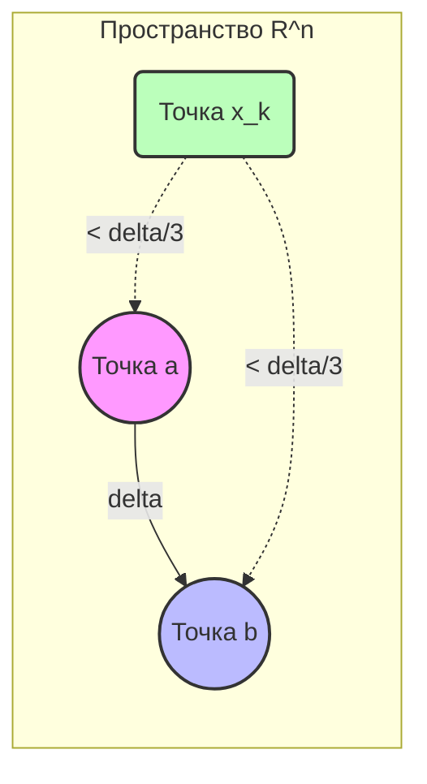

---
tags:
  - матанализ
  - 1_курс
  - подготовка_к_экзамену
тип: конспект
статус: готов
---

# Вопрос №40. Применение интеграла Римана к вычислению работы силы.

> [!abstract] Физический смысл и постановка задачи
> Пусть материальная точка перемещается по прямой под действием силы, направленной вдоль этой прямой. Если сила постоянна и равна $F$, то работа $A$ на отрезке перемещения длиной $\Delta x$ равна $A = F \cdot \Delta x$. 
> Однако, если сила меняется в зависимости от координаты $x$, то есть задана функцией $F(x)$, мы не можем использовать простую формулу умножения. Нам необходимо применить аппарат [[Интеграл Римана|интеграла Римана]], разбив процесс на бесконечно малые участки, на которых силу можно считать *почти* постоянной.

> [!definition] Работа переменной силы
> Пусть функция $F(x)$ определена на отрезке $[a, b]$ и описывает проекцию силы на ось $Ox$. Работой $A$, совершаемой этой силой при перемещении точки из $a$ в $b$, называется предел [[Интегральная сумма|интегральных сумм]] Римана при стремлении мелкости разбиения к нулю (если такой предел существует):
> $$A = \lim_{d(\tau) \to 0} \sum_{i=0}^{n-1} F(\xi_i)\Delta x_i = \int_a^b F(x) dx$$

> [!theorem] О вычислении работы непрерывной силы
> Если функция $F(x)$ непрерывна на отрезке $[a, b]$, то работа $A$ корректно определена и равна определенному интегралу Римана: $A = \int_a^b F(x) dx$.

> [!proof]+ Доказательство корректности физической модели через суммы Дарбу
> 1. Рассмотрим произвольное разбиение $\tau$ отрезка $[a, b]$ точками:
> $$a = x_0 < x_1 < x_2 < \dots < x_{n-1} < x_n = b$$
> 2. Пусть $\Delta x_i = x_{i+1} - x_i$ — длина $i$-го частичного отрезка.
> 3. Так как $F(x)$ непрерывна на отрезке $[a, b]$, по первой теореме Вейерштрасса она ограничена на каждом частичном отрезке $[x_i, x_{i+1}]$. Введем точные грани:
> $$m_i = \inf_{x \in [x_i, x_{i+1}]} F(x), \qquad M_i = \sup_{x \in [x_i, x_{i+1}]} F(x)$$
> 4. Обозначим истинную (физическую) работу на участке $[x_i, x_{i+1}]$ как $\Delta A_i$. Согласно физическому принципу монотонности работы, если на участке действует сила, значения которой лежат в пределах от $m_i$ до $M_i$, то совершаемая работа ограничена работами постоянных сил $m_i$ и $M_i$:
> $$m_i \Delta x_i \le \Delta A_i \le M_i \Delta x_i$$
> 5. Просуммируем эти неравенства по всем $i$ от $0$ до $n-1$. В силу аддитивности работы, общая работа $A = \sum_{i=0}^{n-1} \Delta A_i$. Получаем:
> $$\sum_{i=0}^{n-1} m_i \Delta x_i \le A \le \sum_{i=0}^{n-1} M_i \Delta x_i$$
> 6. Заметим, что левая и правая части неравенства суть нижняя и верхняя [[Сумма Дарбу|суммы Дарбу]] соответственно:
> $$s(\tau) \le A \le S(\tau)$$
> 7. Поскольку функция $F(x)$ непрерывна на $[a, b]$, по [[Критерий интегрируемости|критерию интегрируемости Дарбу]], при стремлении мелкости разбиения $d(\tau) = \max \Delta x_i$ к нулю, пределы нижней и верхней сумм Дарбу существуют и равны значению интеграла Римана:
> $$\lim_{d(\tau) \to 0} s(\tau) = \lim_{d(\tau) \to 0} S(\tau) = \int_a^b F(x) dx$$
> 8. По [[Теорема о двух милиционерах|теореме о пределе промежуточной функции]], так как $A$ постоянно зажата между $s(\tau)$ и $S(\tau)$, то:
> $$A = \int_a^b F(x) dx$$
> Теорема доказана абсолютно строго.

> [!abstract] Логическая схема построения интегральной модели

> [!warning] Важное замечание
> Если сила $F(x)$ задана разрывной функцией (например, ступенчатое изменение поля), то работа определяется как сумма интегралов по промежуткам непрерывности. Интегрируемость по Риману сохраняется, если функция ограничена и множество точек разрыва имеет [[Мера Жордана|лебегову меру ноль]] (для 1 курса: конечное число точек разрыва 1-го рода).

---

# Вопрос №41. Функции многих переменных (основные определения). Норма вектора и её свойства. Окрестности точек в $\mathbb{R}^n$.

> [!definition] Арифметическое пространство $\mathbb{R}^n$
> Множество всех упорядоченных наборов из $n$ действительных чисел $(x_1, x_2, \dots, x_n)$ называется $n$-мерным координатным пространством и обозначается $\mathbb{R}^n$. Элементы этого пространства называются точками или векторами: $x = (x_1, \dots, x_n)$.

> [!definition] Функция многих переменных
> Пусть задано множество $D \subset \mathbb{R}^n$. Если каждому элементу $x = (x_1, \dots, x_n) \in D$ по некоторому правилу $f$ поставлено в соответствие единственное действительное число $y \in \mathbb{R}$, то говорят, что на множестве $D$ задана **числовая функция $n$ переменных**. Обозначается: $y = f(x_1, x_2, \dots, x_n)$ или $y = f(x)$.

> [!definition] Норма вектора
> Нормой в пространстве $\mathbb{R}^n$ называется функция $||\cdot||: \mathbb{R}^n \to \mathbb{R}$, ставящая в соответствие каждому вектору $x$ действительное число $||x||$ и удовлетворяющая следующим трем аксиомам:
> 1. **Положительная определенность:** $||x|| \ge 0$ для любого $x \in \mathbb{R}^n$, причем $||x|| = 0 \iff x = (0, \dots, 0)$.
> 2. **Однородность:** $||\alpha x|| = |\alpha| \cdot ||x||$ для любого $\alpha \in \mathbb{R}$ и $x \in \mathbb{R}^n$.
> 3. **Неравенство треугольника:** $||x + y|| \le ||x|| + ||y||$ для любых $x, y \in \mathbb{R}^n$.

В стандартном курсе математического анализа используется **евклидова норма**:
$$||x|| = \sqrt{x_1^2 + x_2^2 + \dots + x_n^2} = \left( \sum_{i=1}^n x_i^2 \right)^{1/2}$$

> [!lemma] Неравенство Коши-Буняковского (вспомогательное для доказательства нормы)
> Для любых двух векторов $x, y \in \mathbb{R}^n$ выполняется неравенство:
> $$\left( \sum_{i=1}^n x_i y_i \right)^2 \le \left( \sum_{i=1}^n x_i^2 \right) \left( \sum_{i=1}^n y_i^2 \right)$$

> [!proof]+ Доказательство леммы
> 1. Рассмотрим функцию действительной переменной $t \in \mathbb{R}$:
> $$P(t) = \sum_{i=1}^n (x_i t + y_i)^2$$
> 2. Так как квадрат любого действительного числа неотрицателен, сумма квадратов также неотрицательна: $P(t) \ge 0$ для всех $t \in \mathbb{R}$.
> 3. Раскроем скобки:
> $$P(t) = \sum_{i=1}^n (x_i^2 t^2 + 2x_i y_i t + y_i^2) = t^2 \left(\sum_{i=1}^n x_i^2\right) + 2t \left(\sum_{i=1}^n x_i y_i\right) + \left(\sum_{i=1}^n y_i^2\right)$$
> 4. Обозначим $A = \sum_{i=1}^n x_i^2$, $B = \sum_{i=1}^n x_i y_i$, $C = \sum_{i=1}^n y_i^2$. Тогда $P(t) = A t^2 + 2B t + C \ge 0$.
> 5. Если $A = 0$, то $x_i = 0$ для всех $i$, и неравенство превращается в $0 \le 0$, что истинно.
> 6. Если $A > 0$, то $P(t)$ — это квадратный трехчлен, который не меняет знак (всегда $\ge 0$). Следовательно, его дискриминант $D \le 0$.
> $$D/4 = B^2 - AC \le 0 \implies B^2 \le AC$$
> 7. Подставляя $A, B, C$, получаем требуемое неравенство:
> $$\left( \sum_{i=1}^n x_i y_i \right)^2 \le \left( \sum_{i=1}^n x_i^2 \right) \left( \sum_{i=1}^n y_i^2 \right)$$
> Лемма доказана.

> [!theorem] Свойства евклидовой нормы
> Функция $||x|| = \left( \sum_{i=1}^n x_i^2 \right)^{1/2}$ удовлетворяет всем аксиомам нормы.

> [!proof]+ Доказательство (проверка аксиом)
> 8. **Положительность:** Сумма квадратов неотрицательна, корень из нее неотрицателен. Если $||x|| = 0$, то $\sum x_i^2 = 0 \implies x_i = 0 \, \forall i$.
> 9. **Однородность:** $||\alpha x|| = \sqrt{\sum (\alpha x_i)^2} = \sqrt{\alpha^2 \sum x_i^2} = |\alpha| \sqrt{\sum x_i^2} = |\alpha| \cdot ||x||$.
> 10. **Неравенство треугольника (Неравенство Минковского):** Возведем левую часть в квадрат:
> $$||x + y||^2 = \sum_{i=1}^n (x_i + y_i)^2 = \sum_{i=1}^n (x_i^2 + 2x_i y_i + y_i^2) = ||x||^2 + 2 \sum_{i=1}^n x_i y_i + ||y||^2$$
> Применим неравенство Коши-Буняковского к среднему слагаемому: $\sum x_i y_i \le \sqrt{\sum x_i^2} \sqrt{\sum y_i^2} = ||x|| \cdot ||y||$.
> $$||x + y||^2 \le ||x||^2 + 2||x|| \cdot ||y|| + ||y||^2 = (||x|| + ||y||)^2$$
> Извлекая арифметический квадратный корень из обеих частей, получаем $||x + y|| \le ||x|| + ||y||$. Аксиомы выполнены.

> [!definition] Окрестности точек в $\mathbb{R}^n$
> Пусть $a \in \mathbb{R}^n$ и $\varepsilon > 0$.
> 11. **$\varepsilon$-окрестностью** точки $a$ называется множество:
> $$U_\varepsilon(a) = \{ x \in \mathbb{R}^n \mid ||x - a|| < \varepsilon \}$$
> Геометрически в $\mathbb{R}^2$ это открытый круг, в $\mathbb{R}^3$ — открытый шар.
> 12. **Проколотой $\varepsilon$-окрестностью** точки $a$ называется $\varepsilon$-окрестность без самой точки $a$:
> $$\mathring{U}_\varepsilon(a) = U_\varepsilon(a) \setminus \{a\} = \{ x \in \mathbb{R}^n \mid 0 < ||x - a|| < \varepsilon \}$$

---

# Вопрос №42. Предел последовательности в $\mathbb{R}^n$. Единственность предела последовательности.

> [!definition] Последовательность в $\mathbb{R}^n$
> Отображение множества натуральных чисел $\mathbb{N}$ в пространство $\mathbb{R}^n$ называется последовательностью точек в $\mathbb{R}^n$ и обозначается $\{x^{(k)}\}_{k=1}^\infty$, где каждый элемент $x^{(k)} = (x_1^{(k)}, x_2^{(k)}, \dots, x_n^{(k)})$.

> [!definition] Предел последовательности в $\mathbb{R}^n$
> Точка $a \in \mathbb{R}^n$ называется **пределом последовательности** $\{x^{(k)}\}$, если для любого $\varepsilon > 0$ существует такой номер $K \in \mathbb{N}$, что для всех номеров $k > K$ выполняется неравенство $||x^{(k)} - a|| < \varepsilon$.
> Обозначение: $\lim_{k \to \infty} x^{(k)} = a$.
> На языке окрестностей: $\forall \varepsilon > 0 \;\exists K \in \mathbb{N} \; \forall k > K \implies x^{(k)} \in U_\varepsilon(a)$.

> [!theorem] Покоординатная сходимость
> Последовательность векторов $\{x^{(k)}\}$ сходится к вектору $a = (a_1, \dots, a_n)$ в $\mathbb{R}^n$ тогда и только тогда, когда она сходится к нему **покоординатно**, то есть:
> $$\lim_{k \to \infty} x^{(k)} = a \iff \forall i \in \{1, \dots, n\} : \lim_{k \to \infty} x_i^{(k)} = a_i$$

> [!proof]+ Доказательство покоординатной сходимости
> Заметим фундаментальное соотношение между модулем координаты и евклидовой нормой. Для любого вектора $v = x^{(k)} - a$:
> $$|v_i| = \sqrt{v_i^2} \le \sqrt{\sum_{j=1}^n v_j^2} = ||v|| \le \sum_{j=1}^n \sqrt{v_j^2} = \sum_{j=1}^n |v_j|$$
> То есть:
> $$|x_i^{(k)} - a_i| \le ||x^{(k)} - a|| \le \sum_{j=1}^n |x_j^{(k)} - a_j| \quad \text{(*)}$$
> 
> **Необходимость ($\implies$):** Пусть $x^{(k)} \to a$. Зафиксируем $\varepsilon > 0$. По определению существует $K$, что для $k > K$ выполняется $||x^{(k)} - a|| < \varepsilon$. Из левого неравенства в (*) следует, что для любого $i$: $|x_i^{(k)} - a_i| \le ||x^{(k)} - a|| < \varepsilon$. Это означает сходимость $x_i^{(k)} \to a_i$.
> 
> **Достаточность ($\impliedby$):** Пусть $\forall i: x_i^{(k)} \to a_i$. Зафиксируем $\varepsilon > 0$. Для каждого $i$ существует номер $K_i$ такой, что при $k > K_i$ выполняется $|x_i^{(k)} - a_i| < \frac{\varepsilon}{n}$.
> Выберем $K = \max\{K_1, K_2, \dots, K_n\}$. Тогда для всех $k > K$ неравенство выполняется для *каждой* координаты одновременно.
> Используя правое неравенство в (*):
> $$||x^{(k)} - a|| \le \sum_{i=1}^n |x_i^{(k)} - a_i| < \sum_{i=1}^n \frac{\varepsilon}{n} = \varepsilon$$
> Таким образом, предел последовательности векторов существует и равен $a$. Теорема доказана.

> [!theorem] Единственность предела
> Если последовательность $\{x^{(k)}\}$ в $\mathbb{R}^n$ имеет предел, то этот предел единственный.

> [!proof]+ Доказательство (от противного)
> 1. Допустим противное: пусть последовательность $\{x^{(k)}\}$ имеет два различных предела $a \in \mathbb{R}^n$ и $b \in \mathbb{R}^n$, причем $a \neq b$.
> 2. Так как $a \neq b$, расстояние между ними строго положительно. Обозначим $||a - b|| = \delta > 0$.
> 3. Выберем $\varepsilon = \frac{\delta}{3} > 0$.
> 4. Так как $\lim x^{(k)} = a$, по определению существует номер $K_1$ такой, что для всех $k > K_1$ выполняется:
> $$||x^{(k)} - a|| < \varepsilon$$
> 5. Так как $\lim x^{(k)} = b$, существует номер $K_2$ такой, что для всех $k > K_2$ выполняется:
> $$||x^{(k)} - b|| < \varepsilon$$
> 6. Выберем $K = \max\{K_1, K_2\}$. Рассмотрим произвольный индекс $k > K$. Для этого номера одновременно выполняются оба неравенства из п.4 и п.5.
> 7. Рассмотрим расстояние $||a - b||$. Прибавим и вычтем внутри нормы член $x^{(k)}$ (прием $+\pm$):
> $$||a - b|| = ||a - x^{(k)} + x^{(k)} - b||$$
> 8. Воспользуемся свойством нормы (неравенство треугольника):
> $$||a - x^{(k)} + x^{(k)} - b|| \le ||a - x^{(k)}|| + ||x^{(k)} - b||$$
> 9. В силу симметрии нормы ($||\alpha x|| = |\alpha|\cdot||x||$, при $\alpha=-1$ получаем $||a - x^{(k)}|| = ||x^{(k)} - a||$), подставим оценки из п.4 и п.5:
> $$||a - b|| \le ||x^{(k)} - a|| + ||x^{(k)} - b|| < \varepsilon + \varepsilon = 2\varepsilon$$
> 10. Вспомним, что $||a - b|| = \delta$, а $\varepsilon = \delta/3$. Подставляем:
> $$\delta < 2 \left(\frac{\delta}{3}\right) \implies \delta < \frac{2\delta}{3}$$
> 11. Разделив обе части на $\delta > 0$, получаем $1 < \frac{2}{3}$. Это очевидное противоречие.
> 12. Следовательно, наше изначальное предположение о существовании двух различных пределов было неверным. Предел единственен.

> [!abstract] Геометрический смысл доказательства единственности

*Геометрически: невозможно поместить точку $x^{(k)}$ одновременно в две непересекающиеся $\varepsilon$-окрестности (где радиус $\varepsilon$ меньше половины расстояния между центрами).*